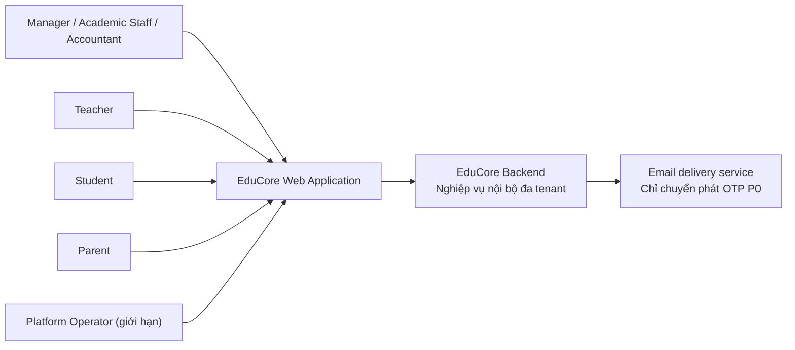
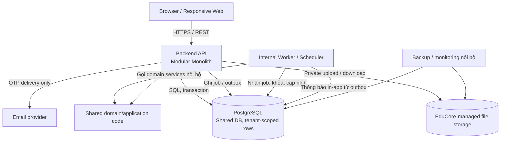
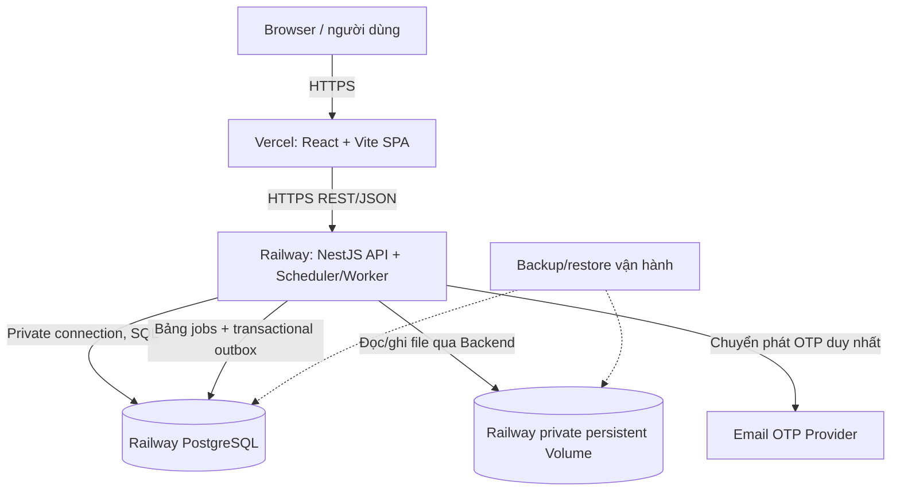
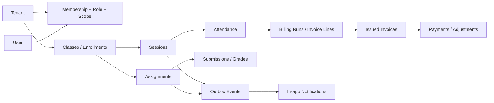
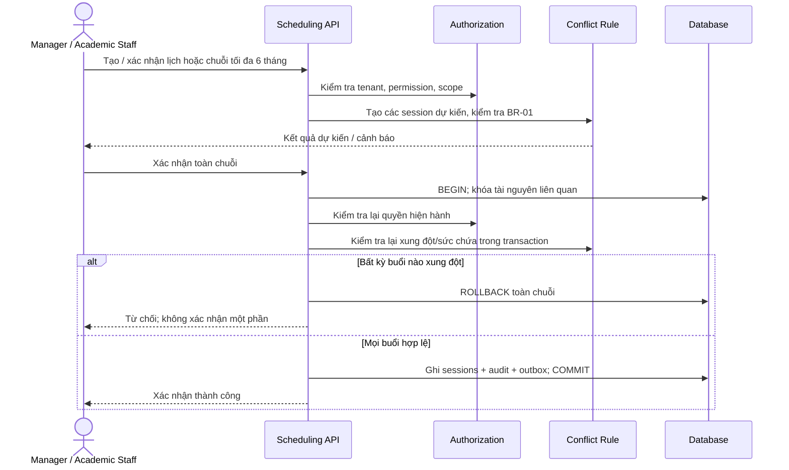
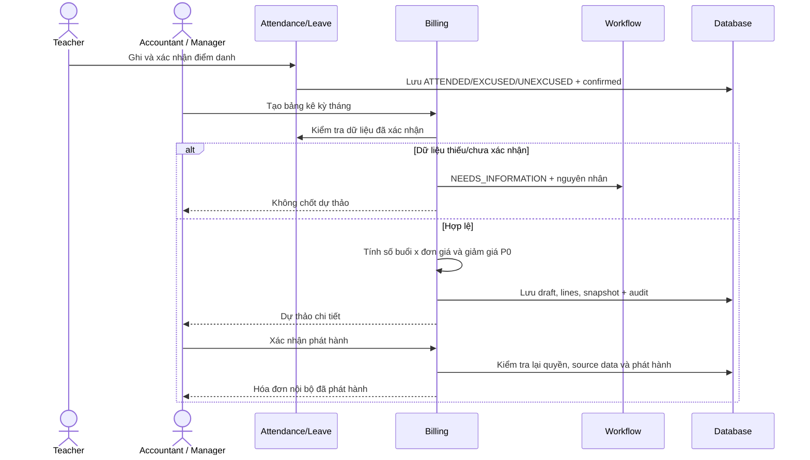
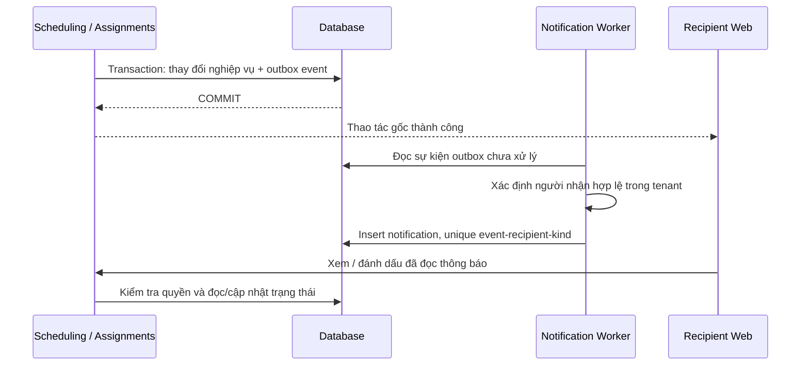
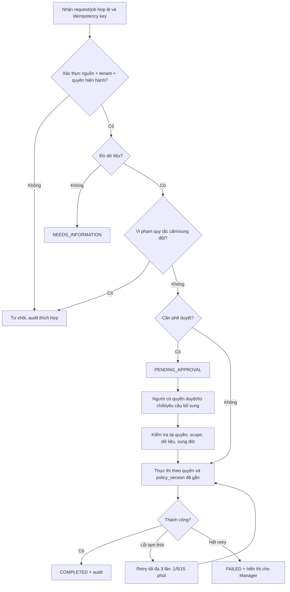

# EduCore — Architectural Design
## 1. Mục đích, phạm vi và quy tắc truy vết

Tài liệu này chuyển các yêu cầu chức năng (`FR-01`–`FR-45`), phi chức năng (`NFR-01`–`NFR-16`), quy tắc nghiệp vụ (`BR-01`–`BR-14`), quyết định baseline (`Q-01`–`Q-15`) và đặc tả `UC-01`–`UC-37` thành **kiến trúc hệ thống có thể dùng làm đầu vào cho Detailed Design, Database Design, API Design và triển khai**. Tài liệu không thay thế hai nguồn, không tự sửa ID hoặc các quyết định nghiệp vụ đã chốt.

Phân biệt hai cấp độ thông tin:

- **[Baseline]**: ràng buộc đã được ghi trong hai tài liệu nguồn; phải được giữ nguyên khi triển khai trừ khi chính các tài liệu đó được sửa.
- **[Quyết định kiến trúc — Accepted]**: stack và lựa chọn nền tảng triển khai đã được chủ dự án chốt ngày 12/10/2026 để phát triển MVP nhanh. Các chi tiết lệnh build, cấu hình bảo mật, schema, API và runbook deployment còn thuộc Detailed Design; không đồng nghĩa mọi gợi ý triển khai trong tài liệu đã được kiểm chứng.
- **[Đề xuất triển khai]**: chi tiết chưa được nguồn nghiệp vụ quy định và chưa khóa bằng ADR; có thể điều chỉnh khi code/test mà không tự sửa các baseline FR/UC/BR/Q.

### 1.1. Nguyên tắc phạm vi

| Nguyên tắc | Nội dung |
|---|---|
| P0 Internal-first | Không tích hợp API nghiệp vụ ngoài hệ thống; **ngoại lệ duy nhất** là dịch vụ chuyển phát OTP email để khôi phục/xác minh tài khoản. OTP được tạo và kiểm tra trong Backend. |
| Đa tenant bắt buộc | Mọi dữ liệu nghiệp vụ được cô lập theo tenant từ P0. Công cụ quản trị vòng đời tenant nâng cao ở P1; tenant P0 do nhân sự vận hành khởi tạo có kiểm soát. |
| Authorization là nghiệp vụ Backend | Không suy luận quyền từ chức danh, menu Frontend hoặc JWT chưa được đối chiếu; kiểm tra quyền hiện hành, tenant và phạm vi lớp/học sinh trước khi đọc/ghi hoặc chạy lại tác vụ. |
| Automation-first có giới hạn | P0 tự động kiểm tra xung đột, tính phí và tạo **hóa đơn dự thảo**; không mặc định tự phát hành hóa đơn, tự chuyển lớp hoặc tự xác nhận dạy thay. |
| Human-in-the-loop | Những thao tác cần duyệt chỉ có hiệu lực sau quyết định đúng quyền; trạng thái `APPROVED` không đồng nghĩa `COMPLETED`. |
| Không đánh đồng ưu tiên | Phần P0 của UC/FR hỗn hợp phải được làm từ P0; tính năng P1 không bị kéo vào MVP chỉ vì cùng module. |

### 1.2. Những thứ **không** thuộc P0

Không triển khai cổng thanh toán/ngân hàng tự động, hóa đơn điện tử hợp pháp, tự hoàn tiền, Google Sign-In, Gmail OAuth, Google Calendar, push/SMS/Zalo, email thông báo nghiệp vụ, Google Drive/S3 bắt buộc, nhắc deadline, báo cáo nâng cao, cấu hình policy/workflow động, đề xuất lịch tối ưu, học bù, bảo lưu, dạy thay hoặc quản trị vòng đời tenant qua giao diện. Việc thuê **hạ tầng lưu trữ/compute được EduCore quản lý quyền truy cập** (Railway PostgreSQL, Railway Volume, worker) không đồng nghĩa tích hợp **dịch vụ nghiệp vụ bên ngoài**; mọi xử lý học phí, lịch học, bài tập và thông báo P0 vẫn nằm trong EduCore. Dịch vụ gửi OTP email là ngoại lệ duy nhất được phép ở tầng nghiệp vụ.

## 2. Kiến trúc được chốt

### 2.1. Kiểu kiến trúc

**[Quyết định kiến trúc — Accepted] Chọn Modular Monolith với phân lớp rõ ràng**, kết hợp REST API, tác vụ nền nội bộ và **transactional outbox lưu PostgreSQL**. Ưu tiên ít tiến trình, ít phụ thuộc và tốc độ hoàn thành MVP; chỉ tách dịch vụ khi có lý do vận hành rõ ràng.

Lý do chọn: Các nghiệp vụ lịch học–điểm danh–học phí cần giao dịch nhất quán; P0 có nhiều ràng buộc liên module, số lượng tích hợp ngoài rất ít; tách microservices sớm sẽ tăng chi phí phân tán giao dịch, vận hành và kiểm thử. Các module vẫn có quyền sở hữu dữ liệu/giao diện riêng để có thể tách ra khi có nhu cầu thực tế ở P1+.

Các lớp chính:

1. **Presentation:** Web responsive cho Manager, Academic Staff, Accountant, Teacher, Student, Parent và quyền nền tảng giới hạn.
2. **API/Application:** Nhận HTTP, xác thực ngữ cảnh, ủy quyền, điều phối use case và giao dịch.
3. **Domain:** Thực hiện luật nghiệp vụ, trạng thái, tính phí, phát hiện xung đột, điều kiện phê duyệt.
4. **Infrastructure:** Repository, PostgreSQL, lưu trữ tệp riêng tư, email OTP adapter, scheduler/worker, log và backup.

Nguyên tắc phụ thuộc: `Controller/API → Application Service → Domain → Ports/Interfaces`; lớp Infrastructure triển khai các ports. Module không sửa bảng thuộc module khác qua repository trực tiếp; điều phối qua public application interface hoặc sự kiện nội bộ. Một transaction nghiệp vụ đa module cần một **application use-case coordinator** được chỉ định rõ.

### 2.2. Context diagram — C4 mức hệ thống (khái niệm)



`Platform Operator` không tự có quyền đọc mọi hồ sơ, điểm hoặc học phí của tenant; mọi truy cập hỗ trợ phải có ủy quyền cụ thể và audit (UC-36, Q-15).

### 2.3. Container diagram — C4 mức container (logic)



**Giới hạn hình:** Đây là sơ đồ *logic*, không ngụ ý rằng API/worker bắt buộc là microservice hoặc phải dùng message broker. P0 có thể chạy Web, API và worker trong ít tiến trình trên cùng hạ tầng, nhưng job nền phải được lưu bền vững để không mất khi restart. Triển khai vật lý P0 được chốt tại §2.5; các tham số build, domain, region, backup và runbook sẽ được làm rõ trong Deployment Design.

### 2.4. Technology stack — đã chốt (Accepted)

Các công nghệ dưới đây là **quyết định kỹ thuật của chủ dự án**, không phải yêu cầu có sẵn trong Requirements Analysis/Use Case Specifications. Không tự suy ra rằng bản source chốt một framework cụ thể.

| Thành phần | Công nghệ được chọn | Phạm vi sử dụng / lý do |
|---|---|---|
| Ngôn ngữ | TypeScript | Frontend và Backend đồng nhất, giảm chi phí chuyển đổi khi phát triển nhanh. |
| Frontend | **React + Vite** | SPA responsive sau đăng nhập; P0 không cần SSR/SEO. |
| Routing | **React Router** | Routing và layout phân quyền theo vai trò ở mức hiển thị; Backend vẫn kiểm tra quyền. |
| UI | **Tailwind CSS + shadcn/ui** | Tạo nhanh giao diện quản trị và các thành phần form/table/dialog có thể chỉnh sửa. |
| Server-state | **TanStack Query** | Quản lý cache/fetch/invalidation API cho UI; không dùng làm nguồn chân lý nghiệp vụ. |
| Form & validation | **React Hook Form + Zod** | Validation và biểu mẫu frontend; Backend vẫn validate độc lập. |
| Backend | **NestJS** | Module hóa nghiệp vụ, DI, guards, pipes, application services. |
| API & documentation | **REST/JSON + Swagger/OpenAPI** | Một hợp đồng API rõ ràng cho Web và Backend. |
| Database | **PostgreSQL** | ACID/constraints, tenant-aware data, locking giao dịch lịch/học phí. |
| ORM & migrations | **Prisma** | Schema/migration và type-safe data access; sử dụng raw SQL có kiểm soát khi cần locks/constraints chuyên biệt. |
| Job/notification | **Job runner/scheduler nội bộ NestJS + bảng job/outbox trong PostgreSQL** | Retry bền vững, chống lặp; **không thêm Redis/BullMQ/Kafka vào P0**. |
| Tệp bài nộp | **Railway persistent Volume riêng tư** gắn vào NestJS API, ví dụ `/data/uploads` | Backend kiểm tra quyền khi upload/download; metadata ở PostgreSQL; backup độc lập và kiểm tra phục hồi. Không lưu trực tiếp trên Vercel. |
| OTP | **SMTP/email-provider adapter chỉ gửi OTP** | Dịch vụ ngoài duy nhất ở P0; OTP do Backend tạo/xác minh. |
| Package manager / repo | **pnpm workspace** | Hai app trong một repository, tránh kiến trúc repo quá phức tạp. |
| Local development | **Docker Compose** (PostgreSQL, thư mục/volume lưu file; NestJS và React chạy local hoặc container tùy workflow) | Môi trường dev/test gần với production, không buộc triển khai Docker Compose lên hosting. |
| Frontend hosting P0 | **Vercel** | Triển khai React/Vite SPA từ monorepo, HTTPS và preview deployments. |
| API & internal worker hosting P0 | **Railway** (một NestJS service/instance ban đầu) | API HTTP và DB-backed scheduler/worker trong cùng ứng dụng; chạy liên tục. |
| PostgreSQL hosting P0 | **Railway PostgreSQL service** | Database riêng, kết nối API qua private networking trong cùng project khi khả dụng; backups phải cấu hình/chứng minh. |

**Không chọn trong P0:** Next.js SSR, Microservices, Redis cache, Kafka/message broker, Kubernetes, sharding, CQRS framework đầy đủ, BI pipeline. Đó là các phương án mở rộng **chỉ khi có dữ liệu thực tế chứng minh cần**.

### 2.5. Deployment Architecture — đã chốt (Accepted)

**[Quyết định kiến trúc — Accepted]** Triển khai giai đoạn P0 bằng **Vercel (web) + Railway (NestJS API, internal worker, PostgreSQL, private file volume)**. Vẫn là **Modular Monolith**: các module nghiệp vụ ở cùng một ứng dụng NestJS, không tách microservices. Chọn để giảm thao tác quản trị VPS, có deploy tự động từ GitHub và dễ thay hạ tầng về sau.



| Thành phần vật lý | Triển khai P0 | Ranh giới / lưu ý |
|---|---|---|
| `apps/web` | Vercel Project trỏ về `apps/web` trong monorepo | Static SPA; thiết lập rewrite về `index.html` để reload deep link như `/dashboard/students` không 404; cấu hình build workspace đúng với các package dùng chung. |
| `apps/api` | Railway Service liên kết cùng GitHub repository | Build NestJS từ monorepo bằng lệnh được khóa trong repo; lắng nghe `0.0.0.0` và `PORT` của nền tảng; health endpoint có kiểm soát. |
| Scheduler + outbox | **Trong cùng ứng dụng/process NestJS P0** | Không deploy service worker độc lập. Bảng job/outbox và idempotency bền vững trong PostgreSQL; khi restart, job chưa hoàn tất được nhận lại có kiểm soát. |
| PostgreSQL | Railway PostgreSQL service trong project/environment riêng | Dùng biến môi trường/secret; không đưa connection string ra Vercel Frontend; ưu tiên private networking giữa API và DB; chỉ DB migration có quyền thay đổi schema. |
| File uploads | Railway Volume mount vào API, ví dụ `/data/uploads` | **Một nơi lưu file riêng tư**; không phục vụ trực tiếp từ static URL; tải/nộp qua API đã xác thực và kiểm tra `tenant_id`/scope; sao lưu tệp đồng bộ với metadata DB. |
| OTP email | Provider chuyển phát email | Ngoại lệ tích hợp bên ngoài duy nhất của P0, OTP sinh/xác minh trong NestJS. |

**Nguyên tắc triển khai và bảo mật:**

1. **GitHub → Vercel/Railway:** `main` hoặc release branch được cấu hình để deploy; preview/staging tách với production và **không dùng chung database/file volume production**. Tránh chạy seed giả vào production. Docker Compose giữ cho **local development**.
2. **Các biến môi trường:** Vercel chỉ được dùng `VITE_API_BASE_URL` chứa public API URL. Railway giữ `DATABASE_URL`, JWT/session/OTP secrets, SMTP credentials, `UPLOAD_DIR`, `CORS_ORIGINS` và cấu hình job ở server; không prefix `VITE_` cho secrets. Quản lý qua secret store của platform; `.env` không commit.
3. **Cross-origin:** Browser gọi HTTPS API ở Railway; CORS allowlist đúng domain/preview được phép, hạn chế credentials theo cơ chế auth được chọn. Không coi CORS là authorization. Chi tiết cookie `Secure`/`SameSite`, CSRF và refresh session phải chốt trong Authentication Detailed Design (Q-01 giữ nguyên).
4. **Prisma migrations:** `prisma migrate deploy` thực thi qua bước release/migration được kiểm soát **một lần cho mỗi phiên bản**, không tùy tiện chạy lặp bởi nhiều replica; có phương án backup/rollback schema trước migration rủi ro.
5. **File retention:** Metadata (owner, checksum, MIME, `tenant_id`, private path, submission/version) ở PostgreSQL; file được ghi bằng tên nội bộ tránh path traversal. Không dùng filesystem tạm của Vercel để giữ bài nộp. Upload thất bại giữa DB và volume phải có quy tắc cleanup/reconciliation, không hứa distributed transaction.
6. **Worker:** Ban đầu API có **một running instance** để tránh nhiều scheduler cùng phát động tác vụ; idempotency, `claim/lease`, unique constraints vẫn bắt buộc theo BR-12/NFR-15 để sẵn sàng cho việc tách/scale sau.
7. **Restore trước production:** Cấu hình backup **riêng cho Railway PostgreSQL và file Volume**, kiểm tra quy trình phục hồi cùng phiên bản metadata/file; không mặc nhiên xem hosting là đã đáp ứng NFR-07/08.

**Hạn chế nền tảng cần chấp nhận ở giai đoạn đầu:** Railway service có Volume gắn trực tiếp **không hỗ trợ replicas** và có thể có khoảng gián đoạn ngắn khi redeploy. Vì vậy thiết kế này thuận tiện cho MVP/số người dùng nhỏ, **chưa phải bằng chứng đạt 99,5% availability**. Nếu yêu cầu nâng khả dụng hoặc lưu lượng upload tăng, cân nhắc chuyển file storage sang dịch vụ chuyên dụng sau khi có quyết định P0/P1 và rà lại ranh giới tích hợp; không tự thêm phụ thuộc đó vào MVP. Chi phí Vercel/Railway, dung lượng Volume và chính sách sử dụng thương mại phải kiểm tra trên plan thực tế trước khi go-live; **Vercel Hobby chỉ dành cho mục đích cá nhân phi thương mại**.

Tài liệu nền tảng để đối chiếu tại thời điểm thiết kế: [Vercel Vite SPA](https://vercel.com/docs/frameworks/frontend/vite), [Vercel Monorepo](https://vercel.com/docs/monorepos), [Railway NestJS](https://docs.railway.com/guides/nest), [Railway Monorepo](https://docs.railway.com/guides/deploying-a-monorepo), [Railway Volumes](https://docs.railway.com/volumes/reference), [Railway Postgres Backup/Restore](https://docs.railway.com/guides/postgres-backups-restores), [Vercel Hobby](https://vercel.com/docs/plans/hobby).

### 2.6. Nguyên tắc phát triển nhanh

1. Dựng **một web app + một NestJS application + một PostgreSQL database**. Scheduler/worker logic chạy nội bộ NestJS ở P0; các job quan trọng phải được lưu bền vững. Nếu sau này tách tiến trình xử lý job, dùng lại module/application services đang có.
2. Sinh migration có kiểm soát bằng Prisma, giữ SQL cụ thể cho giao dịch đa bảng, khóa tài nguyên và ràng buộc PostgreSQL nếu Prisma không biểu đạt đủ; không dùng ORM thay cho transaction/concurrency design.
3. Dùng thành phần UI hiện có từ shadcn/ui, ưu tiên xây dựng các trang CRUD, bảng dữ liệu, lịch học và quy trình phê duyệt trước khi tối ưu hình thức.
4. Không xây dựng hệ thống state management, caching hoặc event infrastructure thứ hai trừ khi tính năng thực tế yêu cầu.
5. Dùng API OpenAPI để làm hợp đồng giữa web/api; chỉ chia sẻ types/schema cần thiết, không chia sẻ domain logic xuống browser.
6. **Đo trước khi tối ưu:** giữ nguyên NFR-01/NFR-02 là mục tiêu về độ trễ, không loại bỏ yêu cầu; chưa đầu tư tối ưu hiệu năng quy mô lớn ở P0. Trước production cần xác định khối lượng dữ liệu thử nghiệm và đo trên môi trường đại diện. Security, transaction, tenant isolation, idempotency và kiểm thử đồng thời là yêu cầu chất lượng **không thể trì hoãn**.

## 3. Phân rã module và quyền sở hữu

| Module / bounded context | Trách nhiệm chính | UC chính | P0/P1 |
|---|---|---|---|
| **Identity & Access** | Đăng nhập/đăng xuất, phiên/OTP, tài khoản, multi-role, permission/scope, liên kết Parent–Student; xác minh quan hệ anh/chị/em là chứng cứ riêng. | UC-01–UC-06 | P0; quyền cấu hình động P1 |
| **Tenant & Policy** | Tenant context và isolation; tham số policy baseline, version hiệu lực và quyền truy cập. | UC-33, UC-36 | P0 isolation, snapshot baseline; quản trị policy/tenant P1 |
| **Academic Management** | Hồ sơ Teacher/Student, khóa/môn/trình độ/lớp, giáo viên lớp, ghi danh và chuyển lớp. | UC-07–UC-10 | P0 |
| **Resource & Scheduling** | Phòng/sức chứa, lịch bận, chuỗi buổi học, kiểm tra trùng và đổi/hủy lịch. | UC-11–UC-14 | P0; gợi ý giờ/tài nguyên P1 |
| **Attendance & Leave** | Điểm danh, chốt/khóa, đơn nghỉ và duyệt nghỉ thường/ngoại lệ. | UC-15–UC-16 | P0 |
| **Academic Exceptions** | Học bù, bảo lưu, tái xếp lớp, giáo viên dạy thay. | UC-17–UC-20 | P1; không làm P0 phụ thuộc vào các tính năng này |
| **Billing & Receivables** | Đơn giá, giảm giá, hóa đơn dự thảo/phát hành, khoản thu thủ công, công nợ, yêu cầu điều chỉnh. | UC-21–UC-26 | P0; combo/gói/tín dụng nâng cao P1 |
| **Assignments & Grading** | Giao bài, deadline/priority, tệp nộp và phiên bản nộp, điểm/phản hồi/công bố. | UC-27–UC-29 | P0; tiến độ tổng hợp P1 (UC-30) |
| **Notification** | Sự kiện đổi lịch/giao bài; người nhận, chống trùng, chưa đọc/đã đọc. | UC-31 | In-app P0; nhắc deadline/kênh ngoài P1 |
| **Reporting** | Dashboard số học sinh ACTIVE duy nhất, lớp hoạt động, công nợ phát hành trong phạm vi được cấp. | UC-32 | Dashboard P0; báo cáo nâng cao P1 |
| **Workflow & Approval** | Yêu cầu/ngoại lệ, quyết định đúng quyền, lý do và thực thi sau duyệt. | UC-26, UC-34 | Workflow thủ công giới hạn P0; engine cấu hình P1 |
| **Automation & Job** | Trigger nội bộ, idempotency, retry/FAILED, lưu policy_version, giám sát bởi Manager. | UC-37 | P0 giới hạn; mở rộng theo chính sách P1 |
| **Audit & Traceability** | Audit bất biến qua UI, giải thích quyết định, correlation ID và lọc theo quyền. | UC-35 | Ghi và tra cứu cơ bản P0; nâng cao P1 |
| **File Management** | Upload an toàn, storage riêng tư, metadata, kiểm tra tenant/quyền khi tải. | UC-28 (hỗ trợ UC-27) | P0 |

**Phụ thuộc cốt lõi:** Scheduling cấp nguồn cho Attendance và Billing; Attendance/Leave + Pricing tạo Billing; Academic + Assignment tạo recipients cho Notification; Billing và Academic cung cấp dữ liệu read-only cho Reporting; Workflow/Audit/Auth/Policy là nền tảng xuyên suốt. Khi một module phát event, payload chỉ chứa định danh và dữ liệu tối thiểu; module nhận **kiểm tra lại quyền** khi phân phối hoặc hiển thị cho user.

### 3.1. Cấu trúc source code chốt ở cấp repository

```text
educore/
├── apps/
│   ├── web/                         # React + Vite + TypeScript
│   │   ├── src/{app,features,components,lib}/
│   │   └── vercel.json              # SPA fallback rewrites (đặt cùng root web)
│   └── api/                         # Một NestJS application
│       ├── src/
│       │   ├── modules/             # identity, tenant, academic, scheduling,
│       │   │                        # attendance, billing, assignments,
│       │   │                        # notifications, reporting, workflow, audit...
│       │   ├── common/              # guards, decorators, pipes, filters
│       │   ├── jobs/                # scheduler, claim/retry, outbox consumers
│       │   └── infrastructure/      # prisma, storage, otp adapter
│       └── prisma/
│           ├── schema.prisma
│           └── migrations/
├── packages/contracts/             # Chỉ tạo khi thật sự cần chia sẻ DTO/schema
├── docker-compose.yml               # Chỉ cho local dev/test
├── pnpm-lock.yaml                    # Khóa dependency xuyên monorepo
└── pnpm-workspace.yaml
```

Dự án bắt đầu với **hai app (web, api)**; deploy web lên Vercel và api lên Railway theo §2.5. Docker Compose dùng để chạy local, không phải production deploy target. `jobs/` chạy trong API P0, không cần triển khai `apps/worker` riêng. `packages/contracts/` có thể để trống/chưa tạo nếu OpenAPI đã đủ cho giai đoạn đầu. Trong các module, giữ ranh giới `controller → application service → domain → repository` mà không bắt buộc tạo đủ bốn thư mục cho mọi CRUD đơn giản. Tránh business logic nằm trong controller; thêm abstraction khi nó thật sự giúp kiểm thử và bảo trì.

## 4. Thiết kế dữ liệu ở mức kiến trúc

### 4.1. Mô hình tenancy và định danh

**[Quyết định kiến trúc — Accepted]** Dùng **một PostgreSQL database/schema chung và `tenant_id` cho toàn bộ bảng nghiệp vụ**. Tài khoản đăng nhập có thể là định danh toàn cục; quan hệ user–tenant–role–scope là bản ghi riêng. Không dùng mỗi tenant một database ở P0 vì chi phí migration/operation cao hơn; vẫn có thể tách sau nếu cần.

Nhóm thực thể logic (chưa phải DDL):

| Nhóm | Thực thể / bảng khái niệm | Ràng buộc chính |
|---|---|---|
| Identity | `users`, `credentials`, `sessions`, `password_reset_otps`, `tenant_memberships`, `roles`, `permissions`, `role_assignments`, `access_scopes` | Một user nhiều tenant/role nhưng quyền luôn gắn tenant và scope. OTP không lưu plaintext. |
| Relationships | `parent_student_links`, `verified_sibling_relationships` | Liên kết phụ huynh **không tự chứng minh** điều kiện giảm giá anh/chị/em. |
| Academic | `teacher_profiles`, `student_profiles`, `subjects`, `levels`, `courses`, `classes`, `class_teacher_assignments`, `enrollments` | `enrollments` có PENDING/ACTIVE/SUSPENDED/COMPLETED/WITHDRAWN/TRANSFERRED; không xóa lịch sử khi chuyển lớp. |
| Scheduling | `rooms`, `resource_unavailability`, `schedule_series`, `sessions`, `session_participants` | Thời điểm UTC; timezone tenant khi nhập/hiển thị. Lịch hủy không chiếm tài nguyên. |
| Attendance | `attendance_records`, `absence_requests`, `attendance_corrections` | Trạng thái tham gia tách cờ xác nhận/khóa; lý do, người sửa có audit. |
| Billing | `price_rules`, `billing_runs`, `invoices`, `invoice_lines`, `invoice_adjustments`, `payments`, `payment_reversals`, `receivable_allocations` | Lưu snapshot giá/ưu đãi/căn cứ; hóa đơn phát hành không update trực tiếp để đổi số tiền. |
| Assignments | `assignments`, `assignment_recipients`, `submissions`, `submission_versions`, `submission_files`, `grades` | Điểm nháp không hiển thị đến khi công bố; version nộp cũ không bị ghi đè. |
| Platform workflow | `approval_requests`, `approval_decisions`, `automation_jobs`, `idempotency_records`, `outbox_events`, `audit_logs` | Lưu tenant, actor, policy_version, correlation ID và kết quả xử lý. |
| Delivery/Reporting | `notifications`, dashboard query/read model | Duy nhất một thông báo trên mỗi `(tenant, source event, recipient, kind)`; báo cáo luôn lọc tenant/scope. |
| P1 extension | `makeup_bookings`, `suspensions`, `tuition_credits`, `substitution_requests`, `policy_versions`, `external_delivery_attempts` | Chỉ làm khi UC/FR P1 được triển khai. |

Các tên bảng ở đây chỉ để thể hiện **quyền sở hữu và quan hệ dữ liệu**; schema, field, nullable, FK, indexes chi tiết phải được quyết định ở Database Design.

### 4.2. Các bất biến dữ liệu phải được củng cố tại DB

1. Mỗi record nghiệp vụ phải có tenant hợp lệ, và khóa ngoại liên bảng không được tham chiếu sang tenant khác. Ưu tiên composite foreign key kiểu `(tenant_id, referenced_id)` ở chỗ nhạy cảm.
2. Truy vấn/ghi luôn áp scope; `(tenant_id, id)` hoặc khóa duy nhất tenant-scoped cho dữ liệu nghiệp vụ. Không chỉ dựa vào filter Frontend.
3. Mọi payment có `idempotency_key` (unique theo tenant + loại tác vụ/phạm vi); phải khóa số dư hóa đơn khi cộng khoản đã thu để ngăn overpayment đồng thời.
4. `billing_runs`/invoice draft có định danh logic `(tenant, billing_period, student/enrollment, business_operation)` để retry không tạo bản thứ hai; quyết định xử lý trường hợp nhiều phiên bản draft thuộc Detailed Design.
5. `sessions` đã xác nhận phải được kiểm tra giao nhau bởi service và cơ chế đồng bộ transaction; chỉ kiểm tra trước commit bằng truy vấn thường **không đủ** khi hai người xác nhận đồng thời.
6. `audit_logs` và `outbox_events` được ghi cùng transaction với thay đổi nghiệp vụ quan trọng khi cần bảo toàn dấu vết hoặc thông báo.
7. Số tiền lưu dạng **decimal/integer VND chính xác**, không dùng floating point; `ROUND_HALF_UP` **một lần cuối công thức** tính phí theo Q-08.
8. Dữ liệu tài chính, điểm danh, điểm công bố và lần nộp cũ được lưu lịch sử/correction, không xóa hoặc ghi đè âm thầm.

### 4.3. Quan hệ dữ liệu khái niệm



Hình chỉ mô tả phụ thuộc logic, không ngụ ý quan hệ 1–n cụ thể; Database Design cần ERD chính thức.

## 5. Luồng xử lý nghiệp vụ trọng yếu

### 5.1. Xác nhận lịch học và chống tranh chấp tài nguyên (UC-11–UC-13)



**Quy tắc bắt buộc [Baseline]:** Khoảng `[start, end)`, cùng giáo viên/phòng (nếu học trực tiếp)/học sinh hoặc lịch bận xác nhận thì xung đột; `CANCELLED` không chiếm tài nguyên. Chuỗi tuần tối đa 6 tháng **all-or-nothing** (Q-04). Kiểm tra lại ngay trước khi ghi; đổi/hủy chỉ một buổi hoặc những buổi tương lai, không sửa lịch sử. Lưu UTC, hiển thị theo `Asia/Ho_Chi_Minh` mặc định.

**Cơ chế cạnh tranh [Đề xuất kiến trúc]:** trong transaction, khóa tài nguyên giáo viên/phòng/học sinh liên quan theo thứ tự ổn định (ví dụ advisory locks theo `(tenant, resource_type, resource_id)`), sau đó truy vấn lại lịch xác nhận; kết hợp version check và unique/idempotency. Lựa chọn khóa cụ thể, isolation level và phương án tránh deadlock phải được kiểm tra bằng integration test đồng thời; không giả định một index đơn giản đủ bảo vệ xung đột cho nhiều tài nguyên.

### 5.2. Điểm danh, nghỉ học và tạo hóa đơn dự thảo (UC-15, UC-16, UC-21–UC-24)



- P0: `ATTENDED`/`UNEXCUSED` = 1 buổi; `EXCUSED`/buổi trung tâm hủy = 0. Đơn nghỉ gửi trước ít nhất 24 giờ **vẫn cần người có quyền chấp thuận**, đơn muộn phải duyệt ngoại lệ; không tự gán EXCUSED từ đơn chưa duyệt. Học sinh thực tế có mặt là `ATTENDED` dù đã xin nghỉ có phép (Q-05).
- Điểm danh được xác nhận bởi Teacher có quyền; khóa sau 48 giờ từ khi kết thúc **hoặc** khi hóa đơn dùng dữ liệu đó được phát hành, tùy mốc sớm hơn. Sửa sau khóa cần permission/lý do/audit và điều chỉnh tài chính riêng nếu ảnh hưởng hóa đơn.
- P0 tính theo **tháng**, lập dự thảo kỳ trước đầu tháng sau khi đủ xác nhận; đơn giá ưu tiên **buổi → lớp → khóa**. Giảm giá P0 chỉ **anh/chị/em 10% đã xác minh**, không dùng combo. `ROUND_HALF_UP` tới đồng ở cuối phép tính. Hóa đơn có hạn thanh toán **7 ngày tính từ ngày phát hành**.
- `invoice_auto_issue=false` ở P0. Phát hành sau khi có người đúng quyền xác nhận; invoice là **chứng từ nội bộ**, không đại diện hóa đơn điện tử pháp lý.
- Chênh lệch sau phát hành đi qua adjustment request và phê duyệt thủ công; không chạy lại để ghi đè hóa đơn đã phát hành.

### 5.3. Ghi nhận khoản thu và điều chỉnh tài chính (UC-25, UC-26, UC-34)

1. Nhân sự có quyền xác minh tiền mặt/chuyển khoản **bằng đối soát thủ công**, chọn **một hóa đơn** và nhập số tiền/chứng cứ.
2. Backend kiểm tra tenant, permission, định danh chống trùng; bắt đầu transaction và khóa hóa đơn/số dư phải thu.
3. Nếu số tiền vượt công nợ còn lại, từ chối, không tự phân bổ sang hóa đơn khác. Nếu hợp lệ thì tạo payment và cập nhật công nợ trong **cùng transaction**, kèm audit/idempotency.
4. Với khoản thu sai, tạo nghiệp vụ đảo/điều chỉnh có dấu vết; không xóa lịch sử thu.
5. Với hóa đơn đã phát hành, yêu cầu điều chỉnh/hủy luôn qua **manual approval**, có người, thời điểm, lý do và kết quả. Trung tâm có một Manager đủ quyền được phép tự duyệt ngoại lệ tài chính thủ công với cờ `SELF_APPROVED`; cờ này không phải workflow status.

### 5.4. Giao bài, nộp bài, chấm điểm (UC-27–UC-29)

- Teacher có scope lớp/học sinh hợp lệ mới được giao bài; priority `1..5`; deadline lưu thời điểm chính xác. Khi đã có submission, không âm thầm sửa yêu cầu/giảm deadline; thay đổi hợp lệ (ví dụ gia hạn) có audit.
- Student chỉ nộp bài được giao. Chấp nhận **PDF/DOCX/JPG/PNG**, tối đa **10 MB/tệp và 5 tệp/lần nộp**; nộp muộn đến **7 ngày** sau deadline và đánh dấu `LATE`; quá hạn từ chối. Nộp lại trước chấm/công bố trong thời hạn hợp lệ tạo version mới, giữ version cũ.
- Teacher chấm theo thang **0–10**, một chữ số thập phân; điểm chưa công bố không hiển thị với học sinh/Parent. Việc công bố là hành động riêng; sửa sau công bố cần quyền, lý do và audit.
- **[Quyết định triển khai P0]** Dùng upload và download **qua NestJS Backend kết nối Railway Volume** (chưa dùng presigned URL/object-storage bên ngoài); lưu `file_id`, `tenant_id`, owner/submission, MIME được phép, kích thước, checksum và private storage path. Khi tải file, Backend kiểm tra lại quyền theo **submission**; không trả đường dẫn filesystem thực cho trình duyệt. Áp giới hạn body/request, chống path traversal, kiểm tra loại tệp thực tế và scan tệp theo khả năng hạ tầng.

### 5.5. Thông báo in-app không làm hỏng giao dịch gốc (UC-13, UC-27, UC-31)



Sự kiện P0 hợp lệ: **lịch đã được đổi/hủy xác nhận** và **bài tập mới đã giao**. Người nhận phụ thuộc tenant, lớp/học sinh, phân công và liên kết Parent–Student hợp lệ. API đọc/đánh dấu đã đọc phải kiểm tra lại quyền hiện hành. Nếu xử lý thông báo thất bại, thay đổi lịch/bài tập đã commit **không rollback**; outbox/job lưu trạng thái cho retry/giám sát. Không tự gửi email nghiệp vụ hoặc nhắc deadline ở P0.

### 5.6. Automation, approval và retry (UC-34, UC-37)



Sơ đồ là **logic điều phối**, không thay thế state machine chi tiết. Trạng thái baseline: `DRAFT`, `PENDING_APPROVAL`, `APPROVED`, `REJECTED`, `NEEDS_INFORMATION`, `COMPLETED`, `FAILED`; `SELF_APPROVED` chỉ là flag audit. Mỗi task có `idempotency_key`, `policy_version`, `attempt_count`, `next_attempt_at`, trigger, tenant, actor/source, correlation ID, lỗi gần nhất. Khi request đã `COMPLETED`, retry trả kết quả trước đó; khi thiếu dữ liệu không retry vô hạn; khi cần duyệt nhưng không có approver đủ quyền vẫn giữ `PENDING_APPROVAL` và báo Manager. Quyền **hiện hành** phải được xác minh khi chạy lại, ngay cả nếu policy_version được giữ từ lúc tạo.

**[Đề xuất]** Tách `operation_id` (nghiệp vụ) và `attempt_id` (mỗi lần thực thi); P0 dùng worker lấy job bằng claim/lock, thao tác idempotent trong DB transaction. Với luồng không đồng bộ có nhiều bước, dùng trạng thái và compensation/correction rõ ràng, không hứa giao dịch phân tán tự động.

### 5.7. Dashboard P0 (UC-32)

Dùng read-only query/projection tính ba chỉ số theo **tenant và phạm vi người xem**, kèm `as_of` (thời điểm dữ liệu):

- `active_students`: số **student distinct** có ít nhất một enrollment `ACTIVE` hợp lệ.
- `active_classes`: số lớp đang hoạt động trong phạm vi dữ liệu.
- `outstanding_receivables`: tổng số dư còn phải thu từ **hóa đơn nội bộ đã phát hành**, sau adjustments/credit **đã phân bổ**, trừ khoản đã thu hợp lệ; không tính draft hoặc số trả trước chưa phân bổ là công nợ/doanh thu.

**[Đề xuất]** Ban đầu dùng aggregate SQL có index với transaction snapshot nhất quán; nếu benchmark không đạt, dùng projection/materialized read model có `last_refreshed_at` và cơ chế invalidation. Không cần BI hay export Excel/PDF trong P0.

## 6. Bảo mật và quản trị truy cập

### 6.1. Authentication / session

**[Baseline Q-01]** Email/mật khẩu; mật khẩu dài **ít nhất 12 ký tự**, băm **Argon2id**; access token **15 phút**; refresh token **tối đa 7 ngày** và có thể thu hồi; OTP email **dùng một lần, 15 phút**, được sinh/xác minh ở Backend. Khôi phục/đổi mật khẩu thu hồi toàn bộ phiên cũ. Không Google Sign-In P0.

**[Đề xuất]** Refresh token được lưu dạng hash với `session_id`, rotate khi dùng, cookie `HttpOnly`/`Secure`/`SameSite` phù hợp và CSRF protection nếu xác thực dựa cookie; rate limit login/OTP, chống enumeration, giới hạn số lần thử, không log plaintext token/OTP. Email OTP adapter có timeout và xử lý lỗi riêng để outage nhà cung cấp email không tác động luồng lịch/bài tập/dashboard.

### 6.2. Authorization đa chiều

Mỗi use case cần kiểm tra tối thiểu:

`authenticated principal` + `active tenant membership` + `required permission` + `resource tenant` + `assigned class/student/parent scope` + `business state`.

Một user có thể có nhiều role trong một tenant; tổng quyền chỉ có hiệu lực trong scope hợp lệ **của tenant đó**. Manager kiêm kế toán/giáo vụ nếu có permission tương ứng; không tự tăng quyền vì tenant thiếu nhân sự chuyên trách. Tenant ACTIVE phải có ít nhất một Manager hợp lệ. Platform Administrator không mặc nhiên đọc toàn bộ dữ liệu trung tâm.

Thực thi bảo vệ ở hai nơi: tại endpoint (`authorization guard`) và tại use-case/service khi thao tác sâu hoặc chạy trong worker. **[Đề xuất]** Repository nhận `TenantContext` bắt buộc, truy vấn có điều kiện `tenant_id`, áp composite constraints; cân nhắc PostgreSQL RLS như lớp phòng thủ bổ sung sau khi kiểm thử. Test truy cập sai tenant cả bằng cách đổi ID path/URL/query/body và qua quan hệ FK.

### 6.3. Bảo vệ thông tin và audit

HTTPS cho mọi giao tiếp; dữ liệu mật không nằm trong URL, log hoặc event payload. Tệp nằm ở kho riêng tư, chỉ tải qua API có quyền. Audit chứa `tenant_id`, event, actor/source, target, result, before/after được chọn lọc, reason, `policy_version`, correlation ID, timestamp và `SELF_APPROVED` nếu có; **không** lưu mật khẩu, OTP hay tệp riêng tư trong log. Audit P0 tra cứu theo đối tượng/người thao tác/thời điểm/kết quả, mặc định lưu **24 tháng** theo Q-14 (thời hạn này cần rà soát khi áp dụng thực tế). Không có chức năng sửa/xóa audit qua UI.

## 7. Giao tiếp giữa các thành phần

### 7.1. Hợp đồng API ở mức nguyên tắc

- **REST/JSON qua HTTPS** [Accepted]; các route là nhóm khái niệm, **chưa phải API Contract chốt**. Công bố Swagger/OpenAPI từ API để hai app bám hợp đồng chung.
- Các nhóm route gợi ý: `/auth`, `/tenants/{tenantId}/members`, `/academic`, `/sessions`, `/attendance`, `/absence-requests`, `/billing`, `/payments`, `/assignments`, `/submissions`, `/notifications`, `/dashboard`, `/approvals`, `/jobs`, `/audit`.
- Với mỗi write request: validation → resolve tenant/context → authorization → domain invariants → transaction → audit/outbox → response.
- Các write dễ bị gửi lặp (`confirm schedule`, `generate draft`, `record payment`, `approve/correct invoice`) nhận `Idempotency-Key` hoặc một business operation ID không mơ hồ. Server lưu fingerprint request và trạng thái; cùng key nhưng payload khác phải bị từ chối, không âm thầm dùng lại.
- Cập nhật đối tượng cạnh tranh nên dùng `row_version`/`If-Match` hoặc locking có kiểm soát; paginate, filter và áp access scope ở server khi trả danh sách.
- Lỗi chuẩn hóa theo `code`, `message`, `correlation_id`, `details` an toàn; không tiết lộ dữ liệu tenant khác qua lỗi tồn tại/không tồn tại.

### 7.2. Event contract nội bộ

Ví dụ **[Đề xuất]**:

```text
ScheduleChanged { event_id, tenant_id, session_id, change_type, occurred_at, policy_version }
AssignmentPublished { event_id, tenant_id, assignment_id, occurred_at }
InvoiceDraftGenerated { event_id, tenant_id, invoice_id, period, policy_version }
InvoiceIssued { event_id, tenant_id, invoice_id, occurred_at }
PaymentRecorded { event_id, tenant_id, payment_id, invoice_id }
JobFailed { event_id, tenant_id, job_id, reason_code }
```

Trong P0 chỉ `ScheduleChanged`/`AssignmentPublished` sinh thông báo in-app cho người nhận nghiệp vụ như UC-31; `JobFailed` phục vụ Manager giám sát theo BR-12/UC-37. Các event khác dùng cập nhật dữ liệu nội bộ/audit khi thật sự cần, **không mặc nhiên kích hoạt kênh thông báo mới**.

## 8. Reliability, concurrency và vận hành

### 8.1. Transaction boundaries

| Operation | Ranh giới nguyên tử đề xuất | Lỗi cần xử lý |
|---|---|---|
| Xác nhận lịch lặp | Toàn bộ chuỗi, khóa tài nguyên, recheck và ghi audit/outbox | Một session trùng ⇒ rollback tất cả. |
| Chốt điểm danh | Bản ghi theo session + xác nhận/khóa + audit | Không sinh dữ liệu tính phí đã xác nhận một phần ngoài chính sách. |
| Tạo draft tháng | Một billing operation id, snapshot input, invoice lines, audit | Retry tạo cùng draft; dữ liệu thiếu ⇒ NEEDS_INFORMATION. |
| Phát hành hóa đơn | Recheck nguồn/quyền, đánh dấu phát hành và tạo phải thu trong transaction | Không chuyển `ISSUED` nếu dữ liệu nguồn hết hợp lệ. |
| Ghi nhận payment | Payment + cập nhật allocation/balance + audit | Timeout/retry không cộng tiền lần hai; overpayment bị chặn. |
| Điều chỉnh invoice | Quyết định duyệt + correction/adjustment + balance + audit | Không sửa trực tiếp chứng từ gốc, không bỏ qua manual approval. |
| Giao bài/đổi lịch | Lưu nghiệp vụ + outbox event trong transaction | Thông báo có thể đến sau, không rollback nghiệp vụ đã commit. |

### 8.2. Availability, backup và lỗi hạ tầng

- **[Baseline NFR]** Production mục tiêu **99,5% availability/tháng**, backup **hằng ngày**, **RPO ≤ 24 giờ**, **RTO ≤ 4 giờ**; chỉ được đánh giá đạt sau test/diễn tập restore.
- **[Quyết định triển khai P0]** Bật backup/snapshot theo lịch cho Railway PostgreSQL và **Railway file Volume**; thực hiện thêm logical dump/offsite backup theo độ quan trọng dữ liệu, kiểm thử restore toàn cục DB metadata + file; mã hóa, kế hoạch rollback migration. Không suy ra có backup tự động chỉ vì đã chọn dịch vụ hosting; lưu ý backup gắn với volume/project có giới hạn khả năng khôi phục khi xóa toàn bộ project.
- Health checks phân biệt API sống và dependency sẵn sàng; worker có heartbeat, job lease timeout, dead-job recovery. Theo dõi tình trạng deploy trên cả Vercel/Railway, sức chứa Railway Volume và backup jobs; khi Volume gắn trực tiếp vào API, kế hoạch bảo trì chấp nhận gián đoạn ngắn khi redeploy và phải đo mức ảnh hưởng tới NFR-07.
- Email provider không khả dụng chỉ ảnh hưởng chuyển phát OTP. Nội bộ vẫn tạo được lịch, giao bài, xem thông báo in-app và dashboard như E2E-22.

### 8.3. Observability

Mỗi HTTP request/job có `correlation_id`; log cấu trúc với operation, module, tenant identifier phù hợp, result, latency, retry_count, error class. Ở P0 theo dõi tối thiểu: lỗi API, độ trễ request chậm bất thường, transaction conflict/retry, failed jobs, OTP failures và dung lượng lưu trữ. Các biểu đồ p95 chuyên sâu/queue age/outbox lag có thể bổ sung khi có lưu lượng và nhu cầu vận hành; không trì hoãn log lỗi, audit hoặc cảnh báo tác vụ FAILED. Không ghi PII/secret không cần thiết. Manager chỉ có màn hình nghiệp vụ `FAILED`/`PENDING_APPROVAL`/`NEEDS_INFORMATION` P0; thông tin vận hành nội bộ dành cho operator được bảo vệ riêng.

## 9. Đáp ứng các Non-functional Requirements

| NFR | Quyết định/giải pháp kiến trúc | Cách kiểm chứng |
|---|---|---|
| 01 — API performance | Pagination, index căn bản, tránh N+1 và truy vấn thiếu phạm vi tenant; **không** tối ưu tải cao sớm | P0 ghi nhận độ trễ cơ bản; trước production đo p95 và đối chiếu mục tiêu < 1 giây (không tính network ngoài) trên workload được thống nhất. |
| 02 — Conflict performance | Thiết kế truy vấn/transaction xác nhận lịch đúng và có index theo tenant/time/resource | P0 test đúng quy tắc + tranh chấp đồng thời; trước production đo mục tiêu 2 giây trên tập dữ liệu đại diện. |
| 03 — Scalability | Tenant-scoped schema, tránh state khó di chuyển, job lưu DB | P0 bắt buộc test không lẫn dữ liệu multi-tenant; chỉ load-test mở rộng khi xác định workload/scale. |
| 04 — Security | TLS, Argon2id, session/OTP controls | Security tests, review config và secret handling. |
| 05 — Backend auth | Guard + service-level permission/scope | API direct-call, revoke-before-execute, negative tenancy tests. |
| 06 — Data integrity | ACID, locks, transaction coordinator | Fault injection/rollback ở billing, lịch, payment, P1 học bù. |
| 07 — Availability | Health/restart/monitoring, deployment có kế hoạch | Theo dõi uptime 99,5%/tháng trên môi trường production. |
| 08 — Recoverability | Daily backup DB + files, restore rehearsal | Đo thực tế RPO ≤ 24h và RTO ≤ 4h. |
| 09 — Usability | Web responsive, workflow theo vai trò | Test desktop/tablet/mobile với người dùng mục tiêu. |
| 10 — Compatibility | Web standards, browser test matrix | Chrome/Edge/Firefox bản còn hỗ trợ. |
| 11 — Maintainability | Modular monolith, contracts, tests | Kiểm tra dependency boundaries, code review. |
| 12 — Testability | Pure domain services cho schedule/billing | Unit tests ≥ 80% **branch coverage** cho hai module. |
| 13 — Observability | Correlation ID, structured logs, job monitoring | Trace một request/job end-to-end; review no-secret logs. |
| 14 — Privacy | Tenant/scope/resource access, private files | Negative tests Parent/Teacher/Manager/tenant. |
| 15 — Idempotency | DB uniqueness, idempotency ledger, transactional worker | Same-key retry/concurrent replay không ghi trùng lịch/invoice/payment. |
| 16 — Traceability | Policy snapshot, audit, approval decision/attempt chain | Dò từ event → policy → decision → result/actor/time. |

**Chú ý:** Đây là **cách kiến trúc dự kiến đáp ứng** NFR, không phải báo cáo đã đạt các ngưỡng. Các NFR hiệu năng **không bị xóa/hạ chuẩn**; công việc tối ưu sâu được hoãn tới khi có số liệu đo. Các kiểm thử security, nghiệp vụ, toàn vẹn giao dịch, backup/restore và concurrency không được trì hoãn để đổi lấy tốc độ phát triển.

## 10. Kiểm thử kiến trúc bắt buộc trước MVP

Gắn trực tiếp các E2E trong Use Case Specifications, ưu tiên nhóm làm rõ invariant và boundaries:

| Nhóm | Test bắt buộc | E2E/UC liên quan |
|---|---|---|
| Tenant và quyền | Thay ID để truy cập tenant khác; Parent xem học sinh chưa liên kết; role bị thu hồi trước khi job chạy. | E2E-11, E2E-13; UC-06, UC-36 |
| Scheduling | Hai confirmation đồng thời tranh resource; xác nhận chuỗi có một buổi xung đột bị rollback toàn bộ. | E2E-01, E2E-18; UC-12 |
| Attendance + billing | Chưa xác nhận không chốt; đã xin nghỉ nhưng đến học tính ATTENDED; draft không tự phát hành. | E2E-06, E2E-07, E2E-19; UC-15, UC-23–24 |
| Financial | Giảm đúng 10% P0; thanh toán một phần, từ chối vượt nợ; timeout/retry không trùng; hóa đơn sửa qua duyệt tay. | E2E-08, E2E-10, E2E-20–21; UC-22–26 |
| Notification | Đổi lịch/giao bài sinh đúng thông báo in-app; replay không trùng; không rò tenant; mail OTP lỗi không ảnh hưởng. | E2E-15, E2E-22; UC-31 |
| Reporting | Distinct ACTIVE students, active classes, issued unpaid invoice balance và scope đúng. | E2E-16; UC-32 |
| Auth & OTP | OTP dùng một lần, hết hạn 15 phút; mật khẩu mới băm; revoke sessions. | E2E-17; UC-01–03 |
| Job/workflow | Retry 1/5/15 tối đa 3 lần sau lần đầu, kiểm tra lại quyền, APPROVED không coi là COMPLETED nếu execute lỗi. | E2E-09, E2E-14; UC-34, UC-37 |
| Files/assignment | Loại/kích thước tệp, phạm vi nộp/chấm, điểm chưa công bố; không tải qua URL storage trực tiếp. | UC-27–UC-29 và AC tương ứng |
| P1 regression (khi triển khai) | Học bù đúng hạn và không thu hai lần; bảo lưu/tín dụng; dạy thay không tự chốt. | E2E-02–05, E2E-12; UC-17–20 |

## 11. Roadmap kiến trúc theo ưu tiên

### 11.1. P0 — thành phần phải hoạt động

1. Nền tảng: tenant, membership, permission/scope, auth/OTP/session, audit và policy baseline.
2. Core academic: hồ sơ, khóa/lớp/ghi danh/phụ huynh, phòng/tài nguyên và lịch học có kiểm tra xung đột.
3. Attendance/Leave và workflow thủ công cần thiết; tính học phí tháng, tạo draft, phát hành thủ công, nhận payment thủ công, điều chỉnh có duyệt.
4. Assignment/submission/grading với **private Railway Volume** (Backend kiểm soát upload/download, lưu metadata DB, kiểm tra backup); in-app notifications đúng hai trigger nghiệp vụ.
5. Dashboard 3 chỉ số, automation giới hạn, idempotency, retry, màn hình quản lý job/approval/audit cơ bản.
6. Hardening: test đồng thời hóa, backup/restore, bảo mật phạm vi và E2E. NFR performance đo căn bản ở P0, kiểm chứng các mục tiêu định lượng trước production; không chặn việc bắt đầu code bởi bài toán tối ưu tải cao.

Các bước trên là **thứ tự phụ thuộc kỹ thuật**, không phải cam kết thời gian. Có thể triển khai song song UI và API theo module khi hợp đồng dữ liệu ổn định.

### 11.2. P1 — điểm mở rộng đã dành sẵn

- Academic Exceptions: học bù, bảo lưu, tín dụng trả trước và dạy thay; không phá ghi danh chính thức và lịch sử tính phí.
- Policy/Workflow: tenant policy có version và thời điểm hiệu lực, quyền động, workflow phê duyệt phức tạp; vẫn không tự điều chỉnh/hủy hóa đơn đã phát hành.
- Billing: combo trả trước 6 tháng, mức 5% trước + ưu đãi anh/chị/em 10% sau, học phí gói/tín dụng và phân bổ nhiều hóa đơn nếu được chốt.
- Notifications/Reporting: nhắc deadline 24h/1h, email nghiệp vụ/retry khi được bật; thống kê học tập và tài chính nâng cao.
- Tenant administration: UI lifecycle `CREATED`/`ACTIVE`/`SUSPENDED`/`ARCHIVED`, không mở quyền truy cập dữ liệu cho Platform Admin theo mặc định.

### 11.3. Quy tắc giữ tương thích khi nâng lên P1

`tenant_id`, `policy_version`, `operation_id`, audit chain và snapshot căn cứ tính toán phải có từ P0 để không cần diễn giải lại lịch sử. P1 chỉ mở rộng module, policy và event consumers sau khi migrate an toàn; không hồi tố hóa đơn đã phát hành hoặc sửa lịch sử trạng thái cũ bằng cập nhật hàng loạt thiếu kiểm soát.

## 12. Architecture Decision Records (ADR) đã chốt

**Ngày chốt:** 12/10/2026 — quyết định kỹ thuật nhằm phát triển MVP nhanh. Các quyết định này không sửa phạm vi và quy tắc nghiệp vụ từ tài liệu nguồn.

| ADR | Quyết định | Lý do | Trạng thái |
|---|---|---|---|
| ADR-001 | Modular Monolith trước Microservices | Giao dịch xuyên module, ít tích hợp ngoài, vận hành gọn | **Accepted** |
| ADR-002 | PostgreSQL shared schema + `tenant_id` | ACID, tenant isolation, một DB dễ quản trị | **Accepted** |
| ADR-003 | REST/JSON + DB transactional outbox cho sự kiện cần bền vững | API rõ ràng, notification lỗi không mất nghiệp vụ gốc | **Accepted** |
| ADR-004 | DB-backed scheduler/job runner trong NestJS P0 | Không cần Redis/Kafka/worker deploy riêng; retry và idempotency trong DB | **Accepted** |
| ADR-005 | Private file storage bằng Railway persistent Volume gắn vào NestJS API | Không tích hợp API lưu trữ nghiệp vụ ngoài ở P0; upload/download phải qua Backend có quyền; có backup/restore | **Accepted** |
| ADR-006 | Snapshot giá, policy, audit và idempotency per operation | Truy vết công nợ, chống trùng khi retry | **Accepted** |
| ADR-007 | Transaction-level resource locking khi xác nhận lịch | Ngăn race condition; cách khóa cụ thể cần được xác nhận bằng concurrency test | **Accepted (implementation detail pending)** |
| ADR-008 | SQL aggregation cho dashboard P0, chưa triển khai BI/projection | 3 chỉ số cơ bản, ưu tiên SQL rõ và dữ liệu chính xác | **Accepted** |
| ADR-009 | React + Vite + TypeScript, React Router | SPA nội bộ gọn, không cần SSR | **Accepted** |
| ADR-010 | NestJS + TypeScript, Swagger/OpenAPI | Module rõ ràng, hợp đồng API dễ kiểm thử và xây UI | **Accepted** |
| ADR-011 | Prisma làm ORM/migration; SQL trực tiếp khi cần | Type-safe, phát triển nhanh mà không đánh đổi transaction/locking | **Accepted** |
| ADR-012 | Tailwind + shadcn/ui; TanStack Query; React Hook Form + Zod | Tận dụng component/forms có sẵn, ít thời gian tự xây UI hạ tầng | **Accepted** |
| ADR-013 | pnpm workspace, hai apps web/api; **Docker Compose dành cho local** | Ít repo/process, cấu trúc monorepo thống nhất với Vercel/Railway deploy | **Accepted** |
| ADR-014 | Hoãn cache, load balancing, sharding và tối ưu tải cao tới khi có benchmark | Tránh premature optimization; **giữ nguyên các NFR hiệu năng đã nêu** | **Accepted** |
| ADR-015 | **Frontend React/Vite trên Vercel** | Static SPA dễ deploy từ GitHub, hỗ trợ preview; phải cấu hình SPA rewrite | **Accepted** |
| ADR-016 | **NestJS API + internal worker trên Railway**, một instance ban đầu | Chạy job liên tục, giữ Modular Monolith và DB-backed retry; không đưa worker lên Vercel Functions | **Accepted** |
| ADR-017 | **Railway PostgreSQL + private API Volume**, backup độc lập | Tối giản vận hành và số nhà cung cấp, không lưu file trên Vercel; lưu ý downtime khi redeploy với Volume | **Accepted** |

## 13. Rủi ro, giả định và quyết định còn cần chốt ở Detailed Design

| Vấn đề | Tác động nếu bỏ qua | Hướng xử lý tiếp theo |
|---|---|---|
| Phiên bản dependency và lệnh bootstrap chưa khóa | Công cụ AI có thể tạo code theo major version khác nhau | Khi scaffold, chọn phiên bản ổn định tương thích, commit lockfile và cập nhật README/cấu hình CI. Stack nền đã chốt tại §2.4 và ADR-009–013. |
| Chưa có bộ dữ liệu đo hiệu năng chuẩn | Không thể khẳng định đã đạt NFR-01/02 | Tạo bộ dữ liệu đại diện và đo trước production; P0 vẫn test concurrency correctness và loại truy vấn rõ ràng kém hiệu quả. |
| Đồng bộ conflict lock với nhiều resource | Nguy cơ race/deadlock | Xây dựng protocol lock cố định và test confirm concurrent. |
| Schema billing và xử lý adjustment/tín dụng | Có thể lệch công nợ/khoản thu | Thiết kế ledger/correction, unique operation IDs và transaction semantics trong Database Design. |
| Hợp đồng API và state machine chi tiết chưa phải phạm vi nguồn | Frontend/Backend diễn giải khác nhau | Viết API Contract, workflow transition table và error taxonomy cho từng UC P0. |
| Tệp upload có dữ liệu cá nhân | Rò dữ liệu hoặc mất tệp khi redeploy | API quản lý quyền trên Railway Volume; hạn chế MIME/dung lượng/path traversal; kiểm tra cleanup, backup/restore đồng bộ metadata. |
| Railway Volume hạn chế replicas và gây ngắt dịch vụ khi redeploy | Chưa thể khẳng định NFR-07 99,5%; gián đoạn upload khi bảo trì | Bắt đầu 1 instance; kiểm tra backup/recovery và uptime, lập kế hoạch nâng cấp storage/availability khi có tải thực. |
| Vercel SPA và monorepo build | Fallback route 404, lỗi import workspace packages | Kiểm tra `apps/web/vercel.json`, Root Directory, build/install command và shared packages ở Vercel; Railway có cấu hình build tương ứng. |
| CORS/secrets giữa 2 miền Vercel và Railway | Lộ secret hoặc auth/cookie lỗi trên browser | CORS allowlist, HTTPS, tách server secrets, review `SameSite`/CSRF/cross-site auth khi chốt triển khai Q-01. |
| Giới hạn gói dịch vụ/chi phí và điều khoản thương mại | Deploy bị ngưng hoặc dùng Hobby sai mục đích | Kiểm tra quota, chi phí Volume/DB, và dùng plan Vercel phù hợp nếu EduCore phục vụ mục đích thương mại. |
| Snapshot policy khi P0 chưa có UI quản trị | Retry có thể dùng nhầm policy mới | Seed policy baseline có ID/version bất biến, đặt effective date và lưu reference trên operation. |
| Giám sát/khôi phục theo mục tiêu NFR | Không chứng minh được 99,5%/RPO/RTO | Vận hành thử, giám sát và diễn tập restore trên môi trường đại diện. |
| Baseline chính sách không phải chính sách thực tế | Có thể sai khi triển khai thương mại | Yêu cầu trung tâm xác nhận các tham số BR/Q trước khi dùng production. |
| Reference từ UC sang Requirements Analysis mục 7/8 không tồn tại trong file được gửi | Truy vết sai phiên bản | Đồng bộ tài liệu nguồn/đường dẫn trong lần cập nhật Requirements Analysis tiếp theo; không tự tạo nội dung vắng mặt. |

## 14. Ma trận truy vết kiến trúc → yêu cầu

| Thành phần/Quyết định | Functional Requirements | Use Cases | Business Rules / NFR |
|---|---|---|---|
| Identity, access, tenancy | FR-01–FR-06, FR-42 | UC-01–UC-06, UC-36 | BR-08, BR-10, BR-14; NFR-04, 05, 14 |
| Academic & resources | FR-07–FR-11 | UC-07–UC-11 | BR-01, BR-13, BR-14 |
| Scheduling | FR-12–FR-17 | UC-12–UC-14 | BR-01, BR-09, BR-12; NFR-02, 06, 15 |
| Attendance/leave | FR-18–FR-19 | UC-15–UC-16 | BR-04, BR-08, BR-09 |
| Academic exceptions P1 | FR-20–FR-24 | UC-17–UC-20 | BR-02, 03, 05, 07 |
| Billing/receivables | FR-25–FR-31 | UC-21–UC-26 | BR-04, 06, 08, 11–14; NFR-06, 15 |
| Assignments/files/grading | FR-32–FR-36 | UC-27–UC-30 | BR-08, BR-14; NFR-14 |
| In-app notification + P1 delivery | FR-37–FR-39 | UC-31 | BR-12, BR-14; NFR-15 |
| Reporting & audit | FR-40–FR-41 | UC-32, UC-35 | BR-08, BR-14; NFR-13, 16 |
| Tenant policy/workflow/jobs | FR-43–FR-45 | UC-33, UC-34, UC-37 | BR-08–BR-14; NFR-11, 15, 16 |
| Operations & security cross-cutting | FR-42 + toàn bộ nghiệp vụ | UC-01–UC-37 | NFR-01–NFR-16 |

