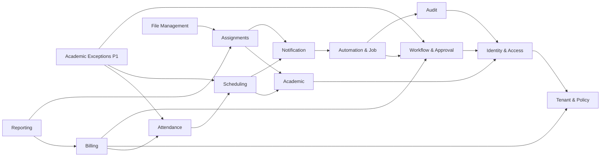

# EduCore — Class Design (Module Index)

**Phiên bản:** 1.0 · **Ngày:** 12/10/2026 · **Trạng thái:** Proposed / review · **Đủ 14 module P0 + P1**

Bộ tài liệu này phân chia theo **14 bounded contexts** của `architectural_design(1).md` §3. Mỗi file là một **thiết kế lớp logic** (không phải code hoàn chỉnh). Class, chữ ký method, service và port là đề xuất triển khai; FR/UC/BR/Q/ADR là baseline từ ba tài liệu nguồn. Database Design hiện tại vẫn ở trạng thái *proposed*, không mặc định các bảng đã migration.

## 1. Danh mục module và truy vết

| Module | Nội dung | FR | UC | P0/P1 |
|---|---|---|---|---|
| [Identity & Access](./identity-access.md) | Xác thực, phiên, OTP, RBAC đa vai trò theo tenant + scope; liên kết Parent–Student và chứng cứ anh/chị/em | FR-01–FR-06 | UC-01–UC-06 | P0 nền tảng + P1 nâng cao |
| [Tenant & Policy](./tenant-policy.md) | Quản lý ngữ cảnh trung tâm và baseline chính sách bất biến; P1 cấu hình, kiểm soát hiệu lực và lifecycle tenant | FR-42–FR-43, FR-44 | UC-33, UC-36 | P0 nền tảng + P1 nâng cao |
| [Academic Management](./academic-management.md) | Hồ sơ giáo viên/học sinh, môn và trình độ, khóa/lớp, phân công, ghi danh và chuyển lớp giữ lịch sử | FR-07–FR-10 | UC-07–UC-10 | P0 nền tảng + P1 nâng cao |
| [Resource & Scheduling](./resource-scheduling.md) | Quản lý phòng, lịch bận, chuỗi tuần và từng buổi học; chống xung đột giáo viên/phòng/học sinh kể cả thao tác đồng thời | FR-11–FR-17 | UC-11–UC-14 | P0 nền tảng + P1 nâng cao |
| [Attendance & Leave](./attendance-leave.md) | Điểm danh dự học, xác nhận bộ điểm danh, xử lý đơn nghỉ và sửa sau khóa có dấu vết, cung cấp căn cứ đáng tin cậy cho học phí | FR-18–FR-19, FR-26 | UC-15–UC-16 | P0 nền tảng + P1 nâng cao |
| [Academic Exceptions](./academic-exceptions.md) | Học bù, bảo lưu/tái xếp lớp, tín dụng học phí liên quan bảo lưu và giáo viên dạy thay | FR-20–FR-24 | UC-17–UC-20 | P1 nghiệp vụ |
| [Billing & Receivables](./billing-receivables.md) | Giá theo buổi/lớp/khóa, billing tháng, draft → issued invoice nội bộ, ưu đãi, thu tiền thủ công, đảo khoản thu/điều chỉnh có phê duyệt, công nợ và P1 prepaid/credit | FR-25–FR-31 | UC-21–UC-26 | P0 nền tảng + P1 nâng cao |
| [Assignments & Grading](./assignments-grading.md) | Giáo viên tạo/giao bài, học sinh nộp có version, chấm nháp/công bố điểm; theo dõi tiến độ P1 | FR-32–FR-36 | UC-27–UC-30 | P0 nền tảng + P1 nâng cao |
| [Notification](./notification.md) | Thông báo trong ứng dụng cho các sự kiện nghiệp vụ đã commit; P1 hỗ trợ deadline reminder và email delivery, không gây rollback nghiệp vụ gốc | FR-37–FR-39 | UC-31 | P0 nền tảng + P1 nâng cao |
| [Reporting](./reporting.md) | Dashboard P0 với 3 chỉ số chính xác theo tenant/scope; P1 tiến độ học tập, chuyên cần và báo cáo tài chính nâng cao; read-only | FR-40, FR-36 (P1) | UC-30, UC-32 | P0 nền tảng + P1 nâng cao |
| [Workflow & Approval](./workflow-approval.md) | Yêu cầu chờ duyệt, quyết định có quyền và xử lý lại sau approve; P0 workflow thủ công giới hạn, P1 rules/threshold/permission cấu hình động | FR-44–FR-45 | UC-26, UC-33–UC-34 | P0 nền tảng + P1 nâng cao |
| [Automation & Job](./automation-jobs.md) | Job runner/scheduler bền vững nội bộ NestJS và PostgreSQL outbox/idempotency; P0 tự kiểm tra xung đột, tính phí, tạo draft; P1 mở rộng theo chính sách | FR-45, FR-39 (hỗ trợ) | UC-37, UC-34 | P0 nền tảng + P1 nâng cao |
| [Audit & Traceability](./audit-traceability.md) | Lưu dấu vết bất biến cho thao tác quan trọng, quyết định/ngoại lệ/automation; tra cứu theo permission/tenant/scope và lưu giữ 24 tháng baseline | FR-41, NFR-16 | UC-35 | P0 nền tảng + P1 nâng cao |
| [File Management](./file-management.md) | Đọc/ghi file bài nộp riêng tư qua Backend và Railway Volume; DB lưu metadata; không có distributed transaction DB–filesystem, nên cần staging/reconciliation | FR-34, NFR-14 (hỗ trợ) | UC-28 (hỗ trợ UC-27) | P0; P1 storage mở rộng |

## 2. Architecture & Class Design conventions

- **Module ownership:** Mỗi module sở hữu domain object và logic. Chỉ trao đổi qua exported application interface / query port; không `PrismaClient` truy cập bảng module khác tùy ý.
- **Domain entities ≠ DB tables:** Aggregate có thể chứa nhiều row/snapshot; bảng projection/ledger không nhất thiết có domain entity 1:1; không tự tạo 1 class cho mỗi DTO hoặc mỗi SQL table.
- **NestJS:** `Controller → Application Service → Domain/Ports → Infrastructure Adapter`. Với tính năng CRUD đơn giản, có thể gộp lớp phù hợp, nhưng không đưa invariant sang Controller.
- **Identity:** `User` toàn cục; `TenantMembership` + roles + permissions + scopes trong từng tenant; `TeacherProfile`/`StudentProfile` có thể tồn tại không login.
- **Tenancy:** Record nghiệp vụ mang `tenantId`; Prisma filter + composite FK/constraint + guard service. Đảm bảo cùng tenant, không thể chỉ dựa UI.
- **Policies:** P0 seed baseline snapshot per tenant; nghiệp vụ lưu `policyVersionId`, retry không đổi policy. Quyền hiện hành phải check lại.
- **Money/time:** VND nguyên `bigint`, tỷ lệ `Decimal`, ROUND_HALF_UP **một lần cuối**; thời gian UTC `Date`/timestamptz, hiển thị `Asia/Ho_Chi_Minh` mặc định, khoảng [start,end).
- **Immutability:** audit, payment, issued invoice, submission versions và published grades không ghi đè lịch sử im lặng; dùng adjustment/reversal/revision.
- **Events:** `outbox_events` trong transaction gốc; consumer at-least-once dùng unique/idempotency. Notification lỗi không rollback nghiệp vụ gốc.
- **Priorities:** Toàn bộ 14 module được **thiết kế**; chỉ feature được bật mới được migration/deploy theo roadmap. Trường `P1` trong tài liệu không có nghĩa phải code đồng thời với P0.

## 3. Sơ đồ phụ thuộc tổng quan

> Mũi tên trong sơ đồ là **phụ thuộc khái niệm/trao đổi hợp đồng**, không phải thứ tự khởi tạo object hay `import` hai chiều. Những kết nối có khả năng tạo chu kỳ ở mức use case phải qua application coordinator + public ports, không để vòng phụ thuộc NestJS module.

## 4. Ma trận sở hữu và source of truth

| Quyết định/dữ liệu gốc | Module chủ | Module sử dụng |
|---|---|---|
| User, membership, permission, parent link | Identity & Access | Tất cả services cần authorization |
| Tenant context/policy snapshot | Tenant & Policy | Workflows, Billing, Jobs |
| Lớp/enrollment, teacher assignment | Academic Management | Scheduling, Billing, Assignments |
| Session, participant, resource booking | Resource & Scheduling | Attendance, Exceptions, Notification |
| Attendance confirmed/leave approval | Attendance & Leave | Billing, Exceptions, Reporting |
| Makeup/suspension/substitution/credit request P1 | Academic Exceptions | Scheduling, Billing |
| Invoice/payment/receivables/adjustments | Billing & Receivables | Reporting, Academic Exceptions |
| Assignment/submission/grade | Assignments & Grading | Reporting, Notification |
| Inbox/read state | Notification | Web clients |
| Aggregate reports / read models | Reporting | UI (không sửa dữ liệu gốc) |
| Approval decisions | Workflow & Approval | Billing, Academic Exceptions |
| Job state, idempotency, outbox | Automation & Job | Modules emit events / consumers |
| Audit trail | Audit & Traceability | Authorized reviewers |
| Private files + metadata | File Management | Assignments & Grading |

## 5. Quy tắc ưu tiên khi triển khai P1 sớm

1. Chỉ triển khai **vertical slice** cụ thể trong module: Domain + Application + DB migration + API + UI + tests; không phải thực hiện toàn bộ P1 cùng một lúc.
2. Kích hoạt P1 chỉ sau khi phụ thuộc nền tảng tối thiểu hoạt động (tenant/identity, audit, workflow/policy nếu feature cần).
3. Với P1 học bù: cần confirmed absence, session participant, booking và chính sách charge_once. Với bảo lưu: cần payment ledger, enrollment và approval. Với substitute: cần scheduling/competencies/accept+approval.
4. Với P1 combo 6 tháng: không chỉ thêm giảm giá mà phải xử lý prepaid, chứng cứ đã thanh toán, credit và snapshot. Với P1 email: thêm delivery attempts sau outbox; OTP adapter P0 không tự trở thành kênh notification.
5. Không bỏ qua invariant BR/Q để tăng tốc. Bất kỳ thay đổi scope, policy, status hoặc grouping hóa đơn cần cập nhật nguồn rồi class design + database design + API contract.

## 6. Quyết định cần chốt trước code

- [ ] Nhóm invoice **một học sinh/tháng** hay **một enrollment/tháng** (Database Design v1.0 mới đề xuất).
- [ ] Bộ permission seed đầy đủ và chi tiết người có quyền duyệt theo scope (authorization detailed design).
- [ ] Giới hạn PII và data retention ngoài audit, quy trình archive tenant.
- [ ] SQL locking/resource booking thực tế và concurrency test.
- [ ] State machines kỹ thuật, DTO và error contracts cho mỗi API; snapshot revision trên workflows.

## 7. Nguồn tham chiếu

- `requirements_analysis(7).md` — FR-01–FR-45, BR-01–BR-14, P0/P1.
- `specification(1).md` — UC-01–UC-37 và Q-01–Q-15 (bao gồm baseline 7-day invoice due/late submission, attendance lock, priority...).
- `architectural_design(1).md` — modular monolith, module ownership, ADR, triển khai Vercel/Railway và outbox.
- `database_design.md` — **Proposed v1.0**: ERD, tên bảng/ràng buộc; không xem schema là đã chốt.

**Trình tự review đề xuất:** README → module nghiệp vụ chính → ranh giới service/port → BR/Q invariant → schema và API Design → coding.
