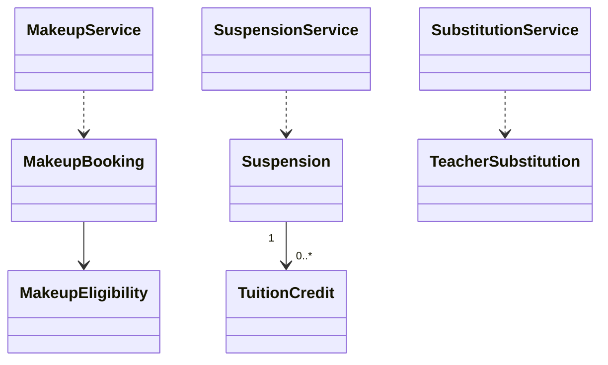

# EduCore — Class Design: Academic Exceptions

**Trạng thái:** Proposed for review · **Version:** 1.0 · **Ngày:** 12/10/2026 · **Phạm vi:** P0 + P1 (đã thể hiện theo lớp).

**Nguồn:** `requirements_analysis(7).md`, `specification(1).md`, `architectural_design(1).md`, `database_design.md` (Database Design v1.0 vẫn *proposed*). Truy vết: **FR-20–FR-24**, **UC-17–UC-20**, **BR-02, BR-03, BR-05, BR-07, BR-13**.

> **Quy tắc đọc:** thông số BR/Q, hành vi UC và quyết định ADR là baseline từ nguồn; **tên class, chữ ký TypeScript, cách tách service/port, trạng thái kỹ thuật mới** trong file này là đề xuất Detailed Design, chưa phải source code hay Prisma schema đã kiểm chứng. Danh sách thuộc tính là lớp nghiệp vụ (không nhất thiết khớp 1:1 toàn bộ cột DB). Không tự coi tính năng P1 thành P0.

## 1. Ranh giới module và phạm vi

Học bù, bảo lưu/tái xếp lớp, tín dụng học phí liên quan bảo lưu và giáo viên dạy thay. Toàn bộ nghiệp vụ chính thuộc P1 nhưng thiết kế đầy đủ.

**Phụ thuộc ngoài module (qua public port/application contract):**
- Academic Management (hồ sơ, enrollment, môn/trình độ/giáo viên).
- Resource & Scheduling (thời gian, suất học, lịch và bookings).
- Attendance & Leave (EXCUSED được duyệt).
- Billing & Receivables (charge_once, credit).
- Workflow & Approval (người duyệt và Teacher nhận dạy).

**Hợp đồng công khai được đề xuất:**
- `AcademicExceptionService.requestMakeup/confirmMakeup`.
- `AcademicExceptionService.requestSuspension/resumeStudent`.
- `AcademicExceptionService.proposeSubstitution/approveSubstitution`.

## 2. Class Diagram (logic UML)



> ERD/bảng DB là nơi định nghĩa FK/constraint; UML ở đây mô tả quan hệ domain và dependency application. Class Diagram có thể lược bớt lớp hỗ trợ để dễ đọc; toàn bộ class chính được đặc tả tại §3.

## 3. Class Specifications

| Class | Vai trò | Phạm vi | Bảng/nguồn dữ liệu |
|---|---|---|---|
| `MakeupEligibility` | Domain value object | P1 | `absence_requests + attendance_records + session_participants (read)` |
| `MakeupBooking` | Domain entity | P1 | `makeup_bookings, session_participants` |
| `Suspension` | Domain entity | P1 | `suspensions` |
| `TuitionCredit` | Domain entity | P1 | `tuition_credits` |
| `TeacherSubstitution` | Domain entity | P1 | `substitution_requests` |
| `MakeupService` | Application service | P1 | `makeup_bookings` |
| `SuspensionService` | Application service | P1 | `suspensions, tuition_credits` |
| `SubstitutionService` | Application service | P1 | `substitution_requests` |

### 3.1. `MakeupEligibility`

**Loại:** Domain value object · **Ưu tiên:** P1 · **Nguồn dữ liệu:** `absence_requests + attendance_records + session_participants (read)`.

**Attributes / dependencies**

| Thuộc tính (đề xuất TypeScript) | Ý nghĩa |
|---|---|
| `originParticipantId: UUID` | buổi nghỉ gốc |
| `approvedExcused: boolean` | nghỉ có phép đã duyệt |
| `expiresAt: Date` | hết ngày thứ 30 theo timezone tenant |
| `remainingUses: number` | tối đa 1 lần được dùng |

**Operations**

| Method/contract (đề xuất) | Trách nhiệm / kiểm soát |
|---|---|
| `assertEligible(now): void` | xác minh trước giữ chỗ |
| `consume(): void` | không tiêu thêm sau 1 lần |

### 3.2. `MakeupBooking`

**Loại:** Domain entity · **Ưu tiên:** P1 · **Nguồn dữ liệu:** `makeup_bookings, session_participants`.

**Attributes / dependencies**

| Thuộc tính (đề xuất TypeScript) | Ý nghĩa |
|---|---|
| `originParticipantId: UUID` | nguồn miễn phí |
| `targetSessionId: UUID` | buổi thay thế |
| `studentId: UUID` | học sinh |
| `status: MakeupStatus` | trạng thái đề xuất |
| `confirmedAt?: Date` | thời điểm giữ chỗ |
| `operationKey: string` | chống trùng |

**Operations**

| Method/contract (đề xuất) | Trách nhiệm / kiểm soát |
|---|---|
| `confirm(): void` | kiểm tra cùng môn/trình độ/nội dung/capacity |
| `reschedule(target): void` | chỉ trước diễn ra |
| `close(consumedReason): void` | ATTENDED/UNEXCUSED đóng quyền |

### 3.3. `Suspension`

**Loại:** Domain entity · **Ưu tiên:** P1 · **Nguồn dữ liệu:** `suspensions`.

**Attributes / dependencies**

| Thuộc tính (đề xuất TypeScript) | Ý nghĩa |
|---|---|
| `studentId: UUID` | học sinh |
| `enrollmentId: UUID` | ghi danh |
| `startDate: DateOnly` | bắt đầu |
| `endDate: DateOnly` | kết thúc |
| `status: SuspensionStatus` | yêu cầu/duyệt/hoàn tất |
| `approvalRequestId?: UUID` | phê duyệt |

**Operations**

| Method/contract (đề xuất) | Trách nhiệm / kiểm soát |
|---|---|
| `request(): void` | lập đề nghị |
| `approve(): void` | chặn lịch/billing tương lai trong khoảng |
| `resumeEarly(): void` | phải duyệt riêng |

### 3.4. `TuitionCredit`

**Loại:** Domain entity · **Ưu tiên:** P1 · **Nguồn dữ liệu:** `tuition_credits`.

**Attributes / dependencies**

| Thuộc tính (đề xuất TypeScript) | Ý nghĩa |
|---|---|
| `studentId: UUID` | hưởng tín dụng |
| `originalInvoiceId: UUID` | căn cứ đã thu |
| `sourceSuspensionId: UUID` | nguồn bảo lưu |
| `amountVnd: bigint` | chỉ tiền đã thu buổi chưa dùng sau ưu đãi |
| `remainingVnd: bigint` | có thể tính ledger |

**Operations**

| Method/contract (đề xuất) | Trách nhiệm / kiểm soát |
|---|---|
| `createFromPaidUnusedSessions(): void` | không lấy gross chưa thu |
| `allocate(amount): void` | trừ công nợ sau ưu đãi |
| `assertNotOverallocated(): void` | không âm |

### 3.5. `TeacherSubstitution`

**Loại:** Domain entity · **Ưu tiên:** P1 · **Nguồn dữ liệu:** `substitution_requests`.

**Attributes / dependencies**

| Thuộc tính (đề xuất TypeScript) | Ý nghĩa |
|---|---|
| `sessionId: UUID` | buổi cần người thay |
| `proposedTeacherId: UUID` | giáo viên thay |
| `acceptedAt?: Date` | Teacher đồng ý |
| `approvedAt?: Date` | người có quyền xác nhận |
| `status: SubstitutionStatus` | đề xuất/đồng ý/duyệt |

**Operations**

| Method/contract (đề xuất) | Trách nhiệm / kiểm soát |
|---|---|
| `acceptByTeacher(): void` | xác minh chính giáo viên |
| `approveByStaff(): void` | kiểm tra lại quyền và lịch |
| `confirmEffectiveAssignment(): void` | cập nhật session sau duyệt |

### 3.6. `MakeupService`

**Loại:** Application service · **Ưu tiên:** P1 · **Nguồn dữ liệu:** `makeup_bookings`.

**Attributes / dependencies**

| Thuộc tính (đề xuất TypeScript) | Ý nghĩa |
|---|---|
| `leaveReader: AbsenceQueryPort` | đơn EXCUSED |
| `availability: AvailabilityPort` | lịch/slot |
| `billing: BillingAdjustmentPort` | chống thu trùng |

**Operations**

| Method/contract (đề xuất) | Trách nhiệm / kiểm soát |
|---|---|
| `findOptions(origin): SessionOption[]` | cùng subject/level/nội dung |
| `requestMakeup(command): MakeupBooking` | không đổi official enrollment |
| `confirmMakeup(command): void` | reserve target participant transaction |
| `rebookCancelledMakeup(command): void` | trong hạn hoặc exception |

### 3.7. `SuspensionService`

**Loại:** Application service · **Ưu tiên:** P1 · **Nguồn dữ liệu:** `suspensions, tuition_credits`.

**Attributes / dependencies**

| Thuộc tính (đề xuất TypeScript) | Ý nghĩa |
|---|---|
| `enrollmentPort: EnrollmentPort` | suspend/resume |
| `billingPort: TuitionCreditPort` | tính nguồn đã thanh toán |

**Operations**

| Method/contract (đề xuất) | Trách nhiệm / kiểm soát |
|---|---|
| `approveSuspension(command): void` | khóa charge window, tạo credit hợp lệ |
| `resumeStudent(command): Enrollment` | check level/timetable/seats |
| `allocateCredit(command): void` | sau discount hóa đơn mới |

### 3.8. `SubstitutionService`

**Loại:** Application service · **Ưu tiên:** P1 · **Nguồn dữ liệu:** `substitution_requests`.

**Attributes / dependencies**

| Thuộc tính (đề xuất TypeScript) | Ý nghĩa |
|---|---|
| `teacherCompetency: CompetencyPort` | môn/trình độ |
| `teachingHours: WorkloadPort` | 8h/ngày,40h/tuần |
| `scheduling: SchedulingCommandPort` | update session |

**Operations**

| Method/contract (đề xuất) | Trách nhiệm / kiểm soát |
|---|---|
| `proposeTeachers(sessionId): TeacherOption[]` | khả dụng & đủ chuẩn |
| `accept(command): void` | Teacher xác nhận |
| `approve(command): void` | Staff đủ permission chốt lịch |

## 4. Luồng phối hợp ứng dụng / transaction boundary

Makeup: EXCUSED duyệt → find same subject/level/content, kiểm tra hết ngày 30 + 1 quyền + chỗ/lịch → duyệt nếu cần → thêm participant MAKEUP không sửa enrollment gốc → billing chỉ tính target. Suspension: approve → loại buổi trong khoảng + tính credit từ **tiền đã thu**; resume → check level/schedule/capacity + phân bổ credit sau ưu đãi. Substitute: Teacher nhận → Staff duyệt → recheck workload và booking → đổi teacher session.

**Nguyên tắc xuyên module:** Không repository trực tiếp vào bảng của module khác. Nếu phải ghi nhiều module trong cùng một nghiệp vụ, application coordinator sở hữu transaction PostgreSQL; domain service chỉ trả kết quả/điều kiện; sự kiện side effect ghi vào outbox cùng transaction khi cần.

## 5. Invariants / Business Rules phải bảo vệ

1. Học bù tối đa 1 lượt dùng/buổi EXCUSED được duyệt, trong 30 ngày; target bị trung tâm hủy có thể sắp lại, không tự gia hạn.
2. Nếu học bù đã dự hoặc vắng không phép → đóng quyền; không tính gốc và bù hai lần.
3. Tín dụng bảo lưu chỉ lấy phần đã thu cho buổi chưa dùng sau ưu đãi, không tự hoàn/hết hạn; quay lại sớm phải duyệt.
4. Giáo viên thay phải Teacher accept + người có quyền approve, giới hạn 8h/ngày/40h/tuần; không auto confirm mặc định.

## 6. Kiểm thử bắt buộc cho module

- [ ] Không tạo makeup cho UNEXCUSED hoặc đã dùng quyền.
- [ ] Đích khác môn/trình độ hoặc trùng lịch → reject hay PENDING_APPROVAL khi chỉ thiếu đánh giá nội dung.
- [ ] Suspend chưa duyệt không phát credit; credit vượt số đã thu từ chối.
- [ ] Teacher nhận lớp nhưng chưa Staff approve → không thay chính thức.

## 7. Phạm vi P1 và điểm nối mở rộng

- Toàn bộ module dự kiến P1, có thể triển khai từng feature độc lập sau dependencies.
- Tách makeup, suspension, substitution application services và migrations riêng để cherry-pick.

## 8. Open decisions (không tự xem là baseline)

- Chi tiết trạng thái và nguồn bảng P1 (makeup_booking, suspension, prepaid/credit ledger) cần chốt trước migration; nguyên tắc ở đây theo BR/Q.

## 9. Hợp đồng triển khai và cách phân lớp

```text
apps/api/src/modules/academic-exceptions/
  domain/          # entities, value objects, policies + pure domain services
  application/     # use cases, application services, port interfaces
  infrastructure/  # Prisma repositories, adapter khi thực sự cần
  presentation/    # NestJS controllers, DTO/validation, guards
```

Không bắt buộc tạo đủ thư mục/abstraction nếu module ít CRUD. **Controller không giữ business rule; guard/check quyền không chỉ nằm ở Controller**, phải đánh giá lại trong service khi xử lý job/duyệt. Các enum nghiệp vụ áp dụng TypeScript và PostgreSQL CHECK/constraint, kiểu VND dùng `bigint` hoặc `Decimal` đúng ngữ cảnh; REST JSON serialize `bigint` thành string.
