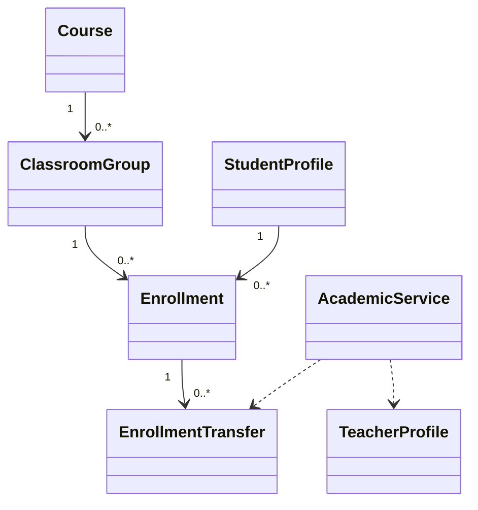

# EduCore — Class Design: Academic Management

**Trạng thái:** Proposed for review · **Version:** 1.0 · **Ngày:** 12/10/2026 · **Phạm vi:** P0 + P1 (đã thể hiện theo lớp).

**Nguồn:** `requirements_analysis(7).md`, `specification(1).md`, `architectural_design(1).md`, `database_design.md` (Database Design v1.0 vẫn *proposed*). Truy vết: **FR-07–FR-10**, **UC-07–UC-10**, **BR-10, BR-13**.

> **Quy tắc đọc:** thông số BR/Q, hành vi UC và quyết định ADR là baseline từ nguồn; **tên class, chữ ký TypeScript, cách tách service/port, trạng thái kỹ thuật mới** trong file này là đề xuất Detailed Design, chưa phải source code hay Prisma schema đã kiểm chứng. Danh sách thuộc tính là lớp nghiệp vụ (không nhất thiết khớp 1:1 toàn bộ cột DB). Không tự coi tính năng P1 thành P0.

## 1. Ranh giới module và phạm vi

Hồ sơ giáo viên/học sinh, môn và trình độ, khóa/lớp, phân công, ghi danh và chuyển lớp giữ lịch sử.

**Phụ thuộc ngoài module (qua public port/application contract):**
- Identity & Access (membership, scope).
- Resource & Scheduling (kiểm tra lịch/sức chứa trước chuyển).
- Billing & Receivables (tài chính khi chuyển lớp).
- Workflow & Approval (duyệt transfer).

**Hợp đồng công khai được đề xuất:**
- `EnrollmentQueryPort.getActiveStudents(classId, at): StudentId[]`.
- `ClassQueryPort.getClassSnapshot(classId): ClassSnapshot`.
- `TeacherAssignmentQueryPort.assertTeacherAssigned(teacherId,classId,at): void`.

## 2. Class Diagram (logic UML)



> ERD/bảng DB là nơi định nghĩa FK/constraint; UML ở đây mô tả quan hệ domain và dependency application. Class Diagram có thể lược bớt lớp hỗ trợ để dễ đọc; toàn bộ class chính được đặc tả tại §3.

## 3. Class Specifications

| Class | Vai trò | Phạm vi | Bảng/nguồn dữ liệu |
|---|---|---|---|
| `TeacherProfile` | Domain entity | P0 | `teacher_profiles` |
| `StudentProfile` | Domain entity | P0 | `student_profiles` |
| `Course` | Domain entity | P0 | `courses, subjects, levels` |
| `ClassroomGroup` | Domain entity | P0 | `classes` |
| `TeacherCompetency` | Domain record | P0 lưu; P1 đề xuất thay | `teacher_competencies` |
| `ClassTeacherAssignment` | Domain entity | P0 | `class_teacher_assignments` |
| `Enrollment` | Domain entity | P0 | `enrollments` |
| `EnrollmentTransfer` | Domain entity | P0 manual confirmation | `enrollment_transfers` |
| `AcademicService` | Application service | P0 | `teacher_profiles, student_profiles, courses, classes, enrollments` |

### 3.1. `TeacherProfile`

**Loại:** Domain entity · **Ưu tiên:** P0 · **Nguồn dữ liệu:** `teacher_profiles`.

**Attributes / dependencies**

| Thuộc tính (đề xuất TypeScript) | Ý nghĩa |
|---|---|
| `id: UUID` | mã giáo viên nghiệp vụ |
| `tenantId: UUID` | trung tâm |
| `membershipId?: UUID` | tài khoản, không bắt buộc |
| `teacherCode: string` | mã unique trong tenant |
| `fullName: string` | tên |
| `status: ProfileStatus` | trạng thái |

**Operations**

| Method/contract (đề xuất) | Trách nhiệm / kiểm soát |
|---|---|
| `linkMembership(membershipId): void` | kiểm tra cùng tenant |
| `deactivate(): void` | không xóa buổi đã dạy |

### 3.2. `StudentProfile`

**Loại:** Domain entity · **Ưu tiên:** P0 · **Nguồn dữ liệu:** `student_profiles`.

**Attributes / dependencies**

| Thuộc tính (đề xuất TypeScript) | Ý nghĩa |
|---|---|
| `id: UUID` | mã học sinh |
| `tenantId: UUID` | trung tâm |
| `membershipId?: UUID` | tài khoản tùy chọn |
| `studentCode: string` | mã trong tenant |
| `fullName: string` | họ tên |
| `dateOfBirth?: DateOnly` | ngày sinh |

**Operations**

| Method/contract (đề xuất) | Trách nhiệm / kiểm soát |
|---|---|
| `linkMembership(membershipId): void` | chặn liên tenant |
| `deactivate(reason): void` | giữ lịch sử tham gia/học phí |

### 3.3. `Course`

**Loại:** Domain entity · **Ưu tiên:** P0 · **Nguồn dữ liệu:** `courses, subjects, levels`.

**Attributes / dependencies**

| Thuộc tính (đề xuất TypeScript) | Ý nghĩa |
|---|---|
| `id: UUID` | khóa học |
| `subjectId: UUID` | môn trong tenant |
| `levelId: UUID` | trình độ trong tenant |
| `name: string` | tên khóa |
| `status: CourseStatus` | hiệu lực |

**Operations**

| Method/contract (đề xuất) | Trách nhiệm / kiểm soát |
|---|---|
| `changeMetadata(command): void` | không xóa tham chiếu lịch sử |
| `assertCanOpenClass(): void` | kiểm tra khóa active |

### 3.4. `ClassroomGroup`

**Loại:** Domain entity · **Ưu tiên:** P0 · **Nguồn dữ liệu:** `classes`.

**Attributes / dependencies**

| Thuộc tính (đề xuất TypeScript) | Ý nghĩa |
|---|---|
| `id: UUID` | lớp nghiệp vụ (khác Room) |
| `courseId: UUID` | khóa |
| `capacity: number` | >0 |
| `status: ClassStatus` | PLANNED/ACTIVE/COMPLETED/ARCHIVED |
| `startDate?: DateOnly` | bắt đầu |

**Operations**

| Method/contract (đề xuất) | Trách nhiệm / kiểm soát |
|---|---|
| `assertHasCapacity(reservedSeats): void` | không quá giới hạn |
| `activate(): void` | chuyển ACTIVE hợp lệ |
| `complete(): void` | giữ enrollments cũ |

### 3.5. `TeacherCompetency`

**Loại:** Domain record · **Ưu tiên:** P0 lưu; P1 đề xuất thay · **Nguồn dữ liệu:** `teacher_competencies`.

**Attributes / dependencies**

| Thuộc tính (đề xuất TypeScript) | Ý nghĩa |
|---|---|
| `teacherId: UUID` | giáo viên |
| `subjectId: UUID` | môn |
| `levelId: UUID` | trình độ |
| `verifiedAt?: Date` | xác minh năng lực |

**Operations**

| Method/contract (đề xuất) | Trách nhiệm / kiểm soát |
|---|---|
| `isEligibleFor(subjectId,levelId): boolean` | phù hợp chuyên môn |

### 3.6. `ClassTeacherAssignment`

**Loại:** Domain entity · **Ưu tiên:** P0 · **Nguồn dữ liệu:** `class_teacher_assignments`.

**Attributes / dependencies**

| Thuộc tính (đề xuất TypeScript) | Ý nghĩa |
|---|---|
| `classId: UUID` | lớp |
| `teacherId: UUID` | giáo viên |
| `validFrom: Date` | hiệu lực |
| `validTo?: Date` | hết hiệu lực |
| `roleKind: string` | vai trò phân công |

**Operations**

| Method/contract (đề xuất) | Trách nhiệm / kiểm soát |
|---|---|
| `isEffective(at): boolean` | kiểm tra hiệu lực |
| `endAt(at): void` | không ghi đè lịch sử |

### 3.7. `Enrollment`

**Loại:** Domain entity · **Ưu tiên:** P0 · **Nguồn dữ liệu:** `enrollments`.

**Attributes / dependencies**

| Thuộc tính (đề xuất TypeScript) | Ý nghĩa |
|---|---|
| `studentId: UUID` | học viên |
| `classId: UUID` | lớp |
| `status: EnrollmentStatus` | PENDING/ACTIVE/SUSPENDED/COMPLETED/WITHDRAWN/TRANSFERRED |
| `effectiveFrom: Date` | bắt đầu |
| `effectiveTo?: Date` | kết thúc |
| `priorEnrollmentId?: UUID` | ghi danh trước |

**Operations**

| Method/contract (đề xuất) | Trách nhiệm / kiểm soát |
|---|---|
| `activate(): void` | đủ điều kiện lớp/sức chứa |
| `suspend(): void` | P1 theo bảo lưu |
| `transferAt(at): void` | kết thúc kỳ ghi danh cũ |
| `isActiveAt(at): boolean` | tham gia hợp lệ theo thời gian |

### 3.8. `EnrollmentTransfer`

**Loại:** Domain entity · **Ưu tiên:** P0 manual confirmation · **Nguồn dữ liệu:** `enrollment_transfers`.

**Attributes / dependencies**

| Thuộc tính (đề xuất TypeScript) | Ý nghĩa |
|---|---|
| `sourceEnrollmentId: UUID` | nguồn |
| `targetClassId: UUID` | lớp đến |
| `effectiveAt: Date` | chỉ buổi tương lai |
| `status: TransferStatus` | requested/confirmed/... đề xuất |
| `reason: string` | lý do |
| `targetEnrollmentId?: UUID` | ghi danh mới |

**Operations**

| Method/contract (đề xuất) | Trách nhiệm / kiểm soát |
|---|---|
| `request(): void` | lập yêu cầu |
| `confirm(): void` | kiểm tra quyền và lịch/sức chứa |
| `linkTargetEnrollment(id): void` | giữ chuỗi lịch sử |

### 3.9. `AcademicService`

**Loại:** Application service · **Ưu tiên:** P0 · **Nguồn dữ liệu:** `teacher_profiles, student_profiles, courses, classes, enrollments`.

**Attributes / dependencies**

| Thuộc tính (đề xuất TypeScript) | Ý nghĩa |
|---|---|
| `academicRepository: AcademicRepository` | CRUD nghiệp vụ |
| `authorization: AuthorizationPort` | scope |

**Operations**

| Method/contract (đề xuất) | Trách nhiệm / kiểm soát |
|---|---|
| `manageProfile(command): Profile` | create/update/disable |
| `createClass(command): ClassroomGroup` | môn/level/khóa hợp lệ |
| `assignTeacher(command): void` | phân công theo thời hạn |
| `enrollStudent(command): Enrollment` | kiểm tra quota |
| `requestTransfer(command): EnrollmentTransfer` | không tự xác nhận |
| `confirmTransfer(command): Enrollment` | điều phối scheduler/billing/approval |

## 4. Luồng phối hợp ứng dụng / transaction boundary

`AcademicService.confirmTransfer` → xác thực quyền → khóa lớp nguồn/đích theo thứ tự → kiểm tra capacity và lịch tương lai → gọi coordinator xử lý học phí nếu phát sinh → tạo enrollment mới/kết thúc enrollment cũ + audit trong transaction thích hợp.

**Nguyên tắc xuyên module:** Không repository trực tiếp vào bảng của module khác. Nếu phải ghi nhiều module trong cùng một nghiệp vụ, application coordinator sở hữu transaction PostgreSQL; domain service chỉ trả kết quả/điều kiện; sự kiện side effect ghi vào outbox cùng transaction khi cần.

## 5. Invariants / Business Rules phải bảo vệ

1. TeacherProfile/StudentProfile khác User; có thể tạo hồ sơ trước account.
2. Enrollment lifecycle chính xác theo Q-03; không tự xóa lịch sử khi chuyển; chuyển chỉ hiệu lực cho buổi tương lai.
3. Class capacity và Room capacity là hai ràng buộc riêng; giáo viên dạy thực tế lấy từ session snapshot.
4. Không tự chuyển lớp P0 (student_transfer_auto_confirm=false).

## 6. Kiểm thử bắt buộc cho module

- [ ] Chuyển lớp không làm mất session/attendance/invoice lịch sử.
- [ ] Không ghi danh quá class.capacity hoặc tham chiếu tenant khác.
- [ ] Đổi phân công lớp không tự thay teacher ở buổi đã diễn ra.

## 7. Phạm vi P1 và điểm nối mở rộng

- Năng lực giáo viên dùng cho dạy thay và học bù, cần dữ liệu cấp lớp.
- Tái xếp lớp sau bảo lưu kết hợp Academic Exceptions.

## 8. Open decisions (không tự xem là baseline)

- Chốt semantics đổi enrollment khi đang PENDING, giới hạn ghi danh đồng thời liên lớp và phân tách credit P1.

## 9. Hợp đồng triển khai và cách phân lớp

```text
apps/api/src/modules/academic-management/
  domain/          # entities, value objects, policies + pure domain services
  application/     # use cases, application services, port interfaces
  infrastructure/  # Prisma repositories, adapter khi thực sự cần
  presentation/    # NestJS controllers, DTO/validation, guards
```

Không bắt buộc tạo đủ thư mục/abstraction nếu module ít CRUD. **Controller không giữ business rule; guard/check quyền không chỉ nằm ở Controller**, phải đánh giá lại trong service khi xử lý job/duyệt. Các enum nghiệp vụ áp dụng TypeScript và PostgreSQL CHECK/constraint, kiểu VND dùng `bigint` hoặc `Decimal` đúng ngữ cảnh; REST JSON serialize `bigint` thành string.
