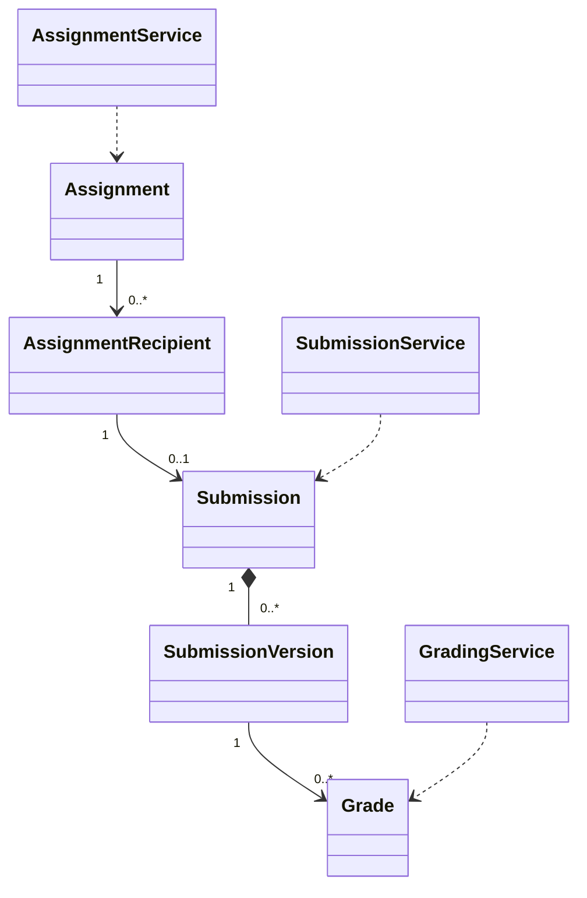

# EduCore — Class Design: Assignments & Grading

**Trạng thái:** Proposed for review · **Version:** 1.0 · **Ngày:** 12/10/2026 · **Phạm vi:** P0 + P1 (đã thể hiện theo lớp).

**Nguồn:** `requirements_analysis(7).md`, `specification(1).md`, `architectural_design(1).md`, `database_design.md` (Database Design v1.0 vẫn *proposed*). Truy vết: **FR-32–FR-36**, **UC-27–UC-30**, **BR-12 (tác vụ), Q-11 (baseline chi tiết)**.

> **Quy tắc đọc:** thông số BR/Q, hành vi UC và quyết định ADR là baseline từ nguồn; **tên class, chữ ký TypeScript, cách tách service/port, trạng thái kỹ thuật mới** trong file này là đề xuất Detailed Design, chưa phải source code hay Prisma schema đã kiểm chứng. Danh sách thuộc tính là lớp nghiệp vụ (không nhất thiết khớp 1:1 toàn bộ cột DB). Không tự coi tính năng P1 thành P0.

## 1. Ranh giới module và phạm vi

Giáo viên tạo/giao bài, học sinh nộp có version, chấm nháp/công bố điểm; theo dõi tiến độ P1. File metadata lưu qua File Management.

**Phụ thuộc ngoài module (qua public port/application contract):**
- Academic Management (class, student, Teacher scope).
- Identity & Access (Teacher/Student/Parent quyền).
- File Management (stored file private).
- Notification (đã giao bài).
- Reporting (thống kê tiến độ P1).

**Hợp đồng công khai được đề xuất:**
- `AssignmentQueryPort.getAssignmentsForStudent(studentId): AssignmentSummary[]`.
- `SubmissionQueryPort.getPublishedGrades(scope): PublishedGrade[]`.
- `AssignmentEventPort.assignmentPublished(event): void` — outbox.

## 2. Class Diagram (logic UML)



> ERD/bảng DB là nơi định nghĩa FK/constraint; UML ở đây mô tả quan hệ domain và dependency application. Class Diagram có thể lược bớt lớp hỗ trợ để dễ đọc; toàn bộ class chính được đặc tả tại §3.

## 3. Class Specifications

| Class | Vai trò | Phạm vi | Bảng/nguồn dữ liệu |
|---|---|---|---|
| `Assignment` | Domain aggregate root | P0 | `assignments` |
| `AssignmentRecipient` | Domain entity | P0 | `assignment_recipients` |
| `Submission` | Domain aggregate root | P0 | `submissions` |
| `SubmissionVersion` | Immutable domain entity | P0 | `submission_versions` |
| `Grade` | Versioned domain entity | P0 | `grades` |
| `AssignmentService` | Application service | P0 | `assignments, assignment_recipients` |
| `SubmissionService` | Application service | P0 | `submissions, submission_versions, submission_files` |
| `GradingService` | Application service | P0 | `grades` |
| `ProgressService` | Read application service | P1 | `assignments, recipients, submissions, grades (read)` |

### 3.1. `Assignment`

**Loại:** Domain aggregate root · **Ưu tiên:** P0 · **Nguồn dữ liệu:** `assignments`.

**Attributes / dependencies**

| Thuộc tính (đề xuất TypeScript) | Ý nghĩa |
|---|---|
| `id: UUID` | mã bài tập |
| `classId?: UUID` | giao theo lớp hoặc chọn học sinh |
| `createdByTeacherId: UUID` | giáo viên |
| `title: string` | tiêu đề |
| `description: string` | yêu cầu |
| `priority: number` | 1..5 |
| `deadlineAt: Date` | hạn chính xác |
| `status: AssignmentStatus` | DRAFT/PUBLISHED/ARCHIVED |
| `revision: number` | kiểm soát thay đổi |

**Operations**

| Method/contract (đề xuất) | Trách nhiệm / kiểm soát |
|---|---|
| `publish(recipients): void` | tạo snapshot recipients và outbox |
| `changeDetails(command): void` | đã có nộp thì kiểm soát sửa/deadline |
| `archive(): void` | không xóa submission |

### 3.2. `AssignmentRecipient`

**Loại:** Domain entity · **Ưu tiên:** P0 · **Nguồn dữ liệu:** `assignment_recipients`.

**Attributes / dependencies**

| Thuộc tính (đề xuất TypeScript) | Ý nghĩa |
|---|---|
| `assignmentId: UUID` | bài |
| `studentId: UUID` | học sinh được giao |
| `enrollmentId?: UUID` | nguồn lớp khi giao |
| `deadlineOverrideAt?: Date` | gia hạn có dấu vết |
| `revokedAt?: Date` | thu hồi không xóa lịch sử |

**Operations**

| Method/contract (đề xuất) | Trách nhiệm / kiểm soát |
|---|---|
| `effectiveDeadline(baseDeadline): Date` | override nếu được duyệt |
| `assertEligibleToSubmit(at): void` | được giao, trong hạn late 7 ngày |

### 3.3. `Submission`

**Loại:** Domain aggregate root · **Ưu tiên:** P0 · **Nguồn dữ liệu:** `submissions`.

**Attributes / dependencies**

| Thuộc tính (đề xuất TypeScript) | Ý nghĩa |
|---|---|
| `recipientId: UUID` | mỗi recipient một container |
| `currentVersionId?: UUID` | lần nộp mới nhất |
| `status: SubmissionStatus` | chưa nộp/đã nộp/đã chấm đề xuất |

**Operations**

| Method/contract (đề xuất) | Trách nhiệm / kiểm soát |
|---|---|
| `createVersion(command): SubmissionVersion` | không ghi đè |
| `setCurrentVersion(version): void` | chỉ khi valid |

### 3.4. `SubmissionVersion`

**Loại:** Immutable domain entity · **Ưu tiên:** P0 · **Nguồn dữ liệu:** `submission_versions`.

**Attributes / dependencies**

| Thuộc tính (đề xuất TypeScript) | Ý nghĩa |
|---|---|
| `submissionId: UUID` | container |
| `versionNo: number` | số tăng |
| `submittedAt: Date` | thời điểm nộp |
| `answerText?: string` | nội dung |
| `isLate: boolean` | quá deadline nhưng ≤7 ngày |
| `contentHash?: string` | bảo toàn nộp |

**Operations**

| Method/contract (đề xuất) | Trách nhiệm / kiểm soát |
|---|---|
| `validateDeadline(deadline): void` | quá deadline + 7 ngày reject |
| `assertCanResubmit(hasGrade): void` | chỉ trước khi chấm |

### 3.5. `Grade`

**Loại:** Versioned domain entity · **Ưu tiên:** P0 · **Nguồn dữ liệu:** `grades`.

**Attributes / dependencies**

| Thuộc tính (đề xuất TypeScript) | Ý nghĩa |
|---|---|
| `submissionVersionId: UUID` | chấm chính xác version |
| `revisionNo: number` | lịch sử chấm |
| `score: Decimal` | 0..10, 1 chữ số |
| `feedback?: string` | nhận xét |
| `gradedByTeacherId: UUID` | giáo viên |
| `status: GradeStatus` | DRAFT/PUBLISHED |
| `publishedAt?: Date` | công bố |

**Operations**

| Method/contract (đề xuất) | Trách nhiệm / kiểm soát |
|---|---|
| `saveDraft(): void` | không cho Student/Parent thấy |
| `publish(): void` | hành động riêng |
| `revisePublished(reason): Grade` | tạo revision mới, audit |

### 3.6. `AssignmentService`

**Loại:** Application service · **Ưu tiên:** P0 · **Nguồn dữ liệu:** `assignments, assignment_recipients`.

**Attributes / dependencies**

| Thuộc tính (đề xuất TypeScript) | Ý nghĩa |
|---|---|
| `assignmentRepo: AssignmentRepository` | aggregate |
| `authorization: AuthorizationPort` | teacher class scope |

**Operations**

| Method/contract (đề xuất) | Trách nhiệm / kiểm soát |
|---|---|
| `createDraft(command): Assignment` | validate priority |
| `publishAssignment(id, recipients): void` | transaction recipients/outbox |
| `updateAssignment(command): void` | version/audit có nộp |

### 3.7. `SubmissionService`

**Loại:** Application service · **Ưu tiên:** P0 · **Nguồn dữ liệu:** `submissions, submission_versions, submission_files`.

**Attributes / dependencies**

| Thuộc tính (đề xuất TypeScript) | Ý nghĩa |
|---|---|
| `submissionRepo: SubmissionRepository` | versioning |
| `filePort: SubmissionFilePort` | file READY cùng tenant |

**Operations**

| Method/contract (đề xuất) | Trách nhiệm / kiểm soát |
|---|---|
| `submit(command): SubmissionVersion` | 5 file/10MB; finalize atomic metadata |
| `resubmit(command): SubmissionVersion` | chỉ trước chấm |
| `getStudentStatus(studentId): SubmissionStatus[]` | tenant/scope |

### 3.8. `GradingService`

**Loại:** Application service · **Ưu tiên:** P0 · **Nguồn dữ liệu:** `grades`.

**Attributes / dependencies**

| Thuộc tính (đề xuất TypeScript) | Ý nghĩa |
|---|---|
| `gradeRepo: GradeRepository` | published revision |
| `authorization: AuthorizationPort` | Teacher assigned |

**Operations**

| Method/contract (đề xuất) | Trách nhiệm / kiểm soát |
|---|---|
| `saveDraftGrade(command): Grade` | 0..10 one decimal |
| `publishGrade(command): void` | publish riêng |
| `reviseGrade(command): Grade` | permission/reason/audit |

### 3.9. `ProgressService`

**Loại:** Read application service · **Ưu tiên:** P1 · **Nguồn dữ liệu:** `assignments, recipients, submissions, grades (read)`.

**Attributes / dependencies**

| Thuộc tính (đề xuất TypeScript) | Ý nghĩa |
|---|---|
| `progressReader: ProgressQueryPort` | scoped read |

**Operations**

| Method/contract (đề xuất) | Trách nhiệm / kiểm soát |
|---|---|
| `getStudentProgress(studentId): ProgressReport` | tỷ lệ bài/điểm theo Q-12 |
| `getParentProgress(parentId, studentId): ProgressReport` | check verified link |

## 4. Luồng phối hợp ứng dụng / transaction boundary

Teacher được phân công tạo draft → publish recipient snapshot + outbox trong transaction → Student có quyền nộp → `SubmissionService` kiểm deadline/late/file READY, thêm version immutable → Teacher chấm draft → publish; chỉ grade revision đã PUBLISHED đi vào API Student/Parent.

**Nguyên tắc xuyên module:** Không repository trực tiếp vào bảng của module khác. Nếu phải ghi nhiều module trong cùng một nghiệp vụ, application coordinator sở hữu transaction PostgreSQL; domain service chỉ trả kết quả/điều kiện; sự kiện side effect ghi vào outbox cùng transaction khi cần.

## 5. Invariants / Business Rules phải bảo vệ

1. Priority 1..5; deadline chính xác và audit khi thay đổi sau nộp.
2. Nộp ≤7 ngày sau deadline là LATE; sau đó từ chối; nộp lại chỉ trước khi chấm.
3. PDF/DOCX/JPG/PNG, ≤10 MB/file, ≤5 file/mỗi lần nộp.
4. Score 0..10 một chữ số; grade unpublished không được trả qua API Student/Parent; revision đã publish giữ lịch sử.
5. P1 progress chỉ thống kê dữ liệu có quyền, không làm lộ grade draft.

## 6. Kiểm thử bắt buộc cho module

- [ ] Teacher lớp A không giao/chấm bài lớp B dù có role TEACHER.
- [ ] Nộp lần 2 tạo versionNo mới; versionNo cũ bất biến.
- [ ] Grade DRAFT không xuất hiện trong view Student/Parent.
- [ ] Quá 7 ngày và file thứ 6 từ chối; upload lỗi không có orphan link.

## 7. Phạm vi P1 và điểm nối mở rộng

- ProgressService tổng hợp completion/on-time/grade theo công thức UC-30/Q-12.
- P1 nhắc deadline do Notification, không nhúng SMTP vào Assignment.

## 8. Open decisions (không tự xem là baseline)

- Chốt eligibility nộp lại khi đã có draft grade chưa publish và giới hạn kiểu sửa assignment đã phát hành.

## 9. Hợp đồng triển khai và cách phân lớp

```text
apps/api/src/modules/assignments-grading/
  domain/          # entities, value objects, policies + pure domain services
  application/     # use cases, application services, port interfaces
  infrastructure/  # Prisma repositories, adapter khi thực sự cần
  presentation/    # NestJS controllers, DTO/validation, guards
```

Không bắt buộc tạo đủ thư mục/abstraction nếu module ít CRUD. **Controller không giữ business rule; guard/check quyền không chỉ nằm ở Controller**, phải đánh giá lại trong service khi xử lý job/duyệt. Các enum nghiệp vụ áp dụng TypeScript và PostgreSQL CHECK/constraint, kiểu VND dùng `bigint` hoặc `Decimal` đúng ngữ cảnh; REST JSON serialize `bigint` thành string.
