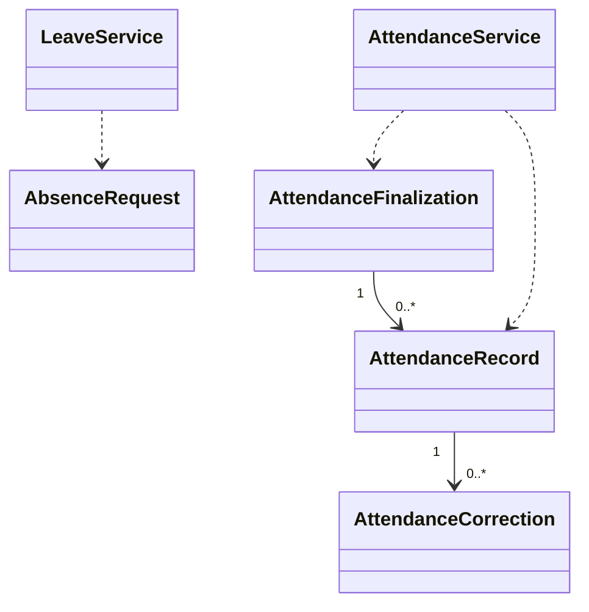

# EduCore — Class Design: Attendance & Leave

**Trạng thái:** Proposed for review · **Version:** 1.0 · **Ngày:** 12/10/2026 · **Phạm vi:** P0 + P1 (đã thể hiện theo lớp).

**Nguồn:** `requirements_analysis(7).md`, `specification(1).md`, `architectural_design(1).md`, `database_design.md` (Database Design v1.0 vẫn *proposed*). Truy vết: **FR-18–FR-19, FR-26**, **UC-15–UC-16**, **BR-04, BR-08**.

> **Quy tắc đọc:** thông số BR/Q, hành vi UC và quyết định ADR là baseline từ nguồn; **tên class, chữ ký TypeScript, cách tách service/port, trạng thái kỹ thuật mới** trong file này là đề xuất Detailed Design, chưa phải source code hay Prisma schema đã kiểm chứng. Danh sách thuộc tính là lớp nghiệp vụ (không nhất thiết khớp 1:1 toàn bộ cột DB). Không tự coi tính năng P1 thành P0.

## 1. Ranh giới module và phạm vi

Điểm danh dự học, xác nhận bộ điểm danh, xử lý đơn nghỉ và sửa sau khóa có dấu vết, cung cấp căn cứ đáng tin cậy cho học phí.

**Phụ thuộc ngoài module (qua public port/application contract):**
- Resource & Scheduling (session participant, thời điểm).
- Identity & Access (Teacher/Parent scope).
- Billing & Receivables (kiểm tra dữ liệu đã confirm, adjustment).
- Workflow & Approval (ngoại lệ đơn muộn).

**Hợp đồng công khai được đề xuất:**
- `AttendanceQueryPort.getConfirmedChargeSources(studentId,period): ChargeSource[]`.
- `AttendanceQueryPort.assertAllFinalized(sessionIds): void`.
- `AbsenceQueryPort.getApprovedForParticipant(participantId): AbsenceDecision?`.

## 2. Class Diagram (logic UML)



> ERD/bảng DB là nơi định nghĩa FK/constraint; UML ở đây mô tả quan hệ domain và dependency application. Class Diagram có thể lược bớt lớp hỗ trợ để dễ đọc; toàn bộ class chính được đặc tả tại §3.

## 3. Class Specifications

| Class | Vai trò | Phạm vi | Bảng/nguồn dữ liệu |
|---|---|---|---|
| `AbsenceRequest` | Domain entity | P0 | `absence_requests` |
| `AttendanceRecord` | Domain entity | P0 | `attendance_records` |
| `AttendanceFinalization` | Domain entity | P0 | `attendance_finalizations` |
| `AttendanceCorrection` | Append-only entity | P0 | `attendance_corrections` |
| `AttendanceService` | Application service | P0 | `attendance_records, attendance_finalizations, attendance_corrections` |
| `LeaveService` | Application service | P0 | `absence_requests` |

### 3.1. `AbsenceRequest`

**Loại:** Domain entity · **Ưu tiên:** P0 · **Nguồn dữ liệu:** `absence_requests`.

**Attributes / dependencies**

| Thuộc tính (đề xuất TypeScript) | Ý nghĩa |
|---|---|
| `participantId: UUID` | học sinh tại buổi |
| `requesterMembershipId: UUID` | student hoặc parent hợp lệ |
| `submittedAt: Date` | nộp đơn |
| `reason: string` | lý do |
| `isLateNotice: boolean` | <24h trước giờ học |
| `status: AbsenceRequestStatus` | chờ/duyệt/từ chối |
| `approvedByMembershipId?: UUID` | người xử lý |

**Operations**

| Method/contract (đề xuất) | Trách nhiệm / kiểm soát |
|---|---|
| `submit(): void` | tính notice window |
| `approve(decision): void` | sớm/muộn đều phải có quyền |
| `reject(reason): void` | lưu lý do |

### 3.2. `AttendanceRecord`

**Loại:** Domain entity · **Ưu tiên:** P0 · **Nguồn dữ liệu:** `attendance_records`.

**Attributes / dependencies**

| Thuộc tính (đề xuất TypeScript) | Ý nghĩa |
|---|---|
| `participantId: UUID` | một row/buổi/học sinh |
| `attendanceStatus: AttendanceStatus` | ATTENDED/EXCUSED/UNEXCUSED |
| `finalizationId?: UUID` | confirmed batch |
| `revision: number` | optimistic revision |
| `recordedByMembershipId: UUID` | giáo viên nhập |

**Operations**

| Method/contract (đề xuất) | Trách nhiệm / kiểm soát |
|---|---|
| `mark(status): void` | draft |
| `confirm(finalizationId): void` | hợp thức hóa |
| `validateExcused(approvedAbsence): void` | EXCUSED cần đơn duyệt |

### 3.3. `AttendanceFinalization`

**Loại:** Domain entity · **Ưu tiên:** P0 · **Nguồn dữ liệu:** `attendance_finalizations`.

**Attributes / dependencies**

| Thuộc tính (đề xuất TypeScript) | Ý nghĩa |
|---|---|
| `sessionId: UUID` | buổi được khóa batch |
| `confirmedByMembershipId: UUID` | Teacher có quyền |
| `confirmedAt: Date` | thời điểm xác nhận |
| `lockedAt?: Date` | lock nghiệp vụ |
| `revision: number` | sửa có version |

**Operations**

| Method/contract (đề xuất) | Trách nhiệm / kiểm soát |
|---|---|
| `confirmAll(records): void` | không để một phần thiếu |
| `isLocked(now, firstInvoiceIssuedAt?): boolean` | 48h hoặc invoice trước |
| `lock(): void` | cấm sửa thường |

### 3.4. `AttendanceCorrection`

**Loại:** Append-only entity · **Ưu tiên:** P0 · **Nguồn dữ liệu:** `attendance_corrections`.

**Attributes / dependencies**

| Thuộc tính (đề xuất TypeScript) | Ý nghĩa |
|---|---|
| `attendanceId: UUID` | record nguồn |
| `oldStatus: AttendanceStatus` | trạng thái cũ |
| `newStatus: AttendanceStatus` | trạng thái mới |
| `reason: string` | bắt buộc |
| `approvedByMembershipId?: UUID` | người duyệt |
| `correctedAt: Date` | mốc |

**Operations**

| Method/contract (đề xuất) | Trách nhiệm / kiểm soát |
|---|---|
| `applyAuthorized(): void` | quyền đặc biệt + audit |
| `requiresBillingAdjustment(): boolean` | khi invoice đã issued |

### 3.5. `AttendanceService`

**Loại:** Application service · **Ưu tiên:** P0 · **Nguồn dữ liệu:** `attendance_records, attendance_finalizations, attendance_corrections`.

**Attributes / dependencies**

| Thuộc tính (đề xuất TypeScript) | Ý nghĩa |
|---|---|
| `attendanceRepository: AttendanceRepository` | trạng thái nguồn |
| `scheduleReader: SessionQueryPort` | xác định session/teacher |

**Operations**

| Method/contract (đề xuất) | Trách nhiệm / kiểm soát |
|---|---|
| `markAttendance(command): void` | Teacher được giao |
| `finalizeSession(sessionId): void` | confirm all snapshot |
| `requestCorrection(command): CorrectionResult` | locked case |
| `getChargeEligibility(participantId): ChargeEligibility` | read-only cho Billing |

### 3.6. `LeaveService`

**Loại:** Application service · **Ưu tiên:** P0 · **Nguồn dữ liệu:** `absence_requests`.

**Attributes / dependencies**

| Thuộc tính (đề xuất TypeScript) | Ý nghĩa |
|---|---|
| `absenceRepository: AbsenceRepository` | đơn nghỉ |
| `approvalPort: ApprovalRequestPort` | nhu cầu duyệt |

**Operations**

| Method/contract (đề xuất) | Trách nhiệm / kiểm soát |
|---|---|
| `submitAbsence(command): AbsenceRequest` | Student/Parent liên kết |
| `decideAbsence(command): void` | permission đúng phạm vi |
| `expireOrRejectInvalid(command): void` | không auto gán EXCUSED |

## 4. Luồng phối hợp ứng dụng / transaction boundary

Student/Parent gửi đơn → `LeaveService` phân loại đúng/muộn nhưng **không tự duyệt** → người có quyền duyệt → Teacher ghi ATTENDED nếu thực tế có mặt, ngược lại EXCUSED chỉ khi được duyệt → Teacher xác nhận toàn bộ → Billing chỉ đọc confirmed.

**Nguyên tắc xuyên module:** Không repository trực tiếp vào bảng của module khác. Nếu phải ghi nhiều module trong cùng một nghiệp vụ, application coordinator sở hữu transaction PostgreSQL; domain service chỉ trả kết quả/điều kiện; sự kiện side effect ghi vào outbox cùng transaction khi cần.

## 5. Invariants / Business Rules phải bảo vệ

1. Điểm danh `ATTENDED/UNEXCUSED` tính 1; `EXCUSED` và session CANCELLED tính 0.
2. Học sinh thực tế có mặt luôn ATTENDED, ngay cả khi đã có đơn xin nghỉ.
3. Khóa điểm danh sau 48h từ kết thúc hoặc khi invoice nguồn đã phát hành, mốc nào đến trước.
4. Sửa locked cần permission, lý do, audit; invoice đã phát hành điều chỉnh riêng.

## 6. Kiểm thử bắt buộc cho module

- [ ] P0 gửi đơn sớm 25h chưa duyệt → chưa tự EXCUSED.
- [ ] Đơn nộp muộn không có duyệt ngoại lệ → EXCUSED bị từ chối.
- [ ] Billing gọi read model còn draft/không confirm → NEEDS_INFORMATION.
- [ ] Sau khóa sửa không tạo adjustment tự động để ghi đè invoice.

## 7. Phạm vi P1 và điểm nối mở rộng

- Bàn giao eligibility dựa nguồn học bù và quyết định P1.
- Bảo lưu loại trừ buổi tính phí trong khoảng hiệu lực.

## 8. Open decisions (không tự xem là baseline)

- Chốt trạng thái kỹ thuật của AbsenceRequest và cách biểu diễn batch điểm danh cho lớp có người vắng chưa rõ (không thay 3 attendance status baseline).

## 9. Hợp đồng triển khai và cách phân lớp

```text
apps/api/src/modules/attendance-leave/
  domain/          # entities, value objects, policies + pure domain services
  application/     # use cases, application services, port interfaces
  infrastructure/  # Prisma repositories, adapter khi thực sự cần
  presentation/    # NestJS controllers, DTO/validation, guards
```

Không bắt buộc tạo đủ thư mục/abstraction nếu module ít CRUD. **Controller không giữ business rule; guard/check quyền không chỉ nằm ở Controller**, phải đánh giá lại trong service khi xử lý job/duyệt. Các enum nghiệp vụ áp dụng TypeScript và PostgreSQL CHECK/constraint, kiểu VND dùng `bigint` hoặc `Decimal` đúng ngữ cảnh; REST JSON serialize `bigint` thành string.
