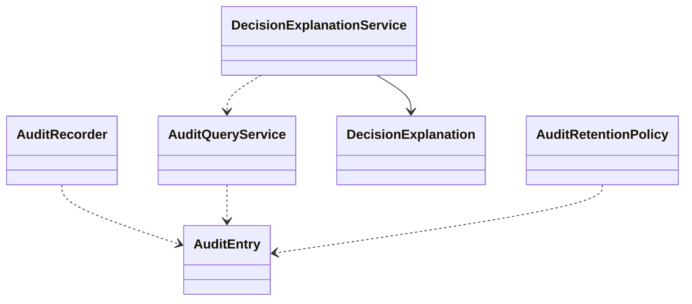

# EduCore — Class Design: Audit & Traceability

**Trạng thái:** Proposed for review · **Version:** 1.0 · **Ngày:** 12/10/2026 · **Phạm vi:** P0 + P1 (đã thể hiện theo lớp).

**Nguồn:** `requirements_analysis(7).md`, `specification(1).md`, `architectural_design(1).md`, `database_design.md` (Database Design v1.0 vẫn *proposed*). Truy vết: **FR-41, NFR-16**, **UC-35**, **BR-08, BR-11, BR-12, BR-14, Q-14**.

> **Quy tắc đọc:** thông số BR/Q, hành vi UC và quyết định ADR là baseline từ nguồn; **tên class, chữ ký TypeScript, cách tách service/port, trạng thái kỹ thuật mới** trong file này là đề xuất Detailed Design, chưa phải source code hay Prisma schema đã kiểm chứng. Danh sách thuộc tính là lớp nghiệp vụ (không nhất thiết khớp 1:1 toàn bộ cột DB). Không tự coi tính năng P1 thành P0.

## 1. Ranh giới module và phạm vi

Lưu dấu vết bất biến cho thao tác quan trọng, quyết định/ngoại lệ/automation; tra cứu theo permission/tenant/scope và lưu giữ 24 tháng baseline.

**Phụ thuộc ngoài module (qua public port/application contract):**
- Identity & Access (actor, tenant/scope).
- Workflow & Approval (quyết định).
- Automation & Job (attempt/correlation).
- Tenant & Policy (version).

**Hợp đồng công khai được đề xuất:**
- `AuditPort.appendInTransaction(event): void`.
- `AuditQueryPort.searchAuthorized(principal,filters): AuditPage`.
- `DecisionExplanationPort.explain(operationId,principal): DecisionExplanation`.

## 2. Class Diagram (logic UML)



> ERD/bảng DB là nơi định nghĩa FK/constraint; UML ở đây mô tả quan hệ domain và dependency application. Class Diagram có thể lược bớt lớp hỗ trợ để dễ đọc; toàn bộ class chính được đặc tả tại §3.

## 3. Class Specifications

| Class | Vai trò | Phạm vi | Bảng/nguồn dữ liệu |
|---|---|---|---|
| `AuditEntry` | Immutable append-only entity | P0 | `audit_logs` |
| `AuditRecorder` | Application/infrastructure service | P0 | `audit_logs` |
| `AuditQueryService` | Read application service | P0 basic; P1 advance | `audit_logs` |
| `DecisionExplanation` | Immutable read model | P0 cơ bản; P1 nâng cao | `audit_logs + approvals + jobs + policy_versions (read)` |
| `DecisionExplanationService` | Read application service | P0; P1 deep inspection | `audit, jobs, approvals, policy (read)` |
| `AuditRetentionPolicy` | Infrastructure policy | P0 policy baseline; P1 operational advanced | `audit_logs` |

### 3.1. `AuditEntry`

**Loại:** Immutable append-only entity · **Ưu tiên:** P0 · **Nguồn dữ liệu:** `audit_logs`.

**Attributes / dependencies**

| Thuộc tính (đề xuất TypeScript) | Ý nghĩa |
|---|---|
| `id: UUID` | event audit |
| `tenantId: UUID` | tenant source |
| `actorUserId?: UUID` | user toàn cục |
| `actorMembershipId?: UUID` | tenant actor |
| `actorKind: ActorKind` | USER/WORKER/OPERATOR |
| `eventType: string` | nghiệp vụ |
| `entityType: string` | loại target |
| `entityId: UUID` | đối tượng |
| `action: string` | hành động |
| `reason?: string` | lý do |
| `before?: JSON` | snapshot đã lọc |
| `after?: JSON` | snapshot đã lọc |
| `policyVersionId?: UUID` | policy gắn |
| `correlationId: UUID` | liên kết event/job/approval |
| `createdAt: Date` | timestamp |

**Operations**

| Method/contract (đề xuất) | Trách nhiệm / kiểm soát |
|---|---|
| `redactSensitiveFields(): void` | không password/OTP/token |
| `assertImmutable(): void` | không update/delete qua app |

### 3.2. `AuditRecorder`

**Loại:** Application/infrastructure service · **Ưu tiên:** P0 · **Nguồn dữ liệu:** `audit_logs`.

**Attributes / dependencies**

| Thuộc tính (đề xuất TypeScript) | Ý nghĩa |
|---|---|
| `auditRepo: AuditRepository` | append only |
| `redactionPolicy: AuditRedactionPolicy` | filter |

**Operations**

| Method/contract (đề xuất) | Trách nhiệm / kiểm soát |
|---|---|
| `recordInsideTransaction(event): void` | atomic cùng nghiệp vụ |
| `recordSecurityDenial(event): void` | không làm lộ secrets |
| `recordWorkerDecision(job,decision): void` | audit nguồn tự động |

### 3.3. `AuditQueryService`

**Loại:** Read application service · **Ưu tiên:** P0 basic; P1 advance · **Nguồn dữ liệu:** `audit_logs`.

**Attributes / dependencies**

| Thuộc tính (đề xuất TypeScript) | Ý nghĩa |
|---|---|
| `repo: AuditRepository` | query indexes |
| `authorization: AuthorizationPort` | scope |

**Operations**

| Method/contract (đề xuất) | Trách nhiệm / kiểm soát |
|---|---|
| `search(principal,filter,page): AuditPage` | không vượt tenant |
| `getEntityTrail(principal,type,id): AuditEntry[]` | quyền xem target |
| `exportAdvanced(filter): AuditExport` | P1 nếu có chính sách |

### 3.4. `DecisionExplanation`

**Loại:** Immutable read model · **Ưu tiên:** P0 cơ bản; P1 nâng cao · **Nguồn dữ liệu:** `audit_logs + approvals + jobs + policy_versions (read)`.

**Attributes / dependencies**

| Thuộc tính (đề xuất TypeScript) | Ý nghĩa |
|---|---|
| `operationId: UUID` | giao dịch nghiệp vụ |
| `trigger: string` | điều kiện khởi phát |
| `policyVersionId: UUID` | phiên bản |
| `decision: string` | kết quả |
| `deciderMembershipId?: UUID` | ai duyệt |
| `timeline: ExplanationStep[]` | mốc lịch sử |

**Operations**

| Method/contract (đề xuất) | Trách nhiệm / kiểm soát |
|---|---|
| `toSafeView(scope): DecisionExplanation` | redaction/scope |
| `assertTraceLinks(): void` | nguồn hợp lệ |

### 3.5. `DecisionExplanationService`

**Loại:** Read application service · **Ưu tiên:** P0; P1 deep inspection · **Nguồn dữ liệu:** `audit, jobs, approvals, policy (read)`.

**Attributes / dependencies**

| Thuộc tính (đề xuất TypeScript) | Ý nghĩa |
|---|---|
| `auditQuery: AuditQueryService` | log |
| `workflowQuery: ApprovalQueryPort` | decisions |
| `jobQuery: JobTracePort` | attempts |

**Operations**

| Method/contract (đề xuất) | Trách nhiệm / kiểm soát |
|---|---|
| `explain(principal,operationId): DecisionExplanation` | reason/version/outcome |
| `getTimeline(principal,target): ExplanationStep[]` | P1 drilldown |

### 3.6. `AuditRetentionPolicy`

**Loại:** Infrastructure policy · **Ưu tiên:** P0 policy baseline; P1 operational advanced · **Nguồn dữ liệu:** `audit_logs`.

**Attributes / dependencies**

| Thuộc tính (đề xuất TypeScript) | Ý nghĩa |
|---|---|
| `retentionMonths: number` | baseline 24 |
| `purgeAuthorizedAfter?: Date` | retention trigger có kiểm soát |

**Operations**

| Method/contract (đề xuất) | Trách nhiệm / kiểm soát |
|---|---|
| `isExpired(entry,at): boolean` | đánh giá retention |
| `planArchive(): void` | không xóa tùy tiện khi còn nghĩa vụ giữ |

## 4. Luồng phối hợp ứng dụng / transaction boundary

Application use case thực thi mutation quan trọng + `AuditRecorder.recordInsideTransaction(...)` trong cùng DB transaction (khi bắt buộc bảo toàn dấu vết). Workflow/job luôn carry `correlationId` + `policyVersionId`; query explanation join theo quyền hiện hành; field nhạy cảm redact trước persist.

**Nguyên tắc xuyên module:** Không repository trực tiếp vào bảng của module khác. Nếu phải ghi nhiều module trong cùng một nghiệp vụ, application coordinator sở hữu transaction PostgreSQL; domain service chỉ trả kết quả/điều kiện; sự kiện side effect ghi vào outbox cùng transaction khi cần.

## 5. Invariants / Business Rules phải bảo vệ

1. Audit ghi actor/source, event, target, reason, before/after an toàn, timestamp, policy version và correlation ID.
2. P0 UI chỉ tra cứu cơ bản khi có permission; không sửa/đổi/xóa log qua UI, baseline giữ 24 tháng.
3. Không ghi plaintext password, OTP, token, secret hoặc nội dung không cần thiết.
4. System Operator không mặc định nhìn audit chứa PII tenant ngoài scope.

## 6. Kiểm thử bắt buộc cho module

- [ ] Hủy invoice/sửa attendance/duyệt tự thân/đổi role đều xuất hiện đầy đủ trong trail.
- [ ] Truy vấn event của tenant khác hoặc thông tin học sinh không thuộc scope bị chặn.
- [ ] Tạo audit log từ reset OTP không lưu OTP/plaintext dù exception.

## 7. Phạm vi P1 và điểm nối mở rộng

- Bộ lọc nâng cao, giải thích policy decisions và timeline nghiệp vụ chi tiết.
- Retention archive/export theo chính sách hợp pháp khi xác nhận.

## 8. Open decisions (không tự xem là baseline)

- Phân loại schema before/after PII và hành vi xóa theo luật sau 24 tháng cần privacy review.

## 9. Hợp đồng triển khai và cách phân lớp

```text
apps/api/src/modules/audit-traceability/
  domain/          # entities, value objects, policies + pure domain services
  application/     # use cases, application services, port interfaces
  infrastructure/  # Prisma repositories, adapter khi thực sự cần
  presentation/    # NestJS controllers, DTO/validation, guards
```

Không bắt buộc tạo đủ thư mục/abstraction nếu module ít CRUD. **Controller không giữ business rule; guard/check quyền không chỉ nằm ở Controller**, phải đánh giá lại trong service khi xử lý job/duyệt. Các enum nghiệp vụ áp dụng TypeScript và PostgreSQL CHECK/constraint, kiểu VND dùng `bigint` hoặc `Decimal` đúng ngữ cảnh; REST JSON serialize `bigint` thành string.
