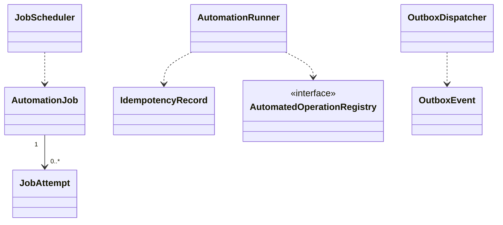

# EduCore — Class Design: Automation & Job

**Trạng thái:** Proposed for review · **Version:** 1.0 · **Ngày:** 12/10/2026 · **Phạm vi:** P0 + P1 (đã thể hiện theo lớp).

**Nguồn:** `requirements_analysis(7).md`, `specification(1).md`, `architectural_design(1).md`, `database_design.md` (Database Design v1.0 vẫn *proposed*). Truy vết: **FR-45, FR-39 (hỗ trợ)**, **UC-37, UC-34**, **BR-09, BR-12–BR-14**.

> **Quy tắc đọc:** thông số BR/Q, hành vi UC và quyết định ADR là baseline từ nguồn; **tên class, chữ ký TypeScript, cách tách service/port, trạng thái kỹ thuật mới** trong file này là đề xuất Detailed Design, chưa phải source code hay Prisma schema đã kiểm chứng. Danh sách thuộc tính là lớp nghiệp vụ (không nhất thiết khớp 1:1 toàn bộ cột DB). Không tự coi tính năng P1 thành P0.

## 1. Ranh giới module và phạm vi

Job runner/scheduler bền vững nội bộ NestJS và PostgreSQL outbox/idempotency; P0 tự kiểm tra xung đột, tính phí, tạo draft; P1 mở rộng theo chính sách.

**Phụ thuộc ngoài module (qua public port/application contract):**
- Tenant & Policy (policy pinned).
- Identity & Access (quyền hiện hành).
- Workflow & Approval (PENDING_APPROVAL).
- Notification (outbox consumer).
- Audit & Traceability (attempt/traces).

**Hợp đồng công khai được đề xuất:**
- `JobSubmissionPort.enqueue(command): JobRef`.
- `IdempotencyPort.executeOnce(tenant,operation,key,requestHash,fn): Result`.
- `OutboxPort.appendInsideTransaction(event): void`.

## 2. Class Diagram (logic UML)



> ERD/bảng DB là nơi định nghĩa FK/constraint; UML ở đây mô tả quan hệ domain và dependency application. Class Diagram có thể lược bớt lớp hỗ trợ để dễ đọc; toàn bộ class chính được đặc tả tại §3.

## 3. Class Specifications

| Class | Vai trò | Phạm vi | Bảng/nguồn dữ liệu |
|---|---|---|---|
| `AutomationJob` | Domain aggregate root | P0 | `automation_jobs` |
| `JobAttempt` | Append-only record | P0 | `job_attempts` |
| `IdempotencyRecord` | Domain entity | P0 | `idempotency_records` |
| `OutboxEvent` | Append-only domain event | P0 | `outbox_events` |
| `JobScheduler` | NestJS infrastructure service | P0 | `automation_jobs` |
| `AutomationRunner` | Application orchestration service | P0; P1 operations | `job_attempts, idempotency_records` |
| `OutboxDispatcher` | Infrastructure/application worker | P0 | `outbox_events` |
| `AutomatedOperationRegistry` | Interface | P0 subset; P1 mở rộng | `không sở hữu bảng` |

### 3.1. `AutomationJob`

**Loại:** Domain aggregate root · **Ưu tiên:** P0 · **Nguồn dữ liệu:** `automation_jobs`.

**Attributes / dependencies**

| Thuộc tính (đề xuất TypeScript) | Ý nghĩa |
|---|---|
| `tenantId: UUID` | tenant |
| `jobKind: string` | loại task |
| `operationKey: string` | unique logic |
| `idempotencyKey: string` | key retry |
| `policyVersionId: UUID` | pin |
| `status: JobStatus` | READY/RUNNING/NEEDS_INFORMATION/PENDING_APPROVAL/COMPLETED/FAILED |
| `attemptCount: number` | 1+≤3 retry |
| `nextAttemptAt?: Date` | thời điểm chạy lại |
| `leaseOwner?: string` | instance claim |
| `leaseUntil?: Date` | hết hạn claim |
| `correlationId: UUID` | truy vết |

**Operations**

| Method/contract (đề xuất) | Trách nhiệm / kiểm soát |
|---|---|
| `claim(workerId, until): void` | transaction lease |
| `markCompleted(result): void` | ghi kết quả |
| `markNeedsInformation(reason): void` | không tự retry |
| `scheduleRetry(error): void` | 1/5/15 phút |
| `markFailed(error): void` | cảnh báo Manager |

### 3.2. `JobAttempt`

**Loại:** Append-only record · **Ưu tiên:** P0 · **Nguồn dữ liệu:** `job_attempts`.

**Attributes / dependencies**

| Thuộc tính (đề xuất TypeScript) | Ý nghĩa |
|---|---|
| `jobId: UUID` | task |
| `attemptNo: number` | lần chạy |
| `startedAt: Date` | bắt đầu |
| `finishedAt?: Date` | kết thúc |
| `outcome: AttemptOutcome` | result/error |
| `errorCode?: string` | mã lỗi đã lọc |

**Operations**

| Method/contract (đề xuất) | Trách nhiệm / kiểm soát |
|---|---|
| `finish(result): void` | append-only record |
| `isTransient(): boolean` | lỗi có thể retry |

### 3.3. `IdempotencyRecord`

**Loại:** Domain entity · **Ưu tiên:** P0 · **Nguồn dữ liệu:** `idempotency_records`.

**Attributes / dependencies**

| Thuộc tính (đề xuất TypeScript) | Ý nghĩa |
|---|---|
| `operationType: string` | loại nghiệp vụ |
| `idempotencyKey: string` | unique per tenant/op |
| `requestHash: string` | bảo vệ cùng key khác payload |
| `status: string` | processing/completed |
| `resultRefId?: UUID` | kết quả thành công |

**Operations**

| Method/contract (đề xuất) | Trách nhiệm / kiểm soát |
|---|---|
| `assertSameRequest(hash): void` | reject hash khác |
| `returnPreviousResult(): Result` | replay success |

### 3.4. `OutboxEvent`

**Loại:** Append-only domain event · **Ưu tiên:** P0 · **Nguồn dữ liệu:** `outbox_events`.

**Attributes / dependencies**

| Thuộc tính (đề xuất TypeScript) | Ý nghĩa |
|---|---|
| `eventKey: string` | duy nhất/tenant |
| `eventType: string` | loại sự kiện |
| `aggregateId: UUID` | nguồn |
| `payload: JSON` | dữ liệu tối thiểu |
| `occurredAt: Date` | commit logical timestamp |
| `status: OutboxStatus` | NEW/PROCESSING/DONE/FAILED |
| `correlationId: UUID` | trace |

**Operations**

| Method/contract (đề xuất) | Trách nhiệm / kiểm soát |
|---|---|
| `markProcessed(): void` | sau consumer thành công |
| `markRetry(): void` | không mất sự kiện |

### 3.5. `JobScheduler`

**Loại:** NestJS infrastructure service · **Ưu tiên:** P0 · **Nguồn dữ liệu:** `automation_jobs`.

**Attributes / dependencies**

| Thuộc tính (đề xuất TypeScript) | Ý nghĩa |
|---|---|
| `jobRepo: AutomationJobRepository` | SELECT ... FOR UPDATE SKIP LOCKED |
| `workerId: string` | định danh worker |

**Operations**

| Method/contract (đề xuất) | Trách nhiệm / kiểm soát |
|---|---|
| `enqueue(command): JobRef` | key unique |
| `claimDueJobs(batch): AutomationJob[]` | lease an toàn |
| `recoverExpiredLeases(): void` | retry sau restart |

### 3.6. `AutomationRunner`

**Loại:** Application orchestration service · **Ưu tiên:** P0; P1 operations · **Nguồn dữ liệu:** `job_attempts, idempotency_records`.

**Attributes / dependencies**

| Thuộc tính (đề xuất TypeScript) | Ý nghĩa |
|---|---|
| `policyReader: PolicySnapshotPort` | load pinned |
| `auth: AuthorizationPort` | permission hiện hành |
| `operationRegistry: AutomatedOperationRegistry` | business handlers |

**Operations**

| Method/contract (đề xuất) | Trách nhiệm / kiểm soát |
|---|---|
| `run(job): ExecutionOutcome` | idempotent |
| `classifyFailure(error): FailureClass` | transient/missing/approval/forbidden |
| `applyRetryPolicy(job): void` | tối đa 3 retry |
| `notifyManager(job): void` | FAILED hoặc thiếu approver |

### 3.7. `OutboxDispatcher`

**Loại:** Infrastructure/application worker · **Ưu tiên:** P0 · **Nguồn dữ liệu:** `outbox_events`.

**Attributes / dependencies**

| Thuộc tính (đề xuất TypeScript) | Ý nghĩa |
|---|---|
| `outboxRepo: OutboxRepository` | claim/lease |
| `consumers: Map<EventType,Consumer>` | handlers |

**Operations**

| Method/contract (đề xuất) | Trách nhiệm / kiểm soát |
|---|---|
| `dispatchBatch(): void` | at-least-once |
| `retryFailedEvent(event): void` | dedup ở consumer |

### 3.8. `AutomatedOperationRegistry`

**Loại:** Interface · **Ưu tiên:** P0 subset; P1 mở rộng · **Nguồn dữ liệu:** `không sở hữu bảng`.

**Attributes / dependencies**

| Thuộc tính (đề xuất TypeScript) | Ý nghĩa |
|---|---|
| `handlers: Map<OperationKey,Handler>` | danh sách nghiệp vụ được phép |

**Operations**

| Method/contract (đề xuất) | Trách nhiệm / kiểm soát |
|---|---|
| `resolve(operation): Handler` | P0 chỉ conflict/billing/draft |
| `assertAutomationAllowed(policy): void` | gate theo BR-09/13 |

## 4. Luồng phối hợp ứng dụng / transaction boundary

Internal scheduler lấy các job due bằng transaction claim/lease → runner load policy version được pin, kiểm tra nguồn và permission hiện hành → check key/hash → route P0 operations hợp lệ → complete hoặc NEEDS_INFORMATION/PENDING_APPROVAL/FAILED; transient backoff 1/5/15 phút tối đa 3 lần **retry**. Outbox consumer dùng at-least-once + unique recipient dedup.

**Nguyên tắc xuyên module:** Không repository trực tiếp vào bảng của module khác. Nếu phải ghi nhiều module trong cùng một nghiệp vụ, application coordinator sở hữu transaction PostgreSQL; domain service chỉ trả kết quả/điều kiện; sự kiện side effect ghi vào outbox cùng transaction khi cần.

## 5. Invariants / Business Rules phải bảo vệ

1. Không Redis/Kafka ở P0; job/outbox durable PostgreSQL cùng ứng dụng Railway NestJS.
2. Idempotency bắt buộc cho create session/invoice/payment; cùng key khác request hash phải từ chối.
3. Sau 3 retry (ngoài lần đầu), FAILED + alert Manager; không retry vô hạn data thiếu.
4. Không tự issue invoice, transfer, substitute theo P0; policyVersion giữ, authorization kiểm tra lại.
5. Outbox event được ghi cùng transaction nghiệp vụ; consumer không rollback thao tác gốc.

## 6. Kiểm thử bắt buộc cho module

- [ ] Worker crash sau claim → lease timeout và chạy lại không trùng invoice/payment.
- [ ] Cùng key khác payload bị từ chối; cùng key completed trả lại kết quả cũ.
- [ ] Missing data → NEEDS_INFORMATION, không cứ 1 phút retry.
- [ ] Permission bị thu hồi trước retry → từ chối thực thi.

## 7. Phạm vi P1 và điểm nối mở rộng

- Các operation risk thấp có thể bật qua policy P1, trừ thao tác luôn manual (adjust/cancel invoice issued).
- Ngoài notification có thể thêm event consumers nội bộ khi cần.

## 8. Open decisions (không tự xem là baseline)

- Chốt cách đặt timeout/lease và cron scheduling, nguồn actor khi job hệ thống chạy; cron không đồng nghĩa new job nếu operation_key trùng.

## 9. Hợp đồng triển khai và cách phân lớp

```text
apps/api/src/modules/automation-jobs/
  domain/          # entities, value objects, policies + pure domain services
  application/     # use cases, application services, port interfaces
  infrastructure/  # Prisma repositories, adapter khi thực sự cần
  presentation/    # NestJS controllers, DTO/validation, guards
```

Không bắt buộc tạo đủ thư mục/abstraction nếu module ít CRUD. **Controller không giữ business rule; guard/check quyền không chỉ nằm ở Controller**, phải đánh giá lại trong service khi xử lý job/duyệt. Các enum nghiệp vụ áp dụng TypeScript và PostgreSQL CHECK/constraint, kiểu VND dùng `bigint` hoặc `Decimal` đúng ngữ cảnh; REST JSON serialize `bigint` thành string.
