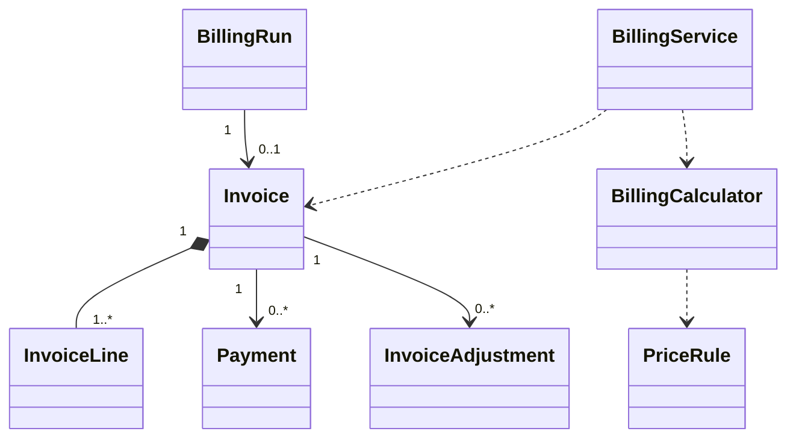

# EduCore — Class Design: Billing & Receivables

**Wallet amendment19/10/2026:** owner xác nhận B1–B5 **BUSINESS APPROVED**, minimal architecture **PRINCIPLE ACCEPTED**; [Register §G](../../ai/DECISION_REGISTER.md#g-wallet-p0--owner-business-approval-2026-10-19). Wallet là business P0, **NOT IMPLEMENTED**; types/fields/locks/SQL/Q1–Q8 **RECOMMENDED / PENDING TECHNICAL SIGN-OFF**. O-12 giữ nguyên.

**Trạng thái:** Proposed for review · **Version:** 1.0 · **Ngày:** 12/10/2026 · **Phạm vi:** P0 + P1 (đã thể hiện theo lớp).

**v1.0 + O-12 amendment · 18/10/2026 · Asia/Ho_Chi_Minh:** A=A, B=B1, C=C1, D=D **APPROVED business** theo chỉ đạo trực tiếp của chủ dự án; [Decision Register](../../ai/DECISION_REGISTER.md#f-o-12--approved-business-decision-2026-10-18). Class signatures/storage/locks là PROPOSED, không code/schema/migration approval. Database v1.1 và Group A ở cuối file thắng các mô tả v1.0 cũ.

**Nguồn:** `requirements_analysis(7).md`, `specification(1).md`, `architectural_design(1).md`, `database_design.md` (Database Design v1.0 vẫn *proposed*). Truy vết: **FR-25–FR-31**, **UC-21–UC-26**, **BR-04, BR-05, BR-06, BR-08, BR-11, BR-13, BR-14**.

> **Quy tắc đọc:** thông số BR/Q, hành vi UC và quyết định ADR là baseline từ nguồn; **tên class, chữ ký TypeScript, cách tách service/port, trạng thái kỹ thuật mới** trong file này là đề xuất Detailed Design, chưa phải source code hay Prisma schema đã kiểm chứng. Danh sách thuộc tính là lớp nghiệp vụ (không nhất thiết khớp 1:1 toàn bộ cột DB). Không tự coi tính năng P1 thành P0.

## 1. Ranh giới module và phạm vi

Giá theo buổi/lớp/khóa, billing tháng, draft → issued invoice nội bộ, ưu đãi, thu tiền thủ công, đảo khoản thu/điều chỉnh có phê duyệt, công nợ và P1 prepaid/credit.

**Phụ thuộc ngoài module (qua public port/application contract):**
- Attendance & Leave (nguồn charge confirmed).
- Academic Management (student/class).
- Tenant & Policy (pinned version).
- Workflow & Approval (manual approve finance).
- Academic Exceptions (P1 makeup/suspension).
- Reporting (read-only ledger projection).

**Hợp đồng công khai được đề xuất:**
- `BillingQueryPort.getReceivable(invoiceId): Vnd`.
- `BillingQueryPort.getOutstandingByScope(scope): Vnd`.
- `BillingCommandPort.applyAuthorizedAdjustment(command): void`.

## 2. Class Diagram (logic UML)



> ERD/bảng DB là nơi định nghĩa FK/constraint; UML ở đây mô tả quan hệ domain và dependency application. Class Diagram có thể lược bớt lớp hỗ trợ để dễ đọc; toàn bộ class chính được đặc tả tại §3.

## 3. Class Specifications

| Class | Vai trò | Phạm vi | Bảng/nguồn dữ liệu |
|---|---|---|---|
| `PriceRule` | Domain entity | P0 | `price_rules` |
| `BillingRun` | Domain entity | P0 | `billing_runs, billing_periods, billing_source_snapshots` |
| `Invoice` | Domain aggregate root | P0 | `invoices, invoice_lines, invoice_discounts, invoiced_participation_claims` |
| `InvoiceLine` | Domain entity | P0 | `invoice_lines` |
| `DiscountPolicy` | Domain service | P0 sibling; P1 combo | `invoice_discounts, verified_sibling_relationships` |
| `Payment` | Append-only entity | P0 | `payments, receivable_allocations` |
| `WalletAccount`, `WalletTransaction` | Balance entity / immutable receipt-money history | P0 business approved, logical model proposed | `wallet_accounts`, `wallet_transactions` chưa có trong Prisma |
| `FinancialCoordinator` | Application transaction owner | P0, concrete implementation pending | Reuse Billing/Workflow/Audit/Idempotency, không general ledger |
| `PaymentReversal` | Append-only entity | P0 | `payment_reversals` |
| `InvoiceAdjustment` | Append-only entity | P0 | `invoice_adjustments` |
| `BillingCalculator` | Domain service | P0; P1 prepaid | `price_rules, charge sources (read)` |
| `BillingService` | Application service | P0 | `billing_runs, invoices, payments, adjustments` |
| `PrepaidPackage` | Domain entity | P1 | `prepaid_packages, prepaid_package_enrollments` |

### 3.1. `PriceRule`

**Loại:** Domain entity · **Ưu tiên:** P0 · **Nguồn dữ liệu:** `price_rules`.

**Attributes / dependencies**

| Thuộc tính (đề xuất TypeScript) | Ý nghĩa |
|---|---|
| `scope: PriceScope` | SESSION/CLASS/COURSE |
| `scopeId: UUID` | đối tượng thuộc tenant |
| `unitPriceVnd: bigint` | >=0 |
| `effectiveFrom: LocalDate` | DATE `YYYY-MM-DD`, inclusive tại ngày session local |
| `effectiveTo?: LocalDate` | DATE exclusive; absent=vô hạn, không UTC instant |
| `policyVersionId: UUID` | provenance tariff, độc lập calculation-policy pin của generation |

**Operations**

| Method/contract (đề xuất) | Trách nhiệm / kiểm soát |
|---|---|
| `appliesTo(source, pricingLocalDate): boolean` | đúng tenant/target gốc và `[effectiveFrom,effectiveTo)` tại local session-start date, không charge time |
| `assertNonOverlapping(): void` | giá cùng scope không chồng |
| `assertFuturePriceMutation(command, evidence): void` | không sửa amount/target/backdate/override giá buổi đã bắt đầu; future window close không phá captured/issued selection |

### 3.2. `BillingRun`

**Loại:** Domain entity · **Ưu tiên:** P0 · **Nguồn dữ liệu:** `billing_runs, billing_periods, billing_source_snapshots`.

**Attributes / dependencies**

| Thuộc tính (đề xuất TypeScript) | Ý nghĩa |
|---|---|
| `periodId: UUID` | kỳ tháng |
| `studentId: UUID` | học sinh |
| `operationKey: string` | initial operation provenance, không overwrite bằng recompute key |
| `policyVersionId: UUID` | projection calculation policy của current applied generation; retry không repin |
| `currentGenerationId?: UUID` | proposed applied pointer cùng run/student/period; không bằng latest pending generation |
| `inputSnapshotHash: string` | căn cứ |
| `status: BillingRunStatus` | draft/NEEDS_INFORMATION/... |

**Operations**

| Method/contract (đề xuất) | Trách nhiệm / kiểm soát |
|---|---|
| `ensureSourceFinalized(sources): void` | không tính nếu thiếu điểm danh |
| `recordSnapshot(hash): void` | giữ evidence |
| `markNeedsInformation(reason): void` | thiếu nguồn không finalize |
| `admitGeneration(command, expectedBase, expectedApplied): GenerationReceipt` | proposed G1/G2 immutable input/key/hash/clock/policy/source/price snapshots; CAS, tối đa một pending; không logical run thứ hai |
| `applyGeneration(generation): void` | recheck nguồn, atomically update draft/current pointer/policy/hash/result/audit; pending/stale chặn issue |

`BillingRunGeneration` là entity/persistence **đề xuất**, không model hiện có: tenant/run/student/period, generationNo, typed key/requestHash, base/expectedApplied IDs, chargeCreatedAt/generationCreatedAt (admission/audit only), calculationPolicyVersionId, timezoneSnapshot, per-source snapshots và result/diff/reason. Không có một pricingLocalDate chung cho toàn generation; mỗi nguồn giữ ngày session riêng. G1 NEEDS_INFORMATION chưa có invoice vẫn được tạo G2 bằng command mới. Payload/result immutable, attempts/status riêng; current applied pointer chỉ đổi cùng draft projection khi apply thành công. Xem DB Design §3.6, O-04 representation/O-01 guards còn review.

### 3.3. `Invoice`

**Loại:** Domain aggregate root · **Ưu tiên:** P0 · **Nguồn dữ liệu:** `invoices, invoice_lines, invoice_discounts, invoiced_participation_claims`.

**Attributes / dependencies**

| Thuộc tính (đề xuất TypeScript) | Ý nghĩa |
|---|---|
| `id: UUID` | chứng từ nội bộ |
| `billingRunId: UUID` | nguồn run |
| `status: InvoiceStatus` | DRAFT/ISSUED/CANCELLED |
| `grossVnd: bigint` | trước ưu đãi |
| `discountVnd: bigint` | ưu đãi |
| `totalVnd: bigint` | sau ưu đãi |
| `issuedAt?: Date` | phát hành |
| `dueAt?: Date` | 7 ngày sau issue |
| `snapshot: InvoiceSnapshot` | frozen khi issued |

**Operations**

| Method/contract (đề xuất) | Trách nhiệm / kiểm soát |
|---|---|
| `recalculateDraft(generation, expectedApplied): void` | chỉ G2 command mới có reason/key/CAS; giữ G1 và một logical invoice; reject ISSUED |
| `issue(approver): void` | chỉ permission invoice.issue; tạo claim & snapshot |
| `assertImmutableWhenIssued(): void` | không sửa tổng/dòng |
| `getOutstanding(ledger): bigint` | tính từ adjustments/allocations |

### 3.4. `InvoiceLine`

**Loại:** Domain entity · **Ưu tiên:** P0 · **Nguồn dữ liệu:** `invoice_lines`.

**Attributes / dependencies**

| Thuộc tính (đề xuất TypeScript) | Ý nghĩa |
|---|---|
| `participantId: UUID` | một người/buổi |
| `sessionId: UUID` | snapshot buổi |
| `attendanceId?: UUID` | căn cứ đã confirm |
| `chargeUnits: 0\|1` | miễn/thu |
| `unitPriceVnd: bigint` | giá snapshot |
| `sourceBusinessDate: LocalDate` | server-derived local session-start date |
| `pricingLocalDate: LocalDate` | bằng sourceBusinessDate, không generation date |
| `timezoneSnapshot: string` | frozen tenant IANA timezone |
| `priceEvidence: PriceSnapshot` | ruleId/window/unitPrice/tier/target/candidate proof và tariff provenance |
| `sourceSnapshot: JSON` | original session/class/course/enrollment lineage, UTC times/revisions/finalization; generation calculation-policy riêng; representation pending review |

**Operations**

| Method/contract (đề xuất) | Trách nhiệm / kiểm soát |
|---|---|
| `calculateBase(): bigint` | chargeUnits * price |
| `assertChargeEligibility(): void` | ATTENDED/UNEXCUSED=1, EXCUSED/CANCELLED=0 |

### 3.5. `DiscountPolicy`

**Loại:** Domain service · **Ưu tiên:** P0 sibling; P1 combo · **Nguồn dữ liệu:** `invoice_discounts, verified_sibling_relationships`.

**Attributes / dependencies**

| Thuộc tính (đề xuất TypeScript) | Ý nghĩa |
|---|---|
| `siblingRate: Decimal` | 0.10 nếu đủ điều kiện |
| `comboRate: Decimal` | 0.05 nếu đóng trước 6 tháng P1 |

**Operations**

| Method/contract (đề xuất) | Trách nhiệm / kiểm soát |
|---|---|
| `evaluateEligibility(studentId, at): Discounts` | cần proof sibling + enrollment |
| `calculateNet(gross, snapshot): bigint` | P0 0.90; P1 0.95 rồi 0.90, ROUND_HALF_UP một lần |

### 3.6. `Payment`

**Loại:** Append-only entity · **Ưu tiên:** P0 · **Nguồn dữ liệu:** `payments, receivable_allocations`.

**Attributes / dependencies**

| Thuộc tính (đề xuất TypeScript) | Ý nghĩa |
|---|---|
| `invoiceId: UUID` | **một invoice** |
| `amountVnd: bigint` | >0 |
| `method: PaymentMethod` | WALLET cho payment mới; CASH/BANK_TRANSFER giữ legacy, dùng cho TOP_UP receipts mới |
| `idempotencyKey: string` | không ghi trùng |
| `recordedByMembershipId: UUID` | người đối soát |

**Operations**

| Method/contract (đề xuất) | Trách nhiệm / kiểm soát |
|---|---|
| `validateAgainstOutstanding(due): void` | amount ≤ due |
| `recordAllocation(): void` | WALLET debit+base allocation+balance/audit/receipt cùng transaction; signed RELEASEs về sau không rewrite base |

### 3.7. `PaymentReversal`

**Loại:** Append-only entity · **Ưu tiên:** P0 · **Nguồn dữ liệu:** `payment_reversals`.

**Attributes / dependencies**

| Thuộc tính (đề xuất TypeScript) | Ý nghĩa |
|---|---|
| `paymentId: UUID` | nguồn |
| `amountVnd: bigint` | đảo toàn bộ P0 |
| `reason: string` | bắt buộc |
| `reversedByMembershipId: UUID` | người thực thi |

**Operations**

| Method/contract (đề xuất) | Trách nhiệm / kiểm soát |
|---|---|
| `reverseOnce(): void` | không xóa payment gốc |
| `reopenReceivable(): void` | tính lại due từ ledger |

### 3.8. `InvoiceAdjustment`

**Loại:** Append-only entity · **Ưu tiên:** P0 · **Nguồn dữ liệu:** `invoice_adjustments`.

**Attributes / dependencies**

| Thuộc tính (đề xuất TypeScript) | Ý nghĩa |
|---|---|
| `invoiceId: UUID` | hóa đơn issued |
| `approvalRequestId: UUID` | bắt buộc duyệt thủ công |
| `deltaVnd: bigint` | +/- điều chỉnh |
| `reason: string` | lý do |
| `status: AdjustmentStatus` | PROPOSED/APPLIED/REJECTED |

**Operations**

| Method/contract (đề xuất) | Trách nhiệm / kiểm soát |
|---|---|
| `applyApproved(): void` | chỉ sau quyết định hợp lệ |
| `cancelIssuedInvoiceAuthorized(): void` | dùng flow cancellation không update thô |

### 3.9. `BillingCalculator`

**Loại:** Domain service · **Ưu tiên:** P0; P1 prepaid · **Nguồn dữ liệu:** `price_rules, charge sources (read)`.

**Attributes / dependencies**

| Thuộc tính (đề xuất TypeScript) | Ý nghĩa |
|---|---|
| `priceResolver: PriceRuleReader` | thứ tự SESSION > CLASS > COURSE |
| `attendanceReader: AttendanceQueryPort` | confirmed source |

**Operations**

| Method/contract (đề xuất) | Trách nhiệm / kiểm soát |
|---|---|
| `calculatePeriod(studentId, period, policy): InvoiceDraft` | gross + discounts |
| `resolvePrice(source, pricingLocalDate): PriceSelection` | pricingLocalDate phải bằng local_date(source.session.startsAt,z); eligible DATE windows, SESSION > CLASS > COURSE theo original lineage; trả price + evidence, không current-enrollment fallback hoặc fake0 |
| `calculateMakeupOrCreditP1(source): ChargeEntry` | chống thu hai lần |

### 3.10. `BillingService`

**Loại:** Application service · **Ưu tiên:** P0 · **Nguồn dữ liệu:** `billing_runs, invoices, payments, adjustments`.

**Attributes / dependencies**

| Thuộc tính (đề xuất TypeScript) | Ý nghĩa |
|---|---|
| `calculator: BillingCalculator` | tính phí |
| `workflow: ApprovalRequestPort` | manual adjustment |
| `tx: TransactionCoordinator` | lock source/invoice |

**Operations**

| Method/contract (đề xuất) | Trách nhiệm / kiểm soát |
|---|---|
| `generateDraft(command): GenerationReceipt` | initial closed-month G1/capture+job atomic; same key/hash replay, same logical run/invoice |
| `recomputeDraft(command): GenerationReceipt` | proposed application command, API path/permission pending review; new key/reason/base+applied CAS → G2/new-request policy, session-date prices, history/diff/audit |
| `issueInvoice(invoiceId): void` | current rights/G/source/snapshot/stale checks; no pending G, no reprice/repin; permanent claims incl units0, number/freeze/audit atomic |
| `recordPayment(command): Payment` | Legacy signature không direct-pay mới; delegate `payInvoiceFromWallet` qua FinancialCoordinator, API transport pending |
| `reversePayment(command): void` | Append-only full nominal reversal proposal; credit/release chỉ remaining sau refunds, không filter reversed+trừ offset hai lần |
| `requestAdjustment(command): ApprovalRequest` | manual |
| `applyApprovedAdjustment(command): void` | durable APPROVED có trước; explicit effect+releases/refund+root receipt/audit+COMPLETED atomic qua FinancialCoordinator |

### 3.11. `PrepaidPackage`

**Loại:** Domain entity · **Ưu tiên:** P1 · **Nguồn dữ liệu:** `prepaid_packages, prepaid_package_enrollments`.

**Attributes / dependencies**

| Thuộc tính (đề xuất TypeScript) | Ý nghĩa |
|---|---|
| `studentId: UUID` | học viên |
| `monthsCovered: number` | ít nhất 6 cho combo |
| `paidAmountVnd: bigint` | paid/verified |
| `startDate: DateOnly` | hiệu lực |

**Operations**

| Method/contract (đề xuất) | Trách nhiệm / kiểm soát |
|---|---|
| `qualifiesForCombo(): boolean` | fully prepaid six months |
| `consumeUnits(count): void` | ghi nguồn tiêu dùng/cân đối |

## 4. Luồng phối hợp ứng dụng / transaction boundary

Chạy kỳ tháng → chụp nguồn session/attendance confirmed + price + policy → tính line 0/1, gross, sibling10%/round cuối → lưu draft → manual ISSUE/source claims; không debit ví. New finance: verified CASH/BANK_TRANSFER TOP_UP independent invoice; explicit WALLET payment đúng ISSUED owner và balance/due, debit/payment/base allocation/audit/receipt atomic. Điều chỉnh/hủy: D1 manual APPROVED commit, explicit E1 apply delta+signed releases+wallet refund đúng excess+receipt/audit+COMPLETED atomic. E1 fail giữ D1, không duplicate retry hoặc external refund; legacy/mixed cần policy riêng.

### Wallet entities và FinancialCoordinator — logical contracts

| Entity/value object/operation | Minimum state / responsibility |
|---|---|
| `WalletAccount` | id/tenant/student/balanceVnd/timestamps; UQ tenant/student, immutable owner, nonnegative exact VND/no expiry; balance update một lần cùng ledger, không domain tự commit |
| `WalletTransaction` | Signed integer amount/type, Wallet/tenant, actor/time/reason, typed root/effect refs; TOP_UP receipt ref/method/evidence; Payment/Adjustment/PaymentReversal/original-topup typed links. Append-only, FK/guards/source UQ proposal ở DB §3.6 |
| VND/receipt/effect identity | BigInt/Decimal exact + API strings, typed key/hash/current ownership; receipt UQ chống key mới cùng tiền gốc, no arbitrary client balance/verified flag |
| `topUpWallet` | Staff current financial permission, student scope, manual verified positive receipt; account lazy-create0+TOP_UP+balance+audit/receipt atomic, không Payment |
| `getWalletBalance` / `listWalletTransactions` | Scoped current read/Parent link, sanitized history/asOf; không Student/Parent mutation |
| `payInvoiceFromWallet` | Staff explicit p, ISSUED same student/tenant, 0<p<=balance/outstanding; Wallet→Invoice locks, debit/Payment/base allocation/receipt/audit atomic |
| `refundInvoicePaymentToWallet` | Internal approved execution only; N_after>=0, r=max(P_before−N_after,0); release+credit cùng amount/source, không client free-form refund |
| `reverseInvalidTopUp` | Full original TOP_UP khi available balance đủ, current permission/reason/audit/compensation; thiếu reject, không tự reverse payment đúng/negative wallet |

**Allocation proposal cần sửa thật:** thay cả UQ `(tenant,payment)` và `(tenant,payment,invoice)` hiện tại bằng partial base PAYMENT/payment UQ; add signed RELEASE/self-parent/source WT refs, giữ same-invoice Payment composite FK. Payment.allocation singular→collection. Query wallet P=SUM(base+release), không exclude reversed payment thêm lần2; legacy positive/no-reversal semantics riêng. Refund UQ adjustment/payment và root approved effect/version ngăn double-credit, không thêm excess-case engine cho wallet-only. Logic/source/grant/trigger/partial keys chưa áp dụng schema.

**Invariant/examples:** B=Σsigned WT>=0, B+A_wallet=T_net_topups; refund100k đồng thời release100k, không giữ credit trong payment. Paid800→N700 hoàn100; paid300→N700 hoàn0; subsequent increase không debit lại. Payment800 đã refund100 full-reversed nominal800 chỉ credit remaining700 (technical recommendation); fully released thì0. Paid/attended cancellation giữ invoice number/source/history/claims. Top-up trước invoice được phép, không revenue hoặc combo package6tháng P1.

**Technical pending:** User-before-Tenant gate/RC/fresh auth → roots/sources → Wallet → Invoice/ledger → audit; one transaction client/no nested commits, cross-row final guards/privilege boundaries/native arithmetic/unknown commit. G1/G2 typed metadata+immutable JSON/current applied pointer là minimal recommendation, pricing vẫn ngày session, ví thay đổi không G2. Exact DB/DD/API contracts phải sign-off. UC-25/26 ACs và W01–W36 **DESIGNED**; PostgreSQL/runtime NOT RUN, không wallet implementation.

**O-12 flow:** Scheduling/Academic port cung cấp historical session/class/course chain + startsAt/revisions; `d=local_date(startsAt,z)` là cả source/pricing date và month source. G1 admission pin calculation policy tại server instant theo BR-14, đồng thời capture giá tại từng d; không dùng admission instant chọn PriceRule. Retry load immutable G1, source change → stale không refresh; intentional G2 nhận nguồn/policy mới nhưng không đổi unitPrice vì clock tháng mới. Snapshot/history giữ mỗi G, current invoice một; historical replay không write-back current. ISSUE recheck không reselect/repin; UC-26 append correction/adjustment sau issued, giữ original basis/claims. Missing attendance/price/ambiguous same tier → NEEDS_INFORMATION, CANCELLED không cần attendance giả nhưng vẫn cần tariff; explicit PriceRule0 khác missing price.

**Transaction protocol PROPOSED:** dùng chung lock graph với Scheduling/Attendance/Price/Tenant writers: tenant gate trước reads → current auth/typed key → period/run/G → course/class/price/resources/session sorted → participant/attendance → invoice/line/claim → audit/counter/outbox. Source mutation trước capture được capture mới, giữa capture/apply/issue thì stale/block; illegal past/issued reschedule reject. Child/inverse period guards + deferred final-state checks, immediate issued-history guard, whole-phase rollback/bounded same-key retry/unknown-commit lookup theo [DB §3.6](../database_design.md) và [DD §5.7](../detailed_design.md). Không gọi Billing arithmetic trong Scheduling, không gọi external I/O dưới lock. O-01 gateway/privileges/isolation chưa được duyệt hay test bằng PostgreSQL.

**Nguyên tắc xuyên module:** Không repository trực tiếp vào bảng của module khác. Nếu phải ghi nhiều module trong cùng một nghiệp vụ, application coordinator sở hữu transaction PostgreSQL; domain service chỉ trả kết quả/điều kiện; sự kiện side effect ghi vào outbox cùng transaction khi cần.

## 5. Invariants / Business Rules phải bảo vệ

1. P0 tháng; giá ưu tiên SESSION → CLASS → COURSE; hạn thanh toán 7 ngày tính từ issue.
2. ROUND_HALF_UP đến VND **một lần cuối**. Sibling 10% có evidence; P1 combo 5% trước + sibling 10% sau = 14.5%.
3. Draft không tự issued P0. Issued invoice không chỉnh totals/lines trực tiếp; chỉnh qua adjustment có manual approval, `SELF_APPROVED` audit khi một Manager hợp lệ.
4. WALLET Payment đúng một invoice ISSUED/student/tenant; partial explicit, amount<=balance/due; debit+allocation atomic. TOP_UP là verified receipt riêng, không payment. Refund/reversal append-only signed offsets, balance=ΣWT, no double-count, no auto debit draft/issue.
5. Invoice là bảng kê **nội bộ**, không được coi hóa đơn điện tử hợp pháp.
6. **Group A đã duyệt:** một logical invoice/student/tenant/month, gộp các lớp; O12-B=B1 dùng local session-start month, không split/UTC month/tháng tạo draft. Permanent issued participation claims kể cả zero/cancel không release sau invoice cancellation.
7. O12-C=C1 freeze zone ở first ScheduleSeries/ClassSession (kể cả DRAFT), BillingPeriod/BillingRun-generation; sticky, Ops chỉ cấu hình trước source. Lưu source/pricing dates + z, không reinterpret lịch sử; source class/course không đổi theo enrollment hiện tại.
8. Giá mới chỉ cho session từ ngày hiệu lực tương lai; DATE không intraday. Không backdate/mutate giá buổi đã bắt đầu kể cả chưa billed; future bound thay đổi phải giữ semantic selection của snapshot cũ. Missing past tariff cần review repair riêng, không ordinary backdated rule. ISSUED bất biến, retry/G2 không dùng current charge clock để chọn giá.

## 6. Kiểm thử bắt buộc cho module

- [ ] Hai worker tính cùng kỳ cùng student không sinh hai run/issued claims.
- [ ] Hai user ghi payment đồng thời tổng vượt due → một bị từ chối.
- [ ] Thử thay đổi attendance sau invoice issue không làm đổi số tiền issued.
- [ ] Combo+sibling P1 tính 0.95 * 0.90, không cộng 15% và không round hai lần.
- [ ] O12-AC-01–27: late draft/recompute giữ session-date prices; mixed rates; boundaries/lineage/confirmed sources; no implicit 0; same-key replay/current-generation CAS; frozen z; issued/claims immutable. [Matrix N.5](../../ai/reviews/database/O12_DECISION_PROPOSAL.md#n5-acceptance-matrix-hien-hanh--o12-aa), chỉ đặc tả chưa chạy.

## 7. Phạm vi P1 và điểm nối mở rộng

- Prepaid 6 tháng + combo; credit bảo lưu không tự refund, phân bổ sau ưu đãi.
- Điều chỉnh cho makeup, suspension và chuyển lớp dựa trên nguồn ledger.

## 8. Open decisions (không tự xem là baseline)

- One logical invoice/student/tenant/month đã được Group A duyệt; O-12 A/B/C/D business đã duyệt 18/10/2026. Còn technical review representation/current pointer/locks/SQL/API recompute, number format/dueAt và excess/cancellation financial workflow; không mở lại monthly identity hoặc lựa chọn O-12.

## 9. Hợp đồng triển khai và cách phân lớp

```text
apps/api/src/modules/billing-receivables/
  domain/          # entities, value objects, policies + pure domain services
  application/     # use cases, application services, port interfaces
  infrastructure/  # Prisma repositories, adapter khi thực sự cần
  presentation/    # NestJS controllers, DTO/validation, guards
```

Không bắt buộc tạo đủ thư mục/abstraction nếu module ít CRUD. **Controller không giữ business rule; guard/check quyền không chỉ nằm ở Controller**, phải đánh giá lại trong service khi xử lý job/duyệt. Các enum nghiệp vụ áp dụng TypeScript và PostgreSQL CHECK/constraint, kiểu VND dùng `bigint` hoặc `Decimal` đúng ngữ cảnh; REST JSON serialize `bigint` thành string.

## P0 decisions approved 17/10/2026

**Historical Group A:** no-credit/excess bullet dưới được **limited-superseded19/10** cho new wallet cohort; các invariant invoice identity/claims giữ. Legacy giữ history/policy riêng; không coi bullet cũ là lệnh xây engine FIFO/excess mới.

- Exactly one invoice logic per (tenant, student, billing month), aggregating all class invoice lines. Invoice number assigned only upon ISSUE with tenant-scoped uniqueness; automatic draft does not issue.
- Price effective ranges are exclusive per tenant+target and must be protected by PostgreSQL exclusion constraints, not just application validation. Migration must include real concurrency tests.
- An approved downward adjustment after already-allocated payment may produce excess. This is NOT negative receivables and NOT P1 tuition credit: retain immutable payment/allocations and record excess in payment_excess_resolutions as PENDING_RESOLUTION with authorization/audit; do not auto-refund/credit in P0. See ../database_design.md v1.1. Financial resolution details remain for Billing slice review.
