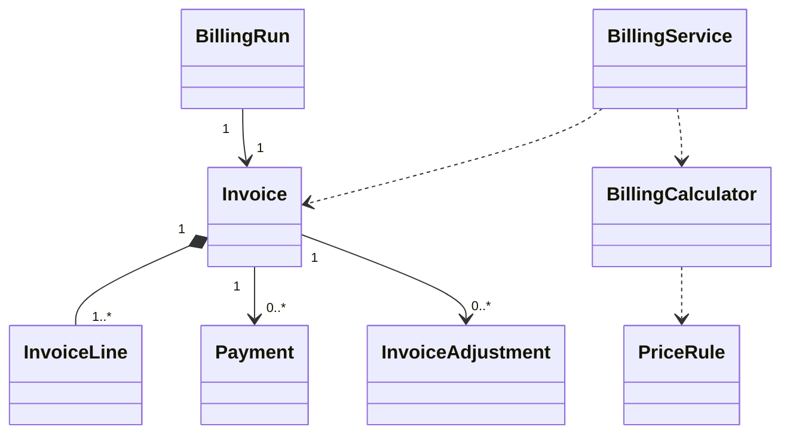

# EduCore — Class Design: Billing & Receivables

**Trạng thái:** Proposed for review · **Version:** 1.0 · **Ngày:** 12/10/2026 · **Phạm vi:** P0 + P1 (đã thể hiện theo lớp).

**Nguồn:** `requirements_analysis(7).md`, `specification(1).md`, `architectural_design(1).md`, `database_design.md` (Database Design v1.0 vẫn *proposed*). Truy vết: **FR-25–FR-31**, **UC-21–UC-26**, **BR-04, BR-05, BR-06, BR-08, BR-11, BR-13, BR-14**.

> **Quy tắc đọc:** thông số BR/Q, hành vi UC và quyết định ADR là baseline từ nguồn; **tên class, chữ ký TypeScript, cách tách service/port, trạng thái kỹ thuật mới** trong file này là đề xuất Detailed Design, chưa phải source code hay Prisma schema đã kiểm chứng. Danh sách thuộc tính là lớp nghiệp vụ (không nhất thiết khớp 1:1 toàn bộ cột DB). Không tự coi tính năng P1 thành P0.

## 1. Ranh giới module và phạm vi

Giá theo buổi/lớp/khóa, billing tháng, draft → issued invoice nội bộ, ưu đãi, thu tiền thủ công, đảo khoản thu/điều chỉnh có phê duyệt, công nợ và P1 prepaid/credit.

**Phụ thuộc ngoài module (qua public port/application contract):**
- Attendance & Leave (nguồn charge confirmed).
- Academic Management (student/class).
- Tenant & Policy (pinned version).
- Workflow & Approval (manual approve finance).
- Academic Exceptions (P1 makeup/suspension).
- Reporting (read-only ledger projection).

**Hợp đồng công khai được đề xuất:**
- `BillingQueryPort.getReceivable(invoiceId): Vnd`.
- `BillingQueryPort.getOutstandingByScope(scope): Vnd`.
- `BillingCommandPort.applyAuthorizedAdjustment(command): void`.

## 2. Class Diagram (logic UML)



> ERD/bảng DB là nơi định nghĩa FK/constraint; UML ở đây mô tả quan hệ domain và dependency application. Class Diagram có thể lược bớt lớp hỗ trợ để dễ đọc; toàn bộ class chính được đặc tả tại §3.

## 3. Class Specifications

| Class | Vai trò | Phạm vi | Bảng/nguồn dữ liệu |
|---|---|---|---|
| `PriceRule` | Domain entity | P0 | `price_rules` |
| `BillingRun` | Domain entity | P0 | `billing_runs, billing_periods, billing_source_snapshots` |
| `Invoice` | Domain aggregate root | P0 | `invoices, invoice_lines, invoice_discounts, invoiced_participation_claims` |
| `InvoiceLine` | Domain entity | P0 | `invoice_lines` |
| `DiscountPolicy` | Domain service | P0 sibling; P1 combo | `invoice_discounts, verified_sibling_relationships` |
| `Payment` | Append-only entity | P0 | `payments, receivable_allocations` |
| `PaymentReversal` | Append-only entity | P0 | `payment_reversals` |
| `InvoiceAdjustment` | Append-only entity | P0 | `invoice_adjustments` |
| `BillingCalculator` | Domain service | P0; P1 prepaid | `price_rules, charge sources (read)` |
| `BillingService` | Application service | P0 | `billing_runs, invoices, payments, adjustments` |
| `PrepaidPackage` | Domain entity | P1 | `prepaid_packages, prepaid_package_enrollments` |

### 3.1. `PriceRule`

**Loại:** Domain entity · **Ưu tiên:** P0 · **Nguồn dữ liệu:** `price_rules`.

**Attributes / dependencies**

| Thuộc tính (đề xuất TypeScript) | Ý nghĩa |
|---|---|
| `scope: PriceScope` | SESSION/CLASS/COURSE |
| `scopeId: UUID` | đối tượng thuộc tenant |
| `unitPriceVnd: bigint` | >=0 |
| `effectiveFrom: Date` | thời điểm áp dụng |
| `effectiveTo?: Date` | hết hạn |
| `policyVersionId: UUID` | pin policy |

**Operations**

| Method/contract (đề xuất) | Trách nhiệm / kiểm soát |
|---|---|
| `appliesTo(source, at): boolean` | đúng thời điểm/tenant |
| `assertNonOverlapping(): void` | giá cùng scope không chồng |

### 3.2. `BillingRun`

**Loại:** Domain entity · **Ưu tiên:** P0 · **Nguồn dữ liệu:** `billing_runs, billing_periods, billing_source_snapshots`.

**Attributes / dependencies**

| Thuộc tính (đề xuất TypeScript) | Ý nghĩa |
|---|---|
| `periodId: UUID` | kỳ tháng |
| `studentId: UUID` | học sinh |
| `operationKey: string` | idempotency logic |
| `policyVersionId: UUID` | fixed |
| `inputSnapshotHash: string` | căn cứ |
| `status: BillingRunStatus` | draft/NEEDS_INFORMATION/... |

**Operations**

| Method/contract (đề xuất) | Trách nhiệm / kiểm soát |
|---|---|
| `ensureSourceFinalized(sources): void` | không tính nếu thiếu điểm danh |
| `recordSnapshot(hash): void` | giữ evidence |
| `markNeedsInformation(reason): void` | thiếu nguồn không finalize |

### 3.3. `Invoice`

**Loại:** Domain aggregate root · **Ưu tiên:** P0 · **Nguồn dữ liệu:** `invoices, invoice_lines, invoice_discounts, invoiced_participation_claims`.

**Attributes / dependencies**

| Thuộc tính (đề xuất TypeScript) | Ý nghĩa |
|---|---|
| `id: UUID` | chứng từ nội bộ |
| `billingRunId: UUID` | nguồn run |
| `status: InvoiceStatus` | DRAFT/ISSUED/CANCELLED |
| `grossVnd: bigint` | trước ưu đãi |
| `discountVnd: bigint` | ưu đãi |
| `totalVnd: bigint` | sau ưu đãi |
| `issuedAt?: Date` | phát hành |
| `dueAt?: Date` | 7 ngày sau issue |
| `snapshot: InvoiceSnapshot` | frozen khi issued |

**Operations**

| Method/contract (đề xuất) | Trách nhiệm / kiểm soát |
|---|---|
| `recalculateDraft(lines, discounts): void` | draft có kiểm soát |
| `issue(approver): void` | chỉ permission invoice.issue; tạo claim & snapshot |
| `assertImmutableWhenIssued(): void` | không sửa tổng/dòng |
| `getOutstanding(ledger): bigint` | tính từ adjustments/allocations |

### 3.4. `InvoiceLine`

**Loại:** Domain entity · **Ưu tiên:** P0 · **Nguồn dữ liệu:** `invoice_lines`.

**Attributes / dependencies**

| Thuộc tính (đề xuất TypeScript) | Ý nghĩa |
|---|---|
| `participantId: UUID` | một người/buổi |
| `sessionId: UUID` | snapshot buổi |
| `attendanceId?: UUID` | căn cứ đã confirm |
| `chargeUnits: 0\|1` | miễn/thu |
| `unitPriceVnd: bigint` | giá snapshot |
| `sourceSnapshot: JSON` | giải thích charge |

**Operations**

| Method/contract (đề xuất) | Trách nhiệm / kiểm soát |
|---|---|
| `calculateBase(): bigint` | chargeUnits * price |
| `assertChargeEligibility(): void` | ATTENDED/UNEXCUSED=1, EXCUSED/CANCELLED=0 |

### 3.5. `DiscountPolicy`

**Loại:** Domain service · **Ưu tiên:** P0 sibling; P1 combo · **Nguồn dữ liệu:** `invoice_discounts, verified_sibling_relationships`.

**Attributes / dependencies**

| Thuộc tính (đề xuất TypeScript) | Ý nghĩa |
|---|---|
| `siblingRate: Decimal` | 0.10 nếu đủ điều kiện |
| `comboRate: Decimal` | 0.05 nếu đóng trước 6 tháng P1 |

**Operations**

| Method/contract (đề xuất) | Trách nhiệm / kiểm soát |
|---|---|
| `evaluateEligibility(studentId, at): Discounts` | cần proof sibling + enrollment |
| `calculateNet(gross, snapshot): bigint` | P0 0.90; P1 0.95 rồi 0.90, ROUND_HALF_UP một lần |

### 3.6. `Payment`

**Loại:** Append-only entity · **Ưu tiên:** P0 · **Nguồn dữ liệu:** `payments, receivable_allocations`.

**Attributes / dependencies**

| Thuộc tính (đề xuất TypeScript) | Ý nghĩa |
|---|---|
| `invoiceId: UUID` | **một invoice** |
| `amountVnd: bigint` | >0 |
| `method: PaymentMethod` | CASH/BANK_TRANSFER |
| `idempotencyKey: string` | không ghi trùng |
| `recordedByMembershipId: UUID` | người đối soát |

**Operations**

| Method/contract (đề xuất) | Trách nhiệm / kiểm soát |
|---|---|
| `validateAgainstOutstanding(due): void` | amount ≤ due |
| `recordAllocation(): void` | cùng transaction |

### 3.7. `PaymentReversal`

**Loại:** Append-only entity · **Ưu tiên:** P0 · **Nguồn dữ liệu:** `payment_reversals`.

**Attributes / dependencies**

| Thuộc tính (đề xuất TypeScript) | Ý nghĩa |
|---|---|
| `paymentId: UUID` | nguồn |
| `amountVnd: bigint` | đảo toàn bộ P0 |
| `reason: string` | bắt buộc |
| `reversedByMembershipId: UUID` | người thực thi |

**Operations**

| Method/contract (đề xuất) | Trách nhiệm / kiểm soát |
|---|---|
| `reverseOnce(): void` | không xóa payment gốc |
| `reopenReceivable(): void` | tính lại due từ ledger |

### 3.8. `InvoiceAdjustment`

**Loại:** Append-only entity · **Ưu tiên:** P0 · **Nguồn dữ liệu:** `invoice_adjustments`.

**Attributes / dependencies**

| Thuộc tính (đề xuất TypeScript) | Ý nghĩa |
|---|---|
| `invoiceId: UUID` | hóa đơn issued |
| `approvalRequestId: UUID` | bắt buộc duyệt thủ công |
| `deltaVnd: bigint` | +/- điều chỉnh |
| `reason: string` | lý do |
| `status: AdjustmentStatus` | PROPOSED/APPLIED/REJECTED |

**Operations**

| Method/contract (đề xuất) | Trách nhiệm / kiểm soát |
|---|---|
| `applyApproved(): void` | chỉ sau quyết định hợp lệ |
| `cancelIssuedInvoiceAuthorized(): void` | dùng flow cancellation không update thô |

### 3.9. `BillingCalculator`

**Loại:** Domain service · **Ưu tiên:** P0; P1 prepaid · **Nguồn dữ liệu:** `price_rules, charge sources (read)`.

**Attributes / dependencies**

| Thuộc tính (đề xuất TypeScript) | Ý nghĩa |
|---|---|
| `priceResolver: PriceRuleReader` | thứ tự SESSION > CLASS > COURSE |
| `attendanceReader: AttendanceQueryPort` | confirmed source |

**Operations**

| Method/contract (đề xuất) | Trách nhiệm / kiểm soát |
|---|---|
| `calculatePeriod(studentId, period, policy): InvoiceDraft` | gross + discounts |
| `resolvePrice(source, at): bigint` | fallback rõ |
| `calculateMakeupOrCreditP1(source): ChargeEntry` | chống thu hai lần |

### 3.10. `BillingService`

**Loại:** Application service · **Ưu tiên:** P0 · **Nguồn dữ liệu:** `billing_runs, invoices, payments, adjustments`.

**Attributes / dependencies**

| Thuộc tính (đề xuất TypeScript) | Ý nghĩa |
|---|---|
| `calculator: BillingCalculator` | tính phí |
| `workflow: ApprovalRequestPort` | manual adjustment |
| `tx: TransactionCoordinator` | lock source/invoice |

**Operations**

| Method/contract (đề xuất) | Trách nhiệm / kiểm soát |
|---|---|
| `generateDraft(command): Invoice` | idempotent per billing logical key |
| `issueInvoice(invoiceId): void` | check input revision, claim sessions, audit |
| `recordPayment(command): Payment` | lock due then insert payment + allocation |
| `reversePayment(command): void` | append-only |
| `requestAdjustment(command): ApprovalRequest` | manual |
| `applyApprovedAdjustment(command): void` | approval + ledger in transaction |

### 3.11. `PrepaidPackage`

**Loại:** Domain entity · **Ưu tiên:** P1 · **Nguồn dữ liệu:** `prepaid_packages, prepaid_package_enrollments`.

**Attributes / dependencies**

| Thuộc tính (đề xuất TypeScript) | Ý nghĩa |
|---|---|
| `studentId: UUID` | học viên |
| `monthsCovered: number` | ít nhất 6 cho combo |
| `paidAmountVnd: bigint` | paid/verified |
| `startDate: DateOnly` | hiệu lực |

**Operations**

| Method/contract (đề xuất) | Trách nhiệm / kiểm soát |
|---|---|
| `qualifiesForCombo(): boolean` | fully prepaid six months |
| `consumeUnits(count): void` | ghi nguồn tiêu dùng/cân đối |

## 4. Luồng phối hợp ứng dụng / transaction boundary

Chạy kỳ tháng → chụp nguồn session/attendance confirmed + price + policy → tính line 0/1, gross, sibling 10% P0, round cuối → lưu draft → người có quyền ISSUE → transaction khóa nguồn và ghi claim một participation vào tối đa một invoice issued → phát hành. Thu tiền: lock invoice/due, kiểm tra key+amount, ghi payment+allocation+audit. Điều chỉnh issued: yêu cầu duyệt thủ công → apply adjustment append-only.

**Nguyên tắc xuyên module:** Không repository trực tiếp vào bảng của module khác. Nếu phải ghi nhiều module trong cùng một nghiệp vụ, application coordinator sở hữu transaction PostgreSQL; domain service chỉ trả kết quả/điều kiện; sự kiện side effect ghi vào outbox cùng transaction khi cần.

## 5. Invariants / Business Rules phải bảo vệ

1. P0 tháng; giá ưu tiên SESSION → CLASS → COURSE; hạn thanh toán 7 ngày tính từ issue.
2. ROUND_HALF_UP đến VND **một lần cuối**. Sibling 10% có evidence; P1 combo 5% trước + sibling 10% sau = 14.5%.
3. Draft không tự issued P0. Issued invoice không chỉnh totals/lines trực tiếp; chỉnh qua adjustment có manual approval, `SELF_APPROVED` audit khi một Manager hợp lệ.
4. Một payment ứng với đúng một invoice; partial được, overpay bị chặn trong transaction, reversal không xóa payment; số dư từ ledger.
5. Invoice là bảng kê **nội bộ**, không được coi hóa đơn điện tử hợp pháp.
6. Việc gom **một hóa đơn/học sinh/tháng** là đề xuất DB v1.0 chưa được baseline chốt; không hard-code trước review.

## 6. Kiểm thử bắt buộc cho module

- [ ] Hai worker tính cùng kỳ cùng student không sinh hai run/issued claims.
- [ ] Hai user ghi payment đồng thời tổng vượt due → một bị từ chối.
- [ ] Thử thay đổi attendance sau invoice issue không làm đổi số tiền issued.
- [ ] Combo+sibling P1 tính 0.95 * 0.90, không cộng 15% và không round hai lần.

## 7. Phạm vi P1 và điểm nối mở rộng

- Prepaid 6 tháng + combo; credit bảo lưu không tự refund, phân bổ sau ưu đãi.
- Điều chỉnh cho makeup, suspension và chuyển lớp dựa trên nguồn ledger.

## 8. Open decisions (không tự xem là baseline)

- Chốt mô hình một invoice/student/month vs per enrollment; chọn number format và kế toán số dư âm/cancellation đã thanh toán.

## 9. Hợp đồng triển khai và cách phân lớp

```text
apps/api/src/modules/billing-receivables/
  domain/          # entities, value objects, policies + pure domain services
  application/     # use cases, application services, port interfaces
  infrastructure/  # Prisma repositories, adapter khi thực sự cần
  presentation/    # NestJS controllers, DTO/validation, guards
```

Không bắt buộc tạo đủ thư mục/abstraction nếu module ít CRUD. **Controller không giữ business rule; guard/check quyền không chỉ nằm ở Controller**, phải đánh giá lại trong service khi xử lý job/duyệt. Các enum nghiệp vụ áp dụng TypeScript và PostgreSQL CHECK/constraint, kiểu VND dùng `bigint` hoặc `Decimal` đúng ngữ cảnh; REST JSON serialize `bigint` thành string.

## P0 decisions approved 17/10/2026

- Exactly one invoice logic per (tenant, student, billing month), aggregating all class invoice lines. Invoice number assigned only upon ISSUE with tenant-scoped uniqueness; automatic draft does not issue.
- Price effective ranges are exclusive per tenant+target and must be protected by PostgreSQL exclusion constraints, not just application validation. Migration must include real concurrency tests.
- An approved downward adjustment after already-allocated payment may produce excess. This is NOT negative receivables and NOT P1 tuition credit: retain immutable payment/allocations and record excess in payment_excess_resolutions as PENDING_RESOLUTION with authorization/audit; do not auto-refund/credit in P0. See ../database_design.md v1.1. Financial resolution details remain for Billing slice review.
