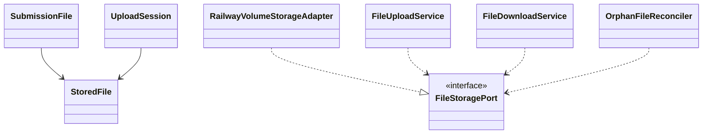

# EduCore — Class Design: File Management

**Trạng thái:** Proposed for review · **Version:** 1.0 · **Ngày:** 12/10/2026 · **Phạm vi:** P0 + P1 (đã thể hiện theo lớp).

**Nguồn:** `requirements_analysis(7).md`, `specification(1).md`, `architectural_design(1).md`, `database_design.md` (Database Design v1.0 vẫn *proposed*). Truy vết: **FR-34, NFR-14 (hỗ trợ)**, **UC-28 (hỗ trợ UC-27)**, **Q-11, ADR-005**.

> **Quy tắc đọc:** thông số BR/Q, hành vi UC và quyết định ADR là baseline từ nguồn; **tên class, chữ ký TypeScript, cách tách service/port, trạng thái kỹ thuật mới** trong file này là đề xuất Detailed Design, chưa phải source code hay Prisma schema đã kiểm chứng. Danh sách thuộc tính là lớp nghiệp vụ (không nhất thiết khớp 1:1 toàn bộ cột DB). Không tự coi tính năng P1 thành P0.

## 1. Ranh giới module và phạm vi

Đọc/ghi file bài nộp riêng tư qua Backend và Railway Volume; DB lưu metadata; không có distributed transaction DB–filesystem, nên cần staging/reconciliation.

**Phụ thuộc ngoài module (qua public port/application contract):**
- Identity & Access (tenant + submission owner).
- Assignments & Grading (SubmissionVersion và quyền).
- Automation & Job (cleanup/reconciliation).
- Audit & Traceability (file access/security).

**Hợp đồng công khai được đề xuất:**
- `FileStoragePort.putPrivate(path,stream): StorageReceipt`.
- `SubmissionFilePort.finalizeSubmissionFiles(ctx,versionId,fileIds): void`.
- `AuthorizedDownloadPort.open(ctx,fileId): FileStream`.

## 2. Class Diagram (logic UML)



> ERD/bảng DB là nơi định nghĩa FK/constraint; UML ở đây mô tả quan hệ domain và dependency application. Class Diagram có thể lược bớt lớp hỗ trợ để dễ đọc; toàn bộ class chính được đặc tả tại §3.

## 3. Class Specifications

| Class | Vai trò | Phạm vi | Bảng/nguồn dữ liệu |
|---|---|---|---|
| `StoredFile` | Domain entity | P0 | `stored_files` |
| `SubmissionFile` | Domain association | P0 | `submission_files` |
| `UploadSession` | Transient application value | P0 | `stored_files STAGING + filesystem staging` |
| `FileStoragePort` | Infrastructure interface | P0 | `Railway private persistent Volume` |
| `RailwayVolumeStorageAdapter` | Infrastructure adapter | P0 | `private persistent Volume` |
| `FileUploadService` | Application service | P0 | `stored_files, submission_files + volume` |
| `FileDownloadService` | Application service | P0 | `stored_files + volume` |
| `OrphanFileReconciler` | Background service | P0 | `stored_files STAGING/ORPHANED` |

### 3.1. `StoredFile`

**Loại:** Domain entity · **Ưu tiên:** P0 · **Nguồn dữ liệu:** `stored_files`.

**Attributes / dependencies**

| Thuộc tính (đề xuất TypeScript) | Ý nghĩa |
|---|---|
| `id: UUID` | ID metadata |
| `tenantId: UUID` | trung tâm |
| `uploadedByMembershipId: UUID` | chủ thao tác |
| `privateStorageKey: string` | path nội bộ ngẫu nhiên |
| `originalFilename: string` | tên gốc đã sanitize |
| `mimeType: string` | loại thật được cho phép |
| `sizeBytes: bigint` | ≤10 MB |
| `sha256: string` | checksum |
| `storageStatus: FileStatus` | STAGING/READY/ORPHANED |

**Operations**

| Method/contract (đề xuất) | Trách nhiệm / kiểm soát |
|---|---|
| `validateUploadConstraints(): void` | extension/MIME/size |
| `markReady(): void` | file an toàn có mặt |
| `markOrphaned(): void` | không có owner hợp lệ |

### 3.2. `SubmissionFile`

**Loại:** Domain association · **Ưu tiên:** P0 · **Nguồn dữ liệu:** `submission_files`.

**Attributes / dependencies**

| Thuộc tính (đề xuất TypeScript) | Ý nghĩa |
|---|---|
| `submissionVersionId: UUID` | lần nộp |
| `fileId: UUID` | metadata |
| `sortOrder: number` | thứ tự tệp |

**Operations**

| Method/contract (đề xuất) | Trách nhiệm / kiểm soát |
|---|---|
| `assertSameTenant(): void` | composite FK |
| `assertLimit(max=5): void` | kiểm tra số tệp theo version |

### 3.3. `UploadSession`

**Loại:** Transient application value · **Ưu tiên:** P0 · **Nguồn dữ liệu:** `stored_files STAGING + filesystem staging`.

**Attributes / dependencies**

| Thuộc tính (đề xuất TypeScript) | Ý nghĩa |
|---|---|
| `fileId: UUID` | nguồn metadata |
| `tenantId: UUID` | trung tâm |
| `tempStorageKey: string` | staging |
| `expectedSize: bigint` | giới hạn |
| `requestedByMembershipId: UUID` | actor |

**Operations**

| Method/contract (đề xuất) | Trách nhiệm / kiểm soát |
|---|---|
| `receiveAndHash(stream): StorageReceipt` | verify bytes/MIME |
| `abort(): void` | cleanup staging |

### 3.4. `FileStoragePort`

**Loại:** Infrastructure interface · **Ưu tiên:** P0 · **Nguồn dữ liệu:** `Railway private persistent Volume`.

**Attributes / dependencies**

| Thuộc tính (đề xuất TypeScript) | Ý nghĩa |
|---|---|
| `root: string` | cấu hình UPLOAD_DIR, không public |

**Operations**

| Method/contract (đề xuất) | Trách nhiệm / kiểm soát |
|---|---|
| `writeStaging(stream): StorageReceipt` | không dùng path do client quyết định |
| `promote(tempKey,privateKey): void` | chuyển private |
| `open(privateKey): FileStream` | chỉ gọi qua authorized service |
| `deleteOrphan(privateKey): void` | cleanup có kiểm soát |

### 3.5. `RailwayVolumeStorageAdapter`

**Loại:** Infrastructure adapter · **Ưu tiên:** P0 · **Nguồn dữ liệu:** `private persistent Volume`.

**Attributes / dependencies**

| Thuộc tính (đề xuất TypeScript) | Ý nghĩa |
|---|---|
| `uploadRoot: string` | ví dụ /data/uploads |
| `fileStorage: FileStoragePort` | implement |

**Operations**

| Method/contract (đề xuất) | Trách nhiệm / kiểm soát |
|---|---|
| `writeStaging(stream): StorageReceipt` | sanitize và giới hạn |
| `readPrivate(key): FileStream` | không expose filesystem path |
| `delete(key): void` | chỉ cleanup object orphan |

### 3.6. `FileUploadService`

**Loại:** Application service · **Ưu tiên:** P0 · **Nguồn dữ liệu:** `stored_files, submission_files + volume`.

**Attributes / dependencies**

| Thuộc tính (đề xuất TypeScript) | Ý nghĩa |
|---|---|
| `fileRepo: StoredFileRepository` | trạng thái |
| `storage: FileStoragePort` | byte operations |
| `authorization: AuthorizationPort` | tenant/submission |

**Operations**

| Method/contract (đề xuất) | Trách nhiệm / kiểm soát |
|---|---|
| `initUpload(command): UploadSession` | kiểm tra quyền |
| `stageFile(file,stream): StoredFile` | MIME/size/checksum |
| `finalizeFiles(versionId,fileIds): void` | READY + link atomic DB metadata |
| `cleanupFailedUpload(fileId): void` | orphan reconciliation |

### 3.7. `FileDownloadService`

**Loại:** Application service · **Ưu tiên:** P0 · **Nguồn dữ liệu:** `stored_files + volume`.

**Attributes / dependencies**

| Thuộc tính (đề xuất TypeScript) | Ý nghĩa |
|---|---|
| `storedFileRepo: StoredFileRepository` | metadata |
| `submissionQuery: SubmissionOwnerQueryPort` | quyền theo submission |
| `storage: FileStoragePort` | stream |

**Operations**

| Method/contract (đề xuất) | Trách nhiệm / kiểm soát |
|---|---|
| `streamSubmissionFile(principal,fileId): FileStream` | recheck tenant+submission |
| `getSafeMetadata(principal,fileId): SafeFileMetadata` | không trả private key |

### 3.8. `OrphanFileReconciler`

**Loại:** Background service · **Ưu tiên:** P0 · **Nguồn dữ liệu:** `stored_files STAGING/ORPHANED`.

**Attributes / dependencies**

| Thuộc tính (đề xuất TypeScript) | Ý nghĩa |
|---|---|
| `repo: StoredFileRepository` | liệt kê orphan |
| `storage: FileStoragePort` | filesystem |

**Operations**

| Method/contract (đề xuất) | Trách nhiệm / kiểm soát |
|---|---|
| `scanAndReconcile(): void` | xử lý DB/file không khớp |
| `deleteExpiredStaging(): void` | chỉ delete staging chưa liên kết |

## 4. Luồng phối hợp ứng dụng / transaction boundary

Client upload qua NestJS → kiểm quyền Student/recipient → ghi tệp staging với key server sinh, kiểm actual MIME + ≤10MB + SHA256 → promote/private, cập nhật metadata READY và link submission_version trong DB transaction khi finalize → nếu lỗi giữa DB/Volume tạo ORPHANED và job cleanup. Download phải xác minh quyền theo submission trước khi mở stream.

**Nguyên tắc xuyên module:** Không repository trực tiếp vào bảng của module khác. Nếu phải ghi nhiều module trong cùng một nghiệp vụ, application coordinator sở hữu transaction PostgreSQL; domain service chỉ trả kết quả/điều kiện; sự kiện side effect ghi vào outbox cùng transaction khi cần.

## 5. Invariants / Business Rules phải bảo vệ

1. P0 chỉ Railway private Volume mount vào **cùng** NestJS service Railway; không dùng Vercel filesystem và không trả public storage URL.
2. Cho phép PDF/DOCX/JPG/PNG; ≤10MB/file và tối đa 5 file/lần nộp (kiểm tra trong transaction).
3. Private key phải tránh path traversal, không lấy raw pathname từ client.
4. Metadata DB và byte volume backup/restore riêng, phải kiểm tra tương thích; không hứa atomic transaction hai hệ.

## 6. Kiểm thử bắt buộc cho module

- [ ] Student A không download file Student B khi cùng tenant nhưng khác scope.
- [ ] Cố tải tệp bằng path traversal hoặc MIME giả → chặn.
- [ ] Mất kết nối sau stage nhưng trước DB commit → cleanup orphan/staging.
- [ ] Backup DB cũ + volume mới không hợp lệ phải được phát hiện bằng reconciliation.

## 7. Phạm vi P1 và điểm nối mở rộng

- Nếu đổi storage sau P0: implement adapter mới sau ADR, vẫn giữ Port.
- P1 cần chính sách scan/quarantine bổ sung nếu triển khai dịch vụ tương ứng (không mặc định tích hợp bên ngoài).

## 8. Open decisions (không tự xem là baseline)

- Chốt MIME sniffing/antivirus thực tế, dung lượng volume và retention/xóa file khi học sinh yêu cầu.

## 9. Hợp đồng triển khai và cách phân lớp

```text
apps/api/src/modules/file-management/
  domain/          # entities, value objects, policies + pure domain services
  application/     # use cases, application services, port interfaces
  infrastructure/  # Prisma repositories, adapter khi thực sự cần
  presentation/    # NestJS controllers, DTO/validation, guards
```

Không bắt buộc tạo đủ thư mục/abstraction nếu module ít CRUD. **Controller không giữ business rule; guard/check quyền không chỉ nằm ở Controller**, phải đánh giá lại trong service khi xử lý job/duyệt. Các enum nghiệp vụ áp dụng TypeScript và PostgreSQL CHECK/constraint, kiểu VND dùng `bigint` hoặc `Decimal` đúng ngữ cảnh; REST JSON serialize `bigint` thành string.
