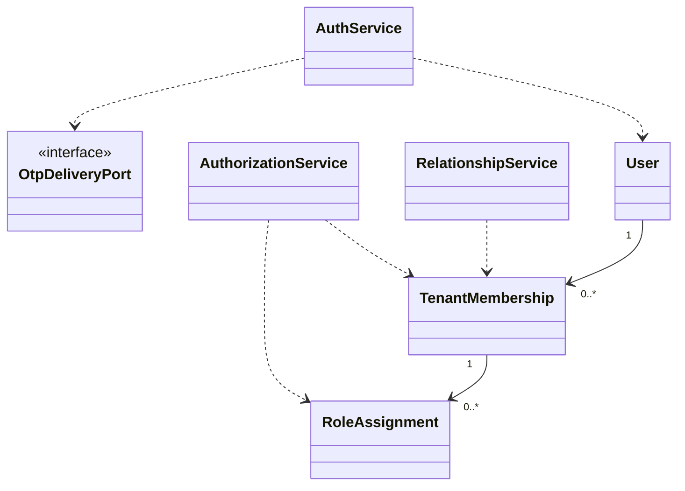

# EduCore — Class Design: Identity & Access

**Trạng thái:** Proposed for review · **Version:** 1.0 · **Ngày:** 12/10/2026 · **Phạm vi:** P0 + P1 (đã thể hiện theo lớp).

**Nguồn:** `requirements_analysis(7).md`, `specification(1).md`, `architectural_design(1).md`, `database_design.md` (Database Design v1.0 vẫn *proposed*). Truy vết: **FR-01–FR-06**, **UC-01–UC-06**, **BR-06, BR-08, BR-10, BR-14**.

> **Quy tắc đọc:** thông số BR/Q, hành vi UC và quyết định ADR là baseline từ nguồn; **tên class, chữ ký TypeScript, cách tách service/port, trạng thái kỹ thuật mới** trong file này là đề xuất Detailed Design, chưa phải source code hay Prisma schema đã kiểm chứng. Danh sách thuộc tính là lớp nghiệp vụ (không nhất thiết khớp 1:1 toàn bộ cột DB). Không tự coi tính năng P1 thành P0.

## 1. Ranh giới module và phạm vi

Xác thực, phiên, OTP, RBAC đa vai trò theo tenant + scope; liên kết Parent–Student và chứng cứ anh/chị/em. Không coi role là job position.

**Phụ thuộc ngoài module (qua public port/application contract):**
- Tenant & Policy (membership/policy baseline).
- Academic Management (StudentProfile/TeacherProfile).
- Audit & Traceability (ghi log hành động nhạy cảm).

**Hợp đồng công khai được đề xuất:**
- `AuthorizationPort.assertPermission(context, code, targetScope): void` — kiểm tra quyền **hiện hành**.
- `PrincipalResolverPort.resolve(accessToken, tenantId): Principal` — tenant hiện hành.
- `RelationshipQueryPort.assertParentCanViewStudent(parentMembershipId, studentId): void`.

## 2. Class Diagram (logic UML)



> ERD/bảng DB là nơi định nghĩa FK/constraint; UML ở đây mô tả quan hệ domain và dependency application. Class Diagram có thể lược bớt lớp hỗ trợ để dễ đọc; toàn bộ class chính được đặc tả tại §3.

## 3. Class Specifications

| Class | Vai trò | Phạm vi | Bảng/nguồn dữ liệu |
|---|---|---|---|
| `User` | Domain entity | P0 | `users` |
| `Credential` | Domain entity | P0 | `credentials` |
| `AuthSession` | Domain entity | P0 | `auth_sessions` |
| `PasswordResetOtp` | Domain entity | P0 | `password_reset_otps` |
| `TenantMembership` | Domain entity | P0 | `tenant_memberships` |
| `RoleAssignment` | Domain entity | P0 | `membership_roles, roles, role_permissions, access_scopes` |
| `AuthorizationService` | Application service | P0; P1 quản trị quyền động | `tenant_memberships, membership_roles, role_permissions, access_scopes` |
| `AuthService` | Application service | P0 | `users, credentials, auth_sessions, password_reset_otps` |
| `RelationshipService` | Application service | P0 | `parent_student_links, verified_sibling_relationships` |
| `PlatformGrantService` | Application service | P0 giới hạn; P1 hỗ trợ vận hành | `platform_staff_grants` |

### 3.1. `User`

**Loại:** Domain entity · **Ưu tiên:** P0 · **Nguồn dữ liệu:** `users`.

**Attributes / dependencies**

| Thuộc tính (đề xuất TypeScript) | Ý nghĩa |
|---|---|
| `id: UUID` | định danh toàn cục |
| `emailNormalized: string` | email duy nhất chuẩn hóa |
| `displayName: string` | tên hiển thị |
| `status: UserStatus` | hoạt động/khóa |

**Operations**

| Method/contract (đề xuất) | Trách nhiệm / kiểm soát |
|---|---|
| `activate(): void` | kích hoạt khi đủ điều kiện |
| `deactivate(reason): void` | thu hồi khả năng đăng nhập |

**Lưu ý:** Không gắn tenantId trực tiếp vào User.

### 3.2. `Credential`

**Loại:** Domain entity · **Ưu tiên:** P0 · **Nguồn dữ liệu:** `credentials`.

**Attributes / dependencies**

| Thuộc tính (đề xuất TypeScript) | Ý nghĩa |
|---|---|
| `userId: UUID` | khóa tới User |
| `passwordHash: string` | Argon2id, không lưu mật khẩu thô |
| `failedAttempts: number` | đếm thất bại |
| `lockedUntil?: Date` | khóa tạm thời |

**Operations**

| Method/contract (đề xuất) | Trách nhiệm / kiểm soát |
|---|---|
| `verifyPassword(plain): boolean` | kiểm tra an toàn |
| `replacePassword(newHash): void` | đổi hash và đặt lại khóa đếm lỗi |

### 3.3. `AuthSession`

**Loại:** Domain entity · **Ưu tiên:** P0 · **Nguồn dữ liệu:** `auth_sessions`.

**Attributes / dependencies**

| Thuộc tính (đề xuất TypeScript) | Ý nghĩa |
|---|---|
| `id: UUID` | phiên |
| `userId: UUID` | người sở hữu |
| `activeTenantId?: UUID` | tenant đang chọn |
| `refreshTokenHash: string` | hash token |
| `expiresAt: Date` | hạn tối đa 7 ngày |
| `revokedAt?: Date` | thời điểm thu hồi |

**Operations**

| Method/contract (đề xuất) | Trách nhiệm / kiểm soát |
|---|---|
| `revoke(reason): void` | vô hiệu refresh token |
| `assertUsable(now): void` | kiểm tra hạn/thu hồi |

### 3.4. `PasswordResetOtp`

**Loại:** Domain entity · **Ưu tiên:** P0 · **Nguồn dữ liệu:** `password_reset_otps`.

**Attributes / dependencies**

| Thuộc tính (đề xuất TypeScript) | Ý nghĩa |
|---|---|
| `userId: UUID` | người yêu cầu |
| `otpHash: string` | chỉ hash OTP |
| `expiresAt: Date` | sau 15 phút |
| `attemptCount: number` | số lần xác minh |
| `consumedAt?: Date` | đã sử dụng |

**Operations**

| Method/contract (đề xuất) | Trách nhiệm / kiểm soát |
|---|---|
| `verify(candidate, now): boolean` | kiểm tra một lần và giới hạn số thử |
| `consume(): void` | vô hiệu OTP |

### 3.5. `TenantMembership`

**Loại:** Domain entity · **Ưu tiên:** P0 · **Nguồn dữ liệu:** `tenant_memberships`.

**Attributes / dependencies**

| Thuộc tính (đề xuất TypeScript) | Ý nghĩa |
|---|---|
| `id: UUID` | định danh thành viên |
| `tenantId: UUID` | phạm vi |
| `userId: UUID` | liên hệ User toàn cục |
| `status: MembershipStatus` | trạng thái trong tenant |

**Operations**

| Method/contract (đề xuất) | Trách nhiệm / kiểm soát |
|---|---|
| `assertActive(): void` | không truy cập tenant nếu ngưng hoạt động |
| `deactivate(): void` | kiểm tra Manager cuối cùng trước khi rời |

### 3.6. `RoleAssignment`

**Loại:** Domain entity · **Ưu tiên:** P0 · **Nguồn dữ liệu:** `membership_roles, roles, role_permissions, access_scopes`.

**Attributes / dependencies**

| Thuộc tính (đề xuất TypeScript) | Ý nghĩa |
|---|---|
| `membershipId: UUID` | thành viên có role |
| `roleId: UUID` | role trong tenant |
| `scope: AccessScope` | TENANT/CLASS/STUDENT |
| `assignedAt: Date` | ngày cấp |
| `revokedAt?: Date` | ngày thu hồi |

**Operations**

| Method/contract (đề xuất) | Trách nhiệm / kiểm soát |
|---|---|
| `isEffective(now): boolean` | grant đang hiệu lực |
| `covers(targetScope): boolean` | kiểm tra phạm vi dữ liệu |

### 3.7. `AuthorizationService`

**Loại:** Application service · **Ưu tiên:** P0; P1 quản trị quyền động · **Nguồn dữ liệu:** `tenant_memberships, membership_roles, role_permissions, access_scopes`.

**Attributes / dependencies**

| Thuộc tính (đề xuất TypeScript) | Ý nghĩa |
|---|---|
| `membershipRepository: MembershipRepository` | đọc thành viên |
| `permissionRepository: PermissionRepository` | đọc catalog và grants |

**Operations**

| Method/contract (đề xuất) | Trách nhiệm / kiểm soát |
|---|---|
| `authorize(ctx, permission, target): void` | kiểm tra role **và** scope thực tế |
| `assignRole(command): RoleAssignment` | kiểm tra quyền cấp role |
| `revokeRole(command): void` | chặn mất Manager hợp lệ cuối cùng |
| `updateRolePermissions(command): void` | P1 quyền cấu hình động |

### 3.8. `AuthService`

**Loại:** Application service · **Ưu tiên:** P0 · **Nguồn dữ liệu:** `users, credentials, auth_sessions, password_reset_otps`.

**Attributes / dependencies**

| Thuộc tính (đề xuất TypeScript) | Ý nghĩa |
|---|---|
| `userRepository: UserRepository` | user toàn cục |
| `credentialRepository: CredentialRepository` | credential |
| `otpDelivery: OtpDeliveryPort` | gửi email OTP ngoài duy nhất P0 |

**Operations**

| Method/contract (đề xuất) | Trách nhiệm / kiểm soát |
|---|---|
| `login(email, password, tenantId?): AuthTokens` | access 15 phút, refresh ≤7 ngày |
| `logout(sessionId): void` | revoke đúng phiên |
| `requestPasswordReset(email): void` | đáp ứng không lộ account tồn tại |
| `resetPassword(email, otp, newPassword): void` | OTP một lần, revoke tất cả phiên |

### 3.9. `RelationshipService`

**Loại:** Application service · **Ưu tiên:** P0 · **Nguồn dữ liệu:** `parent_student_links, verified_sibling_relationships`.

**Attributes / dependencies**

| Thuộc tính (đề xuất TypeScript) | Ý nghĩa |
|---|---|
| `parentStudentRepository: ParentStudentLinkRepository` | liên kết hợp lệ |
| `siblingRepository: SiblingEvidenceRepository` | xác minh riêng |

**Operations**

| Method/contract (đề xuất) | Trách nhiệm / kiểm soát |
|---|---|
| `verifyParentStudentLink(command): void` | cần quyền và cùng tenant |
| `revokeParentStudentLink(linkId): void` | mất quyền xem ngay |
| `verifySiblingRelation(command): void` | không suy từ parent link |
| `assertParentScope(parentId, studentId): void` | chặn phụ huynh không liên kết |

### 3.10. `PlatformGrantService`

**Loại:** Application service · **Ưu tiên:** P0 giới hạn; P1 hỗ trợ vận hành · **Nguồn dữ liệu:** `platform_staff_grants`.

**Attributes / dependencies**

| Thuộc tính (đề xuất TypeScript) | Ý nghĩa |
|---|---|
| `grantRepository: PlatformGrantRepository` | quyền vận hành nền tảng |

**Operations**

| Method/contract (đề xuất) | Trách nhiệm / kiểm soát |
|---|---|
| `checkPlatformPermission(userId, action): void` | không tự cho đọc dữ liệu tenant |
| `grantSupportAccess(command): void` | P1 nếu có ủy quyền cụ thể + audit |

## 4. Luồng phối hợp ứng dụng / transaction boundary

`AuthController → AuthService → User/Credential/AuthSession`; `AuthorizationGuard → AuthorizationService` tại **mỗi** API và trước khi chạy lại job. OTP chỉ gửi qua `OtpDeliveryPort`, Backend sinh/xác minh.

**Nguyên tắc xuyên module:** Không repository trực tiếp vào bảng của module khác. Nếu phải ghi nhiều module trong cùng một nghiệp vụ, application coordinator sở hữu transaction PostgreSQL; domain service chỉ trả kết quả/điều kiện; sự kiện side effect ghi vào outbox cùng transaction khi cần.

## 5. Invariants / Business Rules phải bảo vệ

1. Một user có thể thuộc nhiều tenant; membership/role/scope là thành phần riêng.
2. Quyền được đánh giá theo permission + tenant + scope, không dựa nút UI, tên job position hay JWT cũ.
3. Manager active cuối cùng không được thu hồi; Parent link không thay thế xác minh anh/chị/em.
4. Mật khẩu ≥12 ký tự, Argon2id; OTP 15 phút một lần; không lộ OTP/token vào audit.

## 6. Kiểm thử bắt buộc cho module

- [ ] Truy cập class tenant B bằng membership tenant A → bị chặn.
- [ ] Thay role sau khi phát token → quyền hiện hành có hiệu lực ngay khi check.
- [ ] Reset password → revoke tất cả refresh session; OTP dùng lại/expired từ chối.
- [ ] Không thể thu hồi Manager hợp lệ cuối cùng trong tenant ACTIVE.

## 7. Phạm vi P1 và điểm nối mở rộng

- UI cấp/sửa permission động có guard cho quyền nhạy cảm.
- Quyền hỗ trợ vận hành tenant được cấp riêng, không thừa kế quyền Platform Admin.

## 8. Open decisions (không tự xem là baseline)

- Danh sách permission code và permission seed cho từng role cần khóa ở Authorization Detailed Design.

## 9. Hợp đồng triển khai và cách phân lớp

```text
apps/api/src/modules/identity-access/
  domain/          # entities, value objects, policies + pure domain services
  application/     # use cases, application services, port interfaces
  infrastructure/  # Prisma repositories, adapter khi thực sự cần
  presentation/    # NestJS controllers, DTO/validation, guards
```

Không bắt buộc tạo đủ thư mục/abstraction nếu module ít CRUD. **Controller không giữ business rule; guard/check quyền không chỉ nằm ở Controller**, phải đánh giá lại trong service khi xử lý job/duyệt. Các enum nghiệp vụ áp dụng TypeScript và PostgreSQL CHECK/constraint, kiểu VND dùng `bigint` hoặc `Decimal` đúng ngữ cảnh; REST JSON serialize `bigint` thành string.
