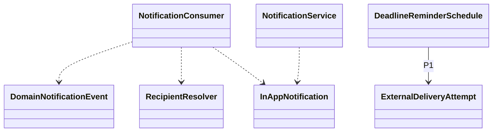

# EduCore — Class Design: Notification

**Trạng thái:** Proposed for review · **Version:** 1.0 · **Ngày:** 12/10/2026 · **Phạm vi:** P0 + P1 (đã thể hiện theo lớp).

**Nguồn:** `requirements_analysis(7).md`, `specification(1).md`, `architectural_design(1).md`, `database_design.md` (Database Design v1.0 vẫn *proposed*). Truy vết: **FR-37–FR-39**, **UC-31**, **BR-12, BR-14, Q-13**.

> **Quy tắc đọc:** thông số BR/Q, hành vi UC và quyết định ADR là baseline từ nguồn; **tên class, chữ ký TypeScript, cách tách service/port, trạng thái kỹ thuật mới** trong file này là đề xuất Detailed Design, chưa phải source code hay Prisma schema đã kiểm chứng. Danh sách thuộc tính là lớp nghiệp vụ (không nhất thiết khớp 1:1 toàn bộ cột DB). Không tự coi tính năng P1 thành P0.

## 1. Ranh giới module và phạm vi

Thông báo trong ứng dụng cho các sự kiện nghiệp vụ đã commit; P1 hỗ trợ deadline reminder và email delivery, không gây rollback nghiệp vụ gốc.

**Phụ thuộc ngoài module (qua public port/application contract):**
- Automation & Job (outbox + job retry).
- Resource & Scheduling (ScheduleChanged event).
- Assignments & Grading (AssignmentPublished event).
- Identity & Access (recipient scope + active membership).

**Hợp đồng công khai được đề xuất:**
- `NotificationPort.enqueueBusinessEvent(event): void` — qua outbox transaction gốc.
- `NotificationQueryPort.listForRecipient(membershipId): Notification[]`.
- `NotificationCommandPort.markRead(notificationId, principal): void`.

## 2. Class Diagram (logic UML)



> ERD/bảng DB là nơi định nghĩa FK/constraint; UML ở đây mô tả quan hệ domain và dependency application. Class Diagram có thể lược bớt lớp hỗ trợ để dễ đọc; toàn bộ class chính được đặc tả tại §3.

## 3. Class Specifications

| Class | Vai trò | Phạm vi | Bảng/nguồn dữ liệu |
|---|---|---|---|
| `DomainNotificationEvent` | Immutable event DTO | P0 | `outbox_events (owned by Automation & Job)` |
| `RecipientResolver` | Domain/application service | P0 | `memberships, links, participants, recipients (read)` |
| `InAppNotification` | Domain entity | P0 | `notifications` |
| `NotificationConsumer` | Application service / worker | P0 | `notifications, outbox_events` |
| `NotificationService` | Application service | P0 | `notifications` |
| `DeadlineReminderSchedule` | Domain entity | P1 | `reminder_schedules` |
| `ExternalDeliveryAttempt` | Append-only record | P1 | `external_delivery_attempts` |

### 3.1. `DomainNotificationEvent`

**Loại:** Immutable event DTO · **Ưu tiên:** P0 · **Nguồn dữ liệu:** `outbox_events (owned by Automation & Job)`.

**Attributes / dependencies**

| Thuộc tính (đề xuất TypeScript) | Ý nghĩa |
|---|---|
| `eventId: UUID` | nguồn outbox |
| `tenantId: UUID` | tenant đã commit |
| `type: string` | SCHEDULE_CHANGED/ASSIGNMENT_PUBLISHED/ADMIN_ALERT |
| `aggregateId: UUID` | nguồn |
| `occurredAt: Date` | mốc sự kiện |

**Operations**

| Method/contract (đề xuất) | Trách nhiệm / kiểm soát |
|---|---|
| `toNotificationKind(): string` | map event→notification |
| `assertCommitted(): void` | chỉ consume outbox đã lưu |

### 3.2. `RecipientResolver`

**Loại:** Domain/application service · **Ưu tiên:** P0 · **Nguồn dữ liệu:** `memberships, links, participants, recipients (read)`.

**Attributes / dependencies**

| Thuộc tính (đề xuất TypeScript) | Ý nghĩa |
|---|---|
| `authorization: AuthorizationPort` | tenant/scope |
| `scopeReaders: RecipientScopePorts` | Teacher/Student/Parent |

**Operations**

| Method/contract (đề xuất) | Trách nhiệm / kiểm soát |
|---|---|
| `resolveForEvent(event): MembershipId[]` | chỉ recipient hợp lệ |
| `filterCurrentAccess(memberships): MembershipId[]` | quyền có thể đã đổi |

### 3.3. `InAppNotification`

**Loại:** Domain entity · **Ưu tiên:** P0 · **Nguồn dữ liệu:** `notifications`.

**Attributes / dependencies**

| Thuộc tính (đề xuất TypeScript) | Ý nghĩa |
|---|---|
| `id: UUID` | thông báo |
| `tenantId: UUID` | trung tâm |
| `recipientMembershipId: UUID` | chủ |
| `outboxEventId: UUID` | sự kiện |
| `kind: string` | loại |
| `title: string` | tiêu đề |
| `body: string` | nội dung |
| `readAt?: Date` | null là chưa đọc |

**Operations**

| Method/contract (đề xuất) | Trách nhiệm / kiểm soát |
|---|---|
| `markRead(now): void` | idempotent |
| `isUnread(): boolean` | readAt null |

### 3.4. `NotificationConsumer`

**Loại:** Application service / worker · **Ưu tiên:** P0 · **Nguồn dữ liệu:** `notifications, outbox_events`.

**Attributes / dependencies**

| Thuộc tính (đề xuất TypeScript) | Ý nghĩa |
|---|---|
| `recipientResolver: RecipientResolver` | scoped recipients |
| `notificationRepo: NotificationRepository` | unique event-recipient-kind |

**Operations**

| Method/contract (đề xuất) | Trách nhiệm / kiểm soát |
|---|---|
| `process(event): DeliveryResult` | insert OR IGNORE unique |
| `retryFailedEvent(eventId): void` | không sinh trùng |
| `createManagerAlert(job): void` | tác vụ FAILED/thiếu approver |

### 3.5. `NotificationService`

**Loại:** Application service · **Ưu tiên:** P0 · **Nguồn dữ liệu:** `notifications`.

**Attributes / dependencies**

| Thuộc tính (đề xuất TypeScript) | Ý nghĩa |
|---|---|
| `repo: NotificationRepository` | inbox scoped |
| `authorization: AuthorizationPort` | recheck |

**Operations**

| Method/contract (đề xuất) | Trách nhiệm / kiểm soát |
|---|---|
| `listInbox(principal, paging): Notification[]` | tenant/recipient |
| `markAsRead(principal, notificationId): void` | chỉ chủ hợp lệ |
| `countUnread(principal): number` | lọc scope |

### 3.6. `DeadlineReminderSchedule`

**Loại:** Domain entity · **Ưu tiên:** P1 · **Nguồn dữ liệu:** `reminder_schedules`.

**Attributes / dependencies**

| Thuộc tính (đề xuất TypeScript) | Ý nghĩa |
|---|---|
| `recipientId: UUID` | assignment recipient |
| `reminderOffsetMinutes: number` | 24h hoặc 1h |
| `dueAt: Date` | lịch gửi |
| `operationKey: string` | dedup |

**Operations**

| Method/contract (đề xuất) | Trách nhiệm / kiểm soát |
|---|---|
| `schedule(): void` | trước deadline chính xác |
| `cancelOnDeadlineChange(): void` | cập nhật phiên bản |

### 3.7. `ExternalDeliveryAttempt`

**Loại:** Append-only record · **Ưu tiên:** P1 · **Nguồn dữ liệu:** `external_delivery_attempts`.

**Attributes / dependencies**

| Thuộc tính (đề xuất TypeScript) | Ý nghĩa |
|---|---|
| `notificationId: UUID` | nguồn |
| `channel: ExternalChannel` | EMAIL nếu bật |
| `attemptNo: number` | retry |
| `status: DeliveryStatus` | pending/sent/failed |
| `providerReference?: string` | metadata provider |

**Operations**

| Method/contract (đề xuất) | Trách nhiệm / kiểm soát |
|---|---|
| `recordResult(result): void` | không sửa lịch sử thử |
| `canRetry(policy): boolean` | theo giới hạn |

## 4. Luồng phối hợp ứng dụng / transaction boundary

Lịch thay đổi hợp lệ / assignment được publish → module gốc ghi outbox trong transaction → worker load event sau commit → resolve recipient hợp lệ → insert notification theo unique `(tenant,event,recipient,kind)` → người nhận đọc inbox/mark read với kiểm tra quyền hiện hành. Event lỗi sẽ retry, không rollback thao tác gốc.

**Nguyên tắc xuyên module:** Không repository trực tiếp vào bảng của module khác. Nếu phải ghi nhiều module trong cùng một nghiệp vụ, application coordinator sở hữu transaction PostgreSQL; domain service chỉ trả kết quả/điều kiện; sự kiện side effect ghi vào outbox cùng transaction khi cần.

## 5. Invariants / Business Rules phải bảo vệ

1. P0 chỉ in-app cho lịch **đã xác nhận thay đổi** và bài tập **đã giao**; cảnh báo job lỗi/thiếu approver cho Manager.
2. Chống lặp `(tenant_id,outbox_event_id,recipient_membership_id,kind)`; không suy recipient từ front-end.
3. Đọc/mark-read phải check tenant và quyền ở thời điểm thực thi.
4. P1 deadline 24h/1h, external email nếu triển khai; chưa dùng email nghiệp vụ trong P0, ngoại trừ OTP của Identity (không do module này).

## 6. Kiểm thử bắt buộc cho module

- [ ] Outbox replay 3 lần → mỗi recipient/kind chỉ có một notification.
- [ ] Teacher chuyển lớp/Parent revoked link → không thể đọc thông báo chứa dữ liệu ngoài scope.
- [ ] Notification worker down → thay đổi schedule/assignment vẫn thành công.

## 7. Phạm vi P1 và điểm nối mở rộng

- Reminder schedule trên bài tập 24h/1h; hỗ trợ thay đổi deadline.
- Email delivery adapter/retry có bảng attempts, không gọi SMTP từ transaction gốc.

## 8. Open decisions (không tự xem là baseline)

- Chốt chiến lược nội dung notification khi quyền bị thu hồi và retention; recipient event schema phiên bản ở API Design.

## 9. Hợp đồng triển khai và cách phân lớp

```text
apps/api/src/modules/notification/
  domain/          # entities, value objects, policies + pure domain services
  application/     # use cases, application services, port interfaces
  infrastructure/  # Prisma repositories, adapter khi thực sự cần
  presentation/    # NestJS controllers, DTO/validation, guards
```

Không bắt buộc tạo đủ thư mục/abstraction nếu module ít CRUD. **Controller không giữ business rule; guard/check quyền không chỉ nằm ở Controller**, phải đánh giá lại trong service khi xử lý job/duyệt. Các enum nghiệp vụ áp dụng TypeScript và PostgreSQL CHECK/constraint, kiểu VND dùng `bigint` hoặc `Decimal` đúng ngữ cảnh; REST JSON serialize `bigint` thành string.
