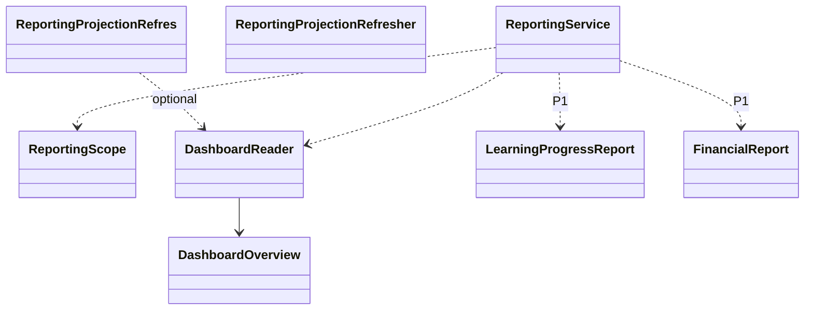

# EduCore — Class Design: Reporting

**Trạng thái:** Proposed for review · **Version:** 1.0 · **Ngày:** 12/10/2026 · **Phạm vi:** P0 + P1 (đã thể hiện theo lớp).

**Nguồn:** `requirements_analysis(7).md`, `specification(1).md`, `architectural_design(1).md`, `database_design.md` (Database Design v1.0 vẫn *proposed*). Truy vết: **FR-40, FR-36 (P1)**, **UC-30, UC-32**, **Q-12, BR-04**.

> **Quy tắc đọc:** thông số BR/Q, hành vi UC và quyết định ADR là baseline từ nguồn; **tên class, chữ ký TypeScript, cách tách service/port, trạng thái kỹ thuật mới** trong file này là đề xuất Detailed Design, chưa phải source code hay Prisma schema đã kiểm chứng. Danh sách thuộc tính là lớp nghiệp vụ (không nhất thiết khớp 1:1 toàn bộ cột DB). Không tự coi tính năng P1 thành P0.

## 1. Ranh giới module và phạm vi

Dashboard P0 với 3 chỉ số chính xác theo tenant/scope; P1 tiến độ học tập, chuyên cần và báo cáo tài chính nâng cao; read-only.

**Phụ thuộc ngoài module (qua public port/application contract):**
- Academic Management (enrollments, classes).
- Billing & Receivables (issued due, ledger).
- Attendance & Leave (P1 attendance).
- Assignments & Grading (P1 grades/progress).
- Identity & Access (scope).

**Hợp đồng công khai được đề xuất:**
- `DashboardQueryPort.getOverview(principal, asOf): DashboardOverview`.
- `ProgressReportPort.getStudentProgress(principal,studentId): LearningProgress` — P1.

## 2. Class Diagram (logic UML)



> ERD/bảng DB là nơi định nghĩa FK/constraint; UML ở đây mô tả quan hệ domain và dependency application. Class Diagram có thể lược bớt lớp hỗ trợ để dễ đọc; toàn bộ class chính được đặc tả tại §3.

## 3. Class Specifications

| Class | Vai trò | Phạm vi | Bảng/nguồn dữ liệu |
|---|---|---|---|
| `DashboardOverview` | Immutable read model | P0 | `SQL aggregate (không bắt buộc bảng riêng)` |
| `ReportingScope` | Immutable value object | P0 | `role/scope read` |
| `DashboardReader` | Query service | P0 | `enrollments, classes, invoices, adjustments, payments/allocations` |
| `LearningProgressReport` | Immutable read model | P1 | `attendance, submissions, published grades (read)` |
| `FinancialReport` | Immutable read model | P1 | `invoice/payments/allocations/credits read` |
| `ReportingService` | Read application service | P0; P1 advanced | `không ghi bảng nghiệp vụ` |
| `ReportingProjectionRefresher` | Background read-model updater | P1 khi benchmark cần | `materialized views / projections (tùy chọn)` |

### 3.1. `DashboardOverview`

**Loại:** Immutable read model · **Ưu tiên:** P0 · **Nguồn dữ liệu:** `SQL aggregate (không bắt buộc bảng riêng)`.

**Attributes / dependencies**

| Thuộc tính (đề xuất TypeScript) | Ý nghĩa |
|---|---|
| `activeStudents: number` | distinct student ACTIVE enrollment |
| `activeClasses: number` | lớp status ACTIVE |
| `outstandingReceivablesVnd: bigint` | issued invoices net valid allocations |
| `asOf: Date` | mốc snapshot |
| `tenantId: UUID` | tenant query |
| `scopeDescription: string` | phạm vi dữ liệu |

**Operations**

| Method/contract (đề xuất) | Trách nhiệm / kiểm soát |
|---|---|
| `assertConsistent(): void` | cùng snapshot/tenant |
| `serialize(): DTO` | VND bigint thành string |

### 3.2. `ReportingScope`

**Loại:** Immutable value object · **Ưu tiên:** P0 · **Nguồn dữ liệu:** `role/scope read`.

**Attributes / dependencies**

| Thuộc tính (đề xuất TypeScript) | Ý nghĩa |
|---|---|
| `tenantId: UUID` | tenant hợp lệ |
| `allowedClassIds?: UUID[]` | phạm vi lớp |
| `allowedStudentIds?: UUID[]` | phạm vi học sinh |

**Operations**

| Method/contract (đề xuất) | Trách nhiệm / kiểm soát |
|---|---|
| `intersect(resourceScope): ReportingScope` | chỉ thu hẹp |
| `assertViewAllowed(): void` | báo cáo permission |

### 3.3. `DashboardReader`

**Loại:** Query service · **Ưu tiên:** P0 · **Nguồn dữ liệu:** `enrollments, classes, invoices, adjustments, payments/allocations`.

**Attributes / dependencies**

| Thuộc tính (đề xuất TypeScript) | Ý nghĩa |
|---|---|
| `db: ReportingReadPort` | aggregate scoped |
| `authorization: AuthorizationPort` | check hiện hành |

**Operations**

| Method/contract (đề xuất) | Trách nhiệm / kiểm soát |
|---|---|
| `getOverview(ctx, asOf): DashboardOverview` | read-only nhất quán |
| `countActiveStudents(scope): number` | DISTINCT |
| `sumOutstanding(scope): bigint` | issued only, ledger valid |

### 3.4. `LearningProgressReport`

**Loại:** Immutable read model · **Ưu tiên:** P1 · **Nguồn dữ liệu:** `attendance, submissions, published grades (read)`.

**Attributes / dependencies**

| Thuộc tính (đề xuất TypeScript) | Ý nghĩa |
|---|---|
| `studentId: UUID` | chủ dữ liệu |
| `attendanceRate?: Decimal` | theo Q-12 |
| `submissionCompletionRate?: Decimal` | theo Q-12 |
| `publishedGradeAverage?: Decimal` | chỉ grade published |
| `asOf: Date` | thời điểm |

**Operations**

| Method/contract (đề xuất) | Trách nhiệm / kiểm soát |
|---|---|
| `calculateFromSources(): void` | công thức theo UC-30/Q-12 |
| `omitDraftGrades(): void` | không lộ chấm nháp |

### 3.5. `FinancialReport`

**Loại:** Immutable read model · **Ưu tiên:** P1 · **Nguồn dữ liệu:** `invoice/payments/allocations/credits read`.

**Attributes / dependencies**

| Thuộc tính (đề xuất TypeScript) | Ý nghĩa |
|---|---|
| `issuedReceivablesVnd: bigint` | nợ issued |
| `collectedVnd: bigint` | đã thu hợp lệ |
| `adjustmentsVnd: bigint` | điều chỉnh đã áp dụng |
| `unallocatedCreditsVnd: bigint` | không tính đã thu/doanh thu |

**Operations**

| Method/contract (đề xuất) | Trách nhiệm / kiểm soát |
|---|---|
| `reconcile(): void` | tách phải thu/đã thu/credit |
| `groupByPeriodOrClass(): void` | P1 drilldown |

### 3.6. `ReportingService`

**Loại:** Read application service · **Ưu tiên:** P0; P1 advanced · **Nguồn dữ liệu:** `không ghi bảng nghiệp vụ`.

**Attributes / dependencies**

| Thuộc tính (đề xuất TypeScript) | Ý nghĩa |
|---|---|
| `dashboardReader: DashboardReader` | P0 |
| `learningReader: LearningReportPort` | P1 |
| `financeReader: FinanceReportPort` | P1 |

**Operations**

| Method/contract (đề xuất) | Trách nhiệm / kiểm soát |
|---|---|
| `getDashboard(principal): DashboardOverview` | P0 |
| `getStudentProgress(principal,studentId): LearningProgressReport` | P1 |
| `getFinancialSummary(principal,filters): FinancialReport` | P1 |

### 3.7. `ReportingProjectionRefresher`

**Loại:** Background read-model updater · **Ưu tiên:** P1 khi benchmark cần · **Nguồn dữ liệu:** `materialized views / projections (tùy chọn)`.

**Attributes / dependencies**

| Thuộc tính (đề xuất TypeScript) | Ý nghĩa |
|---|---|
| `lastRefreshedAt?: Date` | watermark |
| `sourceVersion?: string` | revision policy báo cáo |

**Operations**

| Method/contract (đề xuất) | Trách nhiệm / kiểm soát |
|---|---|
| `refreshIncrementally(): void` | P1 khi đo tải |
| `getFreshness(): Date` | hiển thị độ trễ |

## 4. Luồng phối hợp ứng dụng / transaction boundary

`ReportingService.getDashboard(principal)` → check permission/tenant → lập `ReportingScope` → SQL aggregate cùng snapshot `asOf` → trả 3 metrics và phạm vi. Không ghi business transaction; P1 tạo read models theo cùng scope và loại bỏ draft grade.

**Nguyên tắc xuyên module:** Không repository trực tiếp vào bảng của module khác. Nếu phải ghi nhiều module trong cùng một nghiệp vụ, application coordinator sở hữu transaction PostgreSQL; domain service chỉ trả kết quả/điều kiện; sự kiện side effect ghi vào outbox cùng transaction khi cần.

## 5. Invariants / Business Rules phải bảo vệ

1. active_students = số **DISTINCT student_id** đang có ít nhất một enrollment ACTIVE trong scope.
2. active_classes = số class ACTIVE trong scope.
3. outstanding = sum(invoice ISSUED + APPLIED adjustments − valid payment allocations − credit allocations P1), không tính draft/prepayment chưa phân bổ.
4. Phân biệt outstanding, collected và revenue/tuition; không gộp một con số.
5. Không cần materialized view P0 nếu aggregate SQL đạt hiệu năng; benchmark mới quyết định tối ưu.

## 6. Kiểm thử bắt buộc cho module

- [ ] Một student ACTIVE ở hai lớp chỉ được đếm một lần.
- [ ] Payment đảo làm tăng due; payment chưa phân bổ không tự giảm due.
- [ ] Parent không có report tenant-wide nếu chỉ được xem con.
- [ ] Cùng dữ liệu nhưng scope hai user khác nhau không rò nhau.

## 7. Phạm vi P1 và điểm nối mở rộng

- Báo cáo attendance, bài tập, điểm theo Q-12; điểm chưa publish không tính public view.
- Báo cáo tài chính nâng cao, bộ lọc, projection tùy benchmark.

## 8. Open decisions (không tự xem là baseline)

- Công thức chính xác % học tập phải đối chiếu UC-30, UC-32 và đưa test fixture; policy xử lý học viên chuyển lớp cần ghi rõ.

## 9. Hợp đồng triển khai và cách phân lớp

```text
apps/api/src/modules/reporting/
  domain/          # entities, value objects, policies + pure domain services
  application/     # use cases, application services, port interfaces
  infrastructure/  # Prisma repositories, adapter khi thực sự cần
  presentation/    # NestJS controllers, DTO/validation, guards
```

Không bắt buộc tạo đủ thư mục/abstraction nếu module ít CRUD. **Controller không giữ business rule; guard/check quyền không chỉ nằm ở Controller**, phải đánh giá lại trong service khi xử lý job/duyệt. Các enum nghiệp vụ áp dụng TypeScript và PostgreSQL CHECK/constraint, kiểu VND dùng `bigint` hoặc `Decimal` đúng ngữ cảnh; REST JSON serialize `bigint` thành string.
