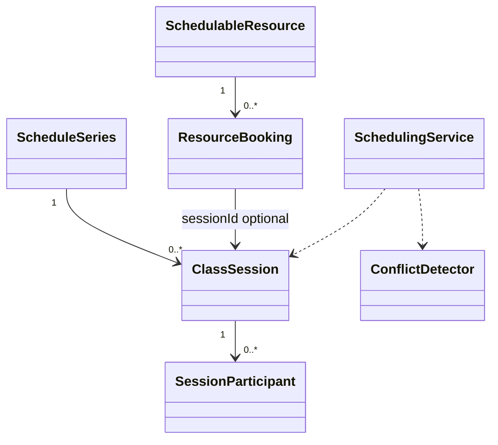

# EduCore — Class Design: Resource & Scheduling

**Wallet amendment19/10/2026:** B1–B5 business approved, minimal architecture principle accepted; [Register §G](../../ai/DECISION_REGISTER.md#g-wallet-p0--owner-business-approval-2026-10-19). Scheduling không sở hữu wallet/payment hoặc tự gọi debit/refund; Q1–Q8 lock/SQL details **PENDING TECHNICAL SIGN-OFF**.

**Trạng thái:** Proposed for review · **Version:** 1.0 · **Ngày:** 12/10/2026 · **Phạm vi:** P0 + P1 (đã thể hiện theo lớp).

**v1.0 + O-12 amendment · 18/10/2026 · Asia/Ho_Chi_Minh:** business A=A, B=B1, C=C1, D=D được chủ dự án phê duyệt trực tiếp; [Decision Register](../../ai/DECISION_REGISTER.md#f-o-12--approved-business-decision-2026-10-18). Source contract bên dưới phục vụ Billing; class/storage/locking vẫn PROPOSED, không schema/migration/implementation approval. Group A Database v1.1 giữ nguyên.

**Nguồn:** `requirements_analysis(7).md`, `specification(1).md`, `architectural_design(1).md`, `database_design.md` (Database Design v1.0 vẫn *proposed*). Truy vết: **FR-11–FR-17**, **UC-11–UC-14**, **BR-01, BR-12**.

> **Quy tắc đọc:** thông số BR/Q, hành vi UC và quyết định ADR là baseline từ nguồn; **tên class, chữ ký TypeScript, cách tách service/port, trạng thái kỹ thuật mới** trong file này là đề xuất Detailed Design, chưa phải source code hay Prisma schema đã kiểm chứng. Danh sách thuộc tính là lớp nghiệp vụ (không nhất thiết khớp 1:1 toàn bộ cột DB). Không tự coi tính năng P1 thành P0.

## 1. Ranh giới module và phạm vi

Quản lý phòng, lịch bận, chuỗi tuần và từng buổi học; chống xung đột giáo viên/phòng/học sinh kể cả thao tác đồng thời.

**Phụ thuộc ngoài module (qua public port/application contract):**
- Academic Management (class/teacher/enrollment).
- Identity & Access (quyền xếp lịch).
- Notification (event sau đổi/hủy hợp lệ).
- Attendance & Leave (buổi đã hoàn tất không sửa lịch sử).
- Billing & Receivables (source attribution/lineage/revisions qua public port; phối hợp stale/issue guards, không tính học phí ở Scheduling).

**Hợp đồng công khai được đề xuất:**
- `ScheduleQueryPort.getSessions(scope,range): SessionSummary[]`.
- `AvailabilityPort.assertResourcesFree(bookingDrafts): void`.
- `SchedulingCommandPort.confirmSession/confirmSeries/reschedule/cancel(command): Result`.
- `BillingSourceQueryPort.getSessionSource(participantId): SessionSourceEvidence` — đề xuất read contract trả same-tenant student/participant/session, startsAt/endsAt UTC, frozen timezone và derived sourceBusinessDate, original class/course/enrollment lineage, source revision; không trả giá/tổng học phí do Scheduling tự tính.

## 2. Class Diagram (logic UML)



> ERD/bảng DB là nơi định nghĩa FK/constraint; UML ở đây mô tả quan hệ domain và dependency application. Class Diagram có thể lược bớt lớp hỗ trợ để dễ đọc; toàn bộ class chính được đặc tả tại §3.

## 3. Class Specifications

| Class | Vai trò | Phạm vi | Bảng/nguồn dữ liệu |
|---|---|---|---|
| `Room` | Domain entity | P0 | `rooms` |
| `SchedulableResource` | Domain entity | P0 | `schedulable_resources` |
| `ResourceUnavailability` | Domain entity | P0 | `resource_unavailability` |
| `ScheduleSeries` | Domain entity | P0 | `schedule_series` |
| `ClassSession` | Domain entity | P0 | `class_sessions` |
| `SessionParticipant` | Domain entity | P0; P1 MAKEUP | `session_participants` |
| `ResourceBooking` | Domain entity | P0 | `resource_bookings` |
| `ConflictDetector` | Domain service | P0 | `resource_bookings, sessions, unavailability` |
| `SchedulingService` | Application service | P0; P1 suggestions | `class_sessions, schedule_series, resource_bookings` |

### 3.1. `Room`

**Loại:** Domain entity · **Ưu tiên:** P0 · **Nguồn dữ liệu:** `rooms`.

**Attributes / dependencies**

| Thuộc tính (đề xuất TypeScript) | Ý nghĩa |
|---|---|
| `id: UUID` | phòng |
| `capacity: number` | sức chứa >0 |
| `active: boolean` | khả dụng |
| `location?: string` | nơi học |

**Operations**

| Method/contract (đề xuất) | Trách nhiệm / kiểm soát |
|---|---|
| `assertCanHost(participantCount): void` | room.capacity |
| `deactivate(): void` | không xóa booking lịch sử |

### 3.2. `SchedulableResource`

**Loại:** Domain entity · **Ưu tiên:** P0 · **Nguồn dữ liệu:** `schedulable_resources`.

**Attributes / dependencies**

| Thuộc tính (đề xuất TypeScript) | Ý nghĩa |
|---|---|
| `id: UUID` | registry tài nguyên |
| `kind: ResourceKind` | TEACHER/STUDENT/ROOM |
| `referenceId: UUID` | trỏ đúng đối tượng cùng tenant |

**Operations**

| Method/contract (đề xuất) | Trách nhiệm / kiểm soát |
|---|---|
| `assertBelongsToTenant(tenantId): void` | composite FK |
| `getLockKey(): string` | thứ tự khóa nhất quán |

### 3.3. `ResourceUnavailability`

**Loại:** Domain entity · **Ưu tiên:** P0 · **Nguồn dữ liệu:** `resource_unavailability`.

**Attributes / dependencies**

| Thuộc tính (đề xuất TypeScript) | Ý nghĩa |
|---|---|
| `resourceId: UUID` | tài nguyên bận |
| `startAt: Date` | UTC |
| `endAt: Date` | UTC |
| `status: AvailabilityStatus` | DRAFT/CONFIRMED/CANCELLED |
| `reason: string` | lý do |

**Operations**

| Method/contract (đề xuất) | Trách nhiệm / kiểm soát |
|---|---|
| `confirm(): void` | tạo booking blocking |
| `cancel(): void` | release booking |

### 3.4. `ScheduleSeries`

**Loại:** Domain entity · **Ưu tiên:** P0 · **Nguồn dữ liệu:** `schedule_series`.

**Attributes / dependencies**

| Thuộc tính (đề xuất TypeScript) | Ý nghĩa |
|---|---|
| `classId: UUID` | lớp |
| `weekday: number` | 1..7 |
| `localStartTime: TimeOnly` | giờ local |
| `durationMinutes: number` | >0 |
| `validFrom: DateOnly` | hiệu lực |
| `validTo: DateOnly` | ≤6 tháng |
| `timezone: string` | tz của tenant |

**Operations**

| Method/contract (đề xuất) | Trách nhiệm / kiểm soát |
|---|---|
| `expand(): SessionDraft[]` | tính UTC xử lý timezone/DST |
| `validateSixMonths(): void` | giới hạn tạo chuỗi |

### 3.5. `ClassSession`

**Loại:** Domain entity · **Ưu tiên:** P0 · **Nguồn dữ liệu:** `class_sessions`.

**Attributes / dependencies**

| Thuộc tính (đề xuất TypeScript) | Ý nghĩa |
|---|---|
| `id: UUID` | buổi |
| `classId: UUID` | lớp |
| `teacherId: UUID` | snapshot giáo viên |
| `roomId?: UUID` | ONSITE bắt buộc |
| `startsAt: Date` | UTC, canonical source time; `startAt` ở API/DTO cũ là alias mapping của cùng mốc, không clock khác |
| `endsAt: Date` | UTC, không dùng để chọn billing month |
| `timezoneSnapshot: string` | proposed source evidence từ tenant zone đã freeze C1 |
| `sourceBusinessDate: LocalDate` | derived local_date(startsAt,z), không client-supplied; lưu trong billing source snapshot theo representation review |
| `sourceClassCourseLineage: SourceLineage` | original class/course/enrollment IDs + revisions cho buổi; không current enrollment sau transfer |
| `status: SessionStatus` | DRAFT/CONFIRMED/COMPLETED/CANCELLED |
| `revision: number` | optimistic check |

**Operations**

| Method/contract (đề xuất) | Trách nhiệm / kiểm soát |
|---|---|
| `confirm(): void` | chỉ nếu đủ nguồn + no conflict |
| `reschedule(start,end): void` | chỉ future-only + source revision guard, phối hợp Billing invalidation; không đổi past/issued source hoặc âm thầm dời kỳ/giá |
| `cancel(reason): void` | không giữ resource |
| `complete(): void` | khóa lịch sử |

### 3.6. `SessionParticipant`

**Loại:** Domain entity · **Ưu tiên:** P0; P1 MAKEUP · **Nguồn dữ liệu:** `session_participants`.

**Attributes / dependencies**

| Thuộc tính (đề xuất TypeScript) | Ý nghĩa |
|---|---|
| `sessionId: UUID` | buổi |
| `studentId: UUID` | người dự học |
| `enrollmentId?: UUID` | snapshot regular |
| `kind: ParticipationKind` | REGULAR/MAKEUP |
| `removedAt?: Date` | rời danh sách |

**Operations**

| Method/contract (đề xuất) | Trách nhiệm / kiểm soát |
|---|---|
| `isActive(): boolean` | hiện diện tại buổi |
| `assertRegularEnrolled(at): void` | xác minh enrollment |

### 3.7. `ResourceBooking`

**Loại:** Domain entity · **Ưu tiên:** P0 · **Nguồn dữ liệu:** `resource_bookings`.

**Attributes / dependencies**

| Thuộc tính (đề xuất TypeScript) | Ý nghĩa |
|---|---|
| `resourceId: UUID` | resource |
| `sessionId?: UUID` | buổi chiếm |
| `unavailabilityId?: UUID` | lịch bận |
| `startAt: Date` | UTC |
| `endAt: Date` | UTC |
| `status: BookingStatus` | ACTIVE/RELEASED |

**Operations**

| Method/contract (đề xuất) | Trách nhiệm / kiểm soát |
|---|---|
| `overlaps(other): boolean` | [start,end) so sánh |
| `release(): void` | khi hủy/đổi |

### 3.8. `ConflictDetector`

**Loại:** Domain service · **Ưu tiên:** P0 · **Nguồn dữ liệu:** `resource_bookings, sessions, unavailability`.

**Attributes / dependencies**

| Thuộc tính (đề xuất TypeScript) | Ý nghĩa |
|---|---|
| `bookingReader: ResourceBookingRepository` | overlap |
| `capacityReader: CapacityPort` | phòng + lớp |

**Operations**

| Method/contract (đề xuất) | Trách nhiệm / kiểm soát |
|---|---|
| `detect(drafts): Conflict[]` | giáo viên/phòng/học sinh + lịch bận |
| `assertNoConflict(drafts): void` | reject nếu conflict |
| `assertCapacity(drafts): void` | cả lớp và phòng |

### 3.9. `SchedulingService`

**Loại:** Application service · **Ưu tiên:** P0; P1 suggestions · **Nguồn dữ liệu:** `class_sessions, schedule_series, resource_bookings`.

**Attributes / dependencies**

| Thuộc tính (đề xuất TypeScript) | Ý nghĩa |
|---|---|
| `conflicts: ConflictDetector` | quy tắc xung đột |
| `tx: TransactionCoordinator` | khóa resources ổn định |

**Operations**

| Method/contract (đề xuất) | Trách nhiệm / kiểm soát |
|---|---|
| `confirmSeries(command): Session[]` | all-or-nothing ≤6 tháng |
| `confirmSession(command): ClassSession` | một buổi |
| `reschedule(command): void` | đổi một buổi/tương lai + outbox |
| `cancelSession(command): void` | release bookings + outbox |
| `suggestSlots(query): SlotSuggestion[]` | P1, không tự xác nhận |

## 4. Luồng phối hợp ứng dụng / transaction boundary

`SchedulingService.confirmSeries()` expand ≤6 tháng → lấy Student/Teacher/Room tại từng buổi → mở DB transaction, khóa resource IDs theo thứ tự ổn định → re-read xung đột và sức chứa → insert sessions/participants/bookings + audit/outbox → commit toàn bộ hoặc rollback toàn bộ.

**O-12 source contract:** `sourceBusinessDate=local_date(ClassSession.startsAt,z)` với `z=tenant.timezoneSnapshot`; Billing dùng ngày đó làm pricingLocalDate và monthStart. Overnight 30/09 23:30–01/10 00:30 thuộc Sep, 01/10 00:00 thuộc Oct; không split, không UTC month. C1 freeze cùng first ScheduleSeries/ClassSession (kể cả DRAFT), BillingPeriod/BillingRun-generation; marker sticky kể cả cancel/delete. Ops chỉ cấu hình trước source, sau freeze reject kể cả Ops; không reinterpret timezone cho source cũ. Scheduling cung cấp lineage tại buổi và giữ lịch sử khi student transfer; không truy ngược enrollment hiện tại để rewrite chain, không triển khai price selection/discount arithmetic ở đây.

**Mutation/lock coordination — PROPOSED, O-01 pending:** resource locking ở flow trên là bước con sau tenant gate chung với Billing/Attendance/Price/Tenant writers. Gate trước source reads, fresh statement sau chờ → auth/key → period/run/G → course/class/price/resources/session sorted → participant/attendance → affected invoices/lines/claims → audit/outbox. Coordinator khám phá OLD+NEW dependencies dưới gate; không lấy thêm tenant gate sau resource/invoice lock. Future reschedule release/rebook/revision và invalidate affected draft trong cùng transaction; nếu change làm persisted line sai tháng/date thì rebuild có thẩm quyền hoặc reject/rollback whole command trước commit, không để final state sai rồi “eventual repair”. Không chuyển period của logical invoice cũ, không mutate G1 payload; G2 command mới mới capture/apply dữ liệu đổi. Nguồn đã bắt đầu/issued không được reschedule; attendance correction hậu khóa có quy trình riêng, issued financial effect qua adjustment. Source thắng trước capture thì Billing đọc mới; giữa prepare/apply/issue thì stale/block, không refresh G cũ; issue thắng thì giữ frozen history/claims. Deferred period guards không thay mutex/permissions; immediate history guards không hoãn. Deadlock/serialization retry hữu hạn cùng key sau rollback, unknown commit lookup; actual PG two-client/privileges/lock tests còn NOT RUN. Xem [DB §3.6](../database_design.md), [DD §5.7](../detailed_design.md) và [O-12 N](../../ai/reviews/database/O12_DECISION_PROPOSAL.md#n-final-approved-decision--2026-10-18).

**Nguyên tắc xuyên module:** Không repository trực tiếp vào bảng của module khác. Nếu phải ghi nhiều module trong cùng một nghiệp vụ, application coordinator sở hữu transaction PostgreSQL; domain service chỉ trả kết quả/điều kiện; sự kiện side effect ghi vào outbox cùng transaction khi cần.

## 5. Invariants / Business Rules phải bảo vệ

**Source/financial boundary:** transfer/class reschedule không đổi wallet owner, original source class/course/enrollment lineage hoặc invoice period; không tự recompute G/financial effect từ balance changes. O-12/date/month/C1/history/confirmed attendance như §4 giữ nguyên. Scheduling cung cấp source evidence, FinancialCoordinator mới áp approved financial change có release/internal refund khi cần.

**Entry refinement recommendation:** User current-auth anchor trước Tenant gate, rồi resources/sessions/participants và affected billing/invoice rows theo reviewed shared graph; financial writers thêm Wallet trước Invoice. Không hold resource/invoice rồi quay lên User/Tenant, không external I/O hoặc generic distributed lock framework. Before R2 invalidation/rebuild adapter, source mutation không thể giữ valid persisted period phải reject/rollback, không commit wrong-period chờ job repair. W17/19/20/32/33 và O12-AC source races **DESIGNED**, H-04 vẫn OPEN tới real SQL/parent/inverse/concurrency verification.

1. Overlap iff `A.start < B.end && B.start < A.end`, biên `[start,end)`; liền kề hợp lệ.
2. CANCELLED và booking RELEASED không chiếm tài nguyên; resource booking EXCLUDE GiST khi ACTIVE là guard DB đề xuất.
3. Kiểm tra lại trước commit, không chỉ UI preview; tránh race với hai người dùng.
4. Không thay lịch quá khứ/học phí đã chốt bằng mutation lặng; P1 gợi ý khung giờ không tương đương xác nhận.

## 6. Kiểm thử bắt buộc cho module

- [ ] Hai request confirm cùng Teacher/Room/Student chồng thời gian: tối đa một thành công.
- [ ] Chuỗi tuần có 1 buổi conflict → rollback toàn chuỗi.
- [ ] Buổi sát giờ không bị báo conflict; CANCELLED giải phóng booking.
- [ ] Học trực tiếp không có Room hoặc vượt capacity bị từ chối.
- [ ] O12-AC-05/06/15/16/24/27: month/midnight/UTC vs local; historical class/course transfer; frozen-zone race; source mutation vs billing prepare/apply/issue; rollback không để wrong-period line. Chỉ acceptance spec; không nhận là concurrency PASS trước PostgreSQL ≥2 connections.

## 7. Phạm vi P1 và điểm nối mở rộng

- Availability finder đề xuất nguồn khác/chỗ trống, không tự reschedule.
- Nhận MAKEUP participant khi Academic Exceptions xác nhận.

## 8. Open decisions (không tự xem là baseline)

- Chọn khóa row/advisory và SQL exclusion migration rồi test concurrency; logic timezone/DST khi mở rộng ngoài Việt Nam.

## 9. Hợp đồng triển khai và cách phân lớp

```text
apps/api/src/modules/resource-scheduling/
  domain/          # entities, value objects, policies + pure domain services
  application/     # use cases, application services, port interfaces
  infrastructure/  # Prisma repositories, adapter khi thực sự cần
  presentation/    # NestJS controllers, DTO/validation, guards
```

Không bắt buộc tạo đủ thư mục/abstraction nếu module ít CRUD. **Controller không giữ business rule; guard/check quyền không chỉ nằm ở Controller**, phải đánh giá lại trong service khi xử lý job/duyệt. Các enum nghiệp vụ áp dụng TypeScript và PostgreSQL CHECK/constraint, kiểu VND dùng `bigint` hoặc `Decimal` đúng ngữ cảnh; REST JSON serialize `bigint` thành string.
