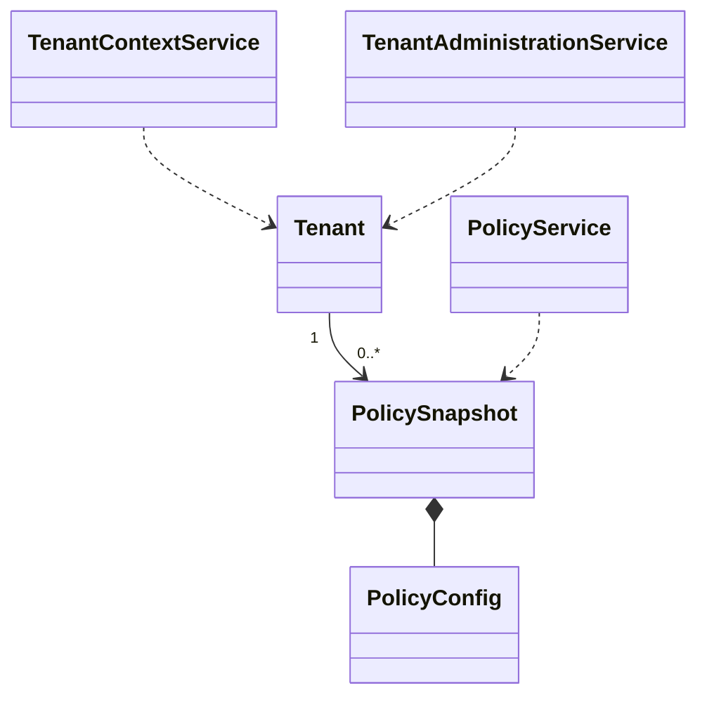

# EduCore — Class Design: Tenant & Policy

**Trạng thái:** Proposed for review · **Version:** 1.0 · **Ngày:** 12/10/2026 · **Phạm vi:** P0 + P1 (đã thể hiện theo lớp).

**Nguồn:** `requirements_analysis(7).md`, `specification(1).md`, `architectural_design(1).md`, `database_design.md` (Database Design v1.0 vẫn *proposed*). Truy vết: **FR-42–FR-43, FR-44**, **UC-33, UC-36**, **BR-10, BR-13, BR-14**.

> **Quy tắc đọc:** thông số BR/Q, hành vi UC và quyết định ADR là baseline từ nguồn; **tên class, chữ ký TypeScript, cách tách service/port, trạng thái kỹ thuật mới** trong file này là đề xuất Detailed Design, chưa phải source code hay Prisma schema đã kiểm chứng. Danh sách thuộc tính là lớp nghiệp vụ (không nhất thiết khớp 1:1 toàn bộ cột DB). Không tự coi tính năng P1 thành P0.

## 1. Ranh giới module và phạm vi

Quản lý ngữ cảnh trung tâm và baseline chính sách bất biến; P1 cấu hình, kiểm soát hiệu lực và lifecycle tenant.

**Phụ thuộc ngoài module (qua public port/application contract):**
- Identity & Access (membership/permission).
- Automation & Job (gắn policy_version, không thay khi retry).
- Audit & Traceability (cấu hình/lifecycle).

**Hợp đồng công khai được đề xuất:**
- `TenantContextPort.requireTenant(principal, tenantId): TenantContext`.
- `PolicySnapshotPort.getForNewOperation(tenantId, at): PolicySnapshot`.
- `PolicySnapshotPort.getPinnedVersion(tenantId, versionId): PolicySnapshot`.

## 2. Class Diagram (logic UML)



> ERD/bảng DB là nơi định nghĩa FK/constraint; UML ở đây mô tả quan hệ domain và dependency application. Class Diagram có thể lược bớt lớp hỗ trợ để dễ đọc; toàn bộ class chính được đặc tả tại §3.

## 3. Class Specifications

| Class | Vai trò | Phạm vi | Bảng/nguồn dữ liệu |
|---|---|---|---|
| `Tenant` | Domain entity | P0 isolation; P1 lifecycle UI | `tenants` |
| `PolicySnapshot` | Immutable domain value | P0 baseline; P1 policy mới | `policy_versions` |
| `PolicyConfig` | Value object | P0 seed; P1 nâng cao | `policy_versions.config_snapshot` |
| `TenantContextService` | Application service | P0 | `tenants, tenant_memberships` |
| `PolicyService` | Application service | P0 pin; P1 publish/retire | `policy_versions` |
| `TenantAdministrationService` | Application service | P1 | `tenants` |

### 3.1. `Tenant`

**Loại:** Domain entity · **Ưu tiên:** P0 isolation; P1 lifecycle UI · **Nguồn dữ liệu:** `tenants`.

**Attributes / dependencies**

| Thuộc tính (đề xuất TypeScript) | Ý nghĩa |
|---|---|
| `id: UUID` | khóa tenant |
| `code: string` | định danh duy nhất nền tảng |
| `name: string` | tên trung tâm |
| `timezone: string` | mặc định Asia/Ho_Chi_Minh |
| `status: TenantStatus` | P1 CREATED/ACTIVE/SUSPENDED/ARCHIVED |

**Operations**

| Method/contract (đề xuất) | Trách nhiệm / kiểm soát |
|---|---|
| `assertOperational(): void` | kiểm tra trạng thái hợp lệ |
| `changeStatus(next, reason): void` | P1 chuyển trạng thái có quyền/audit |

### 3.2. `PolicySnapshot`

**Loại:** Immutable domain value · **Ưu tiên:** P0 baseline; P1 policy mới · **Nguồn dữ liệu:** `policy_versions`.

**Attributes / dependencies**

| Thuộc tính (đề xuất TypeScript) | Ý nghĩa |
|---|---|
| `id: UUID` | phiên bản chính sách |
| `tenantId: UUID` | sở hữu |
| `versionCode: string` | mã version |
| `effectiveFrom: Date` | bắt đầu hiệu lực |
| `effectiveTo?: Date` | kết thúc hiệu lực |
| `config: PolicyConfig` | JSON snapshot |
| `contentHash: string` | chống sửa ngầm |

**Operations**

| Method/contract (đề xuất) | Trách nhiệm / kiểm soát |
|---|---|
| `assertEffectiveAt(time): void` | chọn policy khi tạo nghiệp vụ |
| `get(key): unknown` | lấy tham số snapshot không mutate |
| `verifyHash(): void` | kiểm tra nội dung không bị sửa |

### 3.3. `PolicyConfig`

**Loại:** Value object · **Ưu tiên:** P0 seed; P1 nâng cao · **Nguồn dữ liệu:** `policy_versions.config_snapshot`.

**Attributes / dependencies**

| Thuộc tính (đề xuất TypeScript) | Ý nghĩa |
|---|---|
| `absenceNoticeHours: number` | 24h |
| `invoiceAutoIssue: boolean` | false P0 |
| `siblingDiscountRate: Decimal` | 0.10 P0 |
| `jobRetryDelaysMinutes: number[]` | [1,5,15] |
| `makeupValidDays: number` | 30 P1 |
| `teacherMaxHoursPerDay: number` | 8 P1 |
| `teacherMaxHoursPerWeek: number` | 40 P1 |

**Operations**

| Method/contract (đề xuất) | Trách nhiệm / kiểm soát |
|---|---|
| `validate(): void` | giá trị/rule hợp lệ |
| `freeze(): Readonly<PolicyConfig>` | snapshot bất biến |

### 3.4. `TenantContextService`

**Loại:** Application service · **Ưu tiên:** P0 · **Nguồn dữ liệu:** `tenants, tenant_memberships`.

**Attributes / dependencies**

| Thuộc tính (đề xuất TypeScript) | Ý nghĩa |
|---|---|
| `tenantRepository: TenantRepository` | truy vấn tenant |
| `membershipReader: MembershipQueryPort` | kiểm tra membership |

**Operations**

| Method/contract (đề xuất) | Trách nhiệm / kiểm soát |
|---|---|
| `resolve(userId, tenantId): TenantContext` | chỉ tạo khi được phép |
| `assertSameTenant(ctx, relatedIds): void` | tiền điều kiện trước cập nhật |

### 3.5. `PolicyService`

**Loại:** Application service · **Ưu tiên:** P0 pin; P1 publish/retire · **Nguồn dữ liệu:** `policy_versions`.

**Attributes / dependencies**

| Thuộc tính (đề xuất TypeScript) | Ý nghĩa |
|---|---|
| `policyRepository: PolicyRepository` | phiên bản |
| `policyValidator: PolicyValidator` | ràng buộc chéo |

**Operations**

| Method/contract (đề xuất) | Trách nhiệm / kiểm soát |
|---|---|
| `pinForOperation(tenantId, at): PolicySnapshot` | cố định version khi tạo |
| `loadPinned(tenantId, versionId): PolicySnapshot` | retry dùng version cũ |
| `publishVersion(command): PolicySnapshot` | P1 kiểm soát hiệu lực và overlap |
| `previewChanges(command): PolicyDiff` | P1 không áp dụng hồi tố |

### 3.6. `TenantAdministrationService`

**Loại:** Application service · **Ưu tiên:** P1 · **Nguồn dữ liệu:** `tenants`.

**Attributes / dependencies**

| Thuộc tính (đề xuất TypeScript) | Ý nghĩa |
|---|---|
| `tenantRepository: TenantRepository` | tenant registry |

**Operations**

| Method/contract (đề xuất) | Trách nhiệm / kiểm soát |
|---|---|
| `createTenant(command): Tenant` | quy trình vận hành có kiểm soát |
| `transitionTenant(tenantId, status): void` | lifecycle có quyền |
| `archiveTenant(tenantId): void` | không xóa lịch sử nghiệp vụ |

## 4. Luồng phối hợp ứng dụng / transaction boundary

API tạo nghiệp vụ → xác thực membership/tenant → `PolicyService.pinForOperation()` → gắn `policyVersionId` vào request/job/invoice. Retry đọc bản **đã pin**, trong khi permission phải được kiểm tra mới.

**Nguyên tắc xuyên module:** Không repository trực tiếp vào bảng của module khác. Nếu phải ghi nhiều module trong cùng một nghiệp vụ, application coordinator sở hữu transaction PostgreSQL; domain service chỉ trả kết quả/điều kiện; sự kiện side effect ghi vào outbox cùng transaction khi cần.

## 5. Invariants / Business Rules phải bảo vệ

1. P0 có baseline riêng từng tenant, được seed có kiểm soát; P1 chỉ mở UI quản trị.
2. Không sửa snapshot cũ khi published; phiên bản hiệu lực không được chồng lấn cho cùng loại chính sách.
3. SUSPENDED/ARCHIVED không cho phát sinh nghiệp vụ trái chính sách, nhưng cần giữ khả năng tra cứu dữ liệu hợp lệ; chi tiết quyền vận hành là P1.
4. System Administrator không có quyền mặc định đọc dữ liệu học tập/học phí.

## 6. Kiểm thử bắt buộc cho module

- [ ] Retry job sau khi publish policy mới vẫn giữ `policyVersionId` ban đầu.
- [ ] API tenant A dùng bản ghi B → từ chối.
- [ ] Không publish policy chồng hiệu lực cùng tenant; tài liệu cũ không đổi.

## 7. Phạm vi P1 và điểm nối mở rộng

- UI cấu hình tách workflow, policy version theo tenant và cửa sổ hiệu lực.
- Lifecycle tenant, hỗ trợ kiểm soát truy cập nền tảng.

## 8. Open decisions (không tự xem là baseline)

- Quy tắc chuyển CREATED/ACTIVE/SUSPENDED/ARCHIVED, quyền hỗ trợ và retention sau archive cần quyết định P1.

## 9. Hợp đồng triển khai và cách phân lớp

```text
apps/api/src/modules/tenant-policy/
  domain/          # entities, value objects, policies + pure domain services
  application/     # use cases, application services, port interfaces
  infrastructure/  # Prisma repositories, adapter khi thực sự cần
  presentation/    # NestJS controllers, DTO/validation, guards
```

Không bắt buộc tạo đủ thư mục/abstraction nếu module ít CRUD. **Controller không giữ business rule; guard/check quyền không chỉ nằm ở Controller**, phải đánh giá lại trong service khi xử lý job/duyệt. Các enum nghiệp vụ áp dụng TypeScript và PostgreSQL CHECK/constraint, kiểu VND dùng `bigint` hoặc `Decimal` đúng ngữ cảnh; REST JSON serialize `bigint` thành string.
