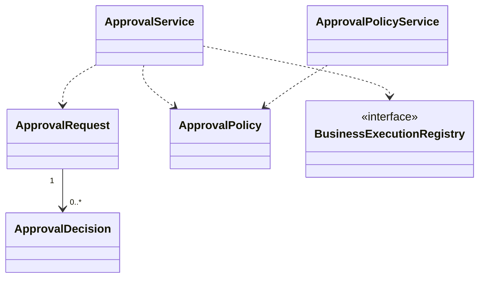

# EduCore — Class Design: Workflow & Approval

**Trạng thái:** Proposed for review · **Version:** 1.0 · **Ngày:** 12/10/2026 · **Phạm vi:** P0 + P1 (đã thể hiện theo lớp).

**Nguồn:** `requirements_analysis(7).md`, `specification(1).md`, `architectural_design(1).md`, `database_design.md` (Database Design v1.0 vẫn *proposed*). Truy vết: **FR-44–FR-45**, **UC-26, UC-33–UC-34**, **BR-08–BR-11, BR-13–BR-14**.

> **Quy tắc đọc:** thông số BR/Q, hành vi UC và quyết định ADR là baseline từ nguồn; **tên class, chữ ký TypeScript, cách tách service/port, trạng thái kỹ thuật mới** trong file này là đề xuất Detailed Design, chưa phải source code hay Prisma schema đã kiểm chứng. Danh sách thuộc tính là lớp nghiệp vụ (không nhất thiết khớp 1:1 toàn bộ cột DB). Không tự coi tính năng P1 thành P0.

## 1. Ranh giới module và phạm vi

Yêu cầu chờ duyệt, quyết định có quyền và xử lý lại sau approve; P0 workflow thủ công giới hạn, P1 rules/threshold/permission cấu hình động.

**Phụ thuộc ngoài module (qua public port/application contract):**
- Identity & Access (permission hiện hành).
- Tenant & Policy (pinned version).
- Billing & Receivables (manual finance adjustment).
- Academic Exceptions (P1 approval).
- Automation & Job (chạy sau duyệt).
- Audit & Traceability (decision trail).

**Hợp đồng công khai được đề xuất:**
- `ApprovalRequestPort.request(command): ApprovalRequest`.
- `ApprovalQueryPort.getDecision(requestId): ApprovalDecision?`.
- `ApprovalExecutionPort.executeApproved(requestId): ExecutionResult`.

## 2. Class Diagram (logic UML)



> ERD/bảng DB là nơi định nghĩa FK/constraint; UML ở đây mô tả quan hệ domain và dependency application. Class Diagram có thể lược bớt lớp hỗ trợ để dễ đọc; toàn bộ class chính được đặc tả tại §3.

## 3. Class Specifications

| Class | Vai trò | Phạm vi | Bảng/nguồn dữ liệu |
|---|---|---|---|
| `ApprovalRequest` | Domain aggregate root | P0; P1 rộng hơn | `approval_requests` |
| `ApprovalDecision` | Append-only domain record | P0 | `approval_decisions` |
| `ApprovalPolicy` | Domain policy | P0 fixed; P1 dynamic | `policy_versions; approval_policies (P1)` |
| `ApprovalService` | Application service | P0; P1 config | `approval_requests, approval_decisions` |
| `ApprovalPolicyService` | Application service | P1 | `approval_policies, policy_change_history` |
| `BusinessExecutionRegistry` | Interface / dispatcher | P0 limited; P1 mở rộng | `không sở hữu bảng riêng` |

### 3.1. `ApprovalRequest`

**Loại:** Domain aggregate root · **Ưu tiên:** P0; P1 rộng hơn · **Nguồn dữ liệu:** `approval_requests`.

**Attributes / dependencies**

| Thuộc tính (đề xuất TypeScript) | Ý nghĩa |
|---|---|
| `id: UUID` | yêu cầu |
| `tenantId: UUID` | trung tâm |
| `operationType: string` | nghiệp vụ |
| `targetType: string` | loại target |
| `targetId: UUID` | đối tượng |
| `requesterMembershipId?: UUID` | nguồn |
| `policyVersionId: UUID` | pin |
| `status: WorkflowStatus` | DRAFT/PENDING_APPROVAL/APPROVED/REJECTED/NEEDS_INFORMATION/COMPLETED/FAILED |
| `payloadSnapshot: JSON` | bằng chứng |
| `correlationId: UUID` | truy vết |

**Operations**

| Method/contract (đề xuất) | Trách nhiệm / kiểm soát |
|---|---|
| `submit(): void` | hợp lệ/cần duyệt |
| `requestInfo(reason): void` | thiếu thông tin |
| `approve(decision): void` | chỉ APPROVED, chưa thực thi |
| `reject(decision): void` | lưu lý do |
| `complete(execution): void` | sau thành công |

### 3.2. `ApprovalDecision`

**Loại:** Append-only domain record · **Ưu tiên:** P0 · **Nguồn dữ liệu:** `approval_decisions`.

**Attributes / dependencies**

| Thuộc tính (đề xuất TypeScript) | Ý nghĩa |
|---|---|
| `requestId: UUID` | yêu cầu |
| `decidedByMembershipId: UUID` | người quyết định |
| `decision: DecisionKind` | APPROVE/REJECT/REQUEST_INFO |
| `reason: string` | bắt buộc |
| `decidedAt: Date` | timestamp |
| `selfApproved: boolean` | cờ audit, không phải status |

**Operations**

| Method/contract (đề xuất) | Trách nhiệm / kiểm soát |
|---|---|
| `validatePermission(ctx): void` | permission + tenant + scope |
| `recordSelfApprovalReason(): void` | trường hợp một Manager |

### 3.3. `ApprovalPolicy`

**Loại:** Domain policy · **Ưu tiên:** P0 fixed; P1 dynamic · **Nguồn dữ liệu:** `policy_versions; approval_policies (P1)`.

**Attributes / dependencies**

| Thuộc tính (đề xuất TypeScript) | Ý nghĩa |
|---|---|
| `operationType: string` | loại thao tác |
| `requiredPermissions: string[]` | quyền xử lý |
| `riskThresholds: JSON` | P1 |
| `allowSelfApproval: boolean` | điều kiện cụ thể |
| `policyVersionId: UUID` | snapshot |

**Operations**

| Method/contract (đề xuất) | Trách nhiệm / kiểm soát |
|---|---|
| `evaluate(operation, actor): Evaluation` | AUTO/NEEDS_INFORMATION/PENDING_APPROVAL/REJECT |
| `maySelfApprove(request,actor): boolean` | ngoại lệ tài chính có audit |

### 3.4. `ApprovalService`

**Loại:** Application service · **Ưu tiên:** P0; P1 config · **Nguồn dữ liệu:** `approval_requests, approval_decisions`.

**Attributes / dependencies**

| Thuộc tính (đề xuất TypeScript) | Ý nghĩa |
|---|---|
| `requestRepo: ApprovalRequestRepository` | state |
| `authorization: AuthorizationPort` | recheck |
| `executors: BusinessExecutionRegistry` | ports nghiệp vụ |

**Operations**

| Method/contract (đề xuất) | Trách nhiệm / kiểm soát |
|---|---|
| `createRequest(command): ApprovalRequest` | pin policy |
| `decide(command): ApprovalDecision` | check hiện hành |
| `executeApproved(requestId): void` | recheck scope/data/concurrency |
| `returnForInfo(requestId,reason): void` | không retry vô tận |

### 3.5. `ApprovalPolicyService`

**Loại:** Application service · **Ưu tiên:** P1 · **Nguồn dữ liệu:** `approval_policies, policy_change_history`.

**Attributes / dependencies**

| Thuộc tính (đề xuất TypeScript) | Ý nghĩa |
|---|---|
| `policyRepository: ApprovalPolicyRepository` | dynamic rules |
| `policyService: PolicySnapshotPort` | immutable snapshots |

**Operations**

| Method/contract (đề xuất) | Trách nhiệm / kiểm soát |
|---|---|
| `configure(command): ApprovalPolicy` | permission người sửa |
| `simulate(command): PolicyEvaluation` | dry-run |
| `publish(command): void` | version/effective time |

### 3.6. `BusinessExecutionRegistry`

**Loại:** Interface / dispatcher · **Ưu tiên:** P0 limited; P1 mở rộng · **Nguồn dữ liệu:** `không sở hữu bảng riêng`.

**Attributes / dependencies**

| Thuộc tính (đề xuất TypeScript) | Ý nghĩa |
|---|---|
| `executors: Map<OperationType,BusinessExecutor>` | một handler hợp đồng |

**Operations**

| Method/contract (đề xuất) | Trách nhiệm / kiểm soát |
|---|---|
| `resolve(operationType): BusinessExecutor` | chỉ các operation cho phép |
| `executePinned(request, ctx): ExecutionResult` | gọi application coordinator đúng module |

## 4. Luồng phối hợp ứng dụng / transaction boundary

Business operation tạo request với pinned policy → thiếu dữ liệu NEEDS_INFORMATION, hợp lệ cần duyệt PENDING_APPROVAL, vi phạm cấm reject → người có permission/scope đưa decision → APPROVED → coordinator re-check quyền **hiện hành**, target, conflict → execute domain action → COMPLETED; lỗi ghi FAILED/job.

**Nguyên tắc xuyên module:** Không repository trực tiếp vào bảng của module khác. Nếu phải ghi nhiều module trong cùng một nghiệp vụ, application coordinator sở hữu transaction PostgreSQL; domain service chỉ trả kết quả/điều kiện; sự kiện side effect ghi vào outbox cùng transaction khi cần.

## 5. Invariants / Business Rules phải bảo vệ

1. APPROVED ≠ COMPLETED; SELF_APPROVED là cờ decision, không phải trạng thái.
2. Điều chỉnh/hủy invoice issued **luôn** manual approval, có reason/audit; một Manager có quyền được self-approve **thủ công**, đánh dấu rõ.
3. Việc kiểm tra permission hiện hành không bị đóng băng theo policyVersionId.
4. Nếu không có approver giữ PENDING_APPROVAL và cảnh báo Manager, không bypass.
5. P1 policy có thresholds/risk, nhưng không nới ràng buộc cấm baseline.

## 6. Kiểm thử bắt buộc cho module

- [ ] Người có role nhưng scope sai/permission revoked bị từ chối duyệt.
- [ ] Finance adjust không tự APPROVED dù auto-job được retry.
- [ ] Approved request đổi dữ liệu target thành không hợp lệ → không execute, giữ trace.
- [ ] Hai người cùng duyệt đồng thời → một chuyển trạng thái thành công.

## 7. Phạm vi P1 và điểm nối mở rộng

- Cấu hình per operation + condition + risk threshold/permission.
- Separation-of-duties theo policy; self approve chỉ các ca được phép.

## 8. Open decisions (không tự xem là baseline)

- Chốt state machine chuyển trạng thái chi tiết và executor registration cho từng use case trước implement.

## 9. Hợp đồng triển khai và cách phân lớp

```text
apps/api/src/modules/workflow-approval/
  domain/          # entities, value objects, policies + pure domain services
  application/     # use cases, application services, port interfaces
  infrastructure/  # Prisma repositories, adapter khi thực sự cần
  presentation/    # NestJS controllers, DTO/validation, guards
```

Không bắt buộc tạo đủ thư mục/abstraction nếu module ít CRUD. **Controller không giữ business rule; guard/check quyền không chỉ nằm ở Controller**, phải đánh giá lại trong service khi xử lý job/duyệt. Các enum nghiệp vụ áp dụng TypeScript và PostgreSQL CHECK/constraint, kiểu VND dùng `bigint` hoặc `Decimal` đúng ngữ cảnh; REST JSON serialize `bigint` thành string.
