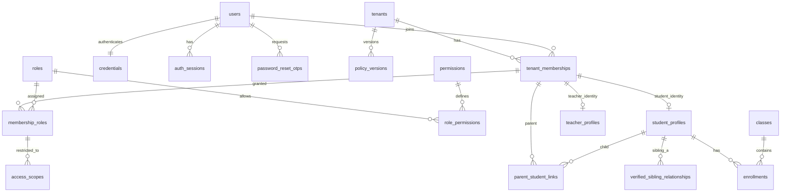
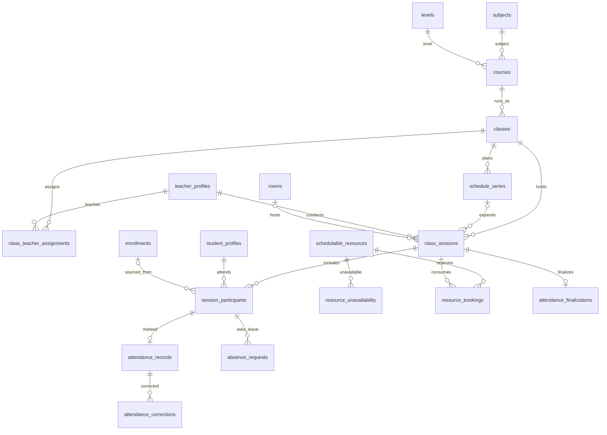
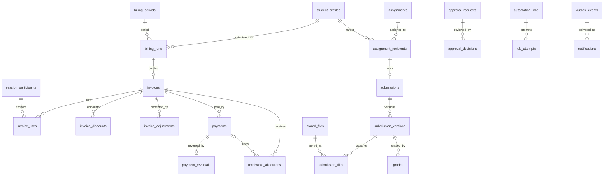

# EduCore — Database Design

**Phiên bản:** 1.1 — 17/10/2026  
**Trạng thái:** Approved — quyết định nhóm A (SQL migrations chưa được kiểm thử)  
**Đầu vào:** `requirements_analysis(7).md` (FR-01–FR-45, BR-01–BR-14), `specification(1).md` (UC-01–UC-37, Q-01–Q-15), `architectural_design(1).md` (kiến trúc và ADR).  
**Đầu ra:** thiết kế logic/physical ở mức bảng, ERD, FK, UNIQUE, CHECK, index, transaction và roadmap schema. **Không phải** schema đã migration hay kết quả đã kiểm thử trên PostgreSQL.

**Changelog — v1.1 + O-12 amendment, 18/10/2026 (`Asia/Ho_Chi_Minh`):** chủ dự án phê duyệt trực tiếp business A=A, B=B1, C=C1, D=D; DB-08 đổi sang local session-date pricing, giữ Group A. [Decision Register](../ai/DECISION_REGISTER.md#f-o-12--approved-business-decision-2026-10-18). Mọi field/key/SQL/generation persistence dưới đây vẫn là **PROPOSED / PENDING TECHNICAL REVIEW**, không là authorization schema/migration.

**Wallet amendment · 19/10/2026:** owner xác nhận trực tiếp **BUSINESS APPROVED WALLET-B1–B5**, **PRINCIPLE ACCEPTED** minimal architecture; [Register §G](../ai/DECISION_REGISTER.md#g-wallet-p0--owner-business-approval-2026-10-19). New P0 top-up→wallet→invoice payment, internal refund khi execute adjustment/hủy đã duyệt thay direct-payment-only/no-auto-credit có giới hạn. Logical fields/constraints/lock/grants Q1–Q8 vẫn **RECOMMENDED / PENDING TECHNICAL SIGN-OFF**; schema62models/28enums hiện chưa có wallet, không SQL/migrations/runtime implementation. Group A history dưới đây giữ và đánh dấu phạm vi supersession.

> **Phân biệt nguồn và đề xuất:** Các mã FR/UC/BR/Q, trạng thái và tham số ghi là **Baseline** đến từ ba tài liệu. Tên bảng, cách tách thực thể, index, kiểu cột và giải pháp SQL là **Đề xuất Database Design**, chưa được nguồn xác nhận như lựa chọn triển khai cuối cùng. Không tự bổ sung nghiệp vụ ngoài P0.

## 1. Phạm vi và quyết định thiết kế

| Chủ đề | Thiết kế |
|---|---|
| DBMS | **PostgreSQL**, một database/schema dùng chung, dữ liệu nghiệp vụ tenant-scoped (`tenant_id NOT NULL`). |
| ORM | **Prisma**; migration SQL bổ sung cho composite FK, `CHECK`, partial/exclusion index, locking khi Prisma không biểu đạt được. |
| Kiến trúc | Modular Monolith NestJS, các module sở hữu bảng riêng trong cùng PostgreSQL; giao dịch liên module do application coordinator thực hiện. |
| Định danh | UUID `id` làm PK; bảng tenant-scoped thêm `UNIQUE(tenant_id,id)` để làm đích composite FK. |
| P0 bắt buộc | IAM/OTP, tenant/scope, hồ sơ và lớp học, lịch và chống trùng, điểm danh/đơn nghỉ, học phí/thu/điều chỉnh, bài tập/nộp/chấm, in-app notification, dashboard SQL, workflow cơ bản, audit/jobs/outbox. |
| P1 chưa tạo logic nghiệp vụ | Học bù, bảo lưu/tín dụng, dạy thay, combo, cấu hình quyền/policy/workflow động, nhắc deadline/kênh ngoài, báo cáo nâng cao. Có thể tạo migration P1 sau. |
| Tệp | BLOB ở **Railway private persistent Volume**, DB chỉ chứa metadata, đường dẫn nội bộ; đọc/ghi qua NestJS API, không public trực tiếp. |
| Tiền | VND lưu `BIGINT` (đồng) hoặc Prisma `BigInt`; tỉ lệ dùng `DECIMAL`, không dùng `FLOAT`. Làm tròn `ROUND_HALF_UP` **một lần cuối công thức**. |
| Thời gian | Mốc thời gian `TIMESTAMPTZ` UTC; `DATE` cho ngày nghiệp vụ; timezone mặc định `Asia/Ho_Chi_Minh` ở tenant; khung giờ `[start,end)`. |
| Xóa dữ liệu | Soft deactivate hồ sơ/danh mục phù hợp; không xóa cứng sự kiện tài chính, audit, điểm danh đã xác nhận, bài nộp phiên bản cũ. |
| Chính sách | Seed phiên bản baseline bất biến mỗi tenant ngay P0, gắn reference/snapshot vào nghiệp vụ; UI quản lý phiên bản là P1. |

### 1.1. Quy ước ký hiệu

- `PK`: khóa chính; `FK`: khóa ngoại; `UQ`: duy nhất; `CK`: CHECK constraint; `IDX`: index; `NN`: NOT NULL.
- Mỗi bảng tenant-scoped mặc định có `id UUID PK`, `tenant_id UUID NN FK -> tenants.id`, `created_at TIMESTAMPTZ NN DEFAULT now()`, `updated_at TIMESTAMPTZ NN` (trừ bảng append-only, chỉ cần `created_at`), và `UQ(tenant_id,id)`. Các trường mặc định **không lặp lại trong mọi bảng** phía dưới.
- FK giữa hai bảng tenant-scoped được hiểu là **composite** `(tenant_id, target_id) -> target(tenant_id,id)`, không chỉ tham chiếu `target.id`. Đối với bảng user toàn cục, dùng `user_id -> users.id`; khi cần kiểm tra user trong tenant phải qua `tenant_memberships`.
- `*_by_membership_id` chỉ thành viên tenant, được xác nhận quyền theo Backend; `*_by_user_id` được dùng cho nguồn toàn cục như OTP/phiên đăng nhập. Không dùng tên role để suy ra quyền.
- Cột `status`, `type`, `kind` mô tả enum/check ở cấp ứng dụng và DB; các tập giá trị dưới đây là tập đề xuất triển khai **bám sát** baseline, không gộp enum của các domain khác nhau.
- Khóa/cột chỉ được nêu ở mức thiết kế, chưa liệt kê tất cả trường UI phụ trợ như ghi chú, tên viết tắt hoặc metadata không ảnh hưởng nghiệp vụ.

## 2. Sơ đồ ERD theo bounded context

Chia ERD thành các nhóm để dễ đọc; các mối nối chéo module được diễn giải ở §4. Đây là sơ đồ các quan hệ chính, không liệt kê mọi trường/cột.

### 2.1. Identity, tenant, học viên



### 2.2. Đào tạo, lịch, điểm danh



### 2.3. Billing, bài tập và nền tảng



**Lưu ý:** `billing_runs` và `invoices` là quan hệ 1–0..1 trong P0; `invoiced_participation_claims` (bảng bảo vệ chống thu trùng) và các `*_by_membership_id` được bỏ khỏi ERD vì mật độ đường nối. `approval_requests.target_type/target_id` là liên kết nghiệp vụ đa loại có kiểm tra trong service, không phải FK đa hình được PostgreSQL tự bảo đảm.

## 3. Danh mục và đặc tả bảng P0

### 3.1. Tenant & Policy — 2 bảng

| Bảng | Cột nghiệp vụ chính | Ràng buộc / ý nghĩa |
|---|---|---|
| `tenants` | `id PK`, `code TEXT`, `name TEXT`, `timezone TEXT DEFAULT 'Asia/Ho_Chi_Minh'`, `status TEXT`, `activated_at` | `UQ(code)`; P0 tenant tạo qua vận hành. Trạng thái nâng cao `CREATED/ACTIVE/SUSPENDED/ARCHIVED` quản trị bằng UI thuộc P1. |
| `policy_versions` | `version_code TEXT`, `effective_from TIMESTAMPTZ`, `effective_to TIMESTAMPTZ?`, `config_snapshot JSONB`, `content_hash TEXT`, `created_by_membership_id?` | `UQ(tenant_id,version_code)`; snapshot bất biến, không sửa ngầm khi retry; seed tham số BR/Q ở P0. `effective_to` phục vụ mở rộng quản trị P1. |

**Baseline P0 seed:** `absence_notice_hours=24`, `sibling_discount_rate=0.10`, `invoice_auto_issue=false`, `teacher_substitution_auto_confirm=false`, `student_transfer_auto_confirm=false`, `max_retries=3`, `retry_delays_minutes=[1,5,15]`. Các giá trị học bù/combo P1 có thể nằm trong snapshot baseline để truy vết nhưng **không kích hoạt nghiệp vụ P1**.

### 3.2. Identity & Access — 13 bảng

| Bảng | Cột nghiệp vụ chính | Ràng buộc / ý nghĩa |
|---|---|---|
| `users` (toàn cục) | `id PK`, `email_normalized TEXT`, `display_name TEXT`, `status`, `created_at`, `updated_at` | `UQ(email_normalized)` theo lowercase/trim; không chứa `tenant_id`; tài khoản đa tenant. |
| `credentials` (toàn cục) | `user_id PK/FK`, `password_hash TEXT`, `password_changed_at`, `failed_attempts`, `locked_until` | Băm Argon2id; không có mật khẩu plaintext. Kiểm tra độ dài ≥12 trước khi băm. |
| `auth_sessions` (toàn cục) | `user_id FK`, `active_tenant_id? FK`, `refresh_token_hash`, `issued_at`, `expires_at`, `revoked_at`, `last_used_at` | Tối đa 7 ngày cho refresh token; thu hồi khi logout/reset password. Access token tối đa 15 phút do auth service phát hành. |
| `password_reset_otps` (toàn cục) | `user_id FK`, `otp_hash`, `requested_at`, `expires_at`, `consumed_at`, `attempt_count`, `max_attempts` | OTP một lần, hết hạn 15 phút, hạn chế thử. Không ghi OTP vào log/audit. |
| `tenant_memberships` | `user_id FK`, `status`, `joined_at`, `left_at?` | `UQ(tenant_id,user_id)`; user thuộc tenant khác nhau theo membership riêng. Ít nhất một Manager hợp lệ mỗi tenant active (service/transaction). |
| `roles` | `code TEXT`, `name TEXT`, `is_system_seeded BOOLEAN` | `UQ(tenant_id,code)`; seed `MANAGER`, `ACADEMIC_STAFF`, `ACCOUNTANT`, `TEACHER`, `STUDENT`, `PARENT` theo baseline. Cấu hình quyền động P1. |
| `permissions` (toàn cục) | `id PK`, `code TEXT`, `description TEXT`, `is_sensitive BOOLEAN` | `UQ(code)`; catalog permissions như `schedule.approve`, `invoice.issue`, `invoice.adjust`, không cấp mặc định khi chỉ có tên role. |
| `role_permissions` | `role_id`, `permission_id`, `granted_at` | `UQ(tenant_id,role_id,permission_id)`; P0 seed mapping quyền cố định theo UC; P1 cho quản lý thay đổi nếu có thẩm quyền. |
| `membership_roles` | `membership_id`, `role_id`, `assigned_by_membership_id`, `assigned_at`, `revoked_at?` | Bản ghi gán role theo tenant; `UQ(tenant_id,membership_id,role_id)` cho **role hiện hành** bằng partial UQ `WHERE revoked_at IS NULL`. |
| `access_scopes` | `membership_role_id`, `scope_kind` = `TENANT/CLASS/STUDENT`, `class_id?`, `student_id?` | CK đúng một kiểu/phạm vi; gán role có scope. FK lớp/học viên phải cùng tenant; grant scope tenant không mặc định cho mọi role. |
| `parent_student_links` | `parent_membership_id`, `student_id`, `relationship TEXT`, `verified_at?`, `verified_by_membership_id?`, `revoked_at?` | Partial UQ `(tenant_id,parent_membership_id,student_id)` khi chưa bị thu hồi. Parent chỉ xem học sinh liên kết hợp lệ. |
| `verified_sibling_relationships` | `student_a_id`, `student_b_id`, `verified_by_membership_id`, `verified_at`, `revoked_at?`, `evidence_note?` | CK `student_a_id < student_b_id` theo thứ tự UUID chuẩn hóa, UQ cho cặp active; **khác** parent link; kiểm tra hai em có ghi danh hợp lệ khi áp dụng giảm giá. |
| `platform_staff_grants` (toàn cục, đề xuất tối thiểu) | `user_id`, `grant_code`, `granted_at`, `revoked_at`, `reason` | Quyền vận hành nền tảng, **không tự cấp quyền đọc dữ liệu nghiệp vụ của tenant**; mọi hỗ trợ truy cập phải qua cấp quyền cụ thể và audit. |

**Quy tắc profile–membership:** Giáo viên/học sinh có thể được tạo hồ sơ trước khi có tài khoản; `teacher_profiles.membership_id` và `student_profiles.membership_id` được phép `NULL`, nếu có thì phải trỏ tới membership **cùng tenant** và unique (một membership không gắn hai hồ sơ giáo viên/học sinh cùng loại). Liên kết phụ huynh dùng membership đã xác minh, không phụ thuộc việc học sinh có login.

#### Quyết định IAM nhóm A (Approved 17/10/2026)
- P0 seed permission catalog/mapping role cố định, có kiểm soát version; role editor động chỉ ở P1. Danh mục quyền xem Detailed Design §A.2. Quyền được kiểm tra cùng tenant, scope TENANT/CLASS/STUDENT và parent-student verified link.
- users.status bổ sung PENDING_ACTIVATION/ACTIVE/DISABLED và activated_at nullable. OTP có purpose ACTIVATION/PASSWORD_RESET (giữ bảng password_reset_otps cho tương thích), hash, hạn 15 phút, dùng một lần, rate-limit; không gửi password tạm.
- Tenant và Manager đầu tiên tạo bằng CLI vận hành, seed policy/role/permission cùng transaction; người dùng kích hoạt bằng OTP email. Tenant ACTIVE chỉ khi có ít nhất một Manager active. Backend luôn chặn xóa quyền Manager hợp lệ cuối.
- OTP verification + set Argon2id password + consume OTP + revoke old sessions thực hiện nguyên tử trong DB transaction.

### 3.3. Academic Management — 10 bảng

| Bảng | Cột nghiệp vụ chính | Ràng buộc / ý nghĩa |
|---|---|---|
| `teacher_profiles` | `membership_id?`, `teacher_code`, `full_name`, `contact?`, `status` | UQ `(tenant_id,teacher_code)`; một hồ sơ có thể độc lập tài khoản. |
| `student_profiles` | `membership_id?`, `student_code`, `full_name`, `date_of_birth?`, `status` | UQ `(tenant_id,student_code)`; hồ sơ thuộc tenant, không dùng `users.id` làm khóa học sinh. |
| `subjects` | `code`, `name`, `active` | UQ `(tenant_id,code)`. |
| `levels` | `code`, `name`, `sort_order`, `active` | UQ `(tenant_id,code)`; trình độ có phạm vi tenant. |
| `courses` | `code`, `name`, `subject_id`, `level_id`, `status`, `description?` | UQ `(tenant_id,code)`; subject/level cùng tenant. |
| `classes` | `code`, `name`, `course_id`, `capacity INT`, `status`, `start_date?`, `end_date?` | UQ `(tenant_id,code)`; CK `capacity > 0`; status `PLANNED/ACTIVE/COMPLETED/ARCHIVED` (đề xuất, chưa khóa enum chi tiết). |
| `teacher_competencies` | `teacher_id`, `subject_id`, `level_id`, `verified_at?` | UQ `(tenant_id,teacher_id,subject_id,level_id)`; P0 lưu năng lực cơ bản nếu có, P1 sử dụng để đề xuất dạy thay. |
| `class_teacher_assignments` | `class_id`, `teacher_id`, `role_kind`, `valid_from`, `valid_to?`, `assigned_by_membership_id` | CHECK `valid_to > valid_from` nếu có; ghi lịch sử, không ghi đè phân công đã có hiệu lực. Giáo viên thực tế của buổi vẫn phải snapshot ở `class_sessions.teacher_id`. |
| `enrollments` | `student_id`, `class_id`, `status`, `effective_from`, `effective_to?`, `prior_enrollment_id?`, `created_by_membership_id` | Trạng thái baseline `PENDING/ACTIVE/SUSPENDED/COMPLETED/WITHDRAWN/TRANSFERRED`; không xóa enrollment cũ khi chuyển. CK khoảng hiệu lực hợp lệ. Chặn 2 enrollment ACTIVE trùng **cùng student/class/khoảng hiệu lực** bằng domain rule + DB constraint có thể áp dụng. |
| `enrollment_transfers` | `source_enrollment_id`, `target_class_id`, `effective_at`, `status`, `target_enrollment_id?`, `requested_by_membership_id`, `confirmed_by_membership_id?`, `approval_request_id?`, `reason`, `operation_key` | UQ `(tenant_id,operation_key)`; chỉ chuyển theo thời điểm tương lai sau xác nhận đúng quyền; phải xét lịch và tài chính. Không tự chuyển lớp mặc định. |

**Lưu ý:** `classes.capacity` là giới hạn lớp, `rooms.capacity` là giới hạn phòng, **hai điều kiện đều phải thỏa** khi ghi danh/xác nhận lịch. `class_sessions` giữ snapshot giáo viên/phòng dùng thực tế để audit, ngay cả khi sau này phân công chung của lớp thay đổi.

### 3.4. Resource & Scheduling — 7 bảng

| Bảng | Cột nghiệp vụ chính | Ràng buộc / ý nghĩa |
|---|---|---|
| `rooms` | `code`, `name`, `capacity INT`, `active`, `location?` | UQ `(tenant_id,code)`; CK `capacity > 0`. |
| `schedulable_resources` | `resource_kind=TEACHER/STUDENT/ROOM`, `teacher_id?`, `student_id?`, `room_id?` | CK **chính xác một** FK theo `resource_kind`; một profile/room có một resource registry row; dùng làm khóa chung để chống trùng nhiều loại tài nguyên. |
| `resource_unavailability` | `resource_id`, `starts_at`, `ends_at`, `status=DRAFT/CONFIRMED/CANCELLED`, `reason`, `created_by_membership_id` | CK `ends_at > starts_at`; khi CONFIRMED tạo resource booking ACTIVE trong cùng transaction. |
| `schedule_series` | `class_id`, `weekday SMALLINT`, `local_start_time TIME`, `duration_minutes INT`, `valid_from DATE`, `valid_to DATE`, `timezone`, `status` | CK `weekday BETWEEN 1 AND 7`, `duration_minutes > 0`; chuỗi lặp tối đa **6 tháng**, expand thành buổi cụ thể; xác nhận **all-or-nothing**. |
| `class_sessions` | `class_id`, `series_id?`, `teacher_id`, `room_id?`, `delivery_mode=ONSITE/ONLINE`, `starts_at`, `ends_at`, `status=DRAFT/CONFIRMED/COMPLETED/CANCELLED`, `cancel_reason?`, `revision INT`, `policy_version_id` | CK `ends_at > starts_at`; ONSITE có phòng; CANCELLED không chiếm tài nguyên. Sửa một buổi/những buổi tương lai; không ghi đè lịch sử đã diễn ra. |
| `session_participants` | `session_id`, `student_id`, `enrollment_id?`, `participant_kind=REGULAR/MAKEUP`, `added_at`, `removed_at?` | `UQ(tenant_id,session_id,student_id)` **không phụ thuộc removed_at** để tránh tạo hai danh tính tham gia cho cùng buổi; REGULAR lấy từ enrollment hợp lệ tại thời điểm buổi. MAKEUP chỉ dùng P1. Snapshot danh sách theo buổi, không đồng nhất với enrollment lớp. |
| `resource_bookings` | `resource_id`, `session_id?`, `unavailability_id?`, `starts_at`, `ends_at`, `status=ACTIVE/RELEASED` | Exactly-one source FK; 1 booking mỗi tài nguyên/buổi hoặc lịch bận. **EXCLUDE GiST** theo `(tenant_id,resource_id,time_range)` khi ACTIVE để chặn xung đột **ở DB**. |

**Cơ chế chống race bắt buộc:** Khi xác nhận buổi/chuỗi, Backend xác định participants, teacher, room; khóa những `schedulable_resources.id` có liên quan theo thứ tự ổn định; kiểm tra lại sự tham gia, lịch bận và sức chứa; ghi tất cả `class_sessions`, participants, bookings, audit/outbox trong **một transaction**. PostgreSQL exclusion constraint là lớp phòng vệ cuối; trường hợp vi phạm => rollback **toàn chuỗi**, không lưu một phần. Bắt đầu bằng một instance worker nhưng **không** dựa vào một instance để bảo đảm an toàn ghi đồng thời.

### 3.5. Attendance & Leave — 4 bảng

| Bảng | Cột nghiệp vụ chính | Ràng buộc / ý nghĩa |
|---|---|---|
| `absence_requests` | `participant_id`, `requester_membership_id`, `submitted_at`, `reason`, `is_late_notice`, `status`, `approved_by_membership_id?`, `decided_at?`, `approval_request_id?` | Tính `is_late_notice` dựa trên **24 giờ** trước giờ buổi bắt đầu; đơn sớm **vẫn cần duyệt**; đơn muộn duyệt ngoại lệ. UQ một đơn active trên participant (dùng partial index theo trạng thái). |
| `attendance_finalizations` | `session_id`, `confirmed_by_membership_id`, `confirmed_at`, `locked_at?`, `revision` | UQ `(tenant_id,session_id)`; Teacher đủ quyền xác nhận bộ điểm danh; không cho billing dùng điểm danh chưa xác nhận. Khoá nghiệp vụ ở `min(session.end+48h, invoice.issued_at)` khi điều kiện tương ứng đến. |
| `attendance_records` | `participant_id`, `finalization_id?`, `attendance_status=ATTENDED/EXCUSED/UNEXCUSED`, `recorded_by_membership_id`, `recorded_at`, `updated_at`, `revision` | UQ `(tenant_id,participant_id)`; EXCUSED phải có đơn nghỉ được duyệt; **thực tế dự học => ATTENDED**. Bản draft chưa thuộc finalization thì không đủ điều kiện billing. |
| `attendance_corrections` | `attendance_id`, `old_status`, `new_status`, `reason`, `requested_by_membership_id`, `approved_by_membership_id?`, `corrected_at`, `approval_request_id?` | Append-only; sửa sau khóa cần quyền/lý do/audit; nếu hóa đơn đã phát hành, tạo **điều chỉnh tài chính** riêng chứ không tự tính lại hóa đơn gốc. |

**Xử lý buổi trung tâm hủy:** `class_sessions.status=CANCELLED` => không thu phí; có thể không tồn tại `attendance_records` được xác nhận cho buổi đã hủy. Billing phải chấp nhận nhánh này, không tự gán `UNEXCUSED` cho học sinh.

### 3.6. Billing & Receivables — 12 bảng nền, thêm 2 bảng ví logical đề xuất

| Bảng | Cột nghiệp vụ chính | Ràng buộc / ý nghĩa |
|---|---|---|
| `price_rules` | `scope_kind=COURSE/CLASS/SESSION`, `course_id?`, `class_id?`, `session_id?`, `unit_price_vnd BIGINT`, `effective_from DATE`, `effective_to DATE?`, `policy_version_id`, `created_by_membership_id` | CK đúng một target, giá không âm, khoảng DATE `[from,to)` hợp lệ, NULL end=vô hạn; không overlap **cùng tenant/target**. Chọn theo local session-start date, thứ tự **SESSION → CLASS → COURSE**. Policy FK là tariff provenance, không bắt buộc bằng calculation-policy pin. |
| `billing_periods` | `month_start DATE`, `month_end DATE`, `status` | UQ `(tenant_id,month_start)`; CK tháng chuẩn và `month_end` là đầu tháng sau (kỳ nửa mở). P0 tính theo tháng. |
| `billing_runs` | `period_id`, `student_id`, `operation_key`, `state`, `policy_version_id`, `input_snapshot_hash`, `computed_at?`, `requested_by_membership_id?`, `error_reason?` | UQ `(tenant_id,operation_key)`; **UQ `(tenant_id,period_id,student_id)`** cho **một run logic mỗi student/tháng** ở P0 (lựa chọn thiết kế, xem §9); draft có thể tính lại có kiểm soát; retry cùng operation trả kết quả cũ. `NEEDS_INFORMATION` khi điểm danh thiếu. |
| `invoices` | `billing_run_id`, `student_id`, `period_id`, `invoice_number?`, `status=DRAFT/ISSUED/CANCELLED`, `gross_vnd BIGINT`, `discount_vnd BIGINT`, `total_vnd BIGINT`, `issued_at?`, `issued_by_membership_id?`, `due_at?`, `policy_version_id`, `snapshot_json JSONB` | UQ `(tenant_id,billing_run_id)` và partial UQ số hóa đơn đã cấp; `total_vnd >= 0`; P0 phát hành **thủ công**, hạn 7 ngày. Không sửa trực tiếp totals/lines của hóa đơn ISSUED. |
| `invoice_lines` | `invoice_id`, `participant_id`, `session_id`, `attendance_id?`, `price_rule_id?`, `source_status`, `charge_units SMALLINT`, `unit_price_vnd BIGINT`, `base_amount_vnd BIGINT`, `reason_code`, `source_snapshot_json JSONB` | UQ `(tenant_id,invoice_id,participant_id)`; `charge_units IN (0,1)`; P0 ATTENDED/UNEXCUSED=1, EXCUSED/CANCELLED=0. Lưu cả dòng 0 đồng để giải thích miễn phí. |
| `invoice_discounts` | `invoice_id`, `kind=SIBLING`, `sequence_no`, `rate DECIMAL(6,5)`, `raw_discount_decimal DECIMAL(20,6)`, `evidence_snapshot_json JSONB` | UQ `(tenant_id,invoice_id,sequence_no)`; P0 chỉ SIBLING 10% nếu có chứng cứ; P1 có thêm COMBO theo thứ tự trước SIBLING. Không làm tròn từng bước trung gian. |
| `invoiced_participation_claims` | `participant_id`, `invoice_line_id`, `claimed_at` | **UQ `(tenant_id,participant_id)`** và UQ invoice_line; claim chỉ ghi khi hóa đơn phát hành, ngăn một buổi/học sinh đi vào **hai hóa đơn đã phát hành**. Sau hủy, không xóa claim để ngăn tái phát hành âm thầm; sửa bằng adjustment. |
| `invoice_adjustments` | `invoice_id`, `approval_request_id`, `adjustment_kind=AMOUNT/CANCELLATION`, `delta_vnd BIGINT`, `reason`, `status=PROPOSED/APPLIED/REJECTED`, `applied_at?`, `applied_by_membership_id?`, `operation_key` | UQ `(tenant_id,operation_key)`; **chỉ APPLIED sau phê duyệt thủ công**; append-only sau áp dụng. Có thể âm hoặc dương, không được khiến tổng phải thu trái chính sách. |
| `payments` | `invoice_id NN`, `amount_vnd BIGINT`, `method=WALLET` cho giao dịch mới; CASH/BANK_TRANSFER giữ legacy; `paid_at`, `recorded_by_membership_id`, `evidence_note?`, `idempotency_key`, `created_at` | UQ `(tenant_id,idempotency_key)`; amount>0; đúng một invoice ISSUED cùng student/tenant, amount<=outstanding/balance dưới khóa. TOP_UP không tạo Payment. WALLET cần debit và base allocation matching; enum extension chưa áp dụng Prisma. |
| `payment_reversals` | `payment_id`, `amount_vnd BIGINT`, `reason`, `reversed_by_membership_id`, `reversed_at`, `approval_request_id?`, `operation_key` | UQ `(tenant_id,payment_id)` và UQ operation_key ở P0 (đảo **toàn khoản**, nếu sai nhập khoản mới); không xóa/sửa payment gốc. |
| `receivable_allocations` | `invoice_id`, `payment_id NN`, `amount_vnd BIGINT signed`, `kind=PAYMENT/RELEASE`, `parent_allocation_id?`, `wallet_transaction_id?`, `adjustment_id?`, `payment_reversal_id?`, `allocated_at`, `operation_key` | **Technical proposal:** base PAYMENT>0, RELEASE<0 cùng payment/invoice/tenant, parent phải base; immutable entries, release không vượt remaining. Giữ Payment FK `(tenant,payment,invoice)` và operation UQ; thay cả2payment UQs hiện tại bằng partial base-only uniqueness, xem amendment dưới. Không P1 credit source trong wallet P0. |
| `wallet_accounts` — mới, logical | `id`, `tenant_id`, `student_id`, `balance_vnd BIGINT default0`, `created_at`, `updated_at` | UQ `(tenant,student)`/`(tenant,id)`, composite Student FK; balance>=0/within BIGINT; owner immutable, không expiry/transfer. Balance chỉ đổi cùng immutable transactions qua reviewed command. |
| `wallet_transactions` — mới, logical | `wallet_id`, `type`, `signed_amount_vnd`, `command_id`, `effect_key`, actor/time/reason; TOP_UP receipt method/reference/receivedAt/evidence; typed `payment_id?`, `adjustment_id?`, `payment_reversal_id?`, `reverses_top_up_transaction_id?` | Tenant-scoped Wallet/Member/Idempotency/source FKs; sign/type/source shape, append-only, UQ effect/receipt và per-source refund/reversal. Một root có nhiều refund children nên không UQ command_id đơn lẻ. Model tối thiểu, không general ledger hoặc settlement tables. |
| `billing_source_snapshots` (**đề xuất; O-04 còn review**) | `billing_run_id`, `generation_id`, `participant_id`, `attendance_revision?`, `session_revision`, `source_business_date DATE`, `pricing_local_date DATE`, `timezone_snapshot`, `price_rule_id?`, `pricing_evidence_json`, `source_hash`, `captured_at` | O-12: UQ `(tenant_id,generation_id,participant_id)`, generation cùng run/student/period; ngày nguồn=ngày giá từ session/z. Có thể lưu versioned JSON của **từng generation** thay bảng riêng; không chỉ mutable invoice_lines snapshot làm mất G1. So lại nguồn trước issue, xem amendment bên dưới; chưa tạo model/SQL. |

**Công thức nghiệp vụ (Baseline):**

```text
Số buổi thu phí  = 1 nếu ATTENDED/UNEXCUSED; 0 nếu EXCUSED/CANCELLED.
Gross             = SUM(charge_units * unit_price_vnd), theo từng nguồn buổi học.
P0 net            = ROUND_HALF_UP(Gross * 0.90, 0) nếu đủ điều kiện sibling;
                    ngược lại = Gross.
P1 combo+sibling  = ROUND_HALF_UP(Gross * 0.95 * 0.90, 0) nếu đủ cả hai.
N (issued)        = total_vnd + SUM(APPLIED adjustment.delta_vnd) >= 0
P (wallet cohort) = SUM(base PAYMENT amounts + signed RELEASE amounts)
Outstanding       = MAX(0, N - P)        // không trừ unused wallet balance
Legacy P          = positive allocations từ payment chưa full reversed,
                    chỉ cho cohort cũ chưa migrate sang signed-offset semantics.
Wallet reversal   = base + releases; KHÔNG filter reversed payment rồi trừ offset lần2.
Refund            = MAX(P_before - N_after_approved_change, 0), release cùng amount.
```

`discount_vnd = gross_vnd - total_vnd` khi phát hành, sau khi ROUND_HALF_UP **cuối phép tính**. Với invoice nhiều lớp trong một tháng, chỉ chốt sau khi **tất cả** buổi liên quan hợp lệ. **Không** coi số tiền draft, tiền trả trước chưa phân bổ, hoặc khoản thu bị đảo là tiền đã thu hợp lệ.

**Giao dịch bắt buộc:** (i) ISSUE nguồn/run/invoice/claim/number/issuedAt/audit atomic, không debit ví; (ii) TOP_UP: verified receipt+WT+balance+audit/receipt atomic, không cần invoice; (iii) wallet pay: lock wallet rồi invoice, fresh balance/due, `0<amount<=balance/outstanding`, debit+Payment+base allocation+audit/receipt một transaction; (iv) decision APPROVED/audit commit bền ở D1, **explicit execution E1 riêng** kiểm current rights/approved payload rồi adjustment/cancel+releases+wallet credits+effect receipt+audit+COMPLETED cùng transaction. E1 lỗi rollback toàn effect, giữ D1; unknown commit lookup receipt, không key mới. Hóa đơn gốc/claims/payments giữ nguyên.

#### Quyết định Billing nhóm A (Approved 17/10/2026)

**Provenance lịch sử:** điều khoản excess/no-auto-credit dưới đây được **limited supersession 19/10/2026** cho new wallet cohort bởi amendment tiếp theo. Không dùng nó để yêu cầu xây case engine song song wallet refund; legacy history giữ, không auto convert. Các quyết định invoice identity/number/price overlap không đổi.
- **Một hóa đơn logic cho mỗi học sinh/tenant/tháng**, gộp các lớp thành invoice_lines; giữ unique billing_runs(tenant_id,period_id,student_id).
- Mã invoice chỉ cấp khi ISSUE qua transaction + counter theo tenant/năm, unique (tenant_id,invoice_number), format hiển thị INV-{YEAR}-{SEQUENCE}; không phải hóa đơn điện tử hợp pháp.
- price_rules: triển khai exclusion SQL trên (tenant, scope target, daterange hiệu lực [from,to)) để ngăn giá overlap, bao gồm write đồng thời. Null end biểu thị vô hạn; cần test PostgreSQL.
- Bổ sung bảng **payment_excess_resolutions**: id, tenant_id, invoice_id, trigger_adjustment_id, amount_vnd BIGINT positive, status PENDING_RESOLUTION/RESOLVED, resolution_kind nullable, approval_request_id nullable, reason, resolved_at nullable, operation_key, created_at. UQ(tenant_id,operation_key), composite tenant FKs. Khi điều chỉnh giảm sau thu làm allocation vượt adjusted total, ghi chênh lệch cần xử lý trong cùng transaction, công nợ hiển thị 0 thay vì âm. Không sửa payment gốc, không tự refund/credit P0. Phải có permission/audit/approval thích hợp để xử lý.
- Công nợ = MAX(0, issued adjusted net - valid allocations); tổng thu vượt được trình bày và đối soát riêng. Chống double count khi JOIN.
- Tên bảng/constraint là lựa chọn thiết kế, chưa phải migration đã chạy.

#### Wallet P0 amendment — business approved, technical representation pending

**Nguồn:** WALLET-B1–B5/Register §G, Requirements FR-30/31/BR-08/11/Q-10/12, UC-25/26/34. Owner19/10 chỉ phê duyệt business+principle, không toàn Q1–Q8. [Wallet Proposal C–J và addendum N](../ai/reviews/database/WALLET_P0_SIMPLIFICATION_PROPOSAL.md) là design reference; các choice LIFO/receipt layout/SQL dưới đây vẫn **RECOMMENDED / PENDING TECHNICAL SIGN-OFF**.

1. **Funding/owner:** một ví/student/tenant, immutable identity; financial staff hiện hành xác minh TOP_UP CASH/BANK_TRANSFER ngoài hệ thống với unique tenant receipt reference và evidence. Không Payment/invoice giả; no expiry/no cash-out/no transfer. Student/Parent chỉ scoped read. Receipt UQ độc lập operation key ngăn cùng receipt nhập bằng key khác; không hứa phát hiện cùng physical transfer bị gán hai reference khác khi không có bằng chứng định danh ổn định. Không bank API.
2. **Allocation extension thực sự cần:** schema hiện có cả `@@unique([tenantId,paymentId])` và `@@unique([tenantId,paymentId,invoiceId])`; **cả hai đều chặn** nhiều release rows. Đề xuất thay bằng partial UQ `(tenant_id,payment_id) WHERE kind='PAYMENT'`, giữ `(tenant,id)`/operation UQ và Payment invoice composite FK; thêm candidate `(tenant,id,payment,invoice)`/self-FK cho RELEASE parent cùng nguồn. `Payment.allocation` singular → collection, caller phải lấy base bằng kind hoặc SUM signed, không tiếp tục assume một row/payment. Các partial keys/custom guards không express đầy đủ bằng Prisma PSL, phải review custom SQL sau này; chưa sửa constraint thật.
3. **Pair/source contract:** WALLET payment amount=−wallet debit=base allocation; RELEASE amount âm đối ứng đúng một positive wallet credit, UQ wallet_transaction_id. Type SOURCE FKs cùng tenant; cross-row guard xác minh wallet.student=invoice.student, adjustment.invoice=payment.invoice, reversal.payment đúng nguồn, parent là base và remaining∈[0,base]. Refund UQ `(tenant,adjustment,payment)` theo loại, debit UQ payment, top-up reversal UQ original TOP_UP, payment-reversal credit UQ reversal; root receipt server-derived approved effect/version chống đổi key để double-credit. Generic referenceType/referenceId hoặc JSON/hash riêng không thay được guard/FK.
4. **Balances/proof:** `B=Σsigned WT`, `A=Σnet wallet payment allocations`, `T=ΣTOP_UP+TOP_UP_REVERSAL`; `B>=0`, `B+A=T`. Pay x: B−x/A+x; refund r: B+r/A−r; top-up x: B+x/T+x; reverse top-up x: B−x/T−x. Stored balance update **một lần** bởi reviewed financial command, không cộng thêm lần nữa ở trigger. Cross-table SUM/pairing cần final-state guard/reconciliation, không row CHECK giả bảo vệ SUM. Tất cả sums exact wide numeric, checked BIGINT storage cast.
5. **Adjust/cancel:** root manual approval theo BR-11, nghĩa vụ sau>=0; refund=`max(P_before−N_after,0)`. Full operation gồm applied delta/release/credit/receipt/audit/COMPLETED atomic. Nếu partial chưa dư thì r0; increase không auto debit. Đề xuất LIFO `(allocated_at,id)` chỉ để trỏ payment còn remaining, không FIFO excess-case engine. No issued reprice/history rewrite/claim release.
6. **Reversals:** TOP_UP full only khi available balance đủ, permission/reason/audit, original preserved, insufficient reject; không tự đảo đúng invoice payment để đủ tiền. Đề xuất PaymentReversal vẫn full nominal/one/payment nhưng credit ví chỉ remaining sau prior refunds;800k đã refund100k thì credit thêm700k, remaining0 không tạo zero WT. Luồng signed wallet **không** filter payment có reversal thêm lần nữa. Approval routing chi tiết/reference fields còn technical/security review.
7. **Legacy:** không opening balance từ payments/excess cũ. Giữ legacy formulas/source/method; any external history/mixed invoice cần inventory/policy trước wallet collection/excess-producing execution. Không policy thì chặn affected command, giữ decision/cases, không fake RESOLVED. No new PaymentExcessResolution cho wallet-only event; nếu case cùng source đã có thì reject/reconcile, không credit hai hệ thống. Không drop history hoặc implement movement/FIFO engine mới cho wallet cohort.
8. **Concurrency/privileges — pending Q1/Q3:** FinancialCoordinator giữ một Prisma transaction connection; recommend actor/affected User locks trước Tenant NK/RC gate, fresh statement current auth, typed receipt/Approval/queue roots → period/run/source anchors → Wallet → Invoice/ledger parents → new evidence/audit. Toàn source/finance/IAM writers phải cùng graph; không invoice-first một flow và wallet-first flow khác. Shape/FK/UQ/history immediate; named cross-row final guards có thể deferred và ép IMMEDIATE cuối command, không defer permissions/history. Runtime không raw protected DML/DDL, narrow fixed domain commands/grants, no generic gateway engine. SQL timing/implicit FK/roles/≥2client tests chưa chạy.
9. **Minimal O-04 recommendation:** một typed BillingRunGeneration+immutable versioned per-source JSON/current-applied pointer; latest qua indexed generationNo dưới Run lock, full source-set/semantic price recheck và CAS, không bắt Source table/sourceEpoch/nhiều projection pointers. Admission/result history/seal/key/policy theo O12-D vẫn bắt buộc; existing snapshot JSON chỉ minimum R1b interface, full G thuộc R2-A. Đây cập nhật recommendation, không sửa business O-12 hoặc claim fields đã có.

**Acceptance chưa chạy:** W01–W36 [Wallet matrix](../ai/reviews/database/WALLET_P0_SIMPLIFICATION_PROPOSAL.md#g-acceptance-test-matrix); all **DESIGNED**. D=technical design approved, S=schema/client validated, P=actual migrations/PG constraints/concurrency, R=runtime/auth/API ready là các gate riêng; B1–B5 không tự đạt S/P/R, H-04 **OPEN**.

#### O-12 amendment — business approved; persistence/SQL proposed

```text
z = tenant.timezoneSnapshot             // frozen tenant timezone, captured by server
d = local_date(ClassSession.startsAt,z)  // sourceBusinessDate = pricingLocalDate, per line
billingMonth = first_day_of_month(d)
Invoice.period.monthStart <= d < Invoice.period.monthEnd
sameTenant(line,invoice,period,session,participant)
line.student = invoice.student = participant.student
line.session = participant.session
```

Session end, UTC calendar month và draft creation month không phân kỳ. Period là tháng chuẩn `[monthStart,nextMonthStart)`; initial monthly generation chỉ nhận sau kỳ đóng. Giữ UQ logical run/invoice `(tenant,student,period)` và permanent participation claim khi ISSUE, kể cả units=0; không xóa claim khi cancel invoice. Hai student cùng session có hai participation identities khác nhau.

**Snapshot từng line:** tenant/student/participant/session; original source class/course/enrollment lineage; UTC startsAt/endsAt + source/attendance/finalization revisions; `sourceBusinessDate`, `pricingLocalDate` (DATE bằng nhau), `timezoneSnapshot`; selected `priceRuleId`, target/tier/source, effective window, unitPriceVnd, chargeUnits/base amount; tariff policy provenance, scheduling policy provenance và generation calculation policy là các reference riêng. Lưu candidates/absence-of-higher-tier proof để giải thích selection; hash không thay payload. Một generation/invoice có thể nhiều pricingLocalDate và đơn giá; **không** thiết kế một generation-wide pricing date dùng chung cho mọi line.

**Generation persistence PROPOSED:** thêm logical `BillingRunGeneration` gồm tenant/run/student/period, generationNo, operationType/key/requestHash, `baseGenerationId`, `expectedAppliedGenerationId?`, server admission `chargeCreatedAt/generationCreatedAt` (instant UTC, chỉ audit/admission), calculationPolicyVersionId, timezoneSnapshot, source/pricing/result payload có schemaVersion/hash, reason và before/after diff. Payload/result đã nhận bất biến; attempt/status riêng. UQ typed key `(tenant,operationType,key)` và `(tenant,run,generationNo)`; base/current/invoice-generation FK buộc cùng tenant/run/student/period. Đề xuất current pointer trên run/invoice đổi cùng projection policy/hash trong apply transaction. Run operationKey cũ giữ initial provenance, không overwrite bằng recompute key. Bảng snapshot nếu tách riêng phải keyed theo **generation + participant**, không chỉ run + participant như phương án cũ, để không mất G1 khi tạo G2. Existing rows phải đối soát/backfill có provenance trước NOT NULL; không bịa historical price/date từ now().

**D lifecycle:** initial G1 capture committed source set/catalog/policy/zone atomically cùng receipt/job enqueue; retry giữ G1/key/hash/payload, không query tariff mới để đổi kết quả. Nguồn đổi trước apply → stale, không refresh G1. Recompute command mới reason/key/expected base/current CAS tạo G2 (kể cả G1 NEEDS_INFORMATION chưa có invoice); chỉ chưa issued, G2 có policy pin request mới, resolve mỗi giá bằng session date. Tối đa một pending generation/run (predicate/state names cần review). Pending/stale chặn issue G1; apply G2 update draft/lines/current pointer/audit cùng transaction, giữ G1 history, không invoice thứ hai. G1 replay sau G2 trả historical G1 result và không ghi ngược current pointer. ISSUE kiểm current authority/source snapshot/generation/claims, không reprice/repin. Issued/cancelled-after-issue chỉ append correction/adjustment có duyệt, không recompute.

**C1:** đề xuất sticky `Tenant.timezoneFrozenAt`; first ScheduleSeries/ClassSession (kể cả DRAFT), BillingPeriod hoặc BillingRun/generation set marker atomically. Ops chỉ sửa zone trước boundary với quyền/reason/audit/revision; không clear marker khi hủy/xóa nguồn. Freeze string đi kèm snapshot derived dates; kiểm tzdata và data-precheck khi backfill/upgrade, không reinterpret lịch sử. Đây không phải mở C2 transition P1.

**Price writer:** ordinary create/update không sửa amount/target hoặc thêm override/backdate để thay giá buổi đã bắt đầu, dù chưa lập draft. Publish theo local DATE tương lai, tối thiểu ngày sau ngày công bố nếu yêu cầu chỉ áp sau công bố; không intraday pricing. Được đóng open-ended window ở tương lai nếu không đổi selection/value tại bất kỳ ngày session đã bắt đầu hoặc complete captured/issued snapshot; giữ bound cũ trong snapshot, recheck semantic eligibility, không dùng updatedAt đơn độc để gây stale. Thiếu tariff quá khứ → NEEDS_INFORMATION/đối soát, không cho ordinary backdated repair/giá hiện hành/implicit 0; data repair ngoại lệ cần task được duyệt riêng. EXCLUDE bảo vệ overlap; nó không tự bảo vệ lịch sử/precedence/snapshot.

**H-04 enforcement/transaction — PROPOSED, O-01 vẫn pending:** period shape là CHECK một dòng; source containment cần child + inverse-parent guards trên InvoiceLine, Invoice, BillingPeriod, SessionParticipant, ClassSession và Tenant. FK không so được local month. Cấm sửa monthly identity của invoice/period đã tạo và issued children ngay lập tức; cross-row final-state checks cho draft có thể DEFERRABLE. Tất cả source/price/timezone/line/issue writers phải cùng protocol: tenant gate `FOR NO KEY UPDATE` ở READ COMMITTED trước đọc nguồn (fresh statement sau khi chờ), rồi auth/key → period/run/generation → class/course/prices/resources/sessions sorted → participants/attendance → invoices/lines/claims → audit/counter/outbox. Mọi coordinator phải tuân một graph chung; không lấy resource lock trước tenant gate. Raw DML privileges/gateway là đề xuất O-01 cần review riêng, Prisma nested write không tự bảo đảm order. Sau final mutations ép named deferred checks IMMEDIATE trước COMMIT. Source mutation thắng trước capture thì capture mới; ở giữa capture/apply/issue thì mark stale và block; issue thắng thì history/claim không đổi. Rollback toàn phase khi fail, giữ durable admission đã commit; bounded deadlock/serialization retry cùng key/pin, unknown commit lookup receipt trước. Không refresh nguồn/clock/policy dưới cùng key hoặc âm thầm dời line qua invoice khác.

**Gates:** business A/B/C/D đã duyệt; field/SQL/privilege/lock graph cần technical sign-off, schema/client validation riêng, migrations được phép apply/test trên PostgreSQL với ≥2 connections riêng, runtime/auth/jobs/API gate riêng. Chưa thực hiện các gate kỹ thuật này trong docs task. Xem [DD §5.7](detailed_design.md), [API §5.4](api_specification.md), [O-12 N](../ai/reviews/database/O12_DECISION_PROPOSAL.md#n-final-approved-decision--2026-10-18) và acceptance matrix O12-AC-01–27.

### 3.7. Assignments, Submissions & Files — 7 bảng

| Bảng | Cột nghiệp vụ chính | Ràng buộc / ý nghĩa |
|---|---|---|
| `assignments` | `class_id?`, `created_by_teacher_id`, `title`, `description`, `priority SMALLINT`, `deadline_at`, `published_at?`, `status=DRAFT/PUBLISHED/ARCHIVED`, `revision` | CK priority **1–5**; ghi rõ thời hạn và nguồn lớp/học sinh; Teacher chỉ được giao trong scope. Sửa sau đã có nộp phải có quy tắc/audit. |
| `assignment_recipients` | `assignment_id`, `student_id`, `enrollment_id?`, `assigned_at`, `revoked_at?`, `deadline_override_at?` | UQ `(tenant_id,assignment_id,student_id)` **kể cả khi revoked**, tránh tạo nhiều submission cho cùng người/bài; reassign sử dụng lại recipient và ghi audit. Snapshot người được giao (không tự làm thay đổi lịch sử khi chuyển lớp). |
| `submissions` | `recipient_id`, `current_version_id?`, `status`, `created_at`, `updated_at` | UQ `(tenant_id,recipient_id)`; là container ổn định cho các lần nộp; quyền truy cập dựa recipient/student. |
| `submission_versions` | `submission_id`, `version_no INT`, `submitted_at`, `answer_text?`, `is_late BOOLEAN`, `status=SUBMITTED`, `content_hash?` | UQ `(tenant_id,submission_id,version_no)`; mỗi lần nộp lại tạo version mới, **không sửa version cũ**. Hạn muộn tối đa **7 ngày** sau deadline; đã chấm thì không nộp lại. |
| `stored_files` | `uploaded_by_membership_id`, `private_storage_key`, `original_filename`, `mime_type`, `size_bytes BIGINT`, `sha256`, `storage_status=STAGING/READY/ORPHANED`, `created_at` | UQ `(tenant_id,private_storage_key)`; tối đa **10 MB/tệp**, MIME PDF/DOCX/JPG/PNG; tên file vật lý ngẫu nhiên, không public đường dẫn. |
| `submission_files` | `submission_version_id`, `file_id`, `sort_order SMALLINT` | UQ `(tenant_id,submission_version_id,file_id)`; tối đa **5 file/lần nộp** (kiểm tra dưới transaction khi finalize), file phải READY và cùng tenant. |
| `grades` | `submission_version_id`, `revision_no`, `score DECIMAL(3,1)`, `feedback?`, `graded_by_teacher_id`, `graded_at`, `status=DRAFT/PUBLISHED`, `published_at?`, `reason_for_revision?` | CK `0 <= score <= 10`, một chữ số; UQ `(tenant_id,submission_version_id,revision_no)`. Bản cũ giữ lịch sử; Student/Parent chỉ thấy **revision đã PUBLISHED**, việc công bố riêng với lưu nháp. |

**Consistency file/DB:** Không có distributed transaction giữa PostgreSQL và Railway Volume. Upload vào đường dẫn tạm → kiểm tra MIME thực tế/dung lượng/checksum → ghi metadata/trạng thái READY và link phiên bản nộp theo transaction → cleanup bản tạm/orphan bằng job. Backup DB và volume phải khớp phiên bản metadata.

### 3.8. Workflow, Jobs, Audit, Notification — 8 bảng

| Bảng | Cột nghiệp vụ chính | Ràng buộc / ý nghĩa |
|---|---|---|
| `approval_requests` | `operation_type`, `target_type`, `target_id`, `requester_membership_id?`, `policy_version_id`, `status`, `reason`, `payload_snapshot_json`, `correlation_id`, `created_at`, `decided_at?` | Status baseline `DRAFT/PENDING_APPROVAL/APPROVED/REJECTED/NEEDS_INFORMATION/COMPLETED/FAILED`; `APPROVED` **chưa** là `COMPLETED`. Đối tượng thực thi phải xác minh lại tồn tại/tenant/quyền trước khi chốt. |
| `approval_decisions` | `approval_request_id`, `decided_by_membership_id`, `decision=APPROVE/REJECT/REQUEST_INFO`, `reason`, `decided_at`, `self_approved BOOLEAN` | Append-only; khi tạo yêu cầu=người duyệt, cho phép theo policy và gắn `self_approved=true` nếu ngoại lệ tài chính một Manager. Không có workflow status `SELF_APPROVED`. |
| `automation_jobs` | `job_kind`, `operation_key`, `idempotency_key`, `policy_version_id`, `trigger_event_id?`, `actor_membership_id?`, `correlation_id`, `status`, `attempt_count`, `next_attempt_at`, `lease_owner?`, `lease_until?`, `last_error_code?`, `payload_json`, `result_json?` | UQ `(tenant_id,operation_key)`; states riêng; initial+3 automatic retries, design `attempt_count<=4` **chưa SQL CHECK** trong checkout. Monotonic fence/current auth; không reset counter. Wallet E.Q4 manual requeue<4/synchronous recovery sau4 là **PENDING TECHNICAL SIGN-OFF**, không nới lifetime bound hoặc thêm cycles. |
| `job_attempts` | `job_id`, `attempt_no`, `started_at`, `finished_at?`, `outcome`, `error_code?` | UQ `(tenant_id,job_id,attempt_no)`; lịch thử lại 1/5/15 phút sau các lần lỗi tạm thời, không retry vô hạn với `NEEDS_INFORMATION`. |
| `idempotency_records` | `operation_type`, `idempotency_key`, `request_hash`, `status`, `result_ref_type?`, `result_ref_id?`, `expires_at?` | UQ `(tenant_id,operation_type,idempotency_key)`; cùng key khác `request_hash` bị từ chối, thành công lặp lại trả kết quả cũ. Không xóa key tài chính nếu chưa có retention đảm bảo chống tái chạy. |
| `outbox_events` | `event_key`, `event_type`, `aggregate_type`, `aggregate_id`, `payload_json`, `occurred_at`, `status=NEW/PROCESSING/DONE/FAILED`, `attempt_count`, `available_at`, `correlation_id` | UQ `(tenant_id,event_key)`; insert **cùng transaction** với đổi lịch/giao bài; worker xử lý ngoài transaction của nghiệp vụ, không rollback thành công gốc khi lỗi notification. |
| `notifications` | `recipient_membership_id`, `outbox_event_id`, `kind`, `title`, `body`, `created_at`, `read_at?` | **UQ `(tenant_id,outbox_event_id,recipient_membership_id,kind)`**; chỉ **in-app P0**, trạng thái đọc = `read_at IS NULL/NOT NULL`. Quyền xem/đọc lại theo tenant, scope hiện hành. |
| `audit_logs` | `actor_user_id?`, `actor_membership_id?`, `actor_kind=USER/WORKER/OPERATOR`, `event_type`, `entity_type`, `entity_id`, `action`, `reason?`, `before_json?`, `after_json?`, `policy_version_id?`, `correlation_id`, `created_at`, `ip_address?` | Append-only qua ứng dụng, người dùng chỉ tra cứu khi có quyền; baseline **giữ 24 tháng**; lọc/ẩn dữ liệu nhạy cảm, không ghi plaintext password/OTP/token. Worker và thay đổi quyền đều phải ghi audit. |

**Thông báo P0** chỉ phát cho thay đổi lịch được **xác nhận** hoặc bài tập mới được **giao**, cùng cảnh báo tác vụ thất bại/thiếu người duyệt tới Manager; không triển khai email nghiệp vụ, nhắc deadline hay retry kênh ngoài ở P0. Outbox + unique notification chống sự kiện lặp.

## 4. Ràng buộc liên bảng quan trọng

| Mã | Bất biến và nơi thực thi |
|---|---|
| DB-01 | Mọi FK tenant-scoped dùng `(tenant_id, target_id)`; tuyệt đối không cho học viên, invoice, parent link, notification tham chiếu đối tượng tenant khác. DB FK + backend authorization + integration test. |
| DB-02 | Ít nhất **một Manager active**/tenant active; khi thu hồi/xóa role Manager cuối cùng cần kiểm tra có khóa transaction theo tenant. Không thể bảo đảm chỉ bằng CHECK một dòng. (BR-10) |
| DB-03 | Một người nhiều role; quyền kiểm tra **role permission hiện hành + scope + tenant + liên kết parent/student** ở từng request/job, không dựa vào claims cũ hoặc tên chức danh. (BR-08/BR-14) |
| DB-04 | Mọi timeslot `[start,end)` và `end > start`; `CANCELLED/RELEASED` không chiếm lịch; GiST exclusion + transaction lock chặn double booking. Không chấp nhận chuỗi 6 tháng nếu bất kỳ buổi nào lỗi. (BR-01/Q-04) |
| DB-05 | Không xác nhận lịch nếu vượt sức chứa lớp/phòng; không trùng học sinh hoặc lịch bận teacher/student/room. Capacity và phạm vi ghi danh cần kiểm tra trong transaction; FK/index không tự tính được COUNT. |
| DB-06 | EXCUSED **phải được duyệt**; điểm danh phải được Teacher có quyền xác nhận; khóa sau 48 giờ hoặc khi invoice phát hành, mốc sớm hơn. Đến học thực tế => ATTENDED. (BR-04/Q-05) |
| DB-07 | `invoice_lines` gắn nguồn buổi/điểm danh/giá và lưu snapshot; kiểm tra `participant.student_id = invoice.student_id` khi phát hành (nên củng cố bằng composite FK bổ sung); draft chưa đủ điểm danh chuyển NEEDS_INFORMATION; invoice ISSUED không ghi đè amount/lines. (BR-04/06/14) |
| DB-08 | **O12-A=A:** PriceRule ưu tiên SESSION → CLASS → COURSE tại `pricingLocalDate=sourceBusinessDate=local_date(ClassSession.startsAt,timezoneSnapshot)`; `effective_from <= pricingLocalDate < effective_to` (NULL end=vô hạn), không overlap cùng tenant/target. Giá mới chỉ cho buổi từ ngày hiệu lực tương lai, không sửa/backdate giá buổi đã bắt đầu. Charge/draft/G2/issue clocks không chọn giá. Calculation policy pin theo admission request/BR-14, retry giữ pin; G2 request mới có thể pin policy mới nhưng giá vẫn session date. ISSUED không hồi tố. (BR-06/Q-08/O-12 amendment) |
| DB-09 | ISSUED adjustment/cancel **manual approval**, SELF_APPROVED exception giữ; durable decision + explicit execute, applied delta/allocation release/wallet refund/audit/receipt/COMPLETED atomic. Failure giữ APPROVED. (BR-11/Q-10 amended19/10) |
| DB-10 | TOP_UP thủ công đã verified không cần invoice, unique receipt, balance>=0. WALLET Payment mới chỉ đúng một invoice ISSUED/student/tenant, `0<amount<=balance/outstanding`, debit/base allocation atomic, signed refunds giảm effective allocation đúng một lần. Legacy/mixed cần policy riêng; immutable history/reversal giữ. (Q-10 amended19/10) |
| DB-11 | Bài tập priority 1–5, deadline; tối đa 5 file x 10 MB PDF/DOCX/JPG/PNG; điểm 0–10 bước 0,1; nộp lại trước chấm; chỉ grade đã published mới hiển thị. (Q-11) |
| DB-12 | Unique key của outbox, notification, job và billing/payment; retry giữ `policy_version_id`, không nhân đôi hiệu ứng; `APPROVED` không đồng nghĩa `COMPLETED`. (BR-09/12/14) |
| DB-13 | Audit bất biến ở tầng app và role DB hạn chế UPDATE/DELETE; nhật ký giữ 24 tháng tối thiểu baseline. (Q-14) |
| DB-14 | Dashboard truy vấn tenant + phạm vi, `COUNT(DISTINCT student_id)` với enrollment ACTIVE, COUNT classes ACTIVE, công nợ **invoice ISSUED** (sau điều chỉnh/đã thu hợp lệ), có `as_of`. (Q-12) |

### 4.1. Ví dụ SQL migration chuyên biệt (minh họa, **chưa chạy**)

Đây là đoạn **minh họa** dùng tên bảng/cột như thiết kế, không phải migration độc lập chạy được khi chưa tạo các bảng và PK/FK tương ứng.

```sql
-- Dùng trong migration PostgreSQL bên cạnh Prisma khi tạo resource_bookings.
CREATE EXTENSION IF NOT EXISTS btree_gist;

ALTER TABLE resource_bookings
  ADD CONSTRAINT ck_booking_time CHECK (ends_at > starts_at),
  ADD CONSTRAINT ck_booking_source CHECK (
    (session_id IS NOT NULL)::int + (unavailability_id IS NOT NULL)::int = 1
  );

ALTER TABLE resource_bookings
  ADD CONSTRAINT ex_no_active_resource_overlap
  EXCLUDE USING gist (
    tenant_id WITH =,
    resource_id WITH =,
    tstzrange(starts_at, ends_at, '[)') WITH &&
  ) WHERE (status = 'ACTIVE');

-- Ví dụ index partial cho các bản gán role còn hiệu lực.
CREATE UNIQUE INDEX uq_active_membership_role
  ON membership_roles (tenant_id, membership_id, role_id)
  WHERE revoked_at IS NULL;

-- Chống thông báo lặp lại khi event được replay.
CREATE UNIQUE INDEX uq_notification_event_recipient_kind
  ON notifications (tenant_id, outbox_event_id, recipient_membership_id, kind);
```

**Điều kiện thực hiện:** `schedulable_resources` được tạo cho Teacher/Student/Room trước khi đặt lịch; mọi confirmation/unavailability update phải tạo hoặc release `resource_bookings` trong cùng transaction. GiST chỉ bảo vệ booking đã được ghi **đầy đủ**; cần test chủ động lỗi quên tạo booking và quy trình hủy/đổi buổi.

### 4.2. Index chính cho P0

| Truy vấn | Index đề xuất |
|---|---|
| Role/scope theo phiên | `tenant_memberships(tenant_id,user_id)`, `membership_roles(tenant_id,membership_id) WHERE revoked_at IS NULL`, `access_scopes(tenant_id,membership_role_id,scope_kind)` |
| Lớp và ghi danh | `enrollments(tenant_id,class_id,status,effective_from)`, `enrollments(tenant_id,student_id,status)`, `classes(tenant_id,status)` |
| Lịch tuần/lịch người học | `class_sessions(tenant_id,class_id,starts_at)`, `class_sessions(tenant_id,teacher_id,starts_at)`, `session_participants(tenant_id,student_id,session_id)`, `resource_bookings` GiST constraint |
| Điểm danh | `attendance_records(tenant_id,participant_id)`, `absence_requests(tenant_id,participant_id,status)` |
| Pricing | `price_rules(tenant_id,scope_kind,effective_from)`, bổ sung exclusion cho cùng target/hiệu lực khi chốt migration |
| Lập hóa đơn | `billing_periods(tenant_id,month_start)`, `billing_runs(tenant_id,period_id,student_id)`, `invoice_lines(tenant_id,participant_id)`, `invoiced_participation_claims(tenant_id,participant_id)` |
| Công nợ | `invoices(tenant_id,status,issued_at)`, `payments(tenant_id,invoice_id)`, `receivable_allocations(tenant_id,invoice_id)`, `invoice_adjustments(tenant_id,invoice_id,status)` |
| Bài tập và thông báo | `assignment_recipients(tenant_id,student_id,assigned_at)`, `submission_versions(tenant_id,submission_id,version_no DESC)`, `notifications(tenant_id,recipient_membership_id,created_at DESC)` |
| Worker | `automation_jobs(status,next_attempt_at) WHERE status IN ('READY','RUNNING')` (đồng thời tenant filter khi thao tác); `outbox_events(status,available_at)`; lease bằng `FOR UPDATE SKIP LOCKED` |
| Audit | `audit_logs(tenant_id,created_at DESC)`, `(tenant_id,entity_type,entity_id,created_at DESC)`, `(tenant_id,correlation_id)` |

**Ghi chú:** Không tạo mọi index theo thói quen. Index thực tế cần `EXPLAIN (ANALYZE, BUFFERS)` và benchmark NFR-01/02; chỉ thêm các index phục vụ truy vấn đã thiết kế.

## 5. Transaction, concurrency và quyền truy cập

### 5.1. Ranh giới transaction

1. **Tạo/đổi lịch:** khóa resource theo thứ tự ổn định → expand/tính participants → xác minh scope và calendar → insert/update session + bookings + audit + outbox → COMMIT; một lỗi => ROLLBACK toàn chuỗi.
2. **Xác nhận attendance:** quyền Teacher cho buổi hiện hành → kiểm tra đơn nghỉ + trạng thái đã khóa → update records + finalization + audit; billing không được thấy nửa bộ điểm danh.
3. **Tính phí:** chụp policy version, nguồn điểm danh/giá và hash → tạo/update draft hợp lệ; nguồn thiếu thì đánh dấu NEEDS_INFORMATION, không phát hành.
4. **Phát hành:** khóa invoice và nguồn, so revision/hash → tạo claim nguồn buổi + `ISSUED` + due date + audit → COMMIT; không sửa issued sau đó.
5. **Wallet financial operations:** common entry/current auth → Wallet trước Invoice/ledger; TOP_UP hoặc pay/reverse/release+credit cùng balance+receipt+audit atomic; rollback toàn command, unknown commit lookup. Exact lock/grant contract theo wallet amendment vẫn pending technical sign-off.
6. **Duyệt ngoại lệ:** commit APPROVED/decision ở D1; explicit execute E1 **kiểm lại** quyền/scope/approved payload/policy reference/điều kiện hiện tại, commit root effect+receipt+audit+COMPLETED atomic; E1 lỗi giữ durable decision và execution outcome riêng.
7. **Giao bài:** create/update recipients + business event outbox trong transaction; worker tạo notification sau; lỗi notification không hủy giao bài.

### 5.2. Tenant isolation và an toàn

- Mỗi API dùng `tenant_id` rút từ phiên hợp lệ **và đối chiếu membership hiện hành**; không chấp nhận tenant ID từ body làm nguồn tin cậy; cùng rule cho worker theo job source.
- Dùng composite FK và explicit `WHERE tenant_id = ...`; Prisma client nên đóng gói tenant-aware repository/service. **Không coi Prisma middleware/frontend là đủ** để ngăn IDOR/cross-tenant.
- PostgreSQL Row Level Security (RLS) có thể thêm như defense in depth khi quyết định rõ pooling, worker context và biến session transaction; **chưa mặc định RLS đã bật** hoặc thay thế authorization ở NestJS.
- P0 kiểm tra scope Teacher và Parent theo liên kết đang còn hiệu lực; `user` đa tenant có thể dùng chung email nhưng không xem chéo dữ liệu.
- Quyền DB của API/worker không được cấp khả năng tự sửa cấu trúc bảng. Audit chỉ ghi append-only trong use case; bảo vệ khỏi actor SQL đặc quyền được xử lý qua cấu hình role/backup.
- Trường PII (ngày sinh, contact, địa chỉ) giới hạn truy xuất; không đưa trực tiếp vào outbox/audit/notification nếu không cần; không lưu OTP hoặc refresh token plaintext.

## 6. Dashboard P0: truy vấn và định nghĩa

Không tạo bảng `dashboard_metrics` tại P0. Tính bằng SQL aggregate với điều kiện tenant/scope và gắn `as_of` thời điểm truy vấn (hoặc timestamp snapshot transaction).

| Chỉ số | Định nghĩa |
|---|---|
| `active_students` | `COUNT(DISTINCT enrollments.student_id)` trên enrollment `ACTIVE` hợp lệ tại `as_of` và thuộc lớp/phạm vi người xem. |
| `active_classes` | `COUNT(DISTINCT classes.id)` nơi trạng thái ACTIVE, trong phạm vi người xem. |
| `outstanding_receivables_vnd` | `SUM(MAX(0, invoice.total_vnd + SUM(APPLIED adjustments.delta_vnd) - valid allocated payments - valid allocated credits))`, chỉ trên invoice `ISSUED`/hóa đơn có hiệu lực tài chính; bỏ qua draft và chứng từ hủy có công nợ đã được xử lý. |

**Tránh nhân bản tiền:** Aggregate adjustment, allocation và reversal **theo từng invoice ở các subquery/CTE riêng** trước khi JOIN vào invoices; không JOIN ba bảng 1–n rồi SUM trực tiếp, sẽ nhân tích Descartes các khoản tiền. Công nợ theo hợp đồng/chính sách thực tế cần kiểm thử ca hủy invoice còn khoản thu và điều chỉnh âm/dương.

**Wallet reporting amendment:** stored balance=Σsigned WT, verified cash received=top-up receipts net invalid-receipt corrections (không bằng cash-out), allocated invoice payment=Σbase+signed releases của wallet cohort, outstanding=max(N−P,0). Không cộng WT pay vào cash receipts mới hoặc trừ wallet balance chưa allocate vào due/revenue. Legacy reversal filter riêng; không filter wallet payment và trừ releases hai lần. Reconciliation B+A=T đọc consistent snapshot. Dashboard vẫn ba KPI, financial report nâng cao P1.

## 7. Mở rộng P1 (chưa migration ở MVP)

| Bảng/nhóm | Quan hệ và ý nghĩa | FR/UC/BR |
|---|---|---|
| `makeup_bookings` | `student_id`, `source_participant_id` (buổi EXCUSED), `target_session_id`, `status`, `used_at?`, `expires_on`; một lượt sử dụng/buổi gốc, trong 30 ngày, không nhập lớp đích và không thu hai lần. Mở `session_participants.participant_kind=MAKEUP`. | FR-20/21, UC-17, BR-02/03/04 |
| `suspensions` | `student_id`, `enrollment_id`, `from_date`, `to_date`, `approval_request_id`, `status`, `resumed_at?`; không thu buổi trong thời gian bảo lưu. | FR-22/23, UC-18/19, BR-05 |
| `tuition_credits` | `student_id`, `suspension_id`, `original_invoice_id`, `amount_vnd`, `remaining_vnd` (hoặc tính ledger), `reason`, `created_at`; tín dụng chỉ từ tiền **đã thu** cho buổi chưa dùng, sau ưu đãi; không tự refund/hết hạn. Bổ sung nguồn CREDIT vào `receivable_allocations`. | UC-18/19/23, Q-06 |
| `substitution_requests` | `session_id`, `proposed_teacher_id`, `accepted_at?`, `approved_at?`, `approval_request_id`, `status`; Teacher nhận dạy và nhân sự đủ quyền xác nhận, kiểm tra tối đa 8h/ngày, 40h/tuần. | FR-24, UC-20, BR-07/Q-07 |
| `prepaid_packages`, `prepaid_package_enrollments` | Gói 6 tháng, thanh toán đủ trước hạn, phân bổ buổi/tín dụng và snapshot ưu đãi COMBO 5%; không kích hoạt ở P0. | FR-28, UC-22, BR-06/Q-09 |
| `external_delivery_attempts`, `reminder_schedules` | P1 email notification nghiệp vụ, nhắc 24h/1h, retry và delivery receipt; P0 chỉ in-app, không dựng các bảng này trước. | FR-37/38/39, UC-31/Q-13 |
| `approval_policies`, `policy_change_history` | UI cấu hình điều kiện/permission và phiên bản chính sách, có audit; `policy_versions` từ P0 tiếp tục làm snapshot bất biến. | FR-43/44, UC-33, BR-14 |
| Reporting read models | Materialized view / projection kèm refresh watermark khi thực sự cần; không trộn P1 analytics vào tài chính P0. | FR-40, UC-30/32 |

## 8. Thứ tự tạo migration và kiểm thử — Approved nhóm A

| Phase | Bảng phụ thuộc | Kiểm thử |
|---|---|---|
| 1 | Tenant/policy, users/credentials/sessions/OTP, membership/roles/permissions/scopes, audit, idempotency | Bootstrap, OTP, Manager cuối, multi-tenant isolation |
| 2 | Workflow approvals, automation jobs/attempts, transactional outbox | Retry, dedup, changed-permission and worker concurrency |
| 3 | Academic/relationships, course/class/enrollment/transfer | Composite FK, transfer/capacity |
| 4 | Resource bookings, scheduling, attendance/leave | GiST exclusion, concurrent overlaps, all-or-nothing |
| 5 | R2-A generations/pricing; R2-B invoice/claims/approval; R2-C wallet/payment/signed releases/refund; R2-D integration. Giữ legacy excess history, không new case engine cho wallet-only | R1b gates trước implementation R2; one invoice/month, O-12, B1–B5, atomic finance/current authorization; mỗi slice authorization riêng |
| 6 | Assignments/file/grading, notifications, dashboard SQL | Staging, permission scopes, published grade/outbox |

Tạo migration theo từng vertical slice; không migrate P1 trong P0. Tránh triển khai nghiệp vụ phụ thuộc jobs/outbox/approval trước hạ tầng cần thiết.

**Schema readiness gate trước lập trình feature:** Prisma schema và migration SQL áp dụng sạch lên DB mới; test rollback transaction; `prisma migrate deploy` chỉ chạy qua bước release kiểm soát; có seed baseline quyền/policy; kiểm thử concurrency với **hai client DB thực**; kiểm thử backup/restore PostgreSQL lẫn Volume; không được tuyên bố đạt hiệu năng/availability trước khi đo NFR.

## 9. Decision log — nhóm A đã Approved; các vấn đề khác còn review theo slice

1. **Kỳ billing [APPROVED]:** một hóa đơn/học sinh/tháng, gộp tất cả các lớp trong tenant theo §3.6.
2. **Giá trị tiền/kiểu dữ liệu:** chọn `BIGINT` nguyên VND và `DECIMAL` cho tỷ lệ; cần thống nhất trên frontend serialization `BigInt -> string` trong REST JSON, không ép sang JS `number` thiếu an toàn cho số lớn.
3. **Mã khóa ngoại với snapshot:** composite FK trên tất cả quan hệ quan trọng, song `invoice.snapshot_json`, event target đa hình, source revision vẫn phải xác minh thêm ở domain layer; DB không tự biết tính đúng của snapshot.
4. **Cấp quyền vận hành:** catalog `permissions` và mapping role seed P0 cần liệt kê từng permission cụ thể trong Authorization Detailed Design; tài liệu nguồn quy định nguyên tắc, chưa cung cấp danh sách đầy đủ permission cho từng role.
5. **Thứ tự và phương thức cấp số hóa đơn nội bộ:** chỉ cấp khi ISSUE trong transaction, unique theo tenant; format `INV-{YEAR}-{SEQUENCE}` là **đề xuất**, chưa phải quyết định nguồn. Không đồng nhất hóa đơn nội bộ với hóa đơn điện tử hợp pháp.
6. **Cancellation/payment sau thu:** B1 business cho internal refund đúng excess khi execute điều chỉnh/hủy manual đã duyệt; no negative obligation/claim release/external cash-out. State/SQL/payment-reversal routing và legacy/mixed policy vẫn review riêng, không approve toàn O-05/06/07.
7. **Versioning lần nộp/chấm:** grade gắn với `submission_version`; khi có bản nháp sửa điểm sau publish, xác định rõ bản điểm published gần nhất vẫn hiển thị đến khi công bố phiên bản mới.
8. **Biên dữ liệu nhân thân:** quyết định các trường PII tối thiểu cho teacher/student/parent, thời hạn lưu và cách xử lý quyền xóa dữ liệu mà không phá lịch sử tài chính/điểm.
9. **Kiểm tra ràng buộc tài nguyên:** mô hình resource registry + exclusion constraint là phương án phòng vệ DB bổ sung so với lock giao dịch trong Architectural Design; xác minh với load/concurrency test trước khi chốt.
10. **Tình trạng đầu vào [RESOLVED]:** Requirements v5 đã đồng bộ vào docs/requirements/requirements_analysis.md. Q-01–Q-15 thuộc baseline hiện tại.

## 10. Ma trận truy vết nhanh

| Module/bảng chủ chốt | FR/UC | BR/Q |
|---|---|---|
| `users`, `tenant_memberships`, `roles`, `membership_roles`, `access_scopes`, `parent_student_links` | FR-01–06; UC-01–06, UC-36 | BR-08/10/14; Q-01/02/15 |
| `student_profiles`, `classes`, `enrollments`, `enrollment_transfers` | FR-07–10; UC-07–10 | BR-13; Q-03 |
| `class_sessions`, `resource_bookings`, `schedule_series`, `session_participants` | FR-11–17; UC-11–14 | BR-01; Q-04 |
| `absence_requests`, `attendance_records`, `attendance_finalizations` | FR-18/19; UC-15/16 | BR-04; Q-05 |
| `price_rules`, `billing_runs`, `invoices`, `invoice_lines`, `invoice_discounts` | FR-25–29; UC-21–24 | BR-04/06/13/14; Q-08/09 |
| `wallet_accounts`, `wallet_transactions` (logical mới), `payments`, `payment_reversals`, `receivable_allocations`, `invoice_adjustments` | FR-30/31; UC-25/26/34 | BR-08/11/12/14; Q-10/12; WALLET-B1–B5 business approved, technical Q1–Q8 pending |
| `assignments`, `assignment_recipients`, `submission_versions`, `stored_files`, `grades` | FR-32–35; UC-27–29 | Q-11 |
| `outbox_events`, `notifications` | FR-37/39 P0; UC-31 | BR-12; Q-13 |
| Dashboard aggregate queries | FR-40 P0; UC-32 | Q-12 |
| `approval_requests`, `approval_decisions`, `automation_jobs`, `idempotency_records`, `audit_logs`, `policy_versions` | FR-41/42/45; UC-34–37 | BR-08–14; Q-13/14/15 |
| P1 extension tables | FR-20–24, FR-28, FR-38, FR-43/44; UC-17–20/30/33 | BR-02/03/05/07; Q-06/07 |

---

### Kết luận thiết kế

Thiết kế sử dụng **một PostgreSQL chung với các FK gắn tenant**, giữ **nguồn dữ liệu và snapshot bất biến** cho học phí/điểm danh/bài nộp, sử dụng **transaction và resource booking exclusion** để chống tranh chấp lịch, và **job/outbox + idempotency** cho automation/notification. P0 chỉ triển khai nghiệp vụ nội bộ, ngoại lệ bên ngoài duy nhất là **gửi OTP email**. Các điểm §9 phải được chốt trong Detailed Design trước khi viết migration chính thức; tài liệu này là bản thiết kế đề xuất, không ngầm sửa baseline từ ba nguồn.
