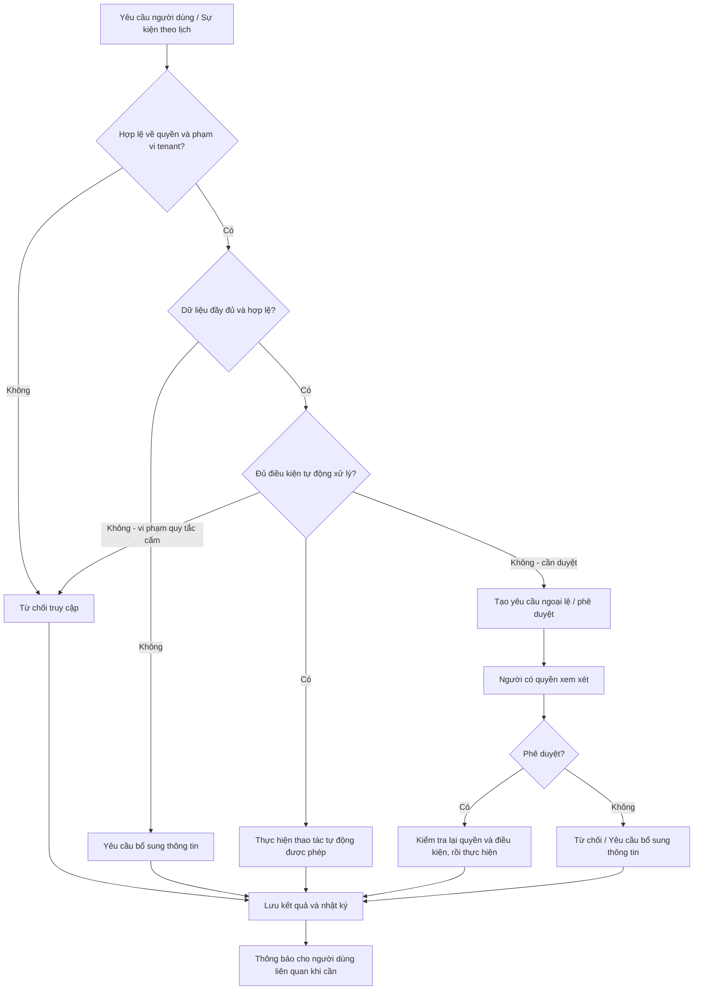

# EduCore — Requirements Analysis
## 1. Mục tiêu và phương pháp
EduCore là hệ thống web quản lý trung tâm đào tạo, tập trung vào bốn nhóm nghiệp vụ: xếp lịch và giải quyết xung đột; học phí theo biến động; theo dõi bài tập và tiến độ; quản lý phân quyền.
### 1.1. Lịch sử thay đổi
| Phiên bản | Thay đổi |
|---|---|
| **1** | Xác định Actors, 15 User Stories, 43 FR, 14 NFR, 8 Business Rules. |
| **2** | Làm rõ Role khác Job Position; cho phép một tài khoản có nhiều role; định hướng Automation-first / Human-in-the-loop; bổ sung US-16 đến US-19, FR-44 và FR-45, NFR-15 đến NFR-16, BR-09 đến BR-14. |
| **3** | Chốt 14 Business Rules thành quy tắc có điều kiện/ngoại lệ rõ ràng; xác định tham số chính sách mặc định, phạm vi P0/P1 và minh họa kiểm thử; cập nhật sơ đồ Automation-first bằng tiếng Việt. |

### 1.2. Thuật ngữ
- **Role:** Nhóm quyền trong hệ thống (ví dụ `ACCOUNTANT`, `ACADEMIC_STAFF`); không đồng nhất với một vị trí tuyển dụng.
- **Job Position:** Vị trí/đầu việc trong tổ chức; một người có thể kiêm nhiệm nhiều vị trí.
- **Permission:** Quyền thao tác cụ thể, ví dụ `invoice.adjust`, `schedule.approve`.
- **Automation-first:** Tự động tính toán/xử lý trường hợp đủ điều kiện theo quy tắc đã xác nhận.
- **Human-in-the-loop:** Cần người được ủy quyền kiểm tra, phê duyệt hoặc giải quyết trường hợp ngoại lệ.
- **Tenant:** Một trung tâm (hoặc một tổ chức quản lý trung tâm) có phạm vi dữ liệu và cấu hình riêng.

## 2. Actors — Các vai trò sử dụng

| Actor / Role | Trách nhiệm chính trong hệ thống | Có cần nhân sự riêng? |
|---|---|---|
| **Manager (Quản lý)** | Cấu hình chính sách, quản lý hoạt động, giám sát, phê duyệt ngoại lệ theo quyền được cấp. | Vai trò nghiệp vụ cốt lõi của trung tâm. |
| **Academic Staff (Giáo vụ)** | Giám sát lịch học, xử lý các trường hợp học bù, bảo lưu, dạy thay và xung đột phức tạp. | **Không bắt buộc.**|
| **Accountant (Kế toán)** | Kiểm soát học phí, đối soát thanh toán, xử lý điều chỉnh và ngoại lệ tài chính. | **Không bắt buộc.**|
| **Teacher (Giáo viên)** | Xem lịch dạy, điểm danh, giao/chấm bài tập, phản hồi học sinh. | Phụ thuộc mô hình đào tạo. |
| **Student (Học sinh)** | Xem lịch học, nộp bài, theo dõi tiến độ. | Là nhóm người dùng nghiệp vụ. |
| **Parent (Phụ huynh)** | Theo dõi học tập, lịch học và nghĩa vụ học phí của con. | Là nhóm người dùng nghiệp vụ. |
| **System Administrator (Quản trị nền tảng)** | Quản lý các tenant và vận hành nền tảng khi triển khai mô hình đa trung tâm. | Thuộc bên vận hành EduCore, **khác** Manager của trung tâm. |

### Quy tắc ánh xạ User – Role – Permission
1. **Một tài khoản có thể được gán nhiều role** trong phạm vi tenant được phép.
2. **Một role có nhiều permission**; các kiểm tra quyền và phạm vi dữ liệu được thực hiện ở Backend. Không dựa vào việc ẩn nút ở Frontend để bảo vệ nghiệp vụ.
3. **Không giả định mỗi role tương ứng một tài khoản độc lập.** Trung tâm lớn có thể phân công riêng, trung tâm nhỏ có thể kiêm nhiệm.
4. Các hành động cần phê duyệt dựa trên **permission** và chính sách trung tâm, không gắn cứng vào tên chức danh. Với thao tác tài chính nhạy cảm, có thể cấu hình người phê duyệt khác người tạo yêu cầu.
5. Một người có nhiều quyền **không được phép vượt phạm vi tenant hoặc phạm vi lớp/học sinh** mà họ được phân công.

## 3. User Stories
Định dạng: **As a [Role], I want [Feature], so that [Benefit].**
### 3.1. Quản lý trung tâm
| ID | User Story |
|---|---|
| US-01 | Là quản lý, tôi muốn quản lý thông tin giáo viên, học sinh, khóa học và lớp học để tổ chức hoạt động đào tạo. |
| US-02 | Là quản lý, tôi muốn xem báo cáo tình trạng lớp học, học phí và tiến độ học tập để đánh giá hoạt động trung tâm. |
| US-03 | Là quản lý, tôi muốn cấu hình vai trò và quyền truy cập để đảm bảo mỗi nhân viên chỉ được thực hiện các nghiệp vụ được cho phép. |

### 3.2. Giáo vụ 
| ID | User Story |
|---|---|
| US-04 | Là giáo vụ, tôi muốn xếp lịch học và được cảnh báo khi trùng giáo viên, phòng học hoặc lịch bận để tránh xung đột. |
| US-05 | Là giáo vụ, tôi muốn tìm lớp học bù phù hợp với trình độ và lịch rảnh của học sinh để sắp xếp học bù. |
| US-06 | Là giáo vụ, tôi muốn quản lý yêu cầu bảo lưu và sắp xếp lại lớp khi học sinh quay lại. |
| US-07 | Là giáo vụ, tôi muốn tìm và chỉ định giáo viên dạy thay phù hợp khi giáo viên chính vắng mặt. |

### 3.3. Kế toán 
| ID | User Story |
|---|---|
| US-08 | Là kế toán, tôi muốn hệ thống tính học phí dựa trên số buổi tính phí và các chính sách giảm giá để hạn chế sai sót. |
| US-09 | Là kế toán, tôi muốn theo dõi hóa đơn, thanh toán và công nợ để quản lý tình hình thu học phí. |

### 3.4. Giáo viên
| ID | User Story |
|---|---|
| US-10 | Là giáo viên, tôi muốn xem lịch dạy và điểm danh học sinh để theo dõi việc tham gia học tập. |
| US-11 | Là giáo viên, tôi muốn giao bài tập, đặt deadline và mức độ ưu tiên để quản lý công việc học tập của học sinh. |
| US-12 | Là giáo viên, tôi muốn đánh giá bài tập và ghi nhận tiến độ để hỗ trợ học sinh cải thiện kết quả. |

### 3.5. Học sinh và phụ huynh
| ID | User Story |
|---|---|
| US-13 | Là học sinh, tôi muốn xem lịch học, nhận bài tập và nộp bài để hoàn thành nhiệm vụ học tập. |
| US-14 | Là phụ huynh, tôi muốn theo dõi lịch học, chuyên cần, bài tập và học phí của con. |
| US-15 | Là học sinh hoặc phụ huynh, tôi muốn nhận thông báo khi sắp đến hạn nộp bài hoặc lịch học thay đổi để không bỏ lỡ thông tin. |

### 3.6. Bổ sung
| ID | User Story |
|---|---|
| US-16 | Là quản lý, tôi muốn cấu hình những nghiệp vụ được xử lý tự động và những trường hợp phải chờ phê duyệt để phù hợp chính sách trung tâm. |
| US-17 | Là người có quyền xử lý, tôi muốn nhận và quản lý danh sách yêu cầu ngoại lệ đang chờ duyệt để không bỏ sót công việc. |
| US-18 | Là quản lý, tôi muốn một tài khoản có thể đảm nhận nhiều vai trò để vận hành trung tâm nhỏ mà không phải tạo tài khoản nhân sự không cần thiết. |
| US-19 | Là người được phân quyền, tôi muốn xem lý do, quy tắc áp dụng và lịch sử thao tác của quyết định tự động để có thể kiểm tra, giải quyết sai lệch. |

**Ghi chú:** 
- **US-16, US-18:** Bổ sung cho Manager.
- **US-17, US-19:** Bổ sung cho các actor có vai trò xử lý / kiểm tra tương ứng.

## 4. Functional Requirements (FR)
**Mức ưu tiên:**
- **P0 — Must Have:** Cần có trong MVP.
- **P1 — Should Have:** Quan trọng, có thể hoàn thiện sau MVP.
- **P2 — Could Have:** Có thể phát triển ở phiên bản tiếp theo.

### 4.1. User & Access Management
| ID | Functional Requirement | Priority |
|---|---|---|
| FR-01 | Hệ thống cho phép người dùng đăng nhập, đăng xuất và khôi phục mật khẩu. | P0 |
| FR-02 | Hệ thống cho phép quản lý tài khoản người dùng và trạng thái hoạt động. | P0 |
| FR-03 | Hệ thống hỗ trợ phân quyền theo vai trò/quyền thao tác, đồng thời cho phép một tài khoản có nhiều vai trò trong cùng tenant. | P0 |
| FR-04 | Hệ thống kiểm soát quyền truy cập theo phạm vi dữ liệu, ví dụ giáo viên chỉ được chấm điểm lớp mình phụ trách. | P0 |
| FR-05 | Hệ thống cho phép người có thẩm quyền cấu hình quyền cho từng vai trò mà không cần sửa mã nguồn; các quyền nhạy cảm chỉ được thay đổi bởi người được ủy quyền. | P1 |
| FR-06 | Hệ thống hỗ trợ liên kết tài khoản phụ huynh với một hoặc nhiều học sinh. | P0 |

### 4.2. Academic Management
| ID | Functional Requirement | Priority |
|---|---|---|
| FR-07 | Hệ thống cho phép thêm, sửa, tìm kiếm và quản lý hồ sơ giáo viên, học sinh. | P0 |
| FR-08 | Hệ thống cho phép quản lý khóa học, trình độ và lớp học. | P0 |
| FR-09 | Hệ thống cho phép phân công giáo viên phụ trách lớp. | P0 |
| FR-10 | Hệ thống cho phép ghi danh, chuyển lớp và cập nhật trạng thái học tập của học sinh. | P0 |
| FR-11 | Hệ thống cho phép quản lý phòng học, sức chứa và lịch bận của các tài nguyên. | P0 |

### 4.3. Scheduling & Conflict Resolution
| ID | Functional Requirement | Priority |
|---|---|---|
| FR-12 | Hệ thống cho phép tạo lịch học theo buổi riêng lẻ hoặc lịch lặp hằng tuần. | P0 |
| FR-13 | Hệ thống phát hiện xung đột lịch của giáo viên, phòng học và học sinh. | P0 |
| FR-14 | Hệ thống ngăn xác nhận lịch học khi tồn tại xung đột không được phép. | P0 |
| FR-15 | Hệ thống cho phép tra cứu/đề xuất các khung giờ và tài nguyên khả dụng để hỗ trợ giải quyết xung đột; không tự xác nhận lịch mới nếu chưa thỏa chính sách. | P1 |
| FR-16 | Hệ thống cho phép thay đổi, hủy và sắp xếp lại lịch học. | P0 |
| FR-17 | Hệ thống hiển thị lịch học theo ngày, tuần và theo vai trò người dùng. | P0 |

### 4.4. Attendance & Academic Exceptions
| ID | Functional Requirement | Priority |
|---|---|---|
| FR-18 | Hệ thống cho phép giáo viên điểm danh và ghi nhận trạng thái tham gia từng buổi học. | P0 |
| FR-19 | Hệ thống cho phép ghi nhận đơn xin nghỉ học và lý do nghỉ. | P0 |
| FR-20 | Hệ thống hỗ trợ tìm lớp học bù dựa trên trình độ, lịch học và số chỗ còn trống. | P1 |
| FR-21 | Hệ thống cho phép đăng ký học bù và liên kết buổi học bù với buổi nghỉ ban đầu. | P1 |
| FR-22 | Hệ thống cho phép tạo yêu cầu bảo lưu với thời gian bắt đầu và kết thúc. | P1 |
| FR-23 | Hệ thống hỗ trợ quản lý trạng thái bảo lưu và sắp xếp lại lớp khi học sinh quay lại. | P1 |
| FR-24 | Hệ thống hỗ trợ đề xuất/phân công giáo viên dạy thay, kiểm tra năng lực và xung đột lịch; xác nhận tự động chỉ khi chính sách cho phép. | P1 |

### 4.5. Dynamic Billing & Payment Management
| ID | Functional Requirement | Priority |
|---|---|---|
| FR-25 | Hệ thống hỗ trợ cấu hình đơn giá học phí theo khóa học, lớp học hoặc buổi học. | P0 |
| FR-26 | Hệ thống tính số buổi được thu phí dựa trên lịch học, điểm danh và chính sách nghỉ học. | P0 |
| FR-27 | Hệ thống hỗ trợ áp dụng chính sách giảm giá khi tính học phí. | P0 |
| FR-28 | Hệ thống cho phép cấu hình nhiều loại ưu đãi như giảm giá anh em ruột, combo hoặc khuyến mãi. | P1 |
| FR-29 | Hệ thống tự động tính và tạo bảng kê/hóa đơn dự thảo chi tiết; việc phát hành hóa đơn tuân theo chính sách xác nhận và phê duyệt của trung tâm. | P0 |
| FR-30 | Hệ thống cho phép ghi nhận các khoản thanh toán và theo dõi công nợ. | P0 |
| FR-31 | Hệ thống lưu lịch sử điều chỉnh hóa đơn và ngăn sửa trực tiếp hóa đơn đã phát hành nếu không thông qua quy trình điều chỉnh được ủy quyền. | P0 |

### 4.6. Assignment & Progress Tracking
| ID | Functional Requirement | Priority |
|---|---|---|
| FR-32 | Giáo viên có thể tạo, chỉnh sửa và giao bài tập cho học sinh hoặc lớp học. | P0 |
| FR-33 | Bài tập có deadline và mức độ ưu tiên (priority stars). | P0 |
| FR-34 | Học sinh có thể nộp bài và xem trạng thái bài tập. | P0 |
| FR-35 | Giáo viên có thể đánh giá, chấm điểm và phản hồi bài tập. | P0 |
| FR-36 | Hệ thống tổng hợp tiến độ học tập và cho phép phụ huynh theo dõi kết quả của con. | P1 |

### 4.7. Notification Management
| ID | Functional Requirement | Priority |
|---|---|---|
| FR-37 | Hệ thống gửi thông báo khi lịch học thay đổi hoặc học sinh được giao bài tập mới. | P1 |
| FR-38 | Hệ thống tự động nhắc nhở trước deadline bài tập theo thời điểm được cấu hình. | P1 |
| FR-39 | Hệ thống hỗ trợ lưu trạng thái gửi thông báo và xử lý gửi lại khi thất bại. | P1 |

### 4.8. Reporting & System Administration
| ID | Functional Requirement | Priority |
|---|---|---|
| FR-40 | Hệ thống cung cấp báo cáo tổng quan số lượng học sinh, lớp học, tình trạng học tập và học phí. | P1 |
| FR-41 | Hệ thống lưu nhật ký thay đổi cho các thao tác quan trọng như đổi lịch, sửa hóa đơn và thay đổi phân quyền. | P0 |
| FR-42 | Hệ thống hỗ trợ quản lý dữ liệu độc lập theo từng trung tâm, bảo đảm người dùng không truy cập dữ liệu của trung tâm khác. | P0* |
| FR-43 | Hệ thống cho phép cấu hình chính sách riêng cho từng trung tâm như học phí và quy định nghỉ học. | P1 |

### 4.9. Automation & Approval Workflow
| ID | Functional Requirement | Priority |
|---|---|---|
| **FR-44** | Hệ thống cho phép cấu hình chính sách phê duyệt theo **loại nghiệp vụ, điều kiện, ngưỡng rủi ro và permission**; một yêu cầu có thể được duyệt, từ chối hoặc trả về bổ sung thông tin. | **P1** |
| **FR-45** | Hệ thống tự động thực hiện nghiệp vụ **đủ điều kiện theo Business Rules đã cấu hình**; nếu không đủ điều kiện hoặc phát sinh ngoại lệ, hệ thống không tự chốt kết quả mà tạo yêu cầu xử lý/phê duyệt cho người có quyền, kèm lý do và nhật ký. | **P0 (phạm vi giới hạn)** |

## 5. Non-functional Requirements (NFR)

NFR xác định các thuộc tính chất lượng và ràng buộc vận hành của hệ thống. Các số liệu bên dưới là **mục tiêu đề xuất**, cần thống nhất với phạm vi tải và hạ tầng trước khi nghiệm thu.

| ID | Category | Non-functional Requirement |
|---|---|---|
| NFR-01 | Performance | 95% các yêu cầu API thông thường cần được xử lý trong vòng 1 giây, không tính độ trễ mạng bên ngoài. |
| NFR-02 | Performance | Các thao tác phát hiện xung đột lịch cần phản hồi trong vòng 2 giây với quy mô dữ liệu thử nghiệm đã xác định. |
| NFR-03 | Scalability | Hệ thống cần được thiết kế để hỗ trợ nhiều trung tâm mà không làm lẫn dữ liệu. |
| NFR-04 | Security | Toàn bộ giao tiếp sử dụng HTTPS; mật khẩu phải được băm bằng thuật toán phù hợp như Argon2id hoặc bcrypt. |
| NFR-05 | Security | Mọi API yêu cầu phân quyền phải xác thực quyền truy cập tại Backend, không chỉ ẩn chức năng ở Frontend. |
| NFR-06 | Data Integrity | Những thao tác thay đổi nhiều dữ liệu liên quan, đặc biệt là thu học phí và đăng ký học bù, phải đảm bảo tính toàn vẹn giao dịch. |
| NFR-07 | Reliability | Hệ thống triển khai production hướng đến mức khả dụng tối thiểu 99,5% theo tháng, không tính bảo trì có kế hoạch. |
| NFR-08 | Recoverability | Dữ liệu được sao lưu tự động hằng ngày; mục tiêu khôi phục RPO không quá 24 giờ và RTO không quá 4 giờ. |
| NFR-09 | Usability | Giao diện dễ sử dụng, có khả năng hiển thị phù hợp trên máy tính, máy tính bảng và điện thoại. |
| NFR-10 | Compatibility | Hệ thống hỗ trợ các phiên bản phổ biến, còn được hỗ trợ của Chrome, Edge và Firefox. |
| NFR-11 | Maintainability | Các module nghiệp vụ cần có tính độc lập tương đối, dễ kiểm thử, thay đổi và mở rộng. |
| NFR-12 | Testability | Các module xếp lịch và tính học phí cần đạt tối thiểu 80% branch coverage khi chạy Unit Tests. |
| NFR-13 | Observability | Hệ thống phải ghi nhận lỗi ứng dụng và cung cấp thông tin phục vụ truy vết, không ghi thông tin nhạy cảm vào log. |
| NFR-14 | Privacy | Chỉ những người có thẩm quyền mới được truy cập thông tin cá nhân, học tập và thanh toán của học sinh. |
| **NFR-15** | Workflow Reliability | Các tác vụ tự động cần tránh xử lý trùng gây phát sinh hóa đơn, ghi nhận thanh toán hoặc thay đổi lịch nhiều lần khi retry (idempotency đối với tác vụ có tác động). |
| **NFR-16** | Traceability | Mỗi quyết định tự động/phê duyệt quan trọng phải có dấu vết kiểm tra được: sự kiện khởi phát, bộ quy tắc/phiên bản chính sách, kết quả, người phê duyệt (nếu có) và thời điểm. |

> **Lưu ý:** Các mục tiêu về độ sẵn sàng, sao lưu và hiệu năng áp dụng khi triển khai chính thức. Chưa được xem là đã đáp ứng nếu chưa kiểm thử.

## 6. Business Rules — Bộ quy tắc nghiệp vụ chốt cho EduCore

### 6.1. Quy tắc nghiệp vụ đã xác định

| ID | Quy tắc đã chọn | Phạm vi triển khai |
|---|---|---|
| **BR-01 — Xung đột lịch** | Hai buổi `A`, `B` bị trùng khi `A.start < B.end` **và** `B.start < A.end`, đồng thời cùng sử dụng **ít nhất một** giáo viên, phòng học (nếu học trực tiếp) hoặc học sinh trong cùng tenant. Lịch bận đã xác nhận của giáo viên/học sinh cũng được tính là xung đột. Lịch `CANCELLED` không chiếm tài nguyên; hai buổi tiếp giáp tại thời điểm kết thúc/bắt đầu không bị coi là trùng. Không cho xác nhận lịch còn xung đột hoặc vượt sức chứa phòng/lớp. Kiểm tra lại tính khả dụng khi ghi dữ liệu để hạn chế đặt trùng đồng thời. | **P0** |
| **BR-02 — Điều kiện học bù** | Chỉ cho đăng ký học bù khi có **một buổi nghỉ có phép đã duyệt** và chưa dùng quyền học bù; buổi học thay thế phải cùng môn và trình độ tương đương, còn chỗ, không trùng lịch học sinh, nằm trong hạn học bù và nội dung tương đương (nếu không xác định được mức tương đương thì chuyển người có quyền duyệt). Buổi học bù phải liên kết với buổi nghỉ gốc; không làm thay đổi danh sách học sinh chính thức của lớp đích. | **P1** |
| **BR-03 — Số lần và thời hạn học bù** | **Một buổi nghỉ có phép tối đa một lượt học bù được sử dụng**, trong vòng **30 ngày** kể từ ngày học gốc. Được đổi lịch học bù trước khi diễn ra nếu còn hợp lệ; học bù đã tham dự hoặc vắng không phép thì đóng quyền học bù. Nếu trung tâm hủy buổi học bù, học sinh được sắp lại trong thời hạn còn lại; trường hợp hết hạn do phía trung tâm chuyển duyệt ngoại lệ. **Không được tính học phí hai lần** cho buổi gốc và buổi học bù thay thế. | **P1** |
| **BR-04 — Nghỉ học và số buổi tính phí** | Đơn nghỉ được gửi **ít nhất 24 giờ** trước giờ bắt đầu và được chấp thuận thì ghi nhận `EXCUSED`; nộp muộn chỉ được tính `EXCUSED` khi người có quyền duyệt ngoại lệ. Buổi `ATTENDED` và `UNEXCUSED` được tính **1 buổi tính phí**; buổi `EXCUSED` được tính **0**; buổi do trung tâm hủy được tính **0**. Nếu học bù cho buổi `EXCUSED` được thực hiện, chỉ buổi học bù được tính **1** (hoặc trừ 1 quyền học trong gói trả trước), buổi gốc vẫn là **0**. Vắng không phép tại buổi học bù đã giữ chỗ tính **1**; buổi học bù bị trung tâm hủy tính **0**. Không chốt bảng kê tự động nếu điểm danh chưa được xác nhận. | **P0** (nghỉ/điểm danh/tính phí); **P1** (học bù) |
| **BR-05 — Bảo lưu** | Bảo lưu có ngày bắt đầu, ngày kết thúc và phải được người có quyền phê duyệt. Trong khoảng bảo lưu, không tính buổi học phát sinh cho học sinh; số tiền đã đóng cho **các buổi chưa sử dụng** được giữ dưới dạng **số dư tín dụng học phí**, không tự động hoàn tiền. Khi quay lại, phải kiểm tra trình độ, lịch, sức chứa trước khi xếp lớp; tín dụng còn lại được khấu trừ vào học phí tương lai. Mọi hoàn/điều chỉnh tiền phải đi qua quy trình tài chính có kiểm soát, không sửa trực tiếp hóa đơn đã phát hành. | **P1** |
| **BR-06 — Giảm giá và thứ tự tính** | Học sinh được nhận ưu đãi anh/chị/em khi **quan hệ anh chị em được xác minh** và các em có ghi danh hợp lệ cùng tenant; ưu đãi combo chỉ áp dụng cho **gói đóng trước đủ 6 tháng**. Mặc định cho phép áp dụng đồng thời hai ưu đãi: **combo 5% trước, anh/chị/em 10% sau** trên số tiền còn lại. Không cộng trực tiếp thành 15% (tổng ưu đãi thực tế khi đủ hai điều kiện là **14,5%**). Không áp dụng cùng lúc ưu đãi khác nếu chưa có chính sách riêng; số tiền cuối cùng không âm, làm tròn đến đồng Việt Nam khi kết thúc phép tính. Chỉ áp dụng điều kiện và mức giá có hiệu lực tại thời điểm lập khoản tính phí, không tự tính lại hóa đơn đã phát hành. | **P0** (một loại ưu đãi); **P1** (kết hợp ưu đãi, cấu hình) |
| **BR-07 — Giáo viên dạy thay** | Giáo viên thay thế phải thuộc cùng tenant, đáp ứng môn/chuyên môn, cấp độ giảng dạy phù hợp, còn khả dụng trong toàn bộ buổi học và không vượt giới hạn phân công. Hệ thống **đề xuất**, giáo viên thay thế **xác nhận nhận lớp**, sau đó người có quyền **xác nhận phân công**. Chỉ khi đủ các điều kiện mới cập nhật lịch chính thức và gửi thông báo; nếu không có người phù hợp thì tạo ngoại lệ để đổi/hủy lịch, không tự phân công người không đạt điều kiện. | **P1** |
| **BR-08 — Thẩm quyền phê duyệt** | Việc duyệt dựa trên **permission + phạm vi tenant/lớp**, không dựa đơn thuần vào tên role. Mặc định: học bù/bảo lưu/dạy thay/ngoại lệ lịch thuộc `ACADEMIC_STAFF` hoặc `MANAGER` được cấp quyền tương ứng; phát hành/điều chỉnh hóa đơn thuộc `ACCOUNTANT` hoặc `MANAGER` được cấp quyền tài chính tương ứng. Phê duyệt ngoại lệ phải ghi **người duyệt, thời điểm, lý do và kết quả**. Vai trò chỉ có quyền xem không được duyệt. | **P0** (quyền mặc định); **P1** (quy trình duyệt nâng cao) |
| **BR-09 — Tự động hay chờ duyệt** | Chỉ xử lý tự động khi: người/sự kiện gọi hợp lệ; dữ liệu đầy đủ; cùng tenant; không vi phạm ràng buộc; nghiệp vụ nằm trong danh sách được tự động hóa; và không cần phê duyệt theo chính sách đang hiệu lực. Nếu **thiếu dữ liệu**, chuyển `NEEDS_INFORMATION`; nếu **hợp lệ nhưng cần duyệt/ngoại lệ**, chuyển `PENDING_APPROVAL`; nếu **xung đột hoặc vi phạm quy tắc cấm**, từ chối thao tác, không tự ghi kết quả. Giai đoạn P0 chỉ tự động kiểm tra xung đột, tính phí và tạo **hóa đơn dự thảo**, không mặc định tự phê duyệt hành động nhạy cảm. | **P0** (giới hạn); **P1** (mở rộng) |
| **BR-10 — Không có Giáo vụ/Kế toán riêng** | Mỗi tenant đang hoạt động phải có **ít nhất một tài khoản Manager hợp lệ**. Khi không có tài khoản Giáo vụ/Kế toán riêng, Manager có permission thích hợp đảm nhiệm công việc phê duyệt tương ứng. Không tự cấp quyền cho một người chỉ vì role nghiệp vụ vắng mặt; không cho truy cập vượt tenant hoặc phạm vi được giao. | **P0** |
| **BR-11 — Tự phê duyệt và tách nhiệm vụ** | Với yêu cầu thông thường, người tạo **có thể** tự duyệt nếu có permission và chính sách cho phép. **Điều chỉnh/hủy hóa đơn đã phát hành** luôn phải được xét duyệt thủ công, có lý do và audit log; ưu tiên **người duyệt khác người tạo** nếu có người đủ quyền. Đối với trung tâm chỉ có một Manager, cho phép Manager tự duyệt ngoại lệ tài chính để không khóa hoạt động, nhưng phải đánh dấu `SELF_APPROVED`, lưu lý do và lịch sử thay đổi; không bao giờ tự động duyệt loại này. | **P0** (kiểm soát thủ công); **P1** (cấu hình tách nhiệm vụ) |
| **BR-12 — Xử lý lỗi tác vụ** | Mỗi thao tác tự động có mã chống lặp (*idempotency key*) để retry không sinh thêm buổi học, hóa đơn hoặc thanh toán. Với lỗi tạm thời, thử lại tối đa **3 lần** có giãn cách; sau đó chuyển `FAILED` và thông báo người quản lý xử lý. Với thiếu dữ liệu, chuyển `NEEDS_INFORMATION`, không retry vô hạn. Với yêu cầu cần duyệt nhưng chưa có người thích hợp, giữ `PENDING_APPROVAL` và thông báo Manager; **không bỏ qua bước duyệt**. | **P0** cho tác vụ tác động dữ liệu |
| **BR-13 — Những quyết định không tự xác nhận mặc định** | Hệ thống **được tự tạo hóa đơn dự thảo**, nhưng **không tự phát hành hóa đơn** trong P0; người có quyền phải xác nhận phát hành. Hệ thống **không tự phân công giáo viên dạy thay** và **không tự chuyển lớp** theo mặc định; hai nghiệp vụ chỉ có hiệu lực sau khi được xác nhận đúng quyền và điều kiện. Ở P1, từng tenant **có thể** bật tự xác nhận các trường hợp rủi ro thấp khi thỏa chính sách BR-09/BR-14; điều chỉnh/hủy hóa đơn đã phát hành vẫn không được tự duyệt. | **P0** (giới hạn an toàn); **P1** (cấu hình tự động) |
| **BR-14 — Chính sách theo tenant và phiên bản** | Chính sách nghiệp vụ/giảm giá/tự động hóa thuộc **tenant** và có `policy_version`, thời điểm hiệu lực và người sửa. Khi một yêu cầu được tạo, hệ thống gắn **phiên bản chính sách đã dùng**; xử lý lại/retry không âm thầm đổi phiên bản. Chính sách mới áp dụng cho yêu cầu tạo sau ngày hiệu lực, **không áp dụng hồi tố** cho hóa đơn đã phát hành; nếu muốn thay đổi kết quả cũ phải tạo nghiệp vụ điều chỉnh được ủy quyền. **Quyền truy cập luôn kiểm tra theo quyền hiện hành tại thời điểm thực thi**, kể cả khi yêu cầu từng được tạo hợp lệ. | **P0** (tenant isolation, audit); **P1** (quản trị phiên bản chính sách) |

### 6.2. Các tham số chính sách mặc định đề xuất

Các giá trị dưới đây được **chọn để thống nhất thiết kế và viết test**, **không phải dữ liệu khảo sát từ trung tâm**.

| Tham số | Giá trị baseline | BR liên quan |
|---|---|---|
| `absence_notice_hours` | **24 giờ** trước buổi học; trường hợp khẩn cấp chuyển duyệt thủ công | BR-04 |
| `makeup_valid_days` | **30 ngày** tính từ ngày buổi nghỉ gốc | BR-03 |
| `makeup_max_used_per_absence` | **1 lượt** trên mỗi buổi nghỉ có phép | BR-03 |
| `sibling_discount_rate` | **10%** sau khi xác minh quan hệ anh/chị/em | BR-06 |
| `six_month_prepaid_discount_rate` | **5%** cho gói trả trước đủ 6 tháng | BR-06 |
| `discount_application_order` | Combo **trước**, anh/chị/em **sau** | BR-06 |
| `auto_retry_max_attempts` | **3 lần thử lại** cho lỗi tạm thời, cùng idempotency key | BR-12 |
| `invoice_auto_issue` | **false** ở MVP: chỉ tự tạo dự thảo | BR-13 |
| `teacher_substitution_auto_confirm` | **false** mặc định | BR-07, BR-13 |
| `student_transfer_auto_confirm` | **false** mặc định | BR-13 |

**Phân biệt khoản thu:** `hóa đơn` trong phạm vi EduCore là **chứng từ/bảng kê học phí nội bộ**, không mặc nhiên là **hóa đơn điện tử hợp pháp**. Phát hành hóa đơn điện tử theo quy định thuế hoặc hoàn tiền qua cổng thanh toán cần được đặc tả thành chức năng riêng nếu đưa vào phạm vi sau này.

### 6.3. Ánh xạ về yêu cầu hệ thống

| Nhóm Business Rules | Các FR liên quan chính |
|---|---|
| BR-01 | FR-11, FR-12, FR-13, FR-14, FR-16 |
| BR-02, BR-03 | FR-18, FR-19, FR-20, FR-21 |
| BR-04, BR-05, BR-06 | FR-18, FR-19, FR-22, FR-23, FR-25 đến FR-31 |
| BR-07 | FR-09, FR-13, FR-24 |
| BR-08 đến BR-11 | FR-03, FR-04, FR-05, FR-41, FR-44, FR-45 |
| BR-12 | FR-39, FR-41, FR-45; NFR-15, NFR-16 |
| BR-13 | FR-10, FR-24, FR-29, FR-31, FR-44, FR-45 |
| BR-14 | FR-42, FR-43, FR-44; NFR-16 |

### 6.4. Quy trình Automation-first & Human-in-the-loop

**Trạng thái workflow dùng ở baseline:** `DRAFT`, `PENDING_APPROVAL`, `APPROVED`, `REJECTED`, `NEEDS_INFORMATION`, `COMPLETED`, `FAILED`. `SELF_APPROVED` là **cờ kiểm toán** đối với quyết định tự duyệt, **không phải trạng thái workflow**. Luồng chuyển trạng thái chi tiết của từng nghiệp vụ được xây dựng ở Detailed Design.

**Quy tắc thay đổi sau khi chốt:** Nếu thay đổi hạn xin nghỉ, thời hạn học bù, công thức giảm giá, người có quyền phê duyệt hoặc mức tự động hóa, phải tăng phiên bản tài liệu, cập nhật Business Rules liên quan và đối chiếu lại FR/Use Cases/Test Cases. Không tự ý thay đổi các giả định trên khi lập trình.
